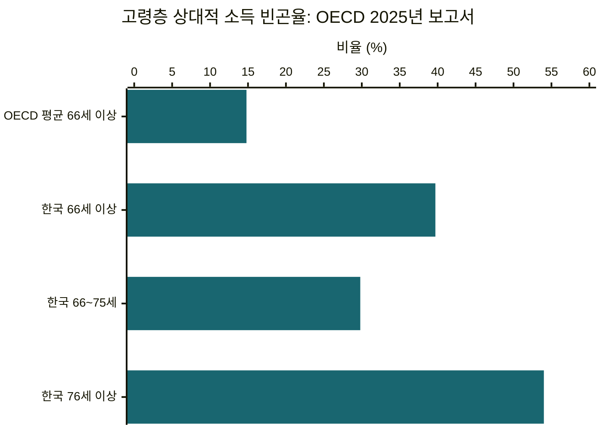
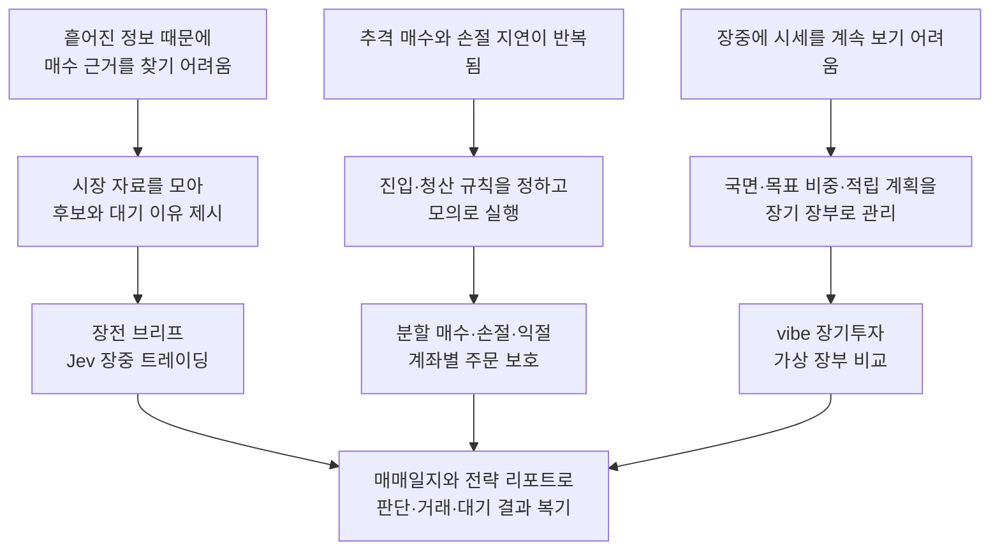
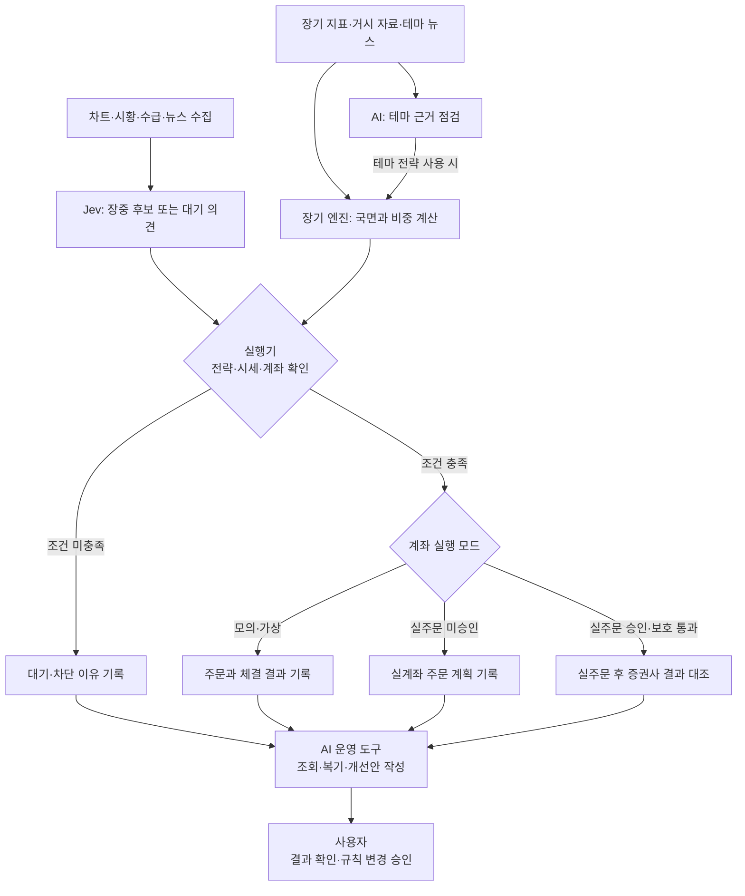
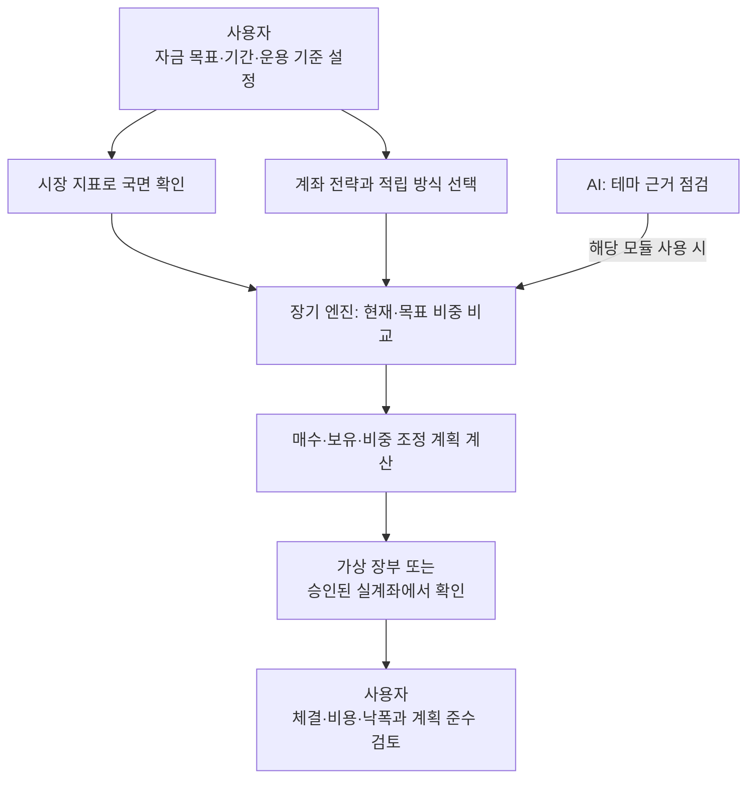
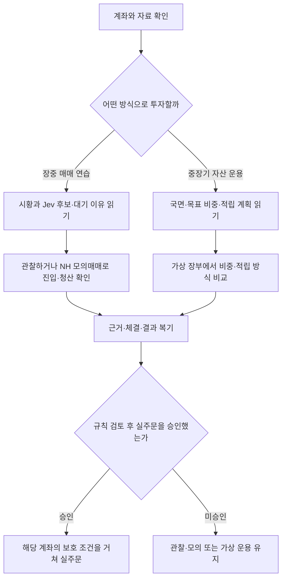
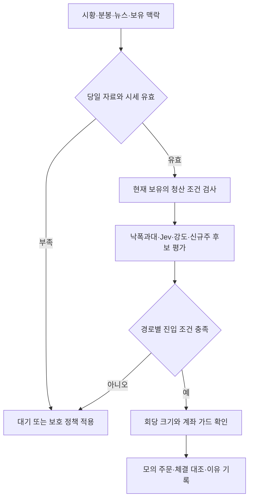
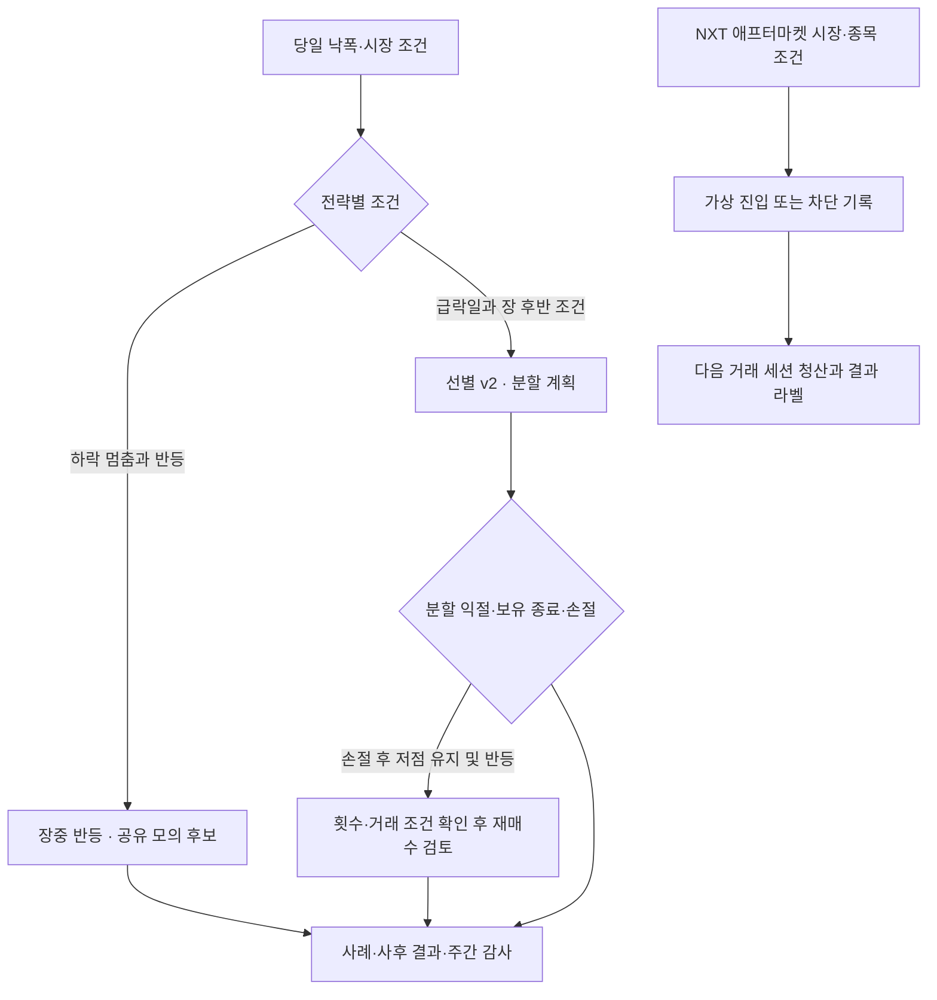
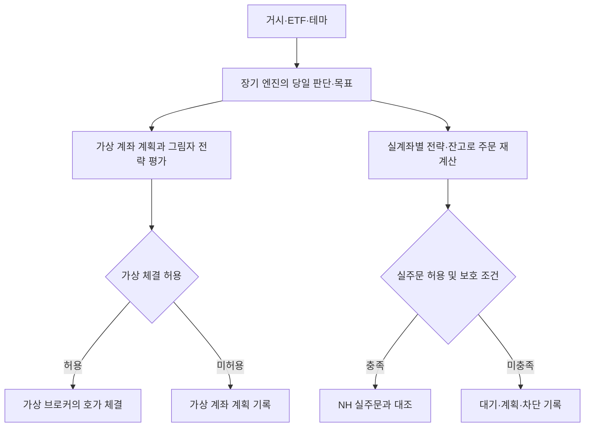
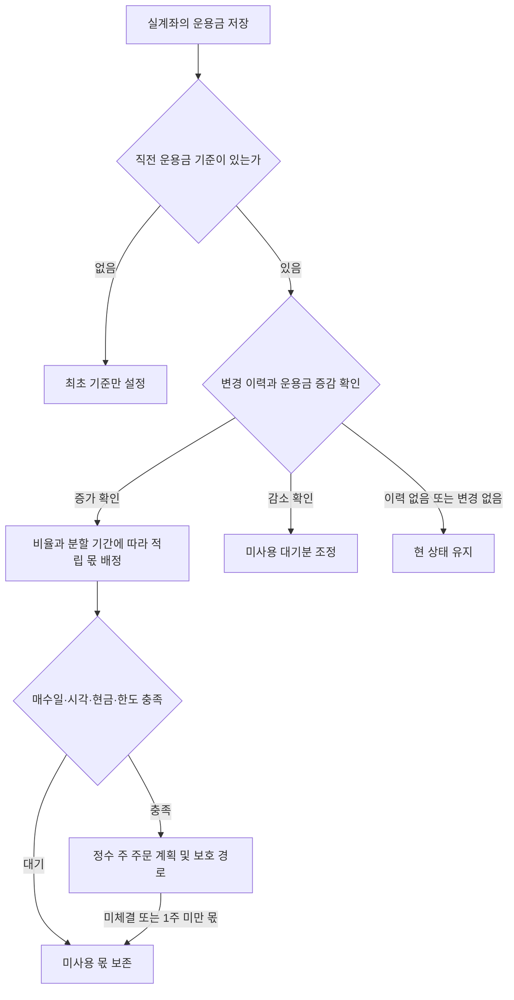
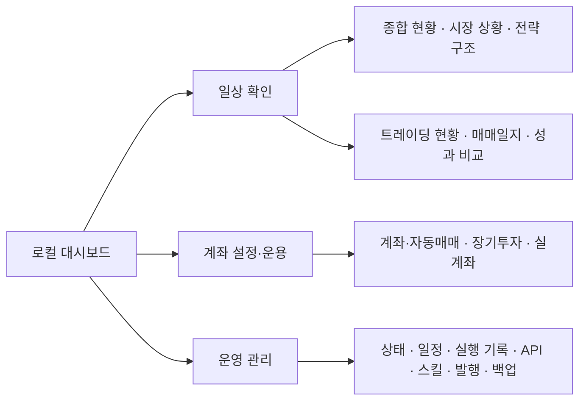

# Omni AI Trading 제품 요구사항

[기획서 홈](README.md) · [아키텍처와 데이터](02_DATA_MODEL.md) · [단계별 로드맵](03_PHASES.md)

> **제품 목표** 투자 입문자가 전문 트레이더들이 살피는 종류의 정보를 활용해 자신의 매매 기준을 만들도록 돕습니다. 장중 매매를 배우고 싶다면 근거 확인과 손실 관리를 모의로 연습하고, 자주 거래하고 싶지 않다면 시장 국면을 읽으며 중장기 자산 성장을 추구할 수 있도록 설계합니다.

## 한국의 금융이해력과 노후 준비

OECD 회원국인 한국에서도 노후 소득의 불안은 큽니다. 금융이해력 조사에서는 평균 점수뿐 아니라 **재무상황을 주기적으로 점검하고 장기 목표를 세우는 행동**에 주목할 필요가 있습니다. 시장에 접근할 수 있게 만드는 것과, 생활비로 쓸 돈과 장기간 운용할 돈을 구분해 계획을 세우고 지켜 가도록 돕는 일은 각각 설계가 필요합니다.

| 지표 | 공식 조사 결과 | 기획에 반영한 점 |
| --- | --- | --- |
| **노후 소득 빈곤** | OECD의 2025년 비교표에서 한국의 66세 이상 상대적 소득 빈곤율은 39.7%, OECD 평균은 14.8%입니다. 한국은 66~75세 29.8%, 76세 이상 54.0%였습니다. 가구 규모를 보정한 가처분소득이 자국 중위값의 절반 미만인 비율입니다. [OECD 연금 지표, 표 7.2](https://www.oecd.org/en/publications/pensions-at-a-glance-2025_e40274c1-en/full-report/old-age-income-poverty_3cd946d7.html) | 사회적 배경을 보여 주는 지표입니다. 실제 운용에서는 당장 생활에 필요한 자금과 오래 운용하기로 한 자금을 사용자 판단으로 구분합니다. |
| **금융이해력 목표선 도달** | OECD/INFE 2023년 보고서의 한국 자료는 2022년 성인 2,400명 조사입니다. 100점 중 70점 이상을 받은 비율은 48%였고, 참여 OECD 회원국 평균은 39%였습니다. [OECD/INFE 국제조사, 그림 2.2·부록 A](https://www.oecd.org/content/dam/oecd/en/publications/reports/2023/12/oecd-infe-2023-international-survey-of-adult-financial-literacy_8ce94e2c/56003a32-en.pdf) | 평균과 별개로 기초 금융 판단에 어려움을 느끼는 사용자가 있습니다. 모의매매와 가상 장부에서 근거를 보며 절차를 익히도록 설계합니다. |
| **계획과 점검의 어려움** | 한국은행·금융감독원의 2024년 조사에서 만 18~79세 성인 2,400명의 금융이해력 평균은 65.7점입니다. 항목별 점수는 평소 재무상황 점검 43.4점, 장기 재무목표 설정 42.5점이었습니다. 18~29세는 각각 33.2점과 36.1점이었습니다. [한국은행 조사](https://www.bok.or.kr/portal/bbs/B0000502/view.do?menuNo=201265&nttId=10091152) · [금융위원회 추진방안 참고표](https://www.fsc.go.kr/comm/getFile?fileNo=8&fileTy=ATTACH&srvcId=BBSTY1&upperNo=87218) | 목표를 정한 뒤에도 실제로 어떻게 관리되는지 볼 수 있도록 적립 설정, 변경 이력과 기간별 복기를 연결합니다. |
| **노후 준비의 시작과 방법** | 국가데이터처의 2025년 사회조사에서 19세 이상 71.5%가 노후를 준비 중이거나 준비가 되어 있다고 답했습니다. 준비한 사람의 주된 방법으로 국민연금이 58.5%로 가장 많았습니다. [2025년 사회조사, 복지 부문](https://www.kostat.go.kr/board.es?act=view&bid=219&list_no=439196&mid=a10301060100) | 장기투자는 노후 계획에 포함될 수 있는 수단입니다. Omni는 사용자가 투자에 배정한 자금의 적립과 비중 관리에 초점을 둡니다. |

각 조사에는 서로 다른 연령, 표본과 기준이 적용됩니다. 70점은 국제조사의 비교 기준으로, 개인을 평가하거나 낙인찍기 위한 분류가 아닙니다. 국내 조사에서의 항목별 **점수**는 행동을 한 사람의 **비율**과도 다릅니다. OECD는 노후 소득 격차에 연금 가입 기간과 급여, 근로 기간과 임금의 차이가 영향을 준다고 설명합니다. [OECD 한국 보고서](https://www.oecd.org/en/publications/pensions-at-a-glance-2025-country-notes_8a53ef12-en/korea-republic-of_5cd52913-en.html)

### 국내 재무상담 사례에서 얻은 설계 기준

금융위원회가 2026년 공개한 서민금융진흥원 사례에는 수입이 일정하지 않은 20대 프리랜서와 주택담보대출 상환으로 생활비 여유가 줄어든 30대 직장인이 나옵니다. 프리랜서 사례는 지출과 비상자금 계획을, 직장인 사례는 대출 조건과 현금 흐름을 먼저 점검했습니다. 금융위원회 청년 재무상담 사업은 진단과 상담 뒤 일정 시간이 지나면 계획의 이행을 다시 확인하는 절차를 둡니다. 이 사례들은 실제 재무상담 사례이며, Omni의 사용 사례나 수익 실적과는 별도입니다. [금융위원회 공개 상담 사례와 사업 절차](https://www.fsc.go.kr/no010101/87218)

Omni에 적용한 설계 원칙도 **사용자가 먼저 자금의 목적과 운용 범위를 정하고, 실행한 뒤 기록을 다시 보는 것**입니다. 투자 학습은 Jev의 판단 근거를 보며 주문 없는 관찰과 모의매매로 시작할 수 있습니다. 오래 운용하기로 한 자금은 장기 엔진에서 적립 방식과 목표 비중을 설정하고, 가상 장부에서 비용·낙폭·비중 변화를 비교합니다. 전체 가계 재무 진단이나 연금 부족액 계산은 현행 기능 범위 밖입니다.

### 최종 목표

**투자 경험이나 시간의 차이가 노후를 준비할 기회의 차이로 굳어지지 않도록 돕는 것이 Omni의 최종 목표입니다.** AI 시대에 더 많은 사람이 시장을 이해하고, 실수해도 실제 자금을 잃기 전에 모의로 배울 수 있고, 감당할 수 있는 범위에서 장기투자 원칙을 익혀 꾸준히 실천할 수 있게 하려 합니다. 이를 통해 생활비 걱정을 덜고, 은퇴 후에도 여유와 선택권을 넓힐 수 있는 노후를 준비하도록 돕고자 합니다. 서비스의 현재 검증 기준은 근거 이해, 모의 연습, 계좌별 규칙 적용과 복기이며, 투자 성과와 노후 소득 개선은 별도로 검증해야 합니다. [사용자 가치 검증](03_PHASES.md#사용자-가치-검증)

## 사용자와 해결할 문제

### 왜 이 서비스가 필요한가

**정보를 얻는 일과 매매 결정을 내리는 일이 동시에 어렵습니다.** 입문자는 차트가 오르는 모습이나 뒤늦게 접한 뉴스만 보고 매수하기 쉽습니다. 전문 트레이더들은 시세와 거래량뿐 아니라 시장 방향, 투자자·프로그램 수급, 테마와 해외 흐름을 함께 봅니다. Omni는 이 자료를 모아 Jev가 검토할 수 있게 구성하고, 사용자가 후보와 대기 이유를 확인할 수 있도록 기록합니다. [Jev가 받는 자료](https://github.com/roadkwonai/omni-ai-trading/blob/v0.1.3/docs/strategy.md#jev가-받는-자료)

**매수 전에 정하지 않은 기준은 손실이 나기 시작하면 세우기 더 어렵습니다.** 오르는 종목을 놓치기 싫어 고점에서 따라 사는 뇌동매매를 하거나, 손실을 확정하기 싫어 손절을 늦출 수 있습니다. 평균 단가를 낮추려고 보유 비중을 더 키우거나, 반대로 수익이 나면 너무 일찍 팔기도 합니다. 진입·재진입 제한, 조건에 맞춘 분할 매수, 손절과 분할 익절, 추적 청산을 둔 이유가 여기에 있습니다. 체결 여부까지 따로 대조하고, 당일 손실 차단 기준과 신호가 막힌 이유를 확인할 수 있어야 합니다. [진입 공통 확인](https://github.com/roadkwonai/omni-ai-trading/blob/v0.1.3/docs/strategy.md#진입-공통-확인) · [청산 프로필](https://github.com/roadkwonai/omni-ai-trading/blob/v0.1.3/docs/strategy.md#청산-프로필) · [안전장치](https://github.com/roadkwonai/omni-ai-trading/blob/v0.1.3/docs/safety.md)

**장중 매매에 시간을 쓰기 어려운 사람에게는 다른 기준이 필요합니다.** 적립을 꾸준히 하기로 했어도 시장이 급락하거나 과열되면 어느 정도를 담고 얼마나 기다릴지 흔들리기 쉽습니다. 장기 엔진은 지수의 낙폭·장기 추세·변동성을 읽고, 달리오의 비중 조정이나 막스의 과열·투매 관점처럼 공개된 원칙을 참고한 전략을 적용합니다. 사용자는 핵심 ETF, 테마 ETF, 대기 자금의 목표 비중과 적립 계획을 보고, 가상 장부에서 서로 다른 조합을 비교합니다. [장기투자 가이드](https://github.com/roadkwonai/omni-ai-trading/blob/v0.1.3/docs/longterm.md) · [적립식 가이드](https://github.com/roadkwonai/omni-ai-trading/blob/v0.1.3/docs/longterm-dca.md)

### 주요 사용자와 필요한 기능

| 사용자 | 실제로 겪는 상황 | 기능과 기대 경험 |
| --- | --- | --- |
| **투자 입문자** | 차트와 뉴스의 의미를 판단하기 어렵고, 오른 종목부터 따라 사기 쉽습니다. | 장전 요약과 시황에서 시장의 흐름을 파악합니다. Jev가 본 자료, 후보와 대기 이유를 확인하고 관찰·모의로 절차를 익힙니다. **FR-01~04** |
| **초보 트레이더** | 고점에서 매수한 뒤 손절을 미루거나, 기준 없이 추가 매수합니다. 거래가 끝나도 자신의 실수와 전략의 문제를 구분하기 어렵습니다. | 사전에 정한 진입·청산 규칙을 적용하고, 차단 사유와 체결을 구분합니다. 장 마감 뒤 매매일지에서 진입·청산 근거와 이후 가격을 대조합니다. **FR-02~04, FR-07~10** |
| **장기 투자자** | 장중 시세를 계속 볼 수 없고, 시장 상황이 바뀔 때 매수 시점과 자금 배분을 결정하기 어렵습니다. | 시장 국면, 목표 비중, 다음 적립 조건과 예상 매수 계획을 읽습니다. 가상 장부에서 비중 조정·분할 투입·적립 방식을 비교합니다. **FR-05~06, FR-09** |
| **투자 도구 운영자** | AI 도구와 계좌 연결이 필요하고, 시세 지연이나 미확인 주문이 생기면 어느 단계에서 문제가 났는지 알아야 합니다. | 연결 상태, 주문 보호, 실행 이력과 알림을 확인합니다. Claude Code·Codex로 분석·복기를 돕고, 설정 변경과 실주문은 별도 승인 절차를 거칩니다. **FR-07~08, FR-10~13** |

한 사람이 관심과 시간에 따라 장기투자만 선택하거나, 장기투자를 기본으로 두고 장중 전략을 따로 검토할 수 있습니다. 실제 자금을 쓰기 전에는 주문 없는 관찰, NH 모의계좌, 가상 장부에서 각 전략이 어떻게 움직이는지 살펴볼 수 있습니다. [운용 유형](https://github.com/roadkwonai/omni-ai-trading/blob/v0.1.3/README.md#내-투자-스타일로-고르고-기록으로-키웁니다) · [모의·가상·실주문 단계](https://github.com/roadkwonai/omni-ai-trading/blob/v0.1.3/docs/safety.md#단계-관찰--가상--보호-실주문)

### 사용자 진입점

| 진입점 | 할 수 있는 일 | 접근 범위 |
| --- | --- | --- |
| Omni 로컬 대시보드 | 시황과 판단·체결 조회, 전략·계좌 설정, 주문 요청, 운영 점검 | 계좌 운용과 설정은 로컬에서 처리합니다. [대시보드 가이드](https://github.com/roadkwonai/omni-ai-trading/blob/v0.1.3/docs/dashboard.md) |
| Claude Code·Codex | 자료 조회와 복기, 시험·연구, 예약 작업 작성 | 프로젝트 스킬과 읽기 전용 MCP·스크립트를 사용합니다. [AI 운영 가이드](https://github.com/roadkwonai/omni-ai-trading/blob/v0.1.3/docs/ai-agents.md) |
| 공개 소개 페이지·리포트 | 서비스 소개와 공개용 리포트 열람 | 공개 페이지에서 읽을 수 있습니다. [발행 가이드](https://github.com/roadkwonai/omni-ai-trading/blob/v0.1.3/docs/report-pages.md) |

## 필요한 서비스와 기능

개인 투자자에게 필요하다고 본 것은 **자료를 읽고, 매매 기준을 확인하고, 주문 결과를 복기하는 일을 한곳에서 이어가는 서비스**입니다. 시황판만 있으면 여러 지표를 보고 다음 행동을 정해야 하고, 주문만 자동화하면 어떤 근거로 거래했는지 배우기 어렵습니다. 그래서 시장 분석, 장중 모의매매, 중장기 가상 운용을 하나의 대시보드에 두고, 판단부터 체결까지의 기록을 매매일지에서 다시 볼 수 있도록 구성했습니다.

| 서비스에 필요했던 기능 | 설계 이유 | 구현한 기능 |
| --- | --- | --- |
| 시장에서 볼 대상을 좁히는 기능 | 입문자는 종목 하나의 가격만 보다 시장 전체의 흐름을 놓치기 쉽습니다. | 해외 시장과 공시를 정리한 장전 브리프, 수급·거래대금·테마를 반영한 관심종목, Jev의 후보 또는 대기 판단. **FR-01~02** |
| 매수와 매도 기준을 반복해서 지키는 기능 | 장중에는 가격이 빠르게 변해도 진입할 때 정한 손실·보유 기준을 적용할 수 있어야 합니다. | 진입·재진입 제한, 조건부 분할 매수, 손절·익절·추적 청산, 미확인 주문과 계좌 한도 확인. **FR-02~04, FR-07~08** |
| 장중 거래 없이 장기 자금을 운용하는 기능 | 투자에 쓸 수 있는 시간과 위험을 감수할 수 있는 범위는 사람마다 다릅니다. | 국면별 목표 비중, 거장 원칙을 참고한 리밸런싱, 저수지 ETF, 날짜·금액·종목을 조절하는 적립식, 가상 계좌와 그림자 장부. **FR-05~06, FR-09** |
| 실거래 전에 규칙을 살펴보는 기능 | 모델 판단, 과거 재현, 모의·가상 체결에는 각각 다른 가정이 들어갑니다. | 주문 없는 관찰과 사후 결과, 증권사의 모의계좌, 장기·NXT 가상 장부, 실계좌 주문 계획 확인과 승인. **FR-04, FR-07~09** |
| 결과를 복기하고 다음에 적용할 기준을 검토하는 기능 | 매매 결과만 보면 판단의 문제인지, 규칙이나 체결의 문제인지 알기 어렵습니다. | 체결과 차단 기록, 매매일지, 기간 성과 비교, 장 마감 개선안과 감사 리포트. **FR-09~12** |

## AI를 접목한 이유와 역할

차트 이미지와 뉴스 문맥을 함께 읽을 수 있는 AI 모델이 등장하면서, 개인이 여러 화면을 오가며 하던 장중 분석을 서비스의 한 회차에 담을 수 있다고 봤습니다. 그래서 TypeSafe Jev에 분봉 차트 이미지와 뉴스, 수급·거래량 같은 숫자 자료를 함께 전달해 후보와 대기 의견을 얻도록 만들었습니다. 중장기 운용에서는 수치 규칙으로 시장 국면과 비중을 계산하고, 테마의 투자 근거가 달라졌는지 살피는 데 AI를 활용합니다. Claude Code·Codex를 이용하면 사용자가 대화로 장전 분석과 장 마감 복기를 읽고 판단 기준을 검토할 수 있습니다.

| 주체 | 맡는 일 | 결과를 읽는 법 |
| --- | --- | --- |
| **Jev** | 차트 이미지와 시장·종목 정보를 읽고 장중 후보, 대기 의견, 보유 판단과 신뢰도를 냅니다. | 신뢰도는 모델의 판단 강도입니다. 실제 적중 여부는 이후 가격과 거래 기록을 따로 봅니다. [Jev 입력 자료](https://github.com/roadkwonai/omni-ai-trading/blob/v0.1.3/docs/strategy.md#jev가-받는-자료) |
| **장기 엔진과 테마 분석** | 거시·시장 지표로 국면을 분류하고, 장부 전략이 비중과 적립 계획을 계산합니다. 테마 점검을 쓰는 전략에는 AI의 유지·주의·훼손 판단을 반영할 수 있습니다. | 장기 매수·대기 판단은 국면, 비중, 적립 기준과 계좌별 조건을 함께 봅니다. [장기투자 국면](https://github.com/roadkwonai/omni-ai-trading/blob/v0.1.3/docs/longterm.md#국면-판정) · [테마 스토리](https://github.com/roadkwonai/omni-ai-trading/blob/v0.1.3/docs/longterm.md#테마-스토리) |
| **실행기와 주문 가드** | 전략 조건, 자료 시각, 수량, 한도, 기존 주문을 대조한 뒤 지정된 계좌에서 실행합니다. | 판단, 주문 접수, 체결은 서로 다른 단계입니다. 실주문에는 계좌별 승인과 보호 조건이 적용됩니다. [주문 보호](04_PROJECT_SPEC.md#권한과-계좌별-계약) |
| **Claude Code·Codex와 사용자** | AI 운영 도구는 읽기 전용 자료로 상태 조회, 분석, 리포트 작성과 개선안 정리를 돕습니다. 사용자는 근거를 확인하고 기준 변경과 실계좌 적용을 결정합니다. | 개선안에서 제안한 내용과 실제로 바뀐 설정은 각각 리포트와 설정 변경 이력에서 확인합니다. [AI 운영 범위](https://github.com/roadkwonai/omni-ai-trading/blob/v0.1.3/docs/ai-agents.md#먼저-알아-둘-것-채팅은-주문하지-않습니다) |

예를 들어 Jev가 강세 종목을 후보로 냈다면, 사용자는 차트·수급·뉴스에서 어떤 근거가 있었는지 살펴봅니다. 가격이나 거래량 조건이 부족해 진입이 막힌 경우에는 주문 차단 이유를 읽고, 장 마감 뒤 후보의 가격 흐름을 확인합니다. 장기 운용에서는 시장 국면이 바뀐 날의 목표 비중과 적립 계획을 전날과 비교해 어떤 규칙이 계획에 영향을 줬는지 확인합니다.

## 장기투자를 핵심에 둔 이유

시장 정보를 전문 트레이더처럼 읽는 일은 하루로 끝나지 않습니다. 시세·수급·뉴스가 바뀔 때마다 판단을 갱신하고, 매수 뒤에는 손절과 익절, 재진입 여부를 다시 봐야 합니다. 이 시간을 매일 내기 어려운 개인에게 단기매매만 제공하면, 투자 경험이 적거나 본업에 시간을 써야 하는 사람이 지속해서 쓰기 어렵습니다. 거래를 자주 한다는 사실도 성과를 높여 주지는 않습니다. 미국 개인 투자자 표본에서는 거래가 가장 잦은 집단의 성과가 같은 기간 시장보다 낮았습니다. [Barber·Odean의 거래 빈도 연구](https://faculty.haas.berkeley.edu/odean/papers%20current%20versions/individual_investor_performance_final.pdf)

**노후나 중장기 자산 목표에는 오래 실행할 수 있는 계획이 필요합니다.** 자금을 언제 쓸지와 감당할 수 있는 변동을 생각하고, 적립 규모와 자산 배분, 비중을 조정할 기준을 정해야 합니다. 시장이 급락하면 계획을 중단하고 싶고, 과열되면 이미 오른 자산을 더 사고 싶을 수 있습니다. 장기투자 기능은 그런 순간에도 사전에 정한 계획과 지금의 계좌 상태를 함께 볼 수 있게 만든 것입니다. [자산 배분과 리밸런싱 안내](https://www.investor.gov/introduction-investing/getting-started/asset-allocation)

장기 운용에서 배울 것은 종목을 고르는 법만이 아닙니다. 거장들이 자산을 나누고, 투자 근거를 다시 확인하고, 비중을 줄이거나 회복시키는 방식에는 차이가 있습니다. Omni는 공개된 투자 원칙을 참고해 그 차이를 사용자가 선택하고 비교할 수 있는 규칙으로 옮겼습니다. [거장 모듈](https://github.com/roadkwonai/omni-ai-trading/blob/v0.1.3/docs/longterm.md#거장-모듈)

| 장기 운용의 질문 | 참고한 관점 | 기능으로 옮긴 방식 |
| --- | --- | --- |
| 오른 자산의 비중이 계획보다 커졌으면 어떻게 할까 | 달리오의 비중 관리 | 월별 점검에서 목표 비중을 일정 범위 이상 벗어나면 매수·매도로 비중을 되돌립니다. |
| 가격이 많이 떨어지거나 과열됐을 때 어떻게 할까 | 막스의 사이클 관점, 여운봉의 저수지 방식 | 막스 모듈은 과열 시 비중을 줄이고 투매 시 투입 단계에 영향을 줍니다. 여운봉 방식은 별도 계좌 전략으로, 낙폭 단계와 자산 비율을 기준으로 합니다. |
| 가격이 아니라 투자 근거가 달라졌다면 어떻게 할까 | 린치의 테마 점검 | AI로 테마의 근거를 읽고 유지·주의·훼손으로 구분해 해당 전략의 비중 계산에 반영합니다. |
| 자주 사고팔지 않으면서 관리하려면 어떻게 할까 | 버핏·피셔의 장기 보유와 저회전 | 해당 모듈의 월 매도 상한으로 매도 속도를 제한합니다. 적립식에서는 정한 주기와 자금 배분을 따로 관리합니다. |

AI가 테마 자료를 읽고 복기를 돕는 동안, 장기 엔진은 사용자가 고른 기준을 반복해서 적용합니다. 적립식은 새 자금의 매수를 계획하고, 기존 자산의 매도는 계좌 전략이 판단합니다. 오른 자산을 리밸런싱으로 줄일 때 일부 이익을 실현할 수 있습니다. 시장 국면이나 투자 근거가 달라진 경우에는 손익과 별개로 비중을 조정할 수 있습니다. 이렇게 매 회차 같은 기준을 적용해 순간적인 감정이 결정에 미치는 영향을 줄이고, 계좌별 결과를 비교해 장기 계획을 점검할 수 있도록 설계했습니다. [목표 비중에서 주문까지](https://github.com/roadkwonai/omni-ai-trading/blob/v0.1.3/docs/longterm.md#목표-비중에서-주문까지) · [적립식 가이드](https://github.com/roadkwonai/omni-ai-trading/blob/v0.1.3/docs/longterm-dca.md)

## 사용자 여정

1. **거래 전** · 장중 경로에서는 어떤 정보가 매수 후보를 뒷받침하고 어떤 조건에서 기다리는지 봅니다. 장기 경로에서는 시장 국면과 목표 비중, 예정된 적립 계획을 읽습니다.
2. **연습 중** · 장중 경로는 모의계좌에서 진입 크기와 손절·익절 기준이 실제로 어떤 주문을 내는지 살핍니다. 장기 경로에서는 가상 장부에서 적립과 비중 조정 결과를 비교합니다.
3. **운용 후** · 거래하거나 기다린 이유와 체결 내역을 확인하고 이후 시장 흐름과 대조합니다. 개선안은 사용자가 검토해 승인한 경우 설정에 반영합니다. [매매일지](https://github.com/roadkwonai/omni-ai-trading/blob/v0.1.3/docs/journal.md)

## 상세 요구사항과 수용 기준

`구현`은 제공하는 기능, `조건부`는 계좌 설정·자료·실행 권한이 충족될 때 동작하는 기능입니다.

| ID | 기능과 요구사항 | 수용 기준 | 상태 · 복잡도 |
| --- | --- | --- | --- |
| FR-01 | **장전·시황** · 해외 지수·선물, 국내 수급·테마, 뉴스·공시, NXT 프리마켓을 브리프로 제공 | 화면과 엔진이 동일 거래일·출처·신선도를 확인하며 자료 지연·결측을 표시 | 구현 · 높음 |
| FR-02 | **Jev 실시간** · 차트·뉴스·시장·보유 맥락으로 낸 후보를 진입 규칙과 분리하고 경로별로 집행 | 같은 회차의 후보·신뢰도, 진입·대기·차단 사유와 주문 결과를 추적 | 조건부 · 높음 |
| FR-03 | **보유 관리** · 분할 매수·익절·손절·추적·마감 정리와 이월을 적용 | 매수 경로와 청산 규칙에 맞는 수량·이유를 기록하고 잔고가 일치 | 조건부 · 높음 |
| FR-04 | **낙폭과대·테마·NXT** · 장중 반등과 선별 v2, 사례 재현, 테마 동반주, NXT 가상 종가매매 | 경로별 원장·이벤트와 결과 종류(모의, 가상, 과거 재현)를 식별 | 조건부 · 높음 |
| FR-05 | **장기투자** · 미국 지수·테마에 대응하는 국내 상장 ETF와 저수지, 국면·거장·장부별 목표 | 입력 날짜, 국면, 선택 모듈·계좌, 목표 비중, 수량과 거절 사유를 확인 | 조건부 · 높음 |
| FR-06 | **적립식** · 일정·금액 또는 주 수·배분·매수 시각·이월을 설정 | 정기일·시장 조건과 이력으로 확인한 운용금 증가분을 기록하고 보류·이월·가상 체결·실주문을 구분 | 조건부 · 높음 |
| FR-07 | **계좌·자동매매** · 엔진·자동매매·실주문 스위치·계좌별 한도 설정 및 변경 이력 | 같은 설정을 화면과 실행기가 읽고, 실주문 스위치는 확인·이력 기록을 거침 | 구현 · 높음 |
| FR-08 | **실계좌·보호 주문** · Jev 확정 체결 미러 또는 장기 당일 계획 집행, 수동 요청 | 상태·한도·현금·미확인 거래를 검사하고 접수·체결·잔량과 보호 사유를 표시 | 조건부 · 높음 |
| FR-09 | **일지·성과** · 일지, 차트 체결점, 근거와 출처, 기간별 통계, 전략 비교 | 일·월·분기·반기·연·사용자 지정 범위에 계좌별 집계와 기준 확인 | 구현 · 중간 |
| FR-10 | **운영·감사** · 사전 점검·장중 감사·장 마감 개선안·장기 복기·API 호출 집계·백업 | 실패 단계와 재발 여부를 읽고, 설정·기록 복구 절차에 연결 | 구현 · 높음 |
| FR-11 | **알림·리포트** · 계좌 및 운용별 알림, 정해진 유형의 정적 리포트 발행, 링크 발송 | 민감 정보가 없는 공개본을 검수하고 생성·게시·링크 발송·실패 이력을 따로 확인 | 조건부 · 중간 |
| FR-12 | **AI 협업·연동** · Claude Code·Codex, 읽기 전용 조회, 연구·백테스트 협업 | 입력 제한·출처·도구 권한을 확인하고 제안과 설정 반영을 구분 | 구현 · 중간 |
| FR-13 | **백업·이식** · 배포용 설정 정리본과 비공개 운영 자료 백업을 분리 | 새 환경에서 자격 증명을 별도로 넣고 계좌·원장과 중단 상태를 대조한 뒤 필요한 서비스만 등록 | 구현 · 높음 |

### 실시간 트레이딩

| 경로 | 상세 기획 |
| --- | --- |
| 장전·개장 | 선물·공시·수급·NXT를 수집하고 거래일과 갱신 시각을 확인합니다. v0.1.3은 08:55 시작 준비, 09:00 첫 회차를 지원합니다. 개장 초기 ETF는 전일 분봉, 개별주는 당일 NXT 분봉을 연결합니다. |
| Jev와 대기 | 모델 후보와 신뢰도는 판단 기록에 남깁니다. 현재가·분봉·거래량·방향·재진입·수량 조건이 충족될 때만 주문 후보가 됩니다. 자료 결측과 응답 지연은 이유를 남기고 기다립니다. |
| 강도·신규주·테마 | 강도·신규주에는 후보 조건, 슬롯, 재시도 대기 시간을 적용합니다. 강도 종목에는 독립 추세 청산을 적용하고 인버스 보유 중에도 개별주 진입을 검토합니다. 테마 동반주로 연 포지션은 Jev 실계좌 미러에서 제외합니다. 릴리스는 모의 체결 20건 이후 재검토를 정합니다. [테마 릴리스](https://github.com/roadkwonai/omni-ai-trading/blob/v0.1.3/release/2026-11-20-v0.1.2-theme-companions.md) · [미러 코드](https://github.com/roadkwonai/omni-ai-trading/blob/v0.1.3/scripts/nh_live_follow.py#L322) |
| 인버스 | 지수의 당일·최근 30분 낙폭, 인버스 ETF의 VWAP과 당일 가격 범위, Jev 신뢰도를 함께 봅니다. 강한 신호로 예외 진입할 때는 주문 크기를 줄입니다. 전량 익절 목표는 진입 시 지수 등락률이 −1.5% 이하면 +1%, 그보다 높으면 +0.3%입니다. 손절은 −1%이며 지수 반등 또는 본전 보호 조건으로도 청산합니다. [진입 프로필](https://github.com/roadkwonai/omni-ai-trading/blob/v0.1.3/scripts/nh_paper_isolated.py#L1943) · [청산 기준](https://github.com/roadkwonai/omni-ai-trading/blob/v0.1.3/scripts/nh_paper_isolated.py#L2012) |
| 낙폭과대 | 장중 반등과 시장 급락일 선별 v2를 각각 평가합니다. 선별 v2 기본 설정은 14:30~14:55 첫 분할 매수, 다음 거래일 조건부 추가 매수, +8% 절반·+15% 잔여 익절, 3거래일째 정리입니다. 평균 매입가 대비 −2%에서 손절 후 저점이 유지되고 반등하면 최대 2회 재매수를 검토합니다. [설정](https://github.com/roadkwonai/omni-ai-trading/blob/v0.1.3/scripts/strategy_settings.py#L101) · [재매수 코드](https://github.com/roadkwonai/omni-ai-trading/blob/v0.1.3/scripts/nh_paper_isolated.py#L1891) |
| 보유·마감 | 진입 경로와 국면별 청산 규칙, 분할과 추적, 모니터링 가드를 적용합니다. 이월·스윙 요건을 확인하고 장 마감 정리 이유를 기록합니다. |
| NXT | 개장 자료의 NXT 분봉과 별도로, NXT 애프터마켓 종가매매는 자체 가상 경로에서 다음 거래 세션의 청산과 사후 결과를 기록합니다. |

근거와 상세 조건은 [장전 분석](https://github.com/roadkwonai/omni-ai-trading/blob/v0.1.3/docs/premarket.md), [Jev 전략](https://github.com/roadkwonai/omni-ai-trading/blob/v0.1.3/docs/strategy.md), [낙폭과대](https://github.com/roadkwonai/omni-ai-trading/blob/v0.1.3/docs/oversold.md), [NXT](https://github.com/roadkwonai/omni-ai-trading/blob/v0.1.3/docs/nxt.md), [v0.1.3 변경점](https://github.com/roadkwonai/omni-ai-trading/blob/v0.1.3/release/2026-11-20-v0.1.3-opening-and-inverse.md)에 있습니다.

개장 보완 분봉은 거래일과 시각을 유지합니다. 자료가 부족하면 해당 후보의 진입 판단을 미룹니다. 대시보드의 1·5·15분 차트는 키움 분봉을 먼저 조회하고 실패하면 NH를 사용합니다. 화면 차트와 실행기 입력 각각의 출처와 시각을 확인합니다. [개장 분봉](https://github.com/roadkwonai/omni-ai-trading/blob/v0.1.3/scripts/nh_paper_isolated.py#L2679) · [차트 조회](https://github.com/roadkwonai/omni-ai-trading/blob/v0.1.3/streamlit_namuh/app.py#L4079)

낙폭과대와 NXT에서 판단을 검증하는 흐름

낙폭 경로는 시장과 종목의 낙폭 정도, 자료 신선도와 전략별 진입·청산을 검증합니다. NXT는 진입하지 않은 날에도 후보·차단 이유와 다음 세션의 비교 자료를 남깁니다. [낙폭과대 실행](https://github.com/roadkwonai/omni-ai-trading/blob/v0.1.3/scripts/nh_paper_isolated.py#L1553) · [선별 v2 실행](https://github.com/roadkwonai/omni-ai-trading/blob/v0.1.3/scripts/nh_paper_isolated.py#L1763) · [NXT 가상 실행](https://github.com/roadkwonai/omni-ai-trading/blob/v0.1.3/scripts/nxt_virtual.py)

### 장기투자와 적립식

- **포트폴리오** · 나스닥100·S&P500 코어, 반도체·양자·우주 위성, KOFR·CD금리·단기채권 중 하나를 택하는 저수지 ETF로 구성합니다. 국면은 나스닥100 낙폭·200일선·VIX 등을 바탕으로 판정합니다. [장부별 저수지 선택](https://github.com/roadkwonai/omni-ai-trading/blob/v0.1.3/scripts/vibe_longterm.py#L50)
- **전략 조합** · 기준 비중, 밴드 리밸런싱, 저수지 분할, 막스 시계추, 윌리엄스 추세·급락 반등, 린치 테마 점검, 버핏·피셔 저회전을 선택합니다. 여운봉 저수지 매매법은 별도 설정·장부 전략으로 적용할 수 있습니다.
- **모듈 선택 권한** · 수동·추천 모드에서는 사용자가 저장한 모듈을 씁니다. 자동 모드에서도 가상 적용 스위치가 꺼져 있으면 기존 모듈을 씁니다. 스위치를 켜면 당일 추천 조합을 가상 계좌에 적용합니다. 장부별로 엔진 구성, 별도 모듈 조합, 여운봉 저수지 매매법을 고를 수 있습니다.
- **적립식** · 매수일과 금액을 각각 사용자 또는 거장 규칙으로 정하고, 매수 대상·시각과 종목 및 보유 수량 제한을 설정합니다. 정기 적립·입금형 적립·알림 전용을 구분하고, 미체결분과 1주를 살 수 없는 잔여 금액은 이월 내역에 남깁니다.
- **비교** · 실시간 호가로 체결하는 가상 계좌, 기본·자동·적립 시황 자동 그림자 장부, 실계좌 가상 운용, 레시피 비교에는 서로 다른 가정이 적용됩니다. 성과 화면에는 기간·원금·적립금·비용·평가 기준을 함께 표시합니다. 미국 개별주 아이디어는 리서치 자료로 제공합니다. [장부와 비교](https://github.com/roadkwonai/omni-ai-trading/blob/v0.1.3/docs/longterm.md#장부와-비교)

#### 입금형 적립식

실계좌의 ‘입금할 때’는 설정 이력으로 확인한 **운용금 증가분**을 입력값으로 씁니다. 처음 확인한 운용금을 비교 기준으로 삼습니다. 이후 증가분 중 지정한 몫을 기간에 나누어 배정하고, 운용금이 줄면 대기분을 조정합니다. 실제 주문 크기는 증권사 현금, 운용금, 대기 중인 주문과 계좌별 한도를 반영해 정합니다. 적립식이 꺼져 있을 때의 매수 알림은 주문 없이 제공할 수 있습니다. [적립식 가이드](https://github.com/roadkwonai/omni-ai-trading/blob/v0.1.3/docs/longterm-dca.md) · [실계좌 입력 검증](https://github.com/roadkwonai/omni-ai-trading/blob/v0.1.3/scripts/longterm_live.py#L142)

세부 설정은 [장기투자](https://github.com/roadkwonai/omni-ai-trading/blob/v0.1.3/docs/longterm.md), [적립식](https://github.com/roadkwonai/omni-ai-trading/blob/v0.1.3/docs/longterm-dca.md), [여운봉 저수지](https://github.com/roadkwonai/omni-ai-trading/blob/v0.1.3/docs/yeo-method.md), [입금형 적립식](#입금형-적립식)에 있습니다.

## 화면 설계

| 화면 | 핵심 정보 및 조작 |
| --- | --- |
| 종합 현황 · 시장 상황 | 계좌 손익과 보유 현황, 시황·수급·테마·해외와 장전 브리프, 필요 시 잔고 조회 |
| 전략 구조 · 트레이딩 현황 | 선택된 경로와 설정, 보유·차트·판단·차단, 조건에 맞는 매수·정리 요청 |
| 매매일지 · 성과 비교 | 상세 팝업, 체결점·VWAP, 참고 뉴스·수급·회고, 수익률·낙폭·기간별 비교 |
| 계좌·자동매매 · 장기투자 · 실계좌 | 엔진·스위치·계좌 한도, 장부별 전략·적립식, 잔고·보호·미체결·정리 |
| 운영 | 자동 작업·서비스 상태, API 호출, AI·실행 기록, 리포트 발행과 백업·이식 |

구현과 기존 탭 호환은 [대시보드 가이드](https://github.com/roadkwonai/omni-ai-trading/blob/v0.1.3/docs/dashboard.md)와 [화면 진입점](https://github.com/roadkwonai/omni-ai-trading/blob/v0.1.3/streamlit_namuh/app.py)을 따릅니다.

수동 매수·정리는 화면에서 요청을 남기면 해당 실행기가 확인 후 처리합니다. 장기 가상 체결과 실주문 스위치는 각각 확인 문구를 요구합니다. 모의 `STOP`은 보유 감시까지 멈추고, 실계좌의 신규 매수 중단은 보유 감시를 유지합니다. [화면 조작별 동작](https://github.com/roadkwonai/omni-ai-trading/blob/v0.1.3/docs/dashboard.md#주문을-내지-않는-원칙과-예외)

## 기록·연동 상세

| 기능 | 기획 세부 |
| --- | --- |
| 매매일지와 비교 | 계좌별 주문·손익·종목·경로, 국내외 지표와 투자자별 수급, 뉴스·공시·애널리스트 링크를 일별로 모읍니다. 분봉에 매수·매도·거래량·VWAP를 표시하고 기간 보기에서 누적 손익·낙폭·최고/최저일을 비교합니다. [매매일지 가이드](https://github.com/roadkwonai/omni-ai-trading/blob/v0.1.3/docs/journal.md) |
| 감사와 복기 | 장전 사전 점검, 장중 신선도·실행·차단 점검, 마감 개선안, 낙폭 주간 감사와 장기 일·주·월 복기를 지원합니다. 변경 제안은 사용자의 설정 반영과 별도 결과로 남습니다. [자동 작업](https://github.com/roadkwonai/omni-ai-trading/blob/v0.1.3/docs/automation.md), [장기 감사](https://github.com/roadkwonai/omni-ai-trading/blob/v0.1.3/scripts/longterm_audit.py) |
| 알림과 리포트 | 가상·실계좌와 단기·장기 채널을 식별해 체결·요약을 알립니다. 공개 대상 리포트는 가림 검사와 게시 확인을 거쳐 링크를 발송합니다. [알림](https://github.com/roadkwonai/omni-ai-trading/blob/v0.1.3/docs/notifications.md), [발행](https://github.com/roadkwonai/omni-ai-trading/blob/v0.1.3/docs/report-pages.md) |
| 시장 자료와 AI | NH 시세·잔고, 키움·토스 보조, KRX·OpenDART·FRED, 네이버·Yahoo·뉴스를 목적별로 읽습니다. Jev와 OpenAI 적용 범위를 AI 모드로 관리하며 대체 조회 시 출처를 표시합니다. [연동](https://github.com/roadkwonai/omni-ai-trading/blob/v0.1.3/docs/integrations.md), [시세 출처와 역할](02_DATA_MODEL.md#조회주문과-외부-서비스-경계) |
| 운영과 이식 | 실행 상태·일정·API 호출·오류를 확인하고 설정 내보내기 및 데이터 백업을 제공합니다. 계좌 변경과 복원 전후에는 기존 보유와 거래 상태를 대조합니다. [운영](https://github.com/roadkwonai/omni-ai-trading/blob/v0.1.3/docs/operations.md), [이식](https://github.com/roadkwonai/omni-ai-trading/blob/v0.1.3/docs/portability.md) |

## 성공 기준과 범위

- [ ] 투자 입문자가 장중 후보 한 건을 골라 어떤 자료를 봤는지, 진입·대기 조건은 무엇이었는지 설명할 수 있습니다.
- [ ] 장기 투자자가 시장 국면, 목표 비중, 다음 적립 조건을 확인하고 가상 장부별 결과가 달라진 이유를 설명할 수 있습니다.
- [ ] 화면에서 계좌 종류·출처·시각과 판단·접수·부분 체결·완전 체결을 모두 구분할 수 있습니다.
- [ ] 중복·미확인·한도·자료 지연을 재현했을 때 주문 차단과 그 근거를 찾을 수 있습니다.
- [ ] 동일 거래일의 확정 체결을 기준으로 원장·일지·기간 집계가 일치하며, 가상과 비교할 때 비교 기준이 드러납니다.
- [ ] 리포트 생성부터 공개 검사·배포·링크 발송까지 상태를 각각 추적할 수 있습니다.

기획 범위는 로컬 개인 운용과 공개 읽기 자료입니다. 다중 사용자용 공개 계좌 관리, 타인 계좌 주문 위임, 모의 성과의 수익 보장, 승인 없는 실거래 활성화는 이번 버전의 범위 밖입니다. 공개 대시보드의 사용자·인증, 운영 지표의 목표값, 전략 채택 기준은 [미결 사항](03_PHASES.md#미결-사항)에서 추적합니다.

### 비기능 요구사항

| 항목 | 요구사항 | 검증 방법 |
| --- | --- | --- |
| 자료 신선도 | 거래일, 출처, 조회 시각을 보존하고 필수 입력이 늦거나 없으면 해당 전략의 진입을 보류합니다. | 지연된 분봉과 조회 실패를 재현해 화면과 차단 사유를 대조합니다. |
| 처리 일관성 | 접수, 체결, 잔량을 분리해 기록합니다. 전송 결과가 불확실하면 중복 주문을 차단하고 대조를 기다립니다. | 응답 누락, 부분 체결, 재시작을 재현해 주문 건수와 원장을 대조합니다. |
| 정보 보호 | 비밀값과 계좌별 운영 데이터는 로컬에 보관합니다. 발행 대상에는 가림 검사와 공개본 검토가 필요합니다. | 식별 정보, 실계좌 수치, 작성 중 문서의 처리 결과를 각각 확인합니다. |
| 추적과 복구 | 판단과 차단 이유, 계좌·주문 키, 설정 변경 이력으로 결과를 재구성할 수 있어야 합니다. | 알려진 사례의 화면·원장·일지를 대조하고 백업 무결성과 복원 전 사본을 확인합니다. |
