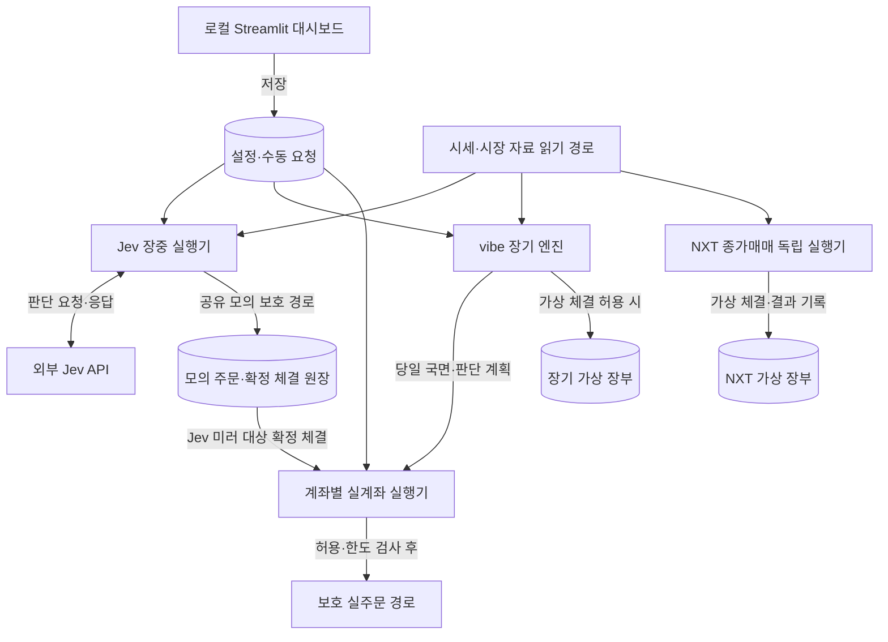
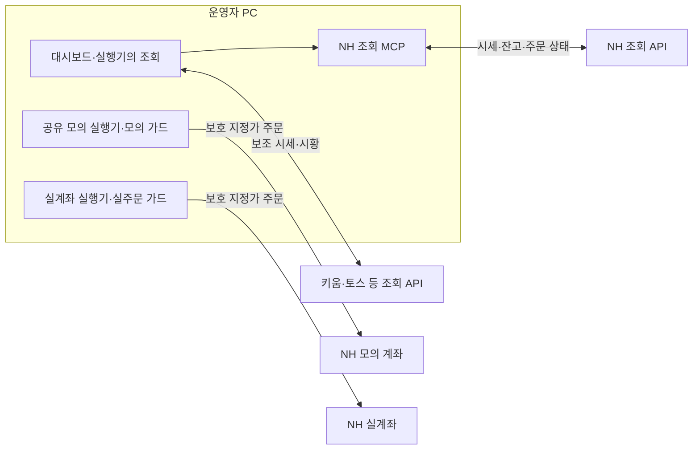
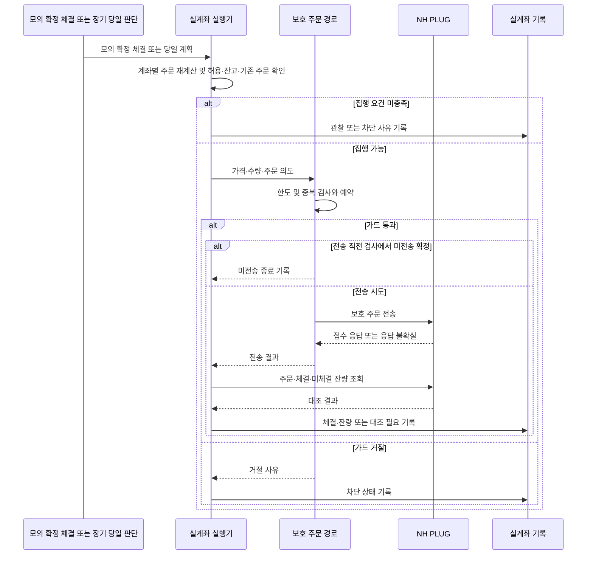
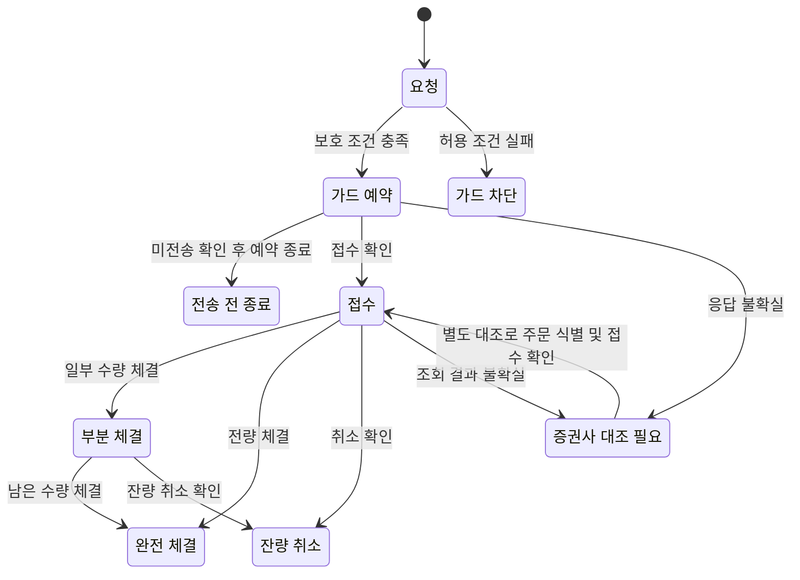
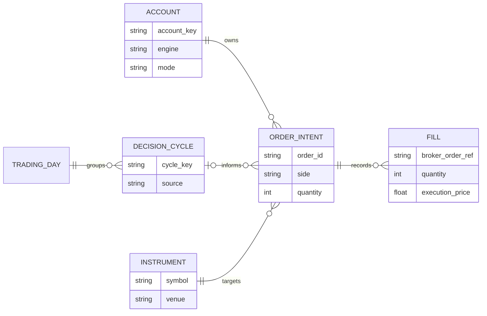
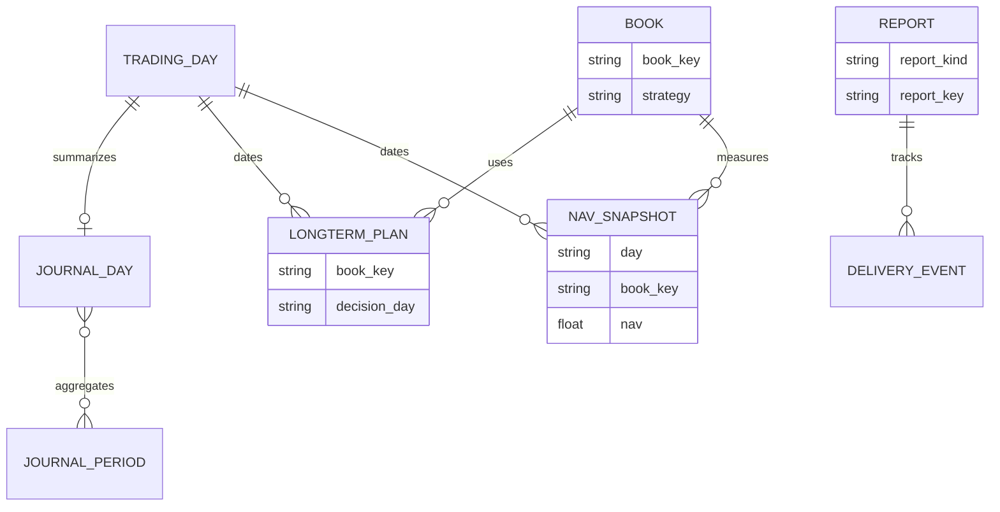
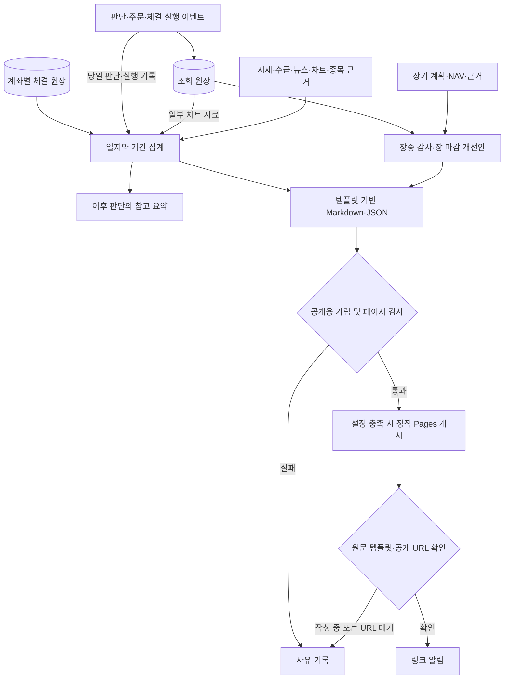

# 아키텍처와 데이터 모델

[기획서 홈](README.md) · [제품 요구사항](01_PRD.md) · [프로젝트 스펙](04_PROJECT_SPEC.md)

## 투자 결정을 설명하는 데이터

매매가 끝난 뒤 손익만 보면 사용자는 정보가 부족했는지, 진입 기준을 지켰는지, 주문이 체결됐는지 구분하기 어렵습니다. 장중·장기 엔진이 쓰는 시세와 판단 근거, 규칙을 적용한 결과, 계좌별 주문·체결을 이어서 볼 수 있도록 데이터를 나눠 기록합니다. [사용자 문제와 요구사항](01_PRD.md#사용자와-해결할-문제)

| 사용자가 확인할 질문 | 필요한 데이터 | 기능에서 쓰는 곳 |
| --- | --- | --- |
| 이 종목을 왜 지금 살펴봤나 | 분봉 차트, 거래량·거래대금, 시황·수급, 뉴스의 출처와 시각, 모델 후보 또는 대기 의견 | 장전 브리프, Jev 판단, 대시보드 차트 |
| 왜 기다렸거나 보유를 정리했나 | 후보와 신뢰도, 진입 제한, 계좌 한도, 청산 규칙, 실제 주문·체결과 잔량 | 판단·차단 기록, 주문 대조, 매매일지 |
| 장기 자금을 언제 어떻게 나누어 투입할까 | 시장 국면, 목표·현재 비중, 대기 자금, 적립 계획, 장부별 평가 기준과 결과 | 장기투자 차트, 적립식, 가상·그림자 장부 비교 |

운영 중에는 증권사 모의 체결, 가상 브로커의 호가 기반 체결, 증권사 실체결을 계좌와 함께 구분합니다. 주문 없이 지켜본 후보의 사후 가격과 과거 재현도 각각 별도 자료로 남깁니다. 이 구분이 있어야 같은 전략을 검토할 때 어느 결과를 비교하고 어떤 가정이 들어갔는지 알 수 있습니다. [체결과 관찰의 차이](https://github.com/roadkwonai/omni-ai-trading/blob/v0.1.3/docs/safety.md#단계-관찰--가상--보호-실주문) · [매매일지](https://github.com/roadkwonai/omni-ai-trading/blob/v0.1.3/docs/journal.md)

## 시스템 아키텍처

대시보드는 각 실행기의 원장·이벤트를 읽어 표시합니다. 보고 작업은 이 기록을 일지와 공개 리포트의 입력으로 사용합니다. 장기 가상 장부와 NXT 종가매매는 별도 실행·저장 경로입니다.

### 조회·주문과 외부 서비스 경계

모의 실행기가 모의 거래의 접수·체결·잔량을 확인하고, 실계좌 실행기도 실제 주문 결과를 따로 대조합니다. 시세 제공자를 바꾸는 대체 경로는 조회에만 적용합니다. NH 호출 한도는 구성 요소가 나누어 씁니다. 조회에 실패하거나 값이 없으면 각 호출자가 자료를 계속 쓸 수 있는지 판단합니다. [NH 로컬 연동](https://github.com/roadkwonai/omni-ai-trading/blob/v0.1.3/guides/nhplug-local.md) · [호출량 관리](https://github.com/roadkwonai/omni-ai-trading/blob/v0.1.3/release/2026-11-20-v0.1.3-opening-and-inverse.md) · [대체 API 선택](https://github.com/roadkwonai/omni-ai-trading/blob/v0.1.3/docs/integrations.md)

| 경계 | 실행 책임 | 저장·검증 책임 |
| --- | --- | --- |
| 화면과 실행기 | 화면은 읽기와 설정·수동 요청을 처리하고, 실행기가 요청을 확인하여 주문 준비 | 설정 이력·요청 파일과 실제 주문 이벤트를 연결. [화면 가이드](https://github.com/roadkwonai/omni-ai-trading/blob/v0.1.3/docs/dashboard.md), [앱](https://github.com/roadkwonai/omni-ai-trading/blob/v0.1.3/streamlit_namuh/app.py) |
| Jev 장중·공유 모의 | `nh_paper_isolated`가 시세·Jev·보유 판단을 받아 NH 모의 주문 | 모의 가드와 공유 실행기 원장을 각각 확인. [실행기](https://github.com/roadkwonai/omni-ai-trading/blob/v0.1.3/scripts/nh_paper_isolated.py), [모의 가드](https://github.com/roadkwonai/omni-ai-trading/blob/v0.1.3/agent/src/tools/nhplug_order_guard.py) |
| 장기·가상 | `vibe_longterm`이 장부별 판단과 계획을 만들고, 가상 브로커는 가상 체결 계산 | 장기 판단·NAV와 가상 주문은 별도 기록. [장기 엔진](https://github.com/roadkwonai/omni-ai-trading/blob/v0.1.3/scripts/vibe_longterm.py), [가상 브로커](https://github.com/roadkwonai/omni-ai-trading/blob/v0.1.3/scripts/virtual_paper_broker.py), [NXT](https://github.com/roadkwonai/omni-ai-trading/blob/v0.1.3/scripts/nxt_virtual.py) |
| 실계좌 | `nh_live_follow`는 모의 확정 체결, `longterm_live`는 장기 계획을 각각 읽음 | `nh_guarded_live`와 `LiveOrderGuard`에서 예약·전송·대조. [미러](https://github.com/roadkwonai/omni-ai-trading/blob/v0.1.3/scripts/nh_live_follow.py), [장기 실계좌](https://github.com/roadkwonai/omni-ai-trading/blob/v0.1.3/scripts/longterm_live.py), [보호 경로](https://github.com/roadkwonai/omni-ai-trading/blob/v0.1.3/scripts/nh_guarded_live.py) |
| 공개·발송 | 보고 작업이 원문을 만들고, 발행기가 가림·검사·게시·링크 발송 | 발행 상태와 실패 이력을 따로 남김. [발행기](https://github.com/roadkwonai/omni-ai-trading/blob/v0.1.3/scripts/report_pages.py), [운영 가이드](https://github.com/roadkwonai/omni-ai-trading/blob/v0.1.3/docs/report-pages.md) |

## 보호 주문 시퀀스

이 시퀀스는 실계좌 자동매매의 대표 흐름입니다. 수동 요청도 실행기가 보호 절차를 거쳐 처리합니다. 모의는 별도 가드를 쓰고, 가상 브로커는 자체 실행 결과를 가상 장부에 남깁니다. [실계좌 가드](https://github.com/roadkwonai/omni-ai-trading/blob/v0.1.3/agent/src/tools/nhplug_live_guard.py) · [보호 경로](https://github.com/roadkwonai/omni-ai-trading/blob/v0.1.3/scripts/nh_guarded_live.py) · [모의 주문 대조 가이드](https://github.com/roadkwonai/omni-ai-trading/blob/v0.1.3/guides/nhplug-order-safety.md)

### 주문 상태

아래 명칭은 사용자에게 표시할 개념 상태입니다. 실제 SQLite 상태 문자열과는 용도가 다릅니다.

부분 체결 뒤 취소되면 체결 수량과 취소 잔량을 모두 보존합니다. 정형 접수 응답이 아니면 실계좌 가드는 불확실 상태를 유지합니다. 실행기는 접수 번호와 종목이 확인된 주문을 자동 대조하며, 주문을 식별할 수 없으면 별도 대조가 필요합니다. 그동안 해당 계좌의 새 주문은 차단합니다. [모의 제출·대조 코드](https://github.com/roadkwonai/omni-ai-trading/blob/v0.1.3/scripts/nh_paper_isolated.py#L2407) · [실계좌 접수·대조 가드](https://github.com/roadkwonai/omni-ai-trading/blob/v0.1.3/agent/src/tools/nhplug_live_guard.py#L396) · [미러 대조](https://github.com/roadkwonai/omni-ai-trading/blob/v0.1.3/scripts/nh_live_follow.py#L705)

## 논리 ERD

거래일, 계좌 키, 주문 번호, 판단 식별자로 파일과 데이터베이스의 기록을 연결합니다. 관계도는 업무상 필요한 연결을 보여 주며, 실제 저장 위치와 스키마는 표에 연결했습니다.

보유 현황은 계좌와 종목을 기준으로 증권사 잔고와 주문·체결 원장을 대조해 구성합니다. 가상 계좌의 보유 현황은 가상 브로커 장부를 사용합니다.

**장기 장부, 일지와 발행**

| 개념과 데이터 예시 | 실제 저장 위치 또는 소유 시스템 | 읽는 기능 |
| --- | --- | --- |
| 계좌 `paper-shared`, `live-1`, `live-2`와 실행 설정 | `nhplug/accounts.json`, 전략·운영 JSON, `settings-history.sqlite3` `changes` | 실행기, 계좌 화면. [계좌](https://github.com/roadkwonai/omni-ai-trading/blob/v0.1.3/scripts/accounts.py) · [설정 이력](https://github.com/roadkwonai/omni-ai-trading/blob/v0.1.3/scripts/config_store.py) |
| 종목·거래일, 예 `069500`, `2026-11-20` | 시장 입력과 이벤트에 포함. 시세 출처별 시각·거래소와 함께 해석 | 시장·보유·실행·일지. [시황](https://github.com/roadkwonai/omni-ai-trading/blob/v0.1.3/scripts/market_context.py) · [달력](https://github.com/roadkwonai/omni-ai-trading/blob/v0.1.3/agent/src/tools/nhplug_calendar.py) |
| 판단 회차·주문 연결, 예 `cycle-example` | 공유 실행기 `events.jsonl`, `orders.sqlite3`의 `decision_order_links` | 전략 화면·복기. [공유 원장](https://github.com/roadkwonai/omni-ai-trading/blob/v0.1.3/scripts/nh_paper_isolated.py#L310) |
| 모의 주문 의도·체결·취소, 예 매수 2주 중 체결 1주 | 공유 실행기의 `intents`, `fills`, `cancels`와 모의 가드의 `intent_fills` | 재시작 대조, Jev 미러, 일지. [모의 가드](https://github.com/roadkwonai/omni-ai-trading/blob/v0.1.3/agent/src/tools/nhplug_order_guard.py) |
| 실계좌 의도·체결·중단, 예 `live-1`의 확정 체결 | `live-orders.sqlite3`, `live-fills.sqlite3`, 계좌별 잔고 기록. 가드는 `live_intents`, `live_halts`에 기록 | 실계좌 화면·손실 한도·일지. [실계좌 가드](https://github.com/roadkwonai/omni-ai-trading/blob/v0.1.3/agent/src/tools/nhplug_live_guard.py) |
| 보유, 예 종목별 수량·평균가·확인 시각 | 증권사 잔고 응답과 계좌별 원장, 가상 계좌는 자체 `account`·`orders` | 화면 손익·실행 전 대조. [가상 브로커](https://github.com/roadkwonai/omni-ai-trading/blob/v0.1.3/scripts/virtual_paper_broker.py) |
| 장기 계획·장부·NAV, 예 특정 장부의 당일 목표 비중 | `vibe-longterm/longterm.sqlite3` `decisions`, `nav`, `state`, `claims`, `account_nav`와 별도 가상 장부 | 장기 대시보드·실계좌 계획·감사. [장기 계획·장부](https://github.com/roadkwonai/omni-ai-trading/blob/v0.1.3/scripts/vibe_longterm.py) |
| 실계좌별 주문 계획과 적립 상태, 예 당일 재계산한 매수·매도 | `longterm-live/state-<키>.json`의 `orders`, `book`, `dca`, 별도 실행 이벤트 | 당일 계획·중복 방지·미체결 대조. [재계산](https://github.com/roadkwonai/omni-ai-trading/blob/v0.1.3/scripts/longterm_live.py#L329) |
| NXT 종가매매 결과와 후보, 예 가상 체결과 다음 세션 결과 | `~/.vibe-trading/nhplug/nxt-virtual/`의 `virtual-account.sqlite3`, `nxt.sqlite3`, `events.jsonl`. 이 실행기의 기본 경로는 코드에서 홈을 직접 참조 | 가상 검증과 연구. [경로 정의](https://github.com/roadkwonai/omni-ai-trading/blob/v0.1.3/scripts/nxt_virtual.py#L31) · [NXT 기록](https://github.com/roadkwonai/omni-ai-trading/blob/v0.1.3/scripts/nxt_virtual.py#L221) · [NXT 가상 브로커](https://github.com/roadkwonai/omni-ai-trading/blob/v0.1.3/scripts/nxt_virtual.py#L250) |
| 원본 이벤트, 예 심볼별 차단 사유 | `events.jsonl`과 조회용 `trading-ledger.sqlite3` `events_v2`·`sources` | 화면·감사·분석. [이벤트 적재](https://github.com/roadkwonai/omni-ai-trading/blob/v0.1.3/scripts/trading_ledger.py) |
| 낙폭과대 사례, 예 날짜·종목·규칙 재현 | `oversold-cases.sqlite3` `cases`, `series`, `meta` | 전략 연구·당일 유사 사례 참고. [사례집](https://github.com/roadkwonai/omni-ai-trading/blob/v0.1.3/scripts/oversold_cases.py) |
| 일·기간 일지, 예 `2026-11-20`, `2026-Q4` | `trading-journal.sqlite3` `days`, `periods`, Markdown·JSON 분석 | 기간 집계·엔진 참고 입력. [일지](https://github.com/roadkwonai/omni-ai-trading/blob/v0.1.3/scripts/trading_journal.py) |
| 리포트·발행, 예 `journal`의 일별 게시 | 원본 Markdown·JSON, `report-pages.sqlite3` `reports`·`events` | 발행 상태·공개 Pages·알림. [발행기](https://github.com/roadkwonai/omni-ai-trading/blob/v0.1.3/scripts/report_pages.py) |

## 일지와 리포트의 데이터 흐름

거래일은 서울 시간과 시장 달력을 기준으로 해석합니다. 설정은 JSON, 체결·원장·집계는 SQLite, 사건 흐름은 JSONL, 읽기 자료는 Markdown과 정적 HTML에 저장합니다. [저장소 지도](https://github.com/roadkwonai/omni-ai-trading/blob/v0.1.3/docs/architecture.md#데이터-위치) · [일지](https://github.com/roadkwonai/omni-ai-trading/blob/v0.1.3/docs/journal.md)

발행기는 공개 HTML을 검사한 뒤 게시합니다. 원문 템플릿은 게시 뒤 링크 발송을 판단할 때 검사하므로 초안이 먼저 게시될 수 있습니다. 자동 가림과 검사도 ‘실계좌’ 표시가 없는 문단의 금액·수량을 놓칠 수 있습니다. `noindex`는 검색 색인 요청이며 접근 제어는 제공하지 않습니다. [가림 코드](https://github.com/roadkwonai/omni-ai-trading/blob/v0.1.3/scripts/report_pages.py#L152) · [발행과 링크 검사](https://github.com/roadkwonai/omni-ai-trading/blob/v0.1.3/scripts/report_pages.py#L831)

| 출력 경로 | 대상과 상태 |
| --- | --- |
| 공개 HTML | 장전 상세 분석, 장기 전략, 장 마감 개선안, 매매일지와 기간 일지, 낙폭과대 주간 감사, 장기 복기·감사. 생성·게시·링크 발송 상태를 각각 관리합니다. |
| 실시간·장기 알림 | 체결·주문 계획·순자산·장 마감 요약은 알림 텍스트로 보냅니다. 채널별 설정과 발송 이력으로 중복을 줄입니다. |
| 내부 기록 | 장중 감사와 운영 기록은 내부 파일·DB에 남기고, 예약 작업의 진행 보고는 대화에서도 확인합니다. |

[공개 유형과 내부 기록](https://github.com/roadkwonai/omni-ai-trading/blob/v0.1.3/scripts/report_pages.py#L60) · [알림과 중복 방지](https://github.com/roadkwonai/omni-ai-trading/blob/v0.1.3/docs/notifications.md#중복-방지와-커서)

외부 공유를 확대할 때 정해야 할 데이터 보존 기간, 접근·삭제 권한과 공개 범위는 [미결 사항](03_PHASES.md#미결-사항)에 포함합니다.
