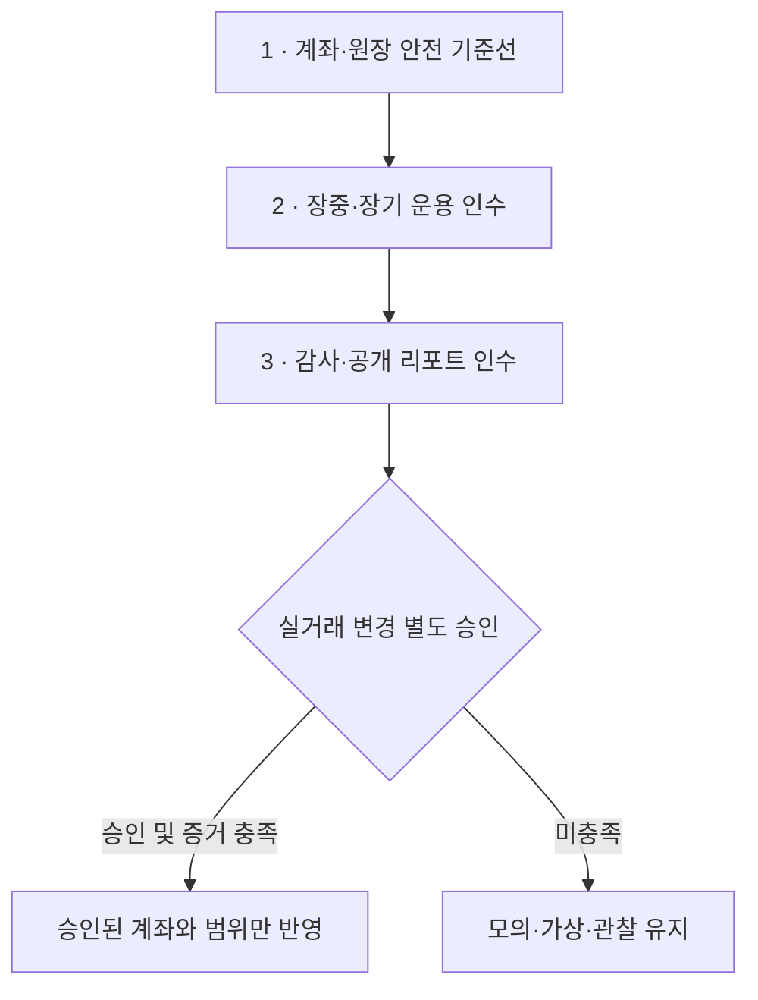

# 검증과 단계별 인수

[기획서 홈](README.md) · [제품 요구사항](01_PRD.md) · [프로젝트 스펙](04_PROJECT_SPEC.md)

## 검증과 인수

운영 인수의 핵심은 주문 상태를 증권사 기록과 대조할 수 있는지, 모의와 실계좌를 구분하는지, 사용자가 판단과 결과의 근거를 따라갈 수 있는지 확인하는 것입니다.

| 검증 관점 | 대표 사례 | 검증 근거 |
| --- | --- | --- |
| 주문 안전 | 접수 후 대조, 주문 취소, 미확인 주문 차단 | [실계좌 가드 테스트](https://github.com/roadkwonai/omni-ai-trading/blob/v0.1.3/agent/tests/test_nhplug_live_guard.py) · [모의 가드 테스트](https://github.com/roadkwonai/omni-ai-trading/blob/v0.1.3/agent/tests/test_nhplug_order_guard.py) |
| 전략과 데이터 | 개장 분봉, 미러 수량, 설정 이력 없는 운용금 변경, 낙폭과대 재현 | [Jev 실행기 테스트](https://github.com/roadkwonai/omni-ai-trading/blob/v0.1.3/scripts/test_nh_paper_isolated.py) · [미러 테스트](https://github.com/roadkwonai/omni-ai-trading/blob/v0.1.3/scripts/test_nh_live_follow.py) · [장기 실계좌 테스트](https://github.com/roadkwonai/omni-ai-trading/blob/v0.1.3/scripts/test_longterm_live.py) · [재현 테스트](https://github.com/roadkwonai/omni-ai-trading/blob/v0.1.3/scripts/test_oversold_replay.py) |
| 운영·공개 | 일지 집계, 공개용 가림, 페이지 대기와 중복 발송, 복원 전 파일 보관 | [일지 테스트](https://github.com/roadkwonai/omni-ai-trading/blob/v0.1.3/scripts/test_trading_journal.py) · [발행 테스트](https://github.com/roadkwonai/omni-ai-trading/blob/v0.1.3/scripts/test_report_pages.py) · [복원 테스트](https://github.com/roadkwonai/omni-ai-trading/blob/v0.1.3/scripts/test_state_sync.py) |

## 사용자 가치 검증

사용자가 화면에서 근거를 찾아 투자 결정을 설명할 수 있는지 확인합니다. 아래 시나리오는 인수 기준이며, 실제 매매 습관과 투자 성과의 변화는 별도 사용자 검증이 필요합니다.

| 확인할 가치 | 인수 시나리오 | 관찰할 결과 |
| --- | --- | --- |
| 투자 입문자가 시장 정보를 연결해 볼 수 있다 | 장전 요약과 Jev 후보 한 건을 열어 차트·수급·뉴스 가운데 판단에 쓰인 자료를 찾아봅니다. | 후보가 나온 이유와 모델이 대기한 이유를 자신의 말로 설명합니다. **FR-01~02** |
| 추격과 손절 지연에 대응할 기준을 볼 수 있다 | 급등 종목의 진입 차단과 손절 가격에 닿은 보유 종목을 모의로 재현합니다. | 차단·주문 발생·미체결·체결을 구분하고 적용한 기준을 찾습니다. **FR-03~04, FR-07~09** |
| 장중에 계속 접속하지 않아도 장기 운용 계획을 이해할 수 있다 | 시장 국면이 바뀐 날의 장기 리포트와 가상 장부를 열어 비중과 적립 조건을 비교합니다. | 매수, 대기, 비중 조정 중 어떤 계획을 냈는지와 장부별 가정의 차이를 설명합니다. **FR-05~06, FR-09** |
| 장기 전략별로 꾸준히 실행할 기준을 찾을 수 있다 | 같은 기간의 가상 장부에서 정기 적립, 월 밴드 조정, 저수지 분할의 판단 기록을 비교합니다. | 적립 매수와 비중 조정 매도를 구분하고, 적용한 조건과 비용·낙폭의 차이를 설명합니다. **FR-05~06, FR-09** |
| 결과를 돌아보고 다음 판단 기준을 세울 수 있다 | 거래한 종목과 조건에 걸려 거래하지 않은 후보를 하루 기록에서 비교합니다. | 모델 판단, 규칙, 체결 결과를 구분하고 검토할 설정이나 개선 가설을 한 가지 기록합니다. **FR-09~12** |

## 공개 릴리스 재현성

공개 v0.1.3에는 Jev 모의 실행기가 참조하는 전략 모듈이 빠져 있습니다. 이 때문에 공개 소스만으로는 Jev 모의 실행과 일부 미러·NXT 검증이 중단됩니다. [Jev 실행기의 함수 참조](https://github.com/roadkwonai/omni-ai-trading/blob/v0.1.3/scripts/nh_paper_isolated.py#L30) · [전략 모듈 의존성](https://github.com/roadkwonai/omni-ai-trading/blob/v0.1.3/scripts/kr_swing_v5_forward.py#L24)

| 실행 환경 | 재현 결과 |
| --- | --- |
| 공개 릴리스 소스 | 주문 가드, 장기 실행·적립식, 낙폭과대 재현, 리포트·일지·복원 테스트 296개 통과 |
| 전략 모듈이 있는 개발 환경 | Jev 모의 실행기 테스트 212개와 하위 테스트 76개 통과 |

다음 릴리스의 인수 조건은 공개 배포물만으로 Jev 모의 실행기와 관련 테스트가 정상 동작하는 것입니다.

## 단계별 인수



운영 인수는 계좌·원장, 운용 흐름, 기록·발행 순서로 진행합니다. 실계좌 변경에는 해당 계좌와 범위의 별도 승인이 필요합니다.

| 단계 | 범위 및 선행 조건 | 인수 증거 | 상태 |
| --- | --- | --- | --- |
| 1 · 계좌·체결 기준선 | 설치·인증 경로, 모의·가상·실계좌 구분, 설정 이력, 주문 예약·대조, 부분 체결·미확인·중복·보호 거절 | 로컬 대시보드 표시와 테스트용 원장의 일치, 실제 접수와 체결 구분, 재시작 전 조정 절차 | 구현 근거 있음 · 운영 인수 미확인 |
| 2 · 운용 흐름 검증 | 단계 1, 서울 시간과 거래일 입력. 장전 → Jev·공유 모의, 장기 판단 → 장부·적립식, 실계좌 경로 계획 관찰 | 휴장, 자료 지연, 지연 개장, 당일 계획 누락, 미체결을 재현한 결과, 모델 근거와 주문 근거의 연결 | 구현 근거 있음 · 운영 인수 미확인 |
| 3 · 기록과 공개 경계 | 단계 2에서 재현한 데이터. 일지·감사·장기 복기·메시지·정적 리포트 | 일·월·분기·반기·연 집계 재현, 중복 발송 차단, 공개 HTML 개인정보 가림·검사 | 구현 근거 있음 · 운영 인수 미확인 |
| 별도 실거래 변경 | 단계 1~3에서 영향받는 조건 확인과 계좌별 사용자 승인 | 실제 운영 설정·사전 점검·대조 절차의 기록. 승인 범위 내에서만 집행 | 별도 승인 필요 |

### 단계 1 인수 체크리스트

- [ ] 표준 모의 자료를 읽는 화면에서 계좌·출처·시각·조회 상태를 함께 확인한다.
- [ ] 접수, 부분 체결, 완전 체결, 취소, 미확인 응답을 각각 재현하고 잔량과 화면 집계를 대조한다.
- [ ] 중복 요청과 한도 초과, 당일 손실 래치, HALT 및 실행 인자 부재 시 차단 증거를 기록한다.
- [ ] `.env` 비밀과 계좌번호가 화면, 테스트 로그, 공유 산출물에 포함되지 않는지 확인한다.
- [ ] 실행 환경에서 실제로 쓰는 증권사 자격 증명과 로컬 접근 정책을 확인한다. 공개 Pages는 정적 게시 경로의 경계만 확인한다.

## 개발 시작 프롬프트

저장소 루트에서 아래 프롬프트를 Claude Code 또는 Codex에 붙여 넣습니다. 특정 단계를 시작하려면 첫 문장에 `2단계부터` 또는 `3단계부터`를 덧붙입니다.

```text
이 기획서를 바탕으로 기존 Omni AI Trading 저장소에서 개발을 시작해 줘.

목표와 사용자
- 투자 입문자가 차트·뉴스·수급을 이해하고, Jev의 후보와 대기 이유를 모의매매에서 익히게 한다.
- 장중에 시간을 쓰기 어려운 사용자가 ETF 목표 비중, 비중 조정과 적립식을 가상 장부에서 검토하게 한다.
- 대시보드에서 판단 근거, 주문 차단, 주문 접수, 체결과 복기를 연결해 사용자가 이유와 결과를 설명할 수 있게 한다.

먼저 읽을 문서
- AGENTS.md와 이 저장소의 README.md, docs/README.md
- PRD/01_PRD.md의 요구사항 FR-01~13과 수용 기준
- PRD/02_DATA_MODEL.md의 데이터 흐름, 주문 상태, 계좌별 원장
- PRD/03_PHASES.md의 단계별 인수와 공개 릴리스 재현성
- PRD/04_PROJECT_SPEC.md의 기술 스택, 주문 보호, 장애 대응과 변경 승인

진행 방법
1. 기획서와 현재 코드를 대조해 이미 구현된 기능, 보완할 기능, 확인이 필요한 점을 요구사항 ID로 정리해 줘. 정해진 기술과 제품 범위는 재사용하고, 기존 사용자 설정과 원장 형식은 호환해 줘. 자료나 승인 범위가 실제로 달라질 때만 질문해 줘.
2. 지정한 단계의 선행 조건을 확인해 구현해 줘. 단계 지정이 없으면 1단계부터 시작해 줘. 각 단계에서 실제 화면 또는 실행기를 통해 입력부터 저장·조회까지 확인해 줘.
3. Python·Streamlit 로컬 대시보드, 계좌별 Python 실행기, SQLite 원장, JSON 설정·JSONL 이벤트, macOS launchd 정의를 기반으로 진행해 줘. NH 나무 PLUG의 조회와 주문 경로를 분리하고, Jev의 응답은 거래 규칙과 주문 가드에 넘길 참고 입력으로 사용해 줘. Claude Code·Codex의 운영 작업은 읽기 전용 조회·분석·복기를 기본으로 해 줘.
4. 공개본의 Jev 모의 실행기 의존성 누락 때문에 깨끗한 설치에서 단계 검증이 막히면 먼저 재현해 줘. 시세 검증 함수 의존성을 좁혀 원인을 해결하고, 개인 전략 파일이나 운영 데이터를 배포물에 넣지 않은 환경에서 실행과 테스트를 다시 확인해 줘.

단계별 구현과 완료 기준
- 1단계 · 계좌·체결 기준선(FR-07~08, FR-12~13). 계좌·운용 방식·출처·시각을 화면에 표시하고, 주문 의도부터 접수·부분 체결·완전 체결·취소까지 원장으로 대조해 줘. 중복 주문, 미확인 주문, 오래된 시세, 계좌 한도, HALT, 재시작 복구를 테스트할 수 있어야 해. 계좌 설정 변경 이력과 백업·복원 확인까지 포함해 줘.
- 2단계 · 장중·장기 운용(FR-01~06). 장전 시황에서 Jev 후보·대기와 차단 이유를 보여 주고, 조건에 맞는 진입·청산을 NH 모의 흐름에서 검증해 줘. 테마·신규주·낙폭과대와 NXT 가상 실행은 해당 전략 및 계좌 경계를 따라 구현해 줘. 장기 엔진은 국면, 사용자 선택 전략, 현재·목표 비중과 적립 설정으로 매수·대기·비중 조정을 계산하고 가상 장부에서 결과를 확인할 수 있게 해 줘. 입금형 적립식은 설정 이력으로 확인한 운용금 증가분을 입력으로 써 줘.
- 3단계 · 기록·감사·공개(FR-09~13). 판단·차단·주문·체결을 일지와 기간 성과에 연결해 줘. 장중·마감 감사, 알림, 공개용 리포트, 백업·이식까지 이어지는 흐름을 확인해 줘. 리포트의 생성, 게시, 링크 발송 상태를 구분하고 공개본은 실계좌 식별 정보와 금액·수량, 초안 여부를 확인해 줘. 외부 접근 검증은 샘플 자료와 테스트 채널을 사용해 줘.

주문과 데이터의 보호 조건
- 변경 작업과 테스트는 주문 없는 관찰, 모의 자료, 가상 장부를 기본으로 해 줘. 실제 NH 모의 주문이나 실주문 전송, 거래 서비스 등록·재시작, 공개 게시·알림 발송을 검증에 쓰려면 해당 동작의 승인을 먼저 확인해 줘.
- 실계좌 실행은 별도 사용자 승인과 계좌별 활성 조건, 주문 가드를 거쳐야 해. 계좌·한도·손실 정책·중단 표시를 우회하거나 실제 운영값을 임의로 바꾸지 마. 전송이 불확실한 주문은 재전송하지 말고 증권사 기록과 대조해 줘.
- 비밀값, 계좌번호, 개인 원장을 화면·로그·문서·공개 배포물에 넣지 마. 모의·가상·실체결은 별개로 기록하고 모델 신뢰도를 수익 확률로 쓰지 마.

검증과 인계
- 성공 사례뿐 아니라 자료 누락·지연, 휴장·지연 개장, 보호 거절, 부분 체결, 재시작과 복원을 재현해 줘. 가상 체결은 실제 체결과 다른 가정을 기록해 줘.
- 완료한 요구사항 ID, 화면·실행기 진입점, 변경 파일, 실제 실행한 검증과 결과를 한국어로 보고해 줘. 승인이나 외부 연동이 있어야 확인할 사항은 미검증으로 표시해 줘. 서울 시간을 기준으로 기록해 줘.
```

## 검증 우선순위

| 우선순위 | 검증 묶음 | 적용 기준 |
| --- | --- | --- |
| P0 | 실제 주문 경계, 손실 래치, 장부 대조, 공개 정보 가림 | 경계가 어긋나면 관련 변경 보류 |
| P1 | 개장 시각·분봉 신선도, 후보 충돌·인버스 진입, 장기 목표 비중·적립식·미체결 | 같은 상황을 재현해 결과와 거절 사유 비교 |
| P1 | 매매일지·차트·기간 합계, 감사·재발 추적, 알림과 공개 링크 | 기록 일관성 및 발행 상태를 독립 확인 |
| P2 | 화면 분류 개선, 외부 리서치와 대체 API, 리포트 확장 | 문서의 계획 상태와 실제 호출·배포 범위를 확인한 뒤 진행 |

<details>
<summary>요구사항에서 인수 근거 찾기</summary>

| 요구사항 | 인수 단계 | 우선 확인할 구현 |
| --- | --- | --- |
| FR-01~04 · 장전·Jev·보유·전략 경로 | 2 | [장전 수집](https://github.com/roadkwonai/omni-ai-trading/blob/v0.1.3/scripts/premarket.py), [Jev 모의 실행기](https://github.com/roadkwonai/omni-ai-trading/blob/v0.1.3/scripts/nh_paper_isolated.py), [사례 재현](https://github.com/roadkwonai/omni-ai-trading/blob/v0.1.3/scripts/oversold_replay.py), [NXT 가상](https://github.com/roadkwonai/omni-ai-trading/blob/v0.1.3/scripts/nxt_virtual.py) |
| FR-05~06 · 장기·적립식 | 2 | [장기 엔진](https://github.com/roadkwonai/omni-ai-trading/blob/v0.1.3/scripts/vibe_longterm.py), [적립식](https://github.com/roadkwonai/omni-ai-trading/blob/v0.1.3/scripts/longterm_dca.py), [여운봉 매매법](https://github.com/roadkwonai/omni-ai-trading/blob/v0.1.3/scripts/yeo_method.py) |
| FR-07~08 · 계좌·실주문 | 1, 별도 승인 | [계좌](https://github.com/roadkwonai/omni-ai-trading/blob/v0.1.3/scripts/accounts.py), [보호 주문](https://github.com/roadkwonai/omni-ai-trading/blob/v0.1.3/scripts/nh_guarded_live.py), [미러](https://github.com/roadkwonai/omni-ai-trading/blob/v0.1.3/scripts/nh_live_follow.py), [장기 실계좌](https://github.com/roadkwonai/omni-ai-trading/blob/v0.1.3/scripts/longterm_live.py) |
| FR-09~11 · 일지·감사·공개 | 3 | [일지](https://github.com/roadkwonai/omni-ai-trading/blob/v0.1.3/scripts/trading_journal.py), [장중 감사](https://github.com/roadkwonai/omni-ai-trading/blob/v0.1.3/scripts/intraday_audit.py), [발행](https://github.com/roadkwonai/omni-ai-trading/blob/v0.1.3/scripts/report_pages.py), [알림](https://github.com/roadkwonai/omni-ai-trading/blob/v0.1.3/scripts/discord_notify.py) |
| FR-12 · AI 협업·연동 | 1~3 | [운영자용 AI 가이드](https://github.com/roadkwonai/omni-ai-trading/blob/v0.1.3/docs/ai-agents.md), [읽기 전용 실행](https://github.com/roadkwonai/omni-ai-trading/blob/v0.1.3/scripts/ro), [연동](https://github.com/roadkwonai/omni-ai-trading/blob/v0.1.3/docs/integrations.md) |
| FR-13 · 백업·이식 | 1, 3 | [이식 코드](https://github.com/roadkwonai/omni-ai-trading/blob/v0.1.3/scripts/state_sync.py), [백업](https://github.com/roadkwonai/omni-ai-trading/blob/v0.1.3/scripts/backup_trading_data.py), [이식 테스트](https://github.com/roadkwonai/omni-ai-trading/blob/v0.1.3/scripts/test_state_sync.py) |

</details>

## 미결 사항

- **배포 범위** · 다른 사용자나 팀에 대시보드를 제공할 경우 인증, 계좌별 접근 권한, 운영 책임, 데이터 보존·삭제 기준을 정합니다.
- **운영 지표 목표** · 시세의 관측 시각부터 판단까지 걸린 시간, 장 종료부터 감사 완료까지 걸린 시간, 운영 중단부터 대조 완료까지 걸린 시간을 기록합니다. 목표값과 관측 기간은 후속 검증 과제입니다.
- **전략 채택 근거** · 그림자 장부의 전략을 실제 진입에 적용하기 전 사용할 거래일·표본·비용·검증 기준을 승인받습니다.
- **운영 등록 상태** · 저장소 일정, 현재 서비스 등록 인자, 실제 계좌 스위치의 일치 여부는 읽기 전용 운영 점검에서 확인합니다.
- **공개 발행 검증 과제** · 라벨 없는 실계좌 금액·수량과 게시 전 초안을 자동으로 막는 경로는 구현 과제로 남아 있습니다. 현행 가림과 링크 발송 조건은 [발행 흐름](02_DATA_MODEL.md#일지와-리포트의-데이터-흐름)을 참고합니다.
