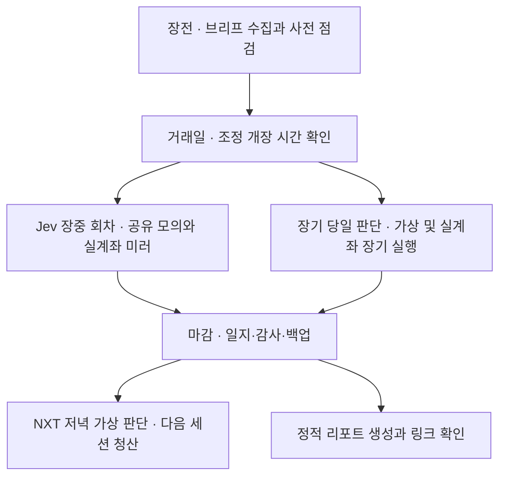
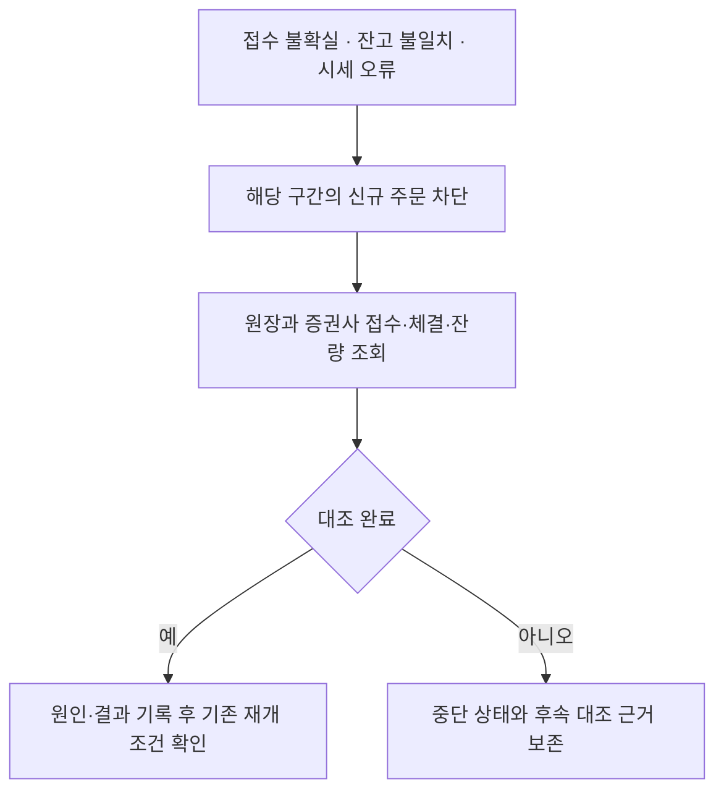
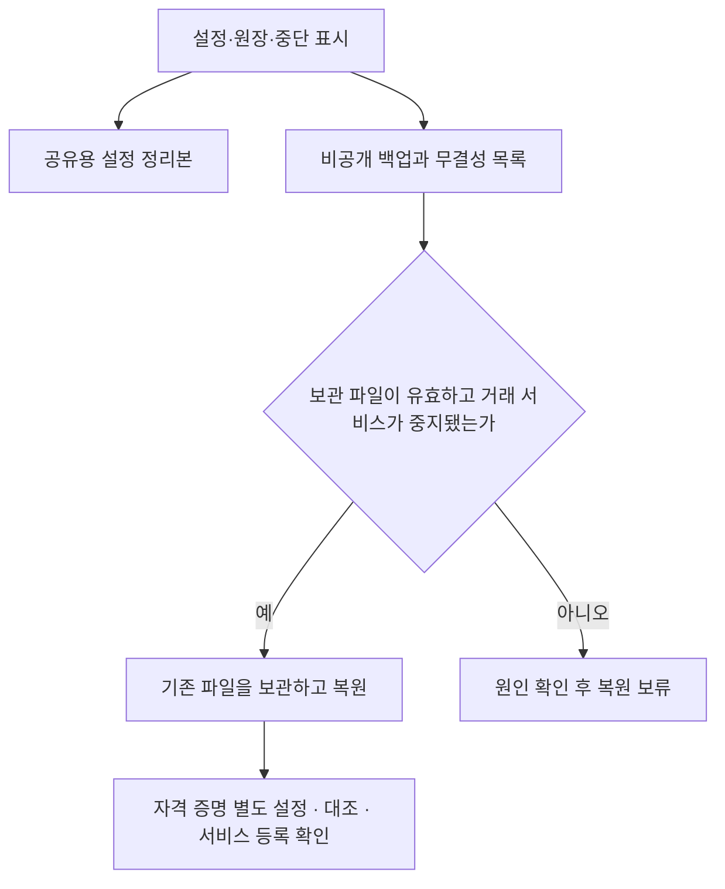

# 프로젝트 스펙과 운영 규칙

[기획서 홈](README.md) · [아키텍처와 데이터](02_DATA_MODEL.md) · [단계별 로드맵](03_PHASES.md)

## 사용자 목적과 운영 전제

장중 매매를 배우려는 사람은 시장 자료, Jev 후보, 진입 차단과 청산 근거를 같은 계좌의 기록에서 확인할 수 있어야 합니다. 장중 거래에 시간을 쓰기 어려운 사람은 장기 엔진을 따로 선택하고, 시장 국면과 적립 계획, 가상 장부의 변화를 중심으로 확인할 수 있어야 합니다. 두 경로는 같은 화면에서 볼 수 있으며 주문 기준과 평가 기록은 계좌별로 관리합니다. [두 엔진의 역할](https://github.com/roadkwonai/omni-ai-trading/blob/v0.1.3/docs/architecture.md) · [운영 엔진과 계좌](https://github.com/roadkwonai/omni-ai-trading/blob/v0.1.3/docs/dashboard.md)

- **시장 판단** · TypeSafe Jev는 장중 차트와 시장 자료를 해석해 후보 또는 대기 의견을 냅니다. 실행기는 진입·청산 규칙, 자료 신선도와 계좌 한도를 확인합니다. 모델이 제시하는 신뢰도와 전략의 성과는 별도로 읽습니다.
- **계좌 운영** · 장중·장기 경로를 선택한 뒤 관찰이나 모의·가상 운용으로 조건을 확인합니다. 실계좌 경로를 쓰려면 사용자가 해당 계좌의 실주문을 승인해야 하며 주문은 보호 조건을 충족해야 합니다. 시세가 급변하거나 미체결이 발생하면 손실이 차단 기준을 넘을 수 있습니다.
- **설치와 비용** · 공개 버전은 로컬 운영을 기준으로 하며, 자동 일정은 macOS `launchd`를 사용합니다. 증권사 연결과 시장·모델 API 설정이 필요합니다. Claude Code 또는 Codex 등 AI 운영 도구의 유료 이용 권한과 별도 모델 API 비용을 고려합니다. [설치와 준비물](https://github.com/roadkwonai/omni-ai-trading/blob/v0.1.3/docs/getting-started.md#1-준비물) · [AI 운영 가이드](https://github.com/roadkwonai/omni-ai-trading/blob/v0.1.3/docs/ai-agents.md)

## 기술 선택과 책임

| 영역 | 구현 기준 | 이 서비스에서 맡는 이유 |
| --- | --- | --- |
| 화면 | Python·Streamlit, `streamlit_namuh/` | 로컬 운영 화면과 Python 기반 원장·리서치 도구를 같은 실행 환경에서 사용할 수 있습니다. 기본 서비스는 `127.0.0.1:8501`에 바인딩합니다. |
| 실행기 | `scripts/`의 분리 프로세스와 macOS `launchd` | 화면 새로고침과 거래 회차를 분리하고 시간·계좌별 실행을 정의합니다. |
| 시세·계좌 | NH 나무 PLUG와 MCP, 키움·토스 조회 보조 | 모의와 실계좌의 권한 경로를 나누고 시장 입력의 공백을 보완합니다. 대체 자료는 출처와 신선도를 유지합니다. |
| 판단·협업 | TypeSafe Jev, 설정에 따른 OpenAI, Claude Code·Codex | 입력을 구조화하고 시장·차트 해석을 보조합니다. 주문 권한은 실행기와 계좌 가드가 가집니다. |
| 로컬 데이터 | SQLite·JSON·JSONL, `VIBE_TRADING_HOME` | 원장 조회와 대조, 설정 재읽기, 이벤트 재현·백업을 보조합니다. |
| 기록과 공개 | 예약 작업, Markdown·JSON, 정적 GitHub Pages, 알림 채널 | 내부 분석 과정과 공개 자료의 생성을 추적하고 발행 및 링크 알림을 별도 확인합니다. |

구현과 연동 근거는 [의존성 정의](https://github.com/roadkwonai/omni-ai-trading/blob/v0.1.3/pyproject.toml), [서비스 정의](https://github.com/roadkwonai/omni-ai-trading/blob/v0.1.3/scripts/launchd_services.py), [설정 레퍼런스](https://github.com/roadkwonai/omni-ai-trading/blob/v0.1.3/docs/configuration.md), [시작하기](https://github.com/roadkwonai/omni-ai-trading/blob/v0.1.3/docs/getting-started.md), [연동 서비스](https://github.com/roadkwonai/omni-ai-trading/blob/v0.1.3/docs/integrations.md)에 있습니다.

```text
agent/            업스트림 리서치·백테스트 기반과 NH 주문 가드·캘린더
scripts/          Jev·장기·실계좌 실행기, 수집기, 원장, 일지·발행기
streamlit_namuh/  로컬 대시보드와 설정·조회 화면
docs/ · guides/   사용자·운영 가이드와 설계 근거
landing/          공개 소개 페이지
release/          공개 버전 변경 기록
PRD/              제품 요구, 구조, 단계, 프로젝트 스펙
```

## 권한과 계좌별 계약

| 작업 | 허용 경로 |
| --- | --- |
| 조회 | 대시보드와 `nhplug_readonly`의 조회 권한, 예약 감사의 `scripts/ro` 경로 |
| 공유 모의 주문 | NH 모의 서버를 고정한 정책과 `nhplug_paper` 보호 경로, 공유 실행기 주문 대조 |
| 장기·NXT 가상 주문 | 가상 실행 스위치 또는 전략 설정, 자체 장부 |
| 실계좌 자동 주문 | Jev 모의 확정 체결 미러 또는 장기 당일 계획, `nh_guarded_live.py`와 `LiveOrderGuard` |
| 수동 매수·정리 | 대시보드에 요청을 기록하고 해당 실행기가 다음 회차에 대조 후 처리 |
| 설정 변경 | 대시보드 또는 승인된 경로에서 `config_store`; 실주문 스위치는 명시 확인과 이력 기록 |
| 공개 발행·발송 | HTML 가림·검사를 거친 정적 발행. 링크 알림은 추가로 원문 템플릿 및 공개 URL을 확인 |

> [!IMPORTANT]
> 실계좌 자동 주문에는 실행기 `--execute`, 계좌 자동매매, 계좌 실주문 스위치, HALT 해제와 주문별 보호 조건이 모두 필요합니다. 조회, 주문 예약, 전송, 체결은 각 단계의 기록으로 확인합니다. 해당 계좌의 주문을 취소할 수 있는 경로는 신규 주문 스위치와 구별합니다.

| 보호 항목 | 보호 기준 |
| --- | --- |
| 공통 | 계좌 식별, 거래일·시각, 시세와 현금·잔고, 기존 주문, 수량·가격, 중복 및 보호 한도 확인 |
| 공유 모의 | 회당·당일 매수, 보유 금액(미체결 매수 포함), 새 종목 수, 당일 손실과 실행기·증권사 원장 대조 |
| 실계좌 | 계좌별 운용금, 회당 금액·수량, 새 종목 수, 매수 1주 가격 상한, 손실 래치, 미체결·미확인 차단. Jev에는 미러 가격 추격과 종목 손절 정책도 적용 |
| 가상 | 가상 체결 가격·수량·수수료와 현금·장부를 기록하고, 실체결·실수익 보고에 가상 결과가 섞이지 않게 표시 |
| 공개 | 계좌 식별자·비밀값·실계좌 금액·수량은 공개 전 확인 대상. 자동 검사와 별도로 라벨 없는 실계좌 수치와 초안 상태를 검토. [자동 검사 범위](02_DATA_MODEL.md#일지와-리포트의-데이터-흐름) |

| 계좌별 적용 | 상세 기준 |
| --- | --- |
| Jev 실계좌 미러 | 당일 모의 확정 체결을 읽어 1주 기준 또는 금액 비율로 실계좌 몫을 고정합니다. 금액 비율은 자동 또는 1~100%이며 추격 한도·횟수·현금·회당 한도를 적용합니다. 매도 우선으로 회차마다 한 건을 처리합니다. 테마 동반주로 시작한 포지션은 제외합니다. [미러 코드](https://github.com/roadkwonai/omni-ai-trading/blob/v0.1.3/scripts/nh_live_follow.py) · [금액 비율과 모의 규모](https://github.com/roadkwonai/omni-ai-trading/blob/v0.1.3/release/2026-11-20-v0.1.3-opening-and-inverse.md) |
| 모의 규모 맞춤 | 선택한 실계좌와 동시 보유 종목 수를 기준으로 모의 분할 금액·종목당 금액·보호 한도를 계산합니다. 실계좌 설정 변경 시 연동을 다시 계산하고 해제하면 이전 값을 복원합니다. [맞춤 코드](https://github.com/roadkwonai/omni-ai-trading/blob/v0.1.3/scripts/accounts.py#L259) |
| 장기 실계좌 | 당일 엔진 계획이 있을 때 계좌 전략·잔고를 적용해 주문을 재계산합니다. 장기 전용 보호는 종목 손절 없이 당일 실현 손실과 수수료를 손실 래치에 반영합니다. [실계좌 주문 계산](https://github.com/roadkwonai/omni-ai-trading/blob/v0.1.3/scripts/longterm_live.py#L255) · [안전장치](https://github.com/roadkwonai/omni-ai-trading/blob/v0.1.3/docs/safety.md#실계좌-한도) |
| 실계좌 공통 상한 | 계좌별 당일 손실 차단 기준의 상한은 2만 원입니다. 매수 1주 가격은 최대 200만 원, 1회 주문 수량은 최대 1,000주, 하루 새 종목은 최대 5개입니다. 장기 계좌의 첫 투입일에만 새 종목 6개 예외를 둡니다. 계좌 설정과 주문 가능 자산에 따라 한도는 더 낮아질 수 있습니다. 시세 급변이나 미체결로 실제 손실은 차단 기준을 넘어설 수 있습니다. [계좌 범위](https://github.com/roadkwonai/omni-ai-trading/blob/v0.1.3/scripts/accounts.py) · [실계좌 가드](https://github.com/roadkwonai/omni-ai-trading/blob/v0.1.3/agent/src/tools/nhplug_live_guard.py) |

실계좌 운용금은 계좌 총자산 안에서 정합니다. 100만 원은 기본값이며, 10억 원은 입력 오류를 막기 위한 상한입니다. 잔고를 조회할 수 없으면 대시보드에서 운용금을 기존 값보다 올릴 수 없습니다. [계좌 검증](https://github.com/roadkwonai/omni-ai-trading/blob/v0.1.3/scripts/accounts.py) · [매수 직전 가드](https://github.com/roadkwonai/omni-ai-trading/blob/v0.1.3/scripts/nh_guarded_live.py#L92)

## 운영 일정과 환경

대표 시각은 **Asia/Seoul** 기준입니다. 평일 일정과 실제 거래 가능 시간은 다를 수 있으므로 거래일 달력과 단축·지연 개장 설정을 함께 확인합니다.

| 구간 | 저장소의 대표 작업 |
| --- | --- |
| 장전 | 07:40 및 08시대 브리프 갱신, 08:20·08:53 사전 점검, 08:55 장중 서비스 준비 |
| 개장·장중 | 09:00 Jev 첫 회차 경로, 장중 분봉 판단과 계좌 대조. 장기 가상·실계좌는 각자의 판단·실행·마감 예약을 적용 |
| 마감 이후 | 일지 수집·개선안·복기·보고서, 백업·설정 이식과 공개 발행, 기간 일지·감사 |

일정 정의는 [launchd](https://github.com/roadkwonai/omni-ai-trading/blob/v0.1.3/scripts/launchd_services.py)와 [자동 작업 가이드](https://github.com/roadkwonai/omni-ai-trading/blob/v0.1.3/docs/automation.md)에 있습니다. 설치·백업·복원 절차는 [운영](https://github.com/roadkwonai/omni-ai-trading/blob/v0.1.3/docs/operations.md), [이식](https://github.com/roadkwonai/omni-ai-trading/blob/v0.1.3/docs/portability.md)을 따릅니다.



<details>
<summary>환경변수와 설정 위치</summary>

| 정보 | 위치와 역할 |
| --- | --- |
| NH PLUG 인증과 계좌 지정 | `.env`의 증권사 설정. 키 이름과 설치 절차는 `.env.example` 및 연동 가이드 |
| AI 연동 | `.env`의 `JEV_API_KEY`, `OPENAI_API_KEY` 등 사용 경로의 인증 |
| 운영 데이터 경로 | 기본은 사용자 홈 아래 `.vibe-trading`입니다. `VIBE_TRADING_HOME`을 따르는 구성 요소와 NXT처럼 홈을 직접 참조하는 실행기를 이식 시 구분합니다. |
| 알림 및 공개 발행 | `.env`의 실시간/장기 알림 채널, 게시 토큰과 `REPORT_PAGES_PUSH` 등 |
| 운영 설정 | 계좌·전략·AI 모드·화면 설정은 런타임 JSON, 변경 이력은 SQLite |

실제 값의 확인은 로컬에서 필요한 권한으로만 합니다. 예시는 [설정 템플릿](https://github.com/roadkwonai/omni-ai-trading/blob/v0.1.3/.env.example)과 [연동 서비스](https://github.com/roadkwonai/omni-ai-trading/blob/v0.1.3/docs/integrations.md)에 있습니다.

</details>

## 장애 대응



1. 거래일·계좌·자료 시각과 장애 범위를 분리합니다. 시세가 오래됐거나 필수 근거가 결측이면 해당 경로의 대기를 확인합니다.
2. 주문 관련 장애에서는 증권사 응답, 접수 번호, 체결 수량, 미체결 수량, 원장 현재 상태를 읽기 전용으로 확인합니다.
3. `STOP`은 모의 실행을 멈춰 보유 감시도 중단합니다. 실계좌의 신규 매수 중단과 HALT는 각각 영향 범위를 확인합니다.
4. 미확인 주문의 대조 결과를 보존하고, 그 결과를 토대로 재개 조건을 판정합니다. 데이터 복원은 백업의 계좌 경계와 원장 연속성을 확인합니다.

장애별 대응은 [안전장치](https://github.com/roadkwonai/omni-ai-trading/blob/v0.1.3/docs/safety.md), [주문 대조](https://github.com/roadkwonai/omni-ai-trading/blob/v0.1.3/guides/nhplug-order-safety.md), [FAQ](https://github.com/roadkwonai/omni-ai-trading/blob/v0.1.3/docs/faq.md)에 있습니다.

### 백업과 복원



공유용 정리본에는 계좌 식별 정보와 개인 원장을 담지 않습니다. 비공개 백업은 민감한 기록을 포함하므로 접근 권한을 제한합니다. 복원 뒤 계좌에 대응하는 원장과 중단 상태를 확인한 다음 실행기를 재등록합니다. [백업과 복원 코드](https://github.com/roadkwonai/omni-ai-trading/blob/v0.1.3/scripts/state_sync.py#L242) · [이식 가이드](https://github.com/roadkwonai/omni-ai-trading/blob/v0.1.3/docs/portability.md)

## AI 운영과 변경 승인

AI 에이전트와 예약 작업은 읽기 전용 경로에서 계좌 상태, 판단 근거, 주문과 체결을 확인하고 개선안을 제시합니다. 주문 보호, 실주문 활성화, 중단 상태, 계좌 한도의 변경에는 사용자 승인이 필요합니다. 적용한 값은 설정 변경 이력으로 확인합니다.

리포트에는 거래일, 관측 시각, 자료 출처, 확인 상태를 표시합니다. 실제 체결, 가상 체결, 과거 재현은 계좌와 계산 기준을 함께 표기하고 비밀값과 계좌 식별 정보는 공개 범위에서 제외합니다. [AI 운영 가이드](https://github.com/roadkwonai/omni-ai-trading/blob/v0.1.3/docs/ai-agents.md)

## 검증과 배포 단위

| 대상 | 검증과 산출물 |
| --- | --- |
| 로컬 UI | [대시보드 테스트](https://github.com/roadkwonai/omni-ai-trading/blob/v0.1.3/streamlit_namuh/test_app.py)와 샘플 계좌별 화면 확인. 실제 페이지에서 계좌와 신선도·출처 확인 |
| 실행기·가드 | [모의 가드 테스트](https://github.com/roadkwonai/omni-ai-trading/blob/v0.1.3/agent/tests/test_nhplug_order_guard.py), [실계좌 가드 테스트](https://github.com/roadkwonai/omni-ai-trading/blob/v0.1.3/agent/tests/test_nhplug_live_guard.py), [장기 실행기 테스트](https://github.com/roadkwonai/omni-ai-trading/blob/v0.1.3/scripts/test_longterm_live.py)로 제한·예외·재시도 경로 검증 |
| 리포트 | [발행 테스트](https://github.com/roadkwonai/omni-ai-trading/blob/v0.1.3/scripts/test_report_pages.py)로 원문·가림·템플릿·상태·중복 방지 확인. 샘플 HTML로 검토 후 공개 배포 승인 |
| 운영 | 서비스 정의·계좌별 승인·백업·복원 조건 검토. 서비스 설치·재시작과 실제 주문 변경은 승인 범위에서만 수행 |

외부 사용자를 위한 인증·접근 제어와 플랫폼별 운영·복구 기준은 [후속 과제](03_PHASES.md#미결-사항)에 포함합니다.
