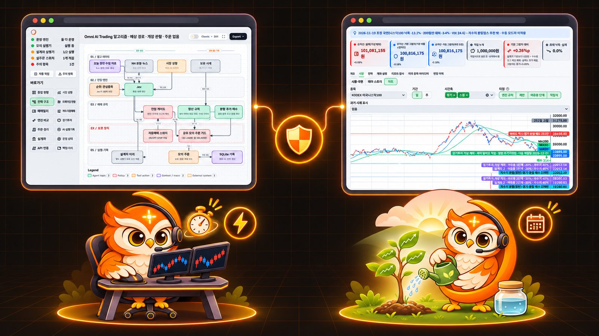
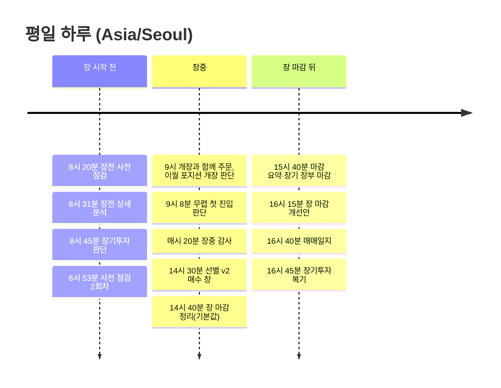
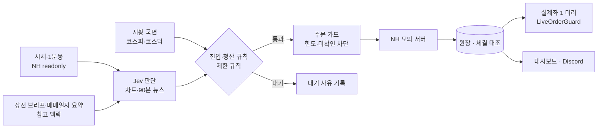
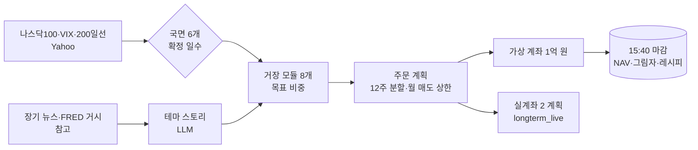
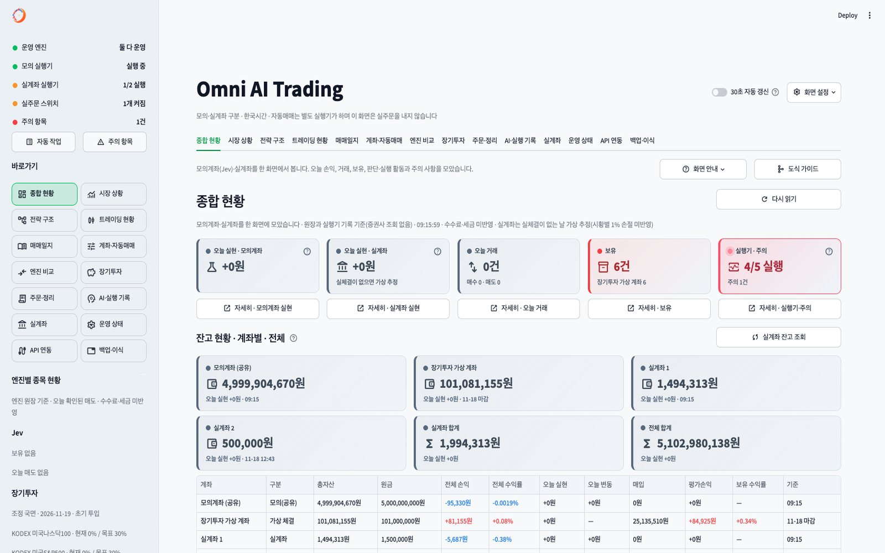
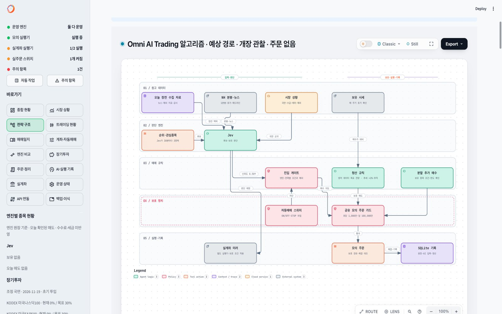

<p align="center">
  <a href="https://roadkwonai.github.io/omni-ai-trading/"></a>
</p>

<a id="omni-ai-trading"></a>
<h1 align="center">Omni AI Trading</h1>

<p align="center"><strong>AI가 시황을 읽고, 규칙과 가드 안에서 매매합니다.</strong></p>
<p align="center">국내 ETF·주식은 1분마다 차트와 뉴스로 판단하고, 미국 ETF는 거장 전략으로 천천히 모읍니다.<br>모든 판단·주문·체결은 원장과 대시보드, 매일의 매매일지에 남습니다.</p>

<p align="center">
  <a href="https://roadkwonai.github.io/omni-ai-trading/"><strong>소개 페이지 보기 →</strong></a>
</p>

<p align="center">
  <a href="LICENSE"></a>
  
  
  
  
  
  
  
</p>

<p align="center">
  <a href="#두-엔진">두 엔진</a> &middot;
  <a href="#기능-한눈에">기능</a> &middot;
  <a href="#하루-흐름">하루 흐름</a> &middot;
  <a href="#동작-구조">동작 구조</a> &middot;
  <a href="#빠른-시작">빠른 시작</a> &middot;
  <a href="#대시보드">대시보드</a> &middot;
  <a href="#안전-장치">안전 장치</a> &middot;
  <a href="docs/README.md">가이드 문서</a> &middot;
  <a href="#라이선스">라이선스</a>
</p>

---

[Vibe-Trading](README_upstream.md)(HKUDS, MIT) 위에 국내 시장 자동매매와 미국 ETF 장기투자를 더한 확장입니다. NH투자증권 나무 PLUG OpenAPI로 시세를 읽고 주문하며, 판단은 AI가 하지만 주문은 승인된 규칙과 주문 가드가 정합니다.

> [!IMPORTANT]
> 기본은 **모의계좌**입니다. 실계좌는 계좌마다 실주문 스위치(확인 문구), 실행 플래그 `--execute`, 하루 손실 한도(계좌별 최대 2만 원)를 모두 거쳐야 주문합니다. NH투자증권과 제휴·후원 관계가 없는 비공식 프로젝트이며 투자 조언이 아닙니다.

## 두 엔진

<table>
<tr>
<td width="50%" valign="top">
<p align="center"></p>

### Jev 실시간 트레이딩

국내 ETF·주식을 **장중 1분마다** 판단합니다. 공유 모의계좌 실행기가 NH 시세와 1분봉을 읽고, Jev가 차트 이미지와 최근 90분 뉴스로 후보를 고릅니다.

- 진입 3경로(Jev 후보 · 관심종목 강도 · 신규상장)와 병렬 전략 슬롯
- 분할 매수, 보유량·시황에 맞춘 비중, 국면별 손절·익절
- 인버스는 모든 신호가 폭락을 가리킬 때만, 비폭락일은 빠른 익절
- 시장 폭락일의 낙폭과대 **선별 v2** 분할 진입·분할 익절
- 실계좌 1은 모의 체결을 비율대로 따라 합니다

[매매 전략](docs/strategy.md) · [낙폭과대](docs/oversold.md) · [실계좌](docs/live-accounts.md)
</td>
<td width="50%" valign="top">
<p align="center"></p>

### 장기투자

국내 상장 미국 지수·테마 ETF를 **천천히** 모읍니다. 매일 아침 나스닥100 낙폭·200일선·VIX로 국면 6개 중 하나를 정하고, 거장 모듈 8개가 목표 비중을 조정합니다.

- 코어 60 · 위성 25 · 저수지 15, 대상 ETF 6종
- 보글·달리오·막스·버핏·린치·윌리엄스·여운봉 관점의 모듈
- 적립식 v3: 언제·얼마나를 거장 자동 또는 내가 정하기
- **여운봉 저수지 매매법**: 전고점 대비 단계 매수와 70:30 리밸런싱
- 가상 1억 원 계좌·레시피 비교로 먼저 검증, 실계좌 2는 계획부터

[장기투자](docs/longterm.md) · [적립식](docs/longterm-dca.md) · [여운봉 매매법](docs/yeo-method.md)
</td>
</tr>
</table>

> [!NOTE]
> 두 엔진은 대시보드 **계좌·자동매매 → 운영 엔진**에서 따로 켜고 끕니다. Jev를 끄면 새 진입만 멈추고 보유 손절·익절·정리는 계속합니다.

## 기능 한눈에

| 묶음 | 하는 일 | 가이드 |
| --- | --- | --- |
| 실시간 매매 | 1분 회차, 진입 3경로, 분할 매수, 청산 프로필, 인버스 관문, 신중 재진입, 제한 규칙 스위치 | [매매 전략](docs/strategy.md) |
| 낙폭과대 | 장중 반등(시장 폭락일만), 선별 v2(14:30~14:55 분할 진입, −2% 손절 뒤 저점 재매수), 10년 사례집·재현 기록 | [낙폭과대](docs/oversold.md) |
| 실계좌 | 실계좌 1 Jev 미러(금액 비례·체결별 고정), 실계좌 2 장기투자, 실주문 스위치, 수동 매수·매도 요청 | [실계좌](docs/live-accounts.md) |
| 장기투자 | 국면 판정, 거장 모듈, 12주 분할 투입, 계좌별 전략·수치, 레시피 비교, 시장 온도, 거시 배경 | [장기투자](docs/longterm.md) |
| 적립식 | 거장·수동 투자, 매수 시각, 금액·N주, 종목·수량 제한, 미체결 재매수 | [적립식](docs/longterm-dca.md) |
| 여운봉 매매법 | 저수지에서 단계 매수, 70:30 짝 리밸런싱, 못 산 몫 넘기기 | [여운봉 매매법](docs/yeo-method.md) |
| NXT 종가매매 | 강세장 애프터마켓 종가매매를 가상 체결로 학습 | [NXT](docs/nxt.md) |
| 기록·리포트 | 매매일지(일·월·분기·반기·년), 장 마감 개선안, 장전 분석, HTML 리포트 발행 | [매매일지](docs/journal.md) · [장전 분석](docs/premarket.md) · [리포트 발행](docs/report-pages.md) |
| 알림 | Discord 실시간·장기 채널, 매도 손익, 15:40 마감 요약, 리포트 링크 | [알림](docs/notifications.md) |
| 운영 자동화 | launchd 서비스 17개, 예약 작업, 장전 사전 점검, 매시 장중 감사, 문제 이력 | [운영](docs/operations.md) · [자동 작업](docs/automation.md) |
| 대시보드 | Streamlit 14개 탭, 상태 카드, 가이드 팝업, Archify 흐름도 | [대시보드](docs/dashboard.md) |
| 백업·이식 | 설정 정리본 git 보관, 전체 백업, 새 계정·세션 복원 절차 | [이식](docs/portability.md) |

<p align="center"></p>

## 하루 흐름

평일 한국 시간 기준이며, 정리 시각 등은 설정·휴장일·시장 일정에 따라 달라집니다.



## 동작 구조

<details>
<summary><strong>Jev 실시간 한 회차가 주문이 되는 과정</strong></summary>



매 회차 증권사 잔고·주문을 원장과 먼저 맞춰 보고, 어긋나면 주문하지 않고 멈춥니다.
</details>

<details>
<summary><strong>장기투자 엔진의 하루</strong></summary>


</details>

자세한 구성 요소와 데이터 위치는 [동작 구조](docs/architecture.md)에 있습니다.

## 빠른 시작

Python 3.11, Node.js 22 이상, NH 나무 PLUG 앱 키(모의투자 계좌 포함)가 필요합니다. 서비스 일정은 macOS launchd 기준입니다.

```bash
git clone https://github.com/roadkwonai/omni-ai-trading.git
cd omni-ai-trading
python3.11 -m venv .venv
.venv/bin/pip install -e . -r requirements-nh.txt
cp .env.example .env && chmod 600 .env   # 키 이름은 .env.example 참고, 값은 출력하지 않습니다
```

| 다음 단계 | 명령·문서 |
| --- | --- |
| NH 공식 MCP 연결 | [시작하기](docs/getting-started.md) |
| 시세 연결 확인 | `PYTHONPATH=agent:scripts .venv/bin/python scripts/vibe_market_brief.py` |
| 대시보드 | `.venv/bin/streamlit run streamlit_namuh/app.py --server.address 127.0.0.1` |
| 서비스 정의 생성 | `PYTHONPATH=agent:scripts .venv/bin/python scripts/launchd_services.py --out ~/vibe-launchd` |
| 테스트 | `PYTHONPATH=agent:scripts .venv/bin/python -m pytest -q scripts streamlit_namuh` |

<details>
<summary><strong>AI 에이전트에게 설치 맡기기 (Claude Code · Codex)</strong></summary>

처음 설치할 때:

```text
이 저장소의 docs/getting-started.md를 따라 Python 환경과 NH 공식 MCP를 설치하고,
.env.example을 복사해 .env를 만든 뒤 내가 넣을 키 항목을 알려줘. 키 값은 출력하지 마.
nhplug_readonly·nhplug_paper 연결과 ETF 시세 조회까지 확인하고, 서비스는 plist만 만들어 보여줘.
모의 주문 서비스 등록은 내가 승인한 뒤에 해줘.
```

이미 설치된 환경에서 새 세션을 시작할 때:

```text
이 저장소의 AGENTS.md와 docs/README.md, docs/operations.md를 읽고, 서비스 상태·오늘 판단·체결·미확인 주문을
조회만 해서 한국시간으로 보고해줘. 주문·재시작·설정 변경은 내가 요청할 때만 해줘.
```

다른 Claude 계정이나 새 컴퓨터로 옮길 때는 `ops-bootstrap` 스킬과 [이식 가이드](docs/portability.md)를 따릅니다.
</details>

> [!TIP]
> 대시보드나 직접 API로 공유 모의계좌에 주문하지 마세요. 실행기가 원장 불일치로 멈춥니다. 정리는 대시보드의 [정리 요청](docs/operations.md)을 씁니다.

## 대시보드

<p align="center"></p>

로컬에서만 여는 Streamlit 대시보드입니다. 화면은 보기와 설정만 하고 실주문을 직접 내지 않습니다(정리·수동 매수 요청은 실행기가 보호 경로로 처리).

<table>
<tr>
<td width="50%"><br><sub><strong>종합 현황</strong> · 계좌별 오늘 손익·잔고·실행기 상태</sub></td>
<td width="50%"><br><sub><strong>전략 구조</strong> · 오늘 설정이 반영된 Archify 흐름도</sub></td>
</tr>
<tr>
<td><br><sub><strong>매매일지</strong> · 계좌 성과, 시장·수급, 이슈 별점</sub></td>
<td><br><sub><strong>장기투자 차트</strong> · 이동평균선, 엔진 타점, 적립식·여운봉 단계</sub></td>
</tr>
</table>

종합 현황 · 시장 상황 · 전략 구조 · 트레이딩 현황 · 매매일지 · 계좌·자동매매 · 엔진 비교 · 장기투자 · 주문·정리 · AI·실행 기록 · 실계좌 · 운영 상태 · API 연동 · 백업·이식, 14개 탭입니다. [대시보드 가이드](docs/dashboard.md)

## 안전 장치

<table>
<tr>
<td width="200" valign="top"></td>
<td valign="top">

| 구분 | 한도 |
| --- | --- |
| 공유 모의계좌 | 회당 매수·하루 매수·보유 금액·하루 새 종목·하루 손실을 대시보드에서 범위 안으로 설정 |
| 실계좌 | 운용금(잔고 안에서) · 하루 손실 계좌별 최대 2만 원 · 1주 가격 상한 · 하루 새 종목 5 · 미체결·미확인 차단 |
| 공통 | 계좌 소유 확인 · KRX 장 시간 · 원장 대조 뒤에만 주문 · STOP·HALT로 즉시 중단 |

실계좌는 **관찰 → 가상 실행 → 보호된 실주문** 순서로만 엽니다. [안전 장치](docs/safety.md) · [실계좌](docs/live-accounts.md)
</td>
</tr>
</table>

> [!WARNING]
> 키와 계좌번호는 `.env`에만 둡니다. 화면·기록·리포트·알림은 계좌번호를 가리고, 저장소에는 키·런타임 원장(`~/.vibe-trading`)이 들어가지 않습니다.

## 가이드 문서

[전체 문서 지도 →](docs/README.md)

| 목적 | 바로가기 |
| --- | --- |
| 설치·설정 | [시작하기](docs/getting-started.md) · [설정 레퍼런스](docs/configuration.md) · [이식](docs/portability.md) |
| 구조·화면 | [동작 구조](docs/architecture.md) · [대시보드](docs/dashboard.md) |
| Jev 실시간 | [매매 전략](docs/strategy.md) · [낙폭과대](docs/oversold.md) · [NXT](docs/nxt.md) · [실계좌](docs/live-accounts.md) · [안전 장치](docs/safety.md) |
| 장기투자 | [장기투자](docs/longterm.md) · [적립식](docs/longterm-dca.md) · [여운봉 매매법](docs/yeo-method.md) |
| 기록·알림 | [매매일지](docs/journal.md) · [장전 분석](docs/premarket.md) · [리포트 발행](docs/report-pages.md) · [알림](docs/notifications.md) |
| 운영 | [운영](docs/operations.md) · [자동 작업](docs/automation.md) · [FAQ](docs/faq.md) |
| 원본 Vibe-Trading | [README (English)](README_upstream.md) · [한국어](README_ko.md) |

## 개발

| 위치 | 내용 |
| --- | --- |
| `scripts/` | 실행기·전략·원장·장기 엔진·리포트·알림 |
| `streamlit_namuh/` | 대시보드 |
| `agent/src/tools/nhplug_*.py` | 주문 가드(모의·실계좌) |
| `landing/` | GitHub Pages 소개 페이지(Vite + React, 대시보드와 별도) |
| `.claude/skills/` | 프로젝트 스킬(매매일지·장기 리포트·리포트 발행·대시보드 검증 등) |

테스트는 [빠른 시작](#빠른-시작)의 명령으로 돌립니다. 기여할 때 키·계좌번호·런타임 원장을 커밋하지 마세요(`.gitignore`가 막습니다).

## 라이선스

원본 [Vibe-Trading](https://github.com/HKUDS/Vibe-Trading)(HKUDS)의 [MIT LICENSE](LICENSE)와 [NOTICE](NOTICE)를 유지합니다. `scripts/nhplug-*.patch`는 NH투자증권의 [nhplug-mcp](https://github.com/PLUG-OpenAPI/nhplug-mcp)(MIT)를 수정합니다. '나무(Namuh)'·'PLUG'는 NH투자증권의 서비스 이름이며 연동 대상을 설명하려고만 씁니다.

> [!CAUTION]
> 이 소프트웨어는 투자 조언이 아니며 수익을 보장하지 않습니다. 모의 성과와 가상 체결은 실제 체결이나 수익성 검증이 아닙니다. 실계좌 사용에 따른 손실은 사용자 책임입니다.
