<p align="center">
  <a href="https://roadkwonai.github.io/omni-ai-trading/">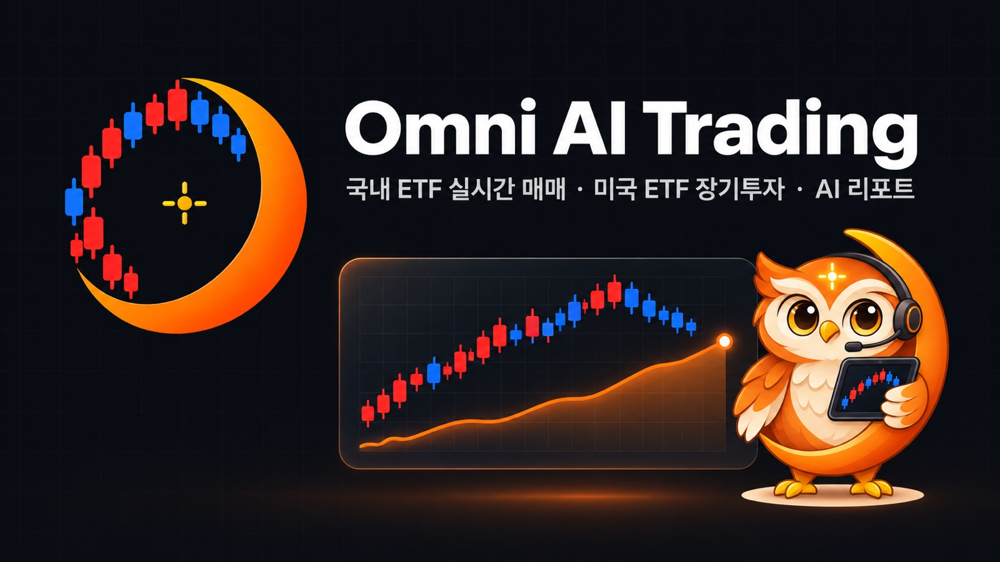</a>
</p>

<a id="omni-ai-trading"></a>
<h1 align="center">Omni AI Trading</h1>

<p align="center"><strong>AI와 시장을 읽고, 단기 매매와 노후를 위한 장기투자 기준을 세웁니다.</strong></p>
<p align="center">Jev는 차트·뉴스·수급을 함께 읽어 장중 후보와 대기 이유를 보여 줍니다.<br>장기 엔진은 거장의 투자 원칙을 참고해 국내 상장 미국 ETF의 적립·비중 조정 계획을 세웁니다.<br>Claude Code·Codex로 운영을 점검하고, 매매일지에서 판단과 체결을 돌아볼 수 있습니다.</p>

<p align="center">
  <a href="https://roadkwonai.github.io/omni-ai-trading/"><strong>소개 페이지 보기 →</strong></a> &nbsp;&middot;&nbsp;
  <a href="https://roadkwonai.github.io/omni-ai-trading/reports/"><strong>리포트 목록 보기 →</strong></a> &nbsp;&middot;&nbsp;
  <a href="https://github.com/roadkwonai/omni-ai-trading/releases"><strong>릴리스 노트 →</strong></a> &nbsp;&middot;&nbsp;
  <a href="https://youtu.be/c4FZw6AYRAg"><strong>소개 영상 보기 →</strong></a>
</p>

<a id="서비스-소개-영상"></a>
<p align="center">
  <a href="https://youtu.be/c4FZw6AYRAg">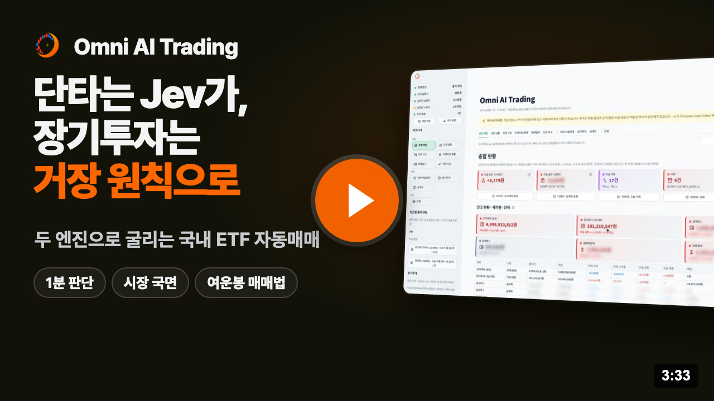</a>
</p>
<p align="center"><sub><strong>서비스 소개 영상 · 3분 33초</strong> — 두 엔진, AI는 의견·규칙이 주문, 종합 현황, Jev 실시간 판단, 안전장치, 장기투자, 복기와 리포트를 실제 화면으로 보여 줍니다. 실계좌 금액은 가렸습니다.</sub></p>

<details>
<summary><strong>영상 챕터</strong> (누르면 그 장면부터 재생)</summary>

| 시각 | 내용 |
| --- | --- |
| [0:00](https://youtu.be/c4FZw6AYRAg?t=0) | 왜 망설이면 지는가 |
| [0:15](https://youtu.be/c4FZw6AYRAg?t=15) | 왜 AI인가 — 개인 투자자의 숫자 |
| [0:36](https://youtu.be/c4FZw6AYRAg?t=36) | 시스템 한눈에 — 두 엔진, AI는 의견·규칙이 주문 |
| [1:01](https://youtu.be/c4FZw6AYRAg?t=61) | 종합 현황 대시보드 |
| [1:24](https://youtu.be/c4FZw6AYRAg?t=84) | Jev 실시간 판단과 진입 관문 |
| [1:49](https://youtu.be/c4FZw6AYRAg?t=109) | 안전장치 — 여러 겹의 가드와 실주문 스위치 |
| [2:18](https://youtu.be/c4FZw6AYRAg?t=138) | 장기투자 — 국면 판단과 여운봉 저수지 매매법 |
| [2:45](https://youtu.be/c4FZw6AYRAg?t=165) | 복기와 리포트 — 매매일지·장 마감 개선안 |
| [3:08](https://youtu.be/c4FZw6AYRAg?t=188) | AI와 함께 운영 — 예약 작업과 대화 |
| [3:22](https://youtu.be/c4FZw6AYRAg?t=202) | 마무리 |

</details>

<p align="center">
  <a href="https://github.com/roadkwonai/omni-ai-trading/releases/tag/v0.1.5"></a>
  <a href="LICENSE"></a>
  
  
  
  
  
  
  
</p>

<p align="center">
  <a href="#서비스-소개-영상"><strong>소개 영상</strong></a> &middot;
  <a href="#왜-ai로-투자해야-할까요"><strong>왜 AI인가</strong></a> &middot;
  <a href="#누구나-노후를-준비할-수-있도록">노후 준비</a> &middot;
  <a href="#claude-codecodex로-운영합니다">AI로 운영</a> &middot;
  <a href="#바로-설치하기"><strong>바로 설치하기</strong></a> &middot;
  <a href="#바로가기">바로가기</a> &middot;
  <a href="#핵심-특징">핵심 특징</a> &middot;
  <a href="#투자-철학과-기법">투자 철학</a> &middot;
  <a href="#두-엔진과-적립식">두 엔진과 적립식</a> &middot;
  <a href="#매일의-감사와-리포트">리포트</a> &middot;
  <a href="#기반-기술">기반 기술</a> &middot;
  <a href="#연동-서비스">연동</a> &middot;
  <a href="#주요-기능">주요 기능</a> &middot;
  <a href="#운영-일정과-자동화">운영 일정</a> &middot;
  <a href="#동작-구조">동작 구조</a> &middot;
  <a href="#알고리즘">알고리즘</a> &middot;
  <a href="#빠른-시작">빠른 시작</a> &middot;
  <a href="#ai와-함께-쓰기">AI와 함께 쓰기</a> &middot;
  <a href="#대시보드">대시보드</a> &middot;
  <a href="#ai-검색">AI 검색</a> &middot;
  <a href="#안전장치">안전장치</a> &middot;
  <a href="docs/README.md">가이드 문서</a> &middot;
  <a href="#투자-유의사항-및-면책-고지">투자 유의사항</a> &middot;
  <a href="#라이선스">라이선스</a>
</p>

---

[HKUDS Vibe-Trading](https://github.com/HKUDS/Vibe-Trading)(MIT) 위에 국내 시장 자동매매와 미국 ETF 장기투자를 더한 확장입니다([기반 기술](#기반-기술)). NH투자증권 나무 PLUG OpenAPI로 시세를 읽고 주문하며, 판단은 AI가 하지만 주문은 승인된 규칙과 주문 가드가 정합니다.

> [!CAUTION]
> **투자 유의사항** · 모든 정보는 투자 판단을 위한 참고 자료이며 투자 권유가 아닙니다. 투자의 최종 판단과 손익(원금 손실 포함)의 책임은 투자자 본인에게 있습니다. AI 판단과 모의·가상 결과는 미래 수익을 보장하지 않으며, 금융투자상품은 원금 손실(0~100%)이 생길 수 있습니다. 전체 내용은 [투자 유의사항 및 면책 고지](#투자-유의사항-및-면책-고지)를 꼭 읽어 주세요.

> [!IMPORTANT]
> **AI 도구 유료 이용이 필요합니다.** 이 서비스는 AI 도구와 함께 쓰는 AI 트레이딩 시스템입니다. 설치·운영·리포트 작성에 Claude Code나 Codex 같은 AI 코딩 에이전트가 필요하고, 이를 쓰려면 해당 서비스의 유료 요금제(Claude Pro·Max 또는 ChatGPT Plus·Pro 같은 구독, 또는 API 사용료)가 필요합니다. 매매 판단에 쓰는 Jev·OpenAI API도 각 서비스의 이용 조건과 요금을 따릅니다.
>
> 기본은 **모의계좌**입니다. 실계좌는 계좌마다 실주문 스위치(확인 문구), 실행 플래그 `--execute`, 하루 손실 한도(계좌별 최대 2만 원)를 모두 거쳐야 주문합니다.

## 왜 AI로 투자해야 할까요

### 누구나 노후를 준비할 수 있도록

한국의 노후 소득 격차는 큽니다. 금융 정보를 접할 기회가 많아졌어도 자신의 상황을 점검하고 오래 지킬 계획을 만드는 데는 도움이 필요합니다.

| 무엇을 조사했나 | 확인한 결과 |
| --- | --- |
| 노후 소득 격차 | OECD 2025년 보고서에서 66세 이상 상대적 소득 빈곤율은 한국 39.7%, OECD 평균 14.8%였습니다. 가구 규모를 보정한 가처분소득이 자국 중위값의 절반 미만인 비율입니다. [OECD 비교표](https://www.oecd.org/en/publications/pensions-at-a-glance-2025_e40274c1-en/full-report/old-age-income-poverty_3cd946d7.html) |
| 금융이해력과 실천 | OECD/INFE 2023년 보고서에서 금융이해력 목표선인 70점에 도달한 비율은 한국 48%, 조사에 참여한 OECD 회원국 평균 39%였습니다. 별도로 한국은행·금융감독원의 2024년 국내 조사에서 성인 평균은 65.7점이었고, 재무상황 점검은 43.4점, 장기 재무목표 설정은 42.5점이었습니다. 뒤의 두 수치는 항목별 점수입니다. [OECD/INFE 국제조사, 그림 2.2](https://www.oecd.org/content/dam/oecd/en/publications/reports/2023/12/oecd-infe-2023-international-survey-of-adult-financial-literacy_8ce94e2c/56003a32-en.pdf) · [국내 조사](https://www.bok.or.kr/portal/bbs/B0000502/view.do?menuNo=201265&nttId=10091152) · [금융위원회 참고표](https://www.fsc.go.kr/comm/getFile?fileNo=8&fileTy=ATTACH&srvcId=BBSTY1&upperNo=87218) |
| 노후 준비 방법 | 국가데이터처의 2025년 사회조사에서 19세 이상 71.5%가 노후를 준비하고 있거나 준비되어 있다고 답했습니다. 준비한 사람이 주된 방법으로 가장 많이 꼽은 것은 국민연금이었습니다. [2025년 사회조사](https://www.kostat.go.kr/board.es?act=view&bid=219&list_no=439196&mid=a10301060100) |

금융위원회의 상담 사례에서는 수입이 불규칙한 프리랜서의 지출과 비상자금 계획을, 대출 상환 부담이 큰 직장인의 현금 흐름을 먼저 살폈습니다. 연금·고용과 개인의 재무 여건은 노후 준비에 함께 영향을 줍니다. Omni가 맡는 부분은 사용자가 투자에 배정한 자금의 운영과 기록입니다. [국내 재무상담 사례](https://www.fsc.go.kr/no010101/87218) · [OECD 한국 보고서](https://www.oecd.org/en/publications/pensions-at-a-glance-2025-country-notes_8a53ef12-en/korea-republic-of_5cd52913-en.html)

**Omni의 최종 목표는 투자 경험이나 시간이 부족한 사람도 AI로 시장을 배우고, 평생 이어 갈 투자 원칙을 세워, 더 여유롭고 안정적인 노후를 준비하도록 돕는 것입니다.** 오늘은 Jev와 모의매매로 무엇을 보고 왜 기다리는지 배우고, 길게 운용하기로 한 자금은 적립과 비중 조정의 기준을 정해 꾸준히 관리할 수 있습니다. 성과를 알기 위해서는 모의·가상 결과와 실제 체결 및 비용을 구분해 봐야 합니다. [장기투자](docs/longterm.md#왜-장기투자를-별도로-설계했나) · [매매일지](docs/journal.md)

장중 매매를 배우려면 Jev가 후보를 골랐거나 기다린 이유를 한 회차씩 살펴보세요. 중장기 운용부터 보고 싶다면 장기 엔진의 가상 장부에서 목표 비중과 적립 계획이 어떻게 달라지는지 비교할 수 있습니다. [목적별 첫 사용 경로](docs/README.md#목적에-따라-시작하기)

### 시장을 읽고 투자 원칙을 지키는 일

장중에는 차트와 호가뿐 아니라 거래량, 외국인·기관 수급, 테마, 뉴스, 해외 시장을 함께 봐야 합니다. 자료를 찾는 동안 가격이 바뀌고, 일하면서 이 과정을 매일 반복하기도 어렵습니다. 종목을 잘 골랐어도 매수·매도 기준을 즉흥적으로 바꾸거나 거래가 잦아지면 수익을 내고 지키기 더 어려워집니다.

두 연구는 개인 투자자의 매매 습관에서 이 문제를 관찰했습니다. Odean은 이익이 난 종목을 더 쉽게 팔고 손실 종목을 오래 보유하는 경향을 발견했습니다. Barber와 Odean의 1991~1996년 미국 가구 표본에서는 가장 자주 거래한 집단의 연수익률이 11.4%, 같은 기간 시장 수익률은 17.9%였습니다. [Odean의 손익 실현 연구](https://faculty.haas.berkeley.edu/odean/Papers%20current%20versions/AreInvestorsReluctant.pdf) · [Barber·Odean의 거래 빈도 연구](https://faculty.haas.berkeley.edu/odean/papers%20current%20versions/individual_investor_performance_final.pdf)

**Omni를 만든 이유는 개인이 시장 정보를 해석하고, 세운 원칙을 지키고, 결과를 돌아보는 일을 매일 반복할 수 있게 하려는 것입니다.** 차트 이미지와 뉴스의 맥락을 함께 읽는 Jev를 이용해, 전문 트레이더가 살피는 여러 종류의 자료를 개인도 한 회차에 확인할 수 있게 했습니다. 실행기는 진입 조건, 주문 크기, 손절·익절과 계좌 보호 기준을 확인합니다. Claude Code·Codex는 흩어진 판단·주문·체결 기록을 읽고 장 마감 복기를 돕습니다.

| 투자자가 겪는 일 | Omni에서 확인하는 과정 |
| --- | --- |
| 급등하는 종목을 뒤늦게 따라 삽니다. | 거래대금·수급·테마로 후보를 좁히고, Jev 판단과 진입 제한을 확인합니다. 기다린 이유도 남깁니다. |
| 손절을 미루거나 하락 종목의 비중을 계획보다 키웁니다. | 진입·추가 매수 조건과 청산 규칙을 회차마다 확인합니다. 손실 차단 기준에 닿으면 신규 매수를 제한합니다. |
| 조금 오르자마자 팔거나 판 뒤에야 이유를 찾습니다. | 적용한 청산 규칙에 따라 분할 익절이나 추적 청산을 검토하고, 실제 주문·체결과 이후 가격을 일지에서 비교합니다. |
| 차트 앞에 오래 있기가 어렵습니다. | 장기 엔진에서 목표 비중, 적립, 비중 조정을 관리하고 장기 전략 리포트에서 계획과 결과를 확인합니다. |

조건을 확인해도 주문과 체결에는 지연이나 실패가 생길 수 있습니다. 시스템은 판단, 주문 접수, 체결을 각각 기록합니다. [Jev 매매 전략](docs/strategy.md) · [주문 보호와 대조](docs/safety.md) · [매매일지](docs/journal.md)

## Claude Code·Codex로 운영합니다


Omni AI Trading은 내려받아 실행하는 앱이 아니라 **AI 코딩 에이전트와 함께 쓰는 트레이딩 시스템**입니다.

| 단계 | 하는 일 |
| --- | --- |
| **1. 설치는 AI 에이전트가 해 줍니다** | Claude Code나 Codex를 열고 [설치 프롬프트](#바로-설치하기)를 붙여 넣으면, 에이전트가 **저장소·가상환경·NH MCP·스킬 연결까지** 알아서 설치합니다. 키를 넣거나 주문과 관련된 단계에서는 멈추고 확인을 받습니다 |
| **2. 운영은 대화로 합니다** | "오늘 왜 안 샀어?", "손절을 1.5%로 바꾸면 뭐가 달라져?"처럼 물으면 **기록을 읽고 근거와 함께** 답합니다. 설정은 사용자가 승인한 것만 바뀝니다 |
| **3. 반복 업무는 예약 작업이 맡습니다** | 사람이 자리를 비워도 **예약 작업 15개**가 08:25 장전 점검, 08:31 장전 상세 분석, 매시 20분 장중 감사, 16:15 장 마감 개선안, 16:40 매매일지, 장기투자 전략 리포트와 복기를 씁니다 |

> [!IMPORTANT]
> **실제 주문은 채팅이 아니라 실행기가 주문 가드를 거쳐 실행합니다.** AI 에이전트는 질문에 답하고 분석하며 기록을 남기고, 설정 변경과 실주문은 사람이 승인한 것만 반영됩니다. 자세한 사용법은 [AI와 함께 쓰기](#ai와-함께-쓰기)에 있습니다.

<br clear="right">

## 바로 설치하기

> [!NOTE]
> 공개 v0.1.3과 v0.1.4에는 Jev 모의 실행에 필요한 Python 모듈이 빠져 있습니다. 해당 공개 버전으로 시작한다면 [설치 후 확인](docs/getting-started.md#공개-v013-설치-후-확인)을 먼저 읽어 주세요.

AI 코딩 에이전트에게 설치를 맡기는 것이 가장 빠릅니다. 준비물은 macOS, Python 3.11, Node.js 22 이상, NH 나무 PLUG 앱 키(모의투자 계좌 포함), 그리고 [Claude Code](https://github.com/anthropics/claude-code) 또는 [Codex](https://github.com/openai/codex) 중 하나입니다. **Claude Code는 Claude 유료 요금제(Pro·Max) 또는 API 사용료, Codex는 ChatGPT 유료 요금제(Plus·Pro 등) 또는 API 사용료가 필요합니다.**

**1. 에이전트를 설치하고, 저장소를 받아 엽니다.**

```bash
npm install -g @anthropic-ai/claude-code   # Codex를 쓰면: npm install -g @openai/codex
git clone https://github.com/roadkwonai/omni-ai-trading.git
cd omni-ai-trading
claude                                     # Codex를 쓰면: codex
```

**2. 아래 프롬프트를 그대로 붙여 넣습니다.** 에이전트가 설치를 진행하고, 키 입력과 주문 관련 단계에서는 멈춰서 묻습니다.

```text
이 저장소는 Omni AI Trading(NH 나무 PLUG 모의·실계좌 자동매매)이다.
docs/getting-started.md와 docs/ai-agents.md를 읽고 그 순서대로 설치를 도와줘.
- 답변은 한국어, 시각은 Asia/Seoul로 쓴다.
- .env 값과 계좌번호는 출력하지 말고, 키는 내가 직접 넣게 키 이름만 안내해.
- Python 가상환경, NH 공식 MCP 설치·패치·빌드, agent.json 등록, vibe_market_brief.py 연결 확인까지 해 줘.
- docs/ai-agents.md의 템플릿으로 AGENTS.md와 CLAUDE.md를 만들고, 프로젝트 스킬과 vibe-trading MCP를 연결하고,
  .claude/settings.local.json에 읽기 전용 권한 4개를 넣어 줘.
- launchd 서비스는 plist를 만들어 보여 주기만 하고, 등록은 대시보드·읽기 전용 서비스부터 내가 승인한 것만 해.
- shared-etf-paper(모의 주문), 실계좌 서비스, 실주문 스위치, 장기 엔진 --execute는 켜지 마.
- 끝나면 있는 것과 없는 것(키 이름, 서비스, 스킬, MCP, 실패한 점검)을 표로 보고해.
```

**3. 설치가 끝나면 이렇게 시작합니다.**

```text
이 저장소의 AGENTS.md, docs/README.md, docs/operations.md를 읽고 지금 상태를 조회만 해서 보고해 줘.
서비스 상태, 오늘 판단·체결, 미확인 주문, 보유와 손익, 장기 엔진 상태를 한국시간으로.
주문·재시작·설정 변경은 내가 요청할 때만 해.
```

키는 사람이 `.env`에 직접 넣습니다. 모의 주문 서비스는 "모의 주문 켜"라고 승인해야 켜지고, 실계좌 실주문은 대시보드에서 확인 문구를 넣어야 켜집니다. 손으로 설치하려면 [빠른 시작](#빠른-시작), 예약 작업·스킬·기능별 프롬프트는 [AI와 함께 쓰기](#ai와-함께-쓰기)를 보세요.

## 바로가기

| 무엇 | 주소 |
| --- | --- |
| 소개 페이지(랜딩) | https://roadkwonai.github.io/omni-ai-trading/ |
| 리포트 목록 | https://roadkwonai.github.io/omni-ai-trading/reports/ |
| 릴리스 노트 | https://github.com/roadkwonai/omni-ai-trading/releases · 저장소 안 [`release/`](release/) |
| 저장소 | https://github.com/roadkwonai/omni-ai-trading |

리포트 목록은 장전 분석·매매일지·장 마감 개선안·장기투자 전략 리포트를 날짜순으로 모은 페이지입니다. 발행 구조는 [리포트 발행](docs/report-pages.md)을 보세요.

## 핵심 특징

Omni AI Trading은 **AI가 판단을 돕고, 사람이 승인한 규칙이 주문을 정하는** 개인용 AI 트레이딩 시스템입니다. 다른 자동매매 도구와 다른 점은 여섯 가지입니다.

| 특징 | 어떻게 하나 | 지키는 장치 |
| --- | --- | --- |
| **AI는 의견, 규칙이 주문** | Jev·OpenAI가 매수·대기·매도 의견과 신뢰도를 내고, 주문은 승인된 진입·청산 규칙과 주문 가드를 모두 통과해야 실행됩니다 | 진입 공통 확인, 주문 가드, "신뢰도는 수익 확률이 아님" |
| **성격이 다른 두 엔진** | 국내 ETF·주식을 1분마다 판단하는 Jev 실시간 트레이딩과, 미국 지수·테마 ETF를 거장 전략·적립식·여운봉 매매법으로 모으는 장기투자를 한 시스템에서 따로 켜고 끕니다 | 운영 엔진 스위치, 엔진별 장부 |
| **모의 먼저, 실계좌는 단계적으로** | 관찰 → 가상 실행 → 보호된 실주문 순서로 한 단계씩 넘어갑니다. 실계좌는 계좌마다 실주문 스위치와 하루 손실 한도(최대 2만 원)를 둡니다 | 실계좌 가드, STOP·HALT, 미확인 주문 차단 |
| **모든 판단을 기록하고 매일 돌아봄** | 판단 근거·주문·체결이 거래 기록에 남고, 장 마감 뒤 매매일지·개선안·신호 적중률·막힌 후보의 사후 결과가 쌓입니다. 개선안은 제안만 하고 사람이 승인해야 반영됩니다 | 거래 기록(SQLite), 설정 변경 이력 |
| **AI와 채팅으로 운영** | Claude Code·Codex에 말로 묻고 맡깁니다. 프로젝트 스킬 9개와 예약 작업 15개가 장전 분석·장중 감사·매매일지·장기 리포트를 씁니다 | 읽기 전용 실행기 `scripts/ro`, 승인 절차 |
| **내 컴퓨터에서, 내 키로** | macOS에서 로컬로 돌고, 키·계좌번호는 `.env`에만 둡니다. 화면·리포트·알림은 계좌번호를 가립니다 | 공개 저장소에 키·원장 없음 |

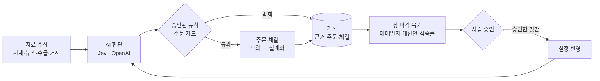

<table>
<tr>
<td width="50%" valign="top">

**이런 분께 맞습니다**

- NH 나무 PLUG 계좌로 국내 ETF·주식 자동매매를 모의계좌부터 실험하고 싶은 분
- AI의 판단 근거와 매매 기록을 남기며 전략을 매일 고쳐 가고 싶은 분
- Claude Code나 Codex를 쓰고, Mac을 장중에 켜 둘 수 있는 분
- 미국 지수 ETF 장기투자를 규칙대로 가상 계좌에서 먼저 검증하고 싶은 분

</td>
<td width="50%" valign="top">

**이런 분께는 맞지 않습니다**

- 설치 없이 바로 쓰는 앱이나 수익이 보장된 매매 신호를 찾는 분
- AI 도구 유료 이용이 어려운 분
- Windows·Linux에서 바로 쓰려는 분(launchd 대신 일정을 직접 구성해야 함)
- 남이 대신 판단·운용해 주기를 바라는 분(투자자문·투자일임이 아님)

</td>
</tr>
</table>

## 투자 철학과 기법

<p align="center"></p>

<h3 align="center">매수는 기술, 매도는 예술</h3>

<p align="center">사는 이유는 차트와 수급으로 설명할 수 있지만, 파는 순간에는 욕심과 공포가 끼어듭니다. 고점은 아무도 모르니까요.<br><strong>Omni는 매수 전에 정한 청산 기준을 장중에도 확인하도록 돕습니다.</strong></p>

| 매수 · 기술 | 매도 · 예술을 규칙으로 |
| --- | --- |
| **국면을 먼저 봅니다.** 코스피·코스닥을 상승장·횡보장·하락장으로 판정하고, 시장이 매수 방향과 다를수록 크기를 **0.75배, 0.5배**로 줄입니다 | **절반은 먼저 챙깁니다.** 방어형은 **+1%에 절반, +2%에 나머지**를 팝니다. 추세가 강하면 +2%에 절반을 팝니다 |
| **돈이 몰리는 곳을 찾습니다.** 거래대금·거래량·상승률 순위, 테마 대장주, 투자자·프로그램 순매수로 **오늘의 주도주 후보**를 추립니다 | **나머지는 추세를 따라갑니다.** 남은 수량은 **고점에서 1.5% 밀릴 때까지** 들고 갑니다. 2배 ETF는 폭을 1.5배로 넓힙니다 |
| **Jev가 매분 판단을 시도합니다.** 차트와 최근 뉴스, 시황과 수급을 보고 후보나 대기 의견을 냅니다 | **경로에 맞춰 남은 보유를 관리합니다.** 본전 보호를 사용하는 청산 규칙에서는 평균가를 기준으로 남은 수량을 정리합니다 |
| **규칙이 한 번 더 거릅니다.** 지수 방향, 5분 전보다 올랐는지, 최근 5분 거래량이 1.2배 이상인지 확인합니다. 인버스는 지수 하락이 이어지는지와 ETF 가격을 추격하는지 추가로 봅니다 | **손실에 대비해 청산 조건을 정합니다.** 일반 전략의 손절 폭은 기본 2%이며, 불리한 국면에서는 1%로 좁힙니다. 계좌별 하루 손실 차단 기준도 적용합니다 |
| **나눠 삽니다.** 한 번에 다 사지 않고, 직전보다 나은 조건일 때만 더 삽니다. 장 마감 30분 전부터는 추가 매수를 하지 않습니다 | **AI가 보유를 다시 봅니다.** 매분 보유 종목마다 AI 판단을 받아 확신이 크면 전량, 애매하면 33%만 팝니다. 산 뒤 하락장으로 바뀌면 절반을 줄입니다 |
| | **큰 추세는 다음 날까지 가져갑니다.** **조건 11개를 통과한 추세형만** 이월하고, 스윙 조건 6개를 매일 다시 확인해 최대 5거래일 들고 갑니다 |

**한 포지션의 일생**

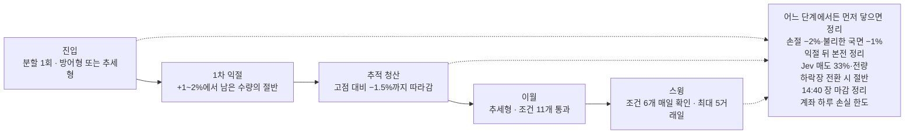

> [!TIP]
> **물타기 대신 분할, 버티기 대신 손절, 조급한 익절 대신 추적 청산.**

### Jev 트레이딩의 핵심: 수급과 시황으로 주도주를 공략합니다

**오늘 시장의 돈이 어디로 가는지 읽고 그 중심에 있는 종목을 공략하는 것**이 Jev 트레이딩의 핵심입니다. 시황에 따라 움직이는 방식도 달라집니다.

| 국면 | 이렇게 움직입니다 |
| --- | --- |
| ▲ 상승장 | 롱을 중심으로 사고 **추세형 포지션은 더 길게** 보유하며, 조건을 통과하면 이월·스윙까지 가져갑니다. 인버스는 관문에서 막힙니다 |
| ■ 횡보장 | 매수 크기 0.75배, 손절 −1%. 같은 날 다시 살 때는 추격 매수를 막고 AI에게 한 번 더 확인합니다. **대부분 그날 정리**합니다 |
| ▼ 하락장 | 롱은 매수 크기 0.5배, 손절 −1%이고 **물을 타지 않습니다.** 인버스 진입에는 시장·수급·가격과 모델 기준을 함께 적용하며, 진입 시 시장 낙폭에 따라 청산 목표가 달라집니다 |

지정학·해외 이슈는 별도 규칙이 아니라 90분 뉴스, 해외 선물·원자재·환율 입력으로 Jev 판단에 들어갑니다.

### 장기투자의 철학: 노후에 필요한 돈을 오늘부터 관리하는 방법

주식시장을 매일 이겨야 한다는 목표로는 몇 년, 몇십 년에 걸친 노후 준비를 이어 가기 어렵습니다. 노후처럼 긴 목표를 위해서는 언제 쓸 돈인지, 얼마를 꾸준히 모을지, 어느 정도의 변동을 감당할지부터 정해야 합니다. 시장이 급락하거나 특정 자산의 비중이 커졌을 때도 그 기준을 유지할 방법이 필요합니다. Omni에 장기투자를 핵심 기능으로 넣은 이유입니다. [자산 배분과 리밸런싱 안내](https://www.investor.gov/introduction-investing/getting-started/asset-allocation)

장기투자는 종목 선택 이후에도 할 일이 많습니다. 달리오의 비중 조정, 버핏·피셔의 저회전, 막스의 과열·투매 관점, 린치의 테마 점검은 같은 시장에서도 서로 다른 판단을 이끌어 냅니다. Omni는 공개된 원칙에서 가져온 아이디어를 비교 가능한 규칙으로 만들었습니다. 사용자는 가상 장부에서 각 방식이 언제 적립하고, 비중을 줄이고, 대기 자금을 투입하는지 살펴볼 수 있습니다.

장기 엔진은 매일 지표를 확인하고, 선택한 전략과 계좌 한도에 맞춰 **적립·보유·매도·리밸런싱** 계획을 계산합니다. AI는 테마 근거와 시장 자료를 읽고 결과 설명과 복기를 돕습니다. 매수와 매도는 설정한 규칙이 정합니다. 오른 자산을 줄이는 과정에서 일부 이익을 실현할 수 있고, 시장 국면이나 테마가 바뀌면 손익과 별개로 비중을 줄이는 경우도 있습니다. 이 구조가 장기 계획을 꾸준히 실행하고 돌아보는 데 도움을 줍니다. [장기투자](docs/longterm.md) · [적립식](docs/longterm-dca.md)

### 내 투자 스타일로 고르고, 기록으로 키웁니다

<p align="center"></p>

| 스타일 | 이런 분께 | 운용 | 켜는 곳 |
| --- | --- | --- | --- |
| **장기형** · 적립과 비중 관리 | 매일 차트를 보지 않고 오래 모으고 싶은 분 | 장기투자 + 적립식 | 운영 엔진 → 장기투자만 |
| **균형형** · 중심은 지키며 일부로 대응 | 자산의 중심은 지키며 시장 흐름에도 올라타고 싶은 분 | 장기투자 + Jev 트레이딩 | 운영 엔진 → 둘 다 운영. 실계좌는 계좌마다 엔진 선택 |
| **공격형** · 흐름을 적극적으로 | 주도주와 시장 흐름을 적극적으로 따라가고 싶은 분 | Jev 트레이딩만 | 운영 엔진 → Jev만. 진입 경로 빠른 선택 → 적극적 |
| **실험형** · 먼저 지켜보기 | 아직 확신이 없어 결과부터 보고 싶은 분 | 모의계좌·가상 계좌로만 | 기본값 그대로(실주문 스위치 꺼짐) |

키우는 법은 세 단계입니다. ① 진입 경로마다 보수적·기본·적극적·끄기 프리셋으로 시작하고, ② 장 마감 개선안·신호 적중률·사지 않은 후보의 사후 결과로 매일 복기하고, ③ 승인한 개선만 설정에 반영합니다. **시간이 지날수록 내 기록과 선택이 쌓여 나에게 맞는 시스템이 됩니다.**

### 관점은 JSON에, 경험은 SQLite에

**서버도 클라우드 DB도 없이 내 컴퓨터의 파일로 움직입니다.** 대시보드에서 바꾼 관점과 설정은 JSON으로, 매일의 판단과 체결은 SQLite로 남아 다음 판단의 근거가 됩니다.

| JSON · 관점과 설정 | SQLite · 경험과 학습 데이터 |
| --- | --- |
| `accounts.json` 계좌, 운용금, 주문 보호 한도, 실주문 스위치 | `trading-ledger` 판단·주문·체결 이벤트 원장 |
| `strategy-settings.json` 진입·익절·손절·이월 기준과 제한 규칙 스위치 | `market-research` Jev 입력과 판단 근거, 신호 적중률, 그림자 후보 |
| `tunables.json` 장 시간, 조회 주기 같은 운영 조정값 | `trading-journal` 일·월·분기·연 매매일지 |
| `vibe-longterm/settings.json` 장기투자 거장 모듈, 비중, 적립식 | `oversold-cases` 10년 일봉 낙폭 사례집 · `longterm` 장기투자 결정·순자산 · `settings-history` 모든 설정 변경 이력 |

### AI도 틀립니다. 그래서 매일 검증합니다

> [!WARNING]
> 첫 주(11/11\~11/17, 공유 모의계좌) Jev 진입 신호를 신뢰도 구간별로 5·15·30분 뒤 결과와 비교해 보니, **신뢰도가 높을수록 오히려 덜 맞았습니다**(0.6\~0.7 구간 72%, 0.7\~0.8 구간 56%, 0.8 이상 38%). 그래서 **신뢰도를 수익 확률로 쓰지 않고**, 손절과 하루 손실 한도를 늘 함께 두고, 장 마감마다 구간별 적중률을 다시 확인합니다.

## 두 엔진과 적립식

Omni AI Trading은 국내 시장을 장중에 읽는 **Jev 실시간 엔진**과 국내 상장 ETF의 목표 비중을 관리하는 **vibe 장기 엔진**으로 나뉩니다. 장기 엔진의 **적립식**은 새로 넣는 돈의 매수 주기, 규모와 대상을 관리합니다. 대시보드 **계좌·자동매매 → 운영 엔진**에서 실시간과 장기투자를 따로 켜고 끕니다.

### Jev 실시간 AI 트레이더


**사람 트레이더가 화면을 보듯, Jev는 1분 차트를 눈으로 읽습니다.** Jev는 TypeSafe의 이미지·선택형 판단 모델입니다. 국내 ETF와 주식을 장중 1분마다 보고 종목 하나(또는 대기)와 신뢰도를 고릅니다. 이 시스템에서는 진입, 보유, 관심종목, 낙폭과대, 재진입, 개장 판단까지 실시간 매매의 판단을 맡습니다.

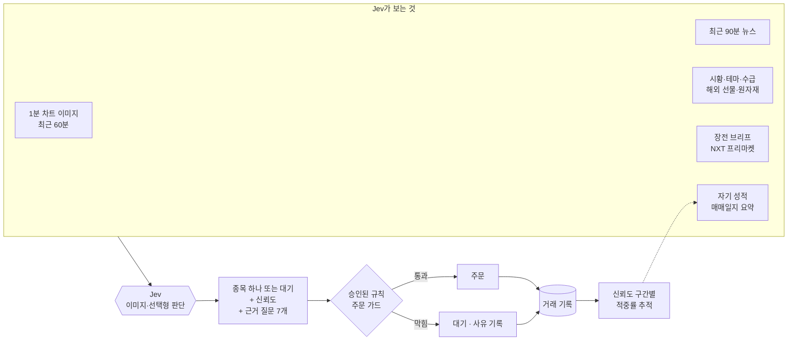

| Jev가 보는 것 | 내용 |
| --- | --- |
| 1분 차트 이미지 | ETF와 관심종목의 최근 60분 캔들을 그림으로 |
| 당일 요약 | 시가·고가·저가, 하루 범위 안 위치, VWAP, 30·60분 변화 |
| 최근 90분 뉴스 | 오래된 기사는 빼고 지금 시장을 움직이는 헤드라인만 |
| 시황과 수급 | 코스피·코스닥 국면, 테마와 대장주, 투자자·프로그램 순매수 |
| 해외와 장전 | 나스닥·S&P500 선물, 금·유가·환율, 장전 브리프와 NXT 프리마켓 |
| 자기 성적과 매매일지 | 최근 판단 성적, 3거래일 매매일지 요약, 『실전 시황 트레이딩』 점검 질문 |

| 맡는 판단 | 하는 일 |
| --- | --- |
| 진입 후보 | 매분 지금 살 만한 종목 하나 또는 대기 |
| 보유 판단 | 보유 종목마다 유지·매도. 신뢰도 0.7 이상이면 전량, 0.55\~0.7이면 33%만 |
| 관심종목 선정 | 30분마다 순위 후보의 재무·수급·뉴스를 보고 3종목 |
| 낙폭과대 리서치 | 시장 폭락일 후보를 차트·수급·애널리스트·과거 사례로 검토 |
| 재진입 재검토 | 그날 사고판 종목을 불리한 시장에서 다시 살 때 한 번 더 |
| 개장 이월 판단 | 전날 들고 온 종목을 09:00 개장 직후 다시 |

**믿고 쓸 수 있게 만든 장치**

- **선택형으로 답합니다.** 자유 문장이 아니라 종목 하나와 신뢰도로 답하므로 규칙으로 걸러 쓰기 쉽고, 엉뚱한 문장이 주문에 끼어들 틈이 없습니다.
- **근거를 함께 남깁니다.** 판단마다 결정 요인과 차트·뉴스·시황·수급 방향, 자료 충분성을 묻는 근거 질문 7개를 같이 보내 기록합니다. `scripts/jev_explain.py`로 "왜 샀나"를 다시 봅니다.
- **적중률을 매일 확인합니다.** 신뢰도 구간별로 5·15·30분 뒤 결과를 모아 장 마감 개선안에 싣습니다. 높은 신뢰도가 오히려 덜 맞은 구간도 그대로 보여 주고, 크기 조절의 근거로 씁니다.
- **주문은 규칙이 정합니다.** 신뢰도는 수익 확률이 아닙니다. 진입 공통 확인, 인버스 관문, 매수 크기, 주문 가드를 모두 통과해야 주문이 실행됩니다. OpenAI Decisions를 함께 켜면 두 모델이 다른 종목을 고른 회차는 사지 않습니다.

[매매 전략](docs/strategy.md) · [낙폭과대](docs/oversold.md) · [실계좌](docs/live-accounts.md)

### 거장의 안목, 장기투자


**시장의 계절을 읽고, 그 계절에 맞는 거장의 원칙으로 운용합니다.** 기준 비중을 켜면 국내 상장 ETF를 코어 60%, 위성 25%, 저수지 15%로 나눕니다. 매일 아침 나스닥100 낙폭, 200일선, VIX로 시장의 계절을 정하고, 켜 둔 거장 전략이 목표 비중을 조정합니다. 거장이 직접 운용하는 것이 아니라 공개된 원칙을 본뜬 규칙입니다.

| 시장의 계절 | 판정 | 그때 추천하는 거장 |
| --- | --- | --- |
| 투매 | VIX 35 이상 · 낙폭 −15% 이하 | 달리오 · 저수지 분할 · 막스 · 윌리엄스 단기 반등 · 린치 · 버핏·피셔 |
| 약세 | 낙폭 −20% 이하 또는 200일선 아래 하락 | 달리오 · 저수지 분할 · 막스 · 윌리엄스 추세 · 린치 · 버핏·피셔 |
| 조정 | 낙폭 −10% 이하 또는 200일선 아래 | 달리오 · 저수지 분할 · 린치 · 버핏·피셔 |
| 회복 | 하락 국면을 벗어나는 중 | 달리오 · 린치 · 버핏·피셔 |
| 과열 | 200일선 +15% 이상 · VIX 14 이하 | 달리오 · 막스 · 린치 · 버핏·피셔 |
| 강세 안정 | 그 밖의 상승장 | 달리오 · 린치 · 버핏·피셔 |

같은 판정이 10거래일(투매는 2거래일) 이어져야 계절이 바뀝니다. 화면은 국면마다 강력 추천·추천·비권장을 보여 주되, 켜고 끄는 것은 사람이 정합니다.

| 거장 전략 | 원칙 | 하는 일 | 기본 |
| --- | --- | --- | --- |
| 기준 비중 | 흔들리지 않는 바탕 | 코어 60 · 위성 25 · 저수지 15를 들고 감 | 켬 |
| 레이 달리오 | 벗어나면 되돌린다 | 매월 목표에서 ±5%p를 벗어나면 전체를 목표로 | 켬 |
| 피터 린치 | 스토리가 살아 있는가 | AI가 테마마다 유지·주의·훼손을 판정해 위성 비중 조정 | 켬 |
| 워런 버핏·필립 피셔 | 팔 이유가 없으면 들고 간다 | 손절 없음, 한 달 매도를 순자산 10%로 | 켬 |
| 하워드 막스 | 시장의 시계추를 거슬러 | 과열이면 코어를 덜고, 투매면 매수 단계를 앞당김 | 선택 |
| 저수지 분할 | 떨어질 때를 기다린 돈 | 나스닥100 고점 대비 −20%·−30%에서 저수지 투입 | 선택 |
| 래리 윌리엄스 · 추세 | 추세가 꺾이면 줄인다 | 테마 지수가 200일선 아래 5일이면 그 테마 절반 | 선택 |
| 래리 윌리엄스 · 반등 | 급락 뒤 짧은 반등 | 하루 −3%·VIX 25 이상이면 저수지 일부를 잠시 나스닥100에 | 선택 |

- **거장별 관점 리포트:** 매일 아침 보글·달리오·버핏·막스·린치·윌리엄스·여운봉 7명의 원칙으로 지금 시장을 읽고, "사기·기다리기·유지·덜기" 의견을 내고, 엔진 판단과 같은지 다른지를 씁니다.
- **시장 온도와 거시 배경:** VIX·200일선·낙폭·하이일드 스프레드로 공포와 탐욕을 0\~100으로 보여 주고, 금리차·실질금리·FOMC·물가 발표 일정을 함께 봅니다(참고 지표).
- **여운봉 저수지 매매법:** 계좌 전체를 저수지에서 시작해 나스닥100이 고점 대비 −20·−30·−40%일 때 나눠 사고 위험·안전 70:30으로 맞춥니다([여운봉 매매법](docs/yeo-method.md)).
- **먼저 비교하고, 근거를 남깁니다:** 가상 1억 원 계좌, 비교용 그림자 장부, 전략 조합별 가상 장부(레시피 7개)가 매일 순자산을 남기고, 주문마다 "왜 샀나·팔았나" 근거가 기록됩니다.
- **미국 종목 아이디어:** 버핏·린치·피셔 스크린과 대형 운용사 13F를 참고 정보로 보여 줍니다(주문 없음).

<details>
<summary><strong>과거 재현 결과 (수익을 보장하지 않습니다)</strong></summary>

대용·근사 자료로 계산한 과거 결과입니다. 기간과 자료에 따라 달라지며 앞으로의 수익을 보장하지 않습니다.

| 전략 조합 (2020-02\~2026-11, 매월 100만 원 적립) | 연수익 · 최대 낙폭 |
| --- | --- |
| 기준 비중 + 달리오 월 밴드 | 연 17.2% · MDD −19.6% |
| 기준 비중 + 달리오 + 버핏 저회전 | 연 17.1% · MDD −20.4% |
| 기준 비중 유지만 | 연 16.0% · MDD −24.8% |
| 저수지 분할만 (기준 비중 없음) | 연 3.6% · MDD −2.3% |

| 여운봉 저수지 매매법 (KRX 2021-11 고점부터) | 연수익 · 최대 낙폭 |
| --- | --- |
| 여운봉 매매법 | 15.0% · −20.0% |
| 처음부터 70:30 | 12.7% · −25.7% |
| 나스닥100 보유 | 13.4% · −31.0% |

출처: [장기투자](docs/longterm.md), [여운봉 매매법 재현 결과](docs/yeo-method.md#재현-결과)
</details>

[장기투자](docs/longterm.md) · [여운봉 매매법](docs/yeo-method.md)

### 적립식 투자


**매달 넣는 돈을, 거장의 리듬으로 꾸준히.** 새로 넣는 적립금은 적립식이, 계좌에 있는 운용금은 계좌 전략이 맡습니다. 언제, 얼마나, 무엇을, 몇 시에 살지를 항목마다 거장에게 맡기거나 직접 정합니다. 적립식은 사기만 하고, 파는 일은 거장 전략이 맡습니다.

| 항목 | 거장에게 맡기면 | 내가 정하면 |
| --- | --- | --- |
| 언제 | 매 거래일 확인하고, 국면과 하락일에 맞춰 매수 빈도마다 한 번 | 정한 날 또는 하락일 우선 |
| 얼마나 | 적립금 속도 × 국면 배수(0.5\~1.5), 밀린 몫은 조금씩 따라잡기, 현금 하한 | 정한 금액 또는 종목별 N주 |
| 무엇을 | 계좌 전략이 정한 ETF 비중대로 | 고른 ETF만 |
| 몇 시 | 09:40부터 전일 종가 아래로 내려온 첫 순간, 없으면 14:20 | 정한 시각 |

| 거장 리듬 | 성격 |
| --- | --- |
| 존 보글·워런 버핏 | 시황 보지 않고 꾸준히 |
| 레이 달리오 | 균형, 과열만 조금 덜 |
| 하워드 막스 | 비쌀 때 덜, 쌀 때 더 |
| 여운봉 | 하락할수록 조금 더 |
| 피터 린치 | 테마 스토리 반영 |
| 래리 윌리엄스 | 급락일 우선(비권장) |
| 시황 자동 | 국면에 맞는 거장(비교용 가상 장부) |

장기투자 차트에는 다음 적립 매수선과 여운봉 매매법 단계가 함께 그려지고, 판단 기록에는 그날 왜 샀는지(또는 기다렸는지)가 남습니다. [적립식](docs/longterm-dca.md)

실계좌의 입금형 적립식은 사용자가 저장한 운용금의 증가분에서 정해 둔 비율을 적립에 배정하고 여러 주에 나눠 매수합니다. 처음 확인한 운용금은 비교 기준으로 삼고 이후 변경은 설정 이력으로 확인합니다. [입금형 적립식 설정](docs/longterm-dca.md#입금형-적립식)

> [!NOTE]
> 두 엔진은 대시보드 **계좌·자동매매 → 운영 엔진**에서 따로 켜고 끕니다. Jev를 끄면 새 진입만 멈추고 보유 손절·익절·정리는 계속합니다.

## AI와 함께 쓰기

<p align="center"></p>

이 서비스는 채팅으로 운영합니다. Claude Code나 Codex에게 저장소를 열어 두고 말로 묻고 맡기면, 에이전트가 프로젝트 스킬과 읽기 전용 도구로 기록을 읽고 리포트를 쓰고 요청을 남깁니다. **주문은 실행기와 주문 가드만 냅니다.** 채팅하는 에이전트는 조회·분석·보고·요청을 맡고, 설정 변경과 실주문 관련 일은 사람이 승인한 것만 합니다.

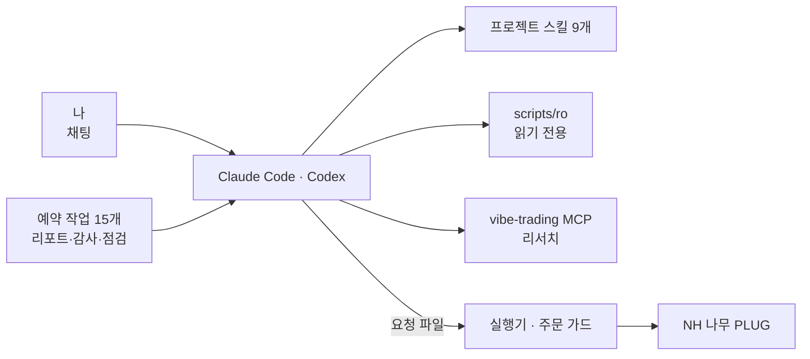

| 준비 | Claude Code | Codex |
| --- | --- | --- |
| 설치 | `npm install -g @anthropic-ai/claude-code` 또는 데스크톱 앱 | `npm install -g @openai/codex` 또는 Codex 앱 |
| 요금 (필수) | Claude 유료 요금제(Pro·Max) 또는 Anthropic API 사용료 | ChatGPT 유료 요금제(Plus·Pro 등) 또는 OpenAI API 사용료 |
| 지침 파일 | `CLAUDE.md` (`@AGENTS.md` 한 줄) | `AGENTS.md` ([템플릿](docs/ai-agents.md#2-지침-파일-만들기)) |
| 스킬 | `.claude/skills/` 자동 | `.agents/skills/`에 링크 ([명령](docs/ai-agents.md#codex에-연결하기)) |
| MCP | `claude mcp add --scope project vibe-trading -- "$PWD/.venv/bin/vibe-trading-mcp"` | `~/.codex/config.toml`의 `[mcp_servers.vibe-trading]` |
| 무인 실행 | 데스크톱 앱 예약 작업 + `.claude/settings.local.json` 읽기 전용 권한 | Codex 앱 자동화 |

설치 프롬프트는 맨 위 [바로 설치하기](#바로-설치하기)에 있습니다. 예약 작업 15개를 만드는 프롬프트와 작업별 지시문은 [AI와 함께 쓰기 6절](docs/ai-agents.md#6-예약-작업-등록)에 있고, Claude 예약 작업과 Codex 자동화 중 한쪽만 켭니다.


<details>
<summary><strong>매일 쓰는 프롬프트</strong></summary>

| 상황 | 프롬프트 |
| --- | --- |
| 새 세션 시작 | `AGENTS.md, docs/README.md, docs/operations.md를 읽고 서비스 상태·오늘 판단·체결·미확인 주문·보유와 손익을 조회만 해서 한국시간으로 보고해 줘.` |
| 장전 | `오늘 장전 상세 분석 써 줘. 야간선물, NXT 프리마켓, 미국 시장, 공시를 근거로 하고 템플릿 검사까지 통과시켜.` |
| 장중 | `지금까지 매매 진행 상황 알려 줘. 증권사 확인 체결과 Jev 판단을 구분하고 미확인 주문 수와 조회 시각을 같이 적어.` |
| 막힌 이유 | `10시 이후 진입이 막힌 이유를 종목별로 정리하고, 같은 이유로 3분 넘게 막힌 것을 따로 표시해 줘.` |
| 종목 정리 | `114800 보유분 전량 정리 요청해 줘. 요청 파일에 쓰고 다음 회차에 팔렸는지 확인해서 알려 줘.` |
| 판단 근거 | `Jev가 방금 산 종목을 왜 샀는지 jev_explain.py로 판단 근거와 입력 자료를 설명해 줘.` |
| 마감 복기 | `오늘 매매 복기해 줘. 계좌별 실현손익, 왕복 매매, 잘한·아쉬운 매매, 막힌 후보의 사후 결과까지.` |
| 매매일지 | `오늘 매매일지를 trading-journal-writer 스킬 템플릿대로 써 줘. 출처는 링크로, 검사 통과까지.` |
| 장기투자 | `장기투자 오늘 아침 판단을 설명해 줘. 국면, 켜진 거장 전략, 오늘 주문 계획, 적립식 다음 매수를 표로.` |
| 설정 변경 | `신규 매수 마감을 14:00으로 바꾸면 무엇이 달라지는지 먼저 설명해 줘. 내가 승인하면 config_store로 저장해 이력을 남겨.` |
| 문제 조사 | `실행기가 멈췄어. 로그, events.jsonl 끝부분, 미확인 주문, STOP·HALT를 조회만 해서 원인을 찾아 줘.` |
| 이식 | `ops-bootstrap 스킬대로 이 Mac의 설치 상태를 점검하고 없는 것만 표로 보여 줘. 실주문 서비스는 건드리지 마.` |

기능마다 대시보드 위치와 프롬프트를 짝지은 표는 [기능별 사용 지도](docs/ai-agents.md#기능별-사용-지도)에, 서비스 켜기·멈추기·실계좌 단계적 개방·낙폭과대·적립식·리포트 설정·주간 돌아보기·업데이트까지 19묶음의 예시는 [프롬프트 예시](docs/ai-agents.md#프롬프트-예시)에 있습니다.
</details>

<details>
<summary><strong>프로젝트 스킬 9개</strong></summary>

| 스킬 | 하는 일 | 쓰는 때 |
| --- | --- | --- |
| `vibe-trading` | 운영 규칙, 진행·마감 보고, 시황·종목 분석, 정리 요청, 리서치 도구 | "진행 상황 알려줘", 예약 보고·개선안 |
| `premarket-analysis` | 장전 상세 분석 작성·검사 | 평일 08:31, "오늘 장 전망" |
| `intraday-audit` | 장중 매매·차단·체결 감사 | 매시 20분 |
| `trading-journal-writer` | 하루·기간 매매일지 | 16:40, 매월 1일 |
| `longterm-strategy-writer` | 장기투자 전략 리포트와 거장별 의견 | 08:50, 금요일, 매월 1일 |
| `report-html-publisher` | 리포트 HTML 발행과 알림 링크(Discord·Telegram·Slack) | 리포트가 생길 때 |
| `ops-bootstrap` | 새 계정·새 기기에서 이어 가기, 복원 | "다른 계정에서 이어서" |
| `verify-dashboard` | 대시보드 변경을 실제 화면으로 확인 | 대시보드를 고친 뒤 |
| `automation-guideline-review` | 예약 작업 지침 검수 | 지침을 고칠 때 |

선택 스킬(대시보드·디자인 작업용)과 설치 명령은 [AI와 함께 쓰기 3절](docs/ai-agents.md#3-스킬-설치)에 있습니다.
</details>

> [!WARNING]
> 키·계좌번호를 채팅에 붙여 넣지 마세요. 공유 모의계좌에 직접 주문하거나, 실주문 스위치를 켜거나, 승인 없이 한도를 바꾸는 일은 AI에게 맡기지 않습니다. [AI에게 맡기지 않는 것](docs/ai-agents.md#ai에게-맡기지-않는-것)

## 매일의 감사와 리포트

**사람이 자리를 비워도, 매일 점검하고 보고합니다.** AI 예약 작업과 서비스가 정해진 시각에 점검·분석·복기를 쓰고, 리포트는 HTML로 [리포트 목록](https://roadkwonai.github.io/omni-ai-trading/reports/)에 게시되며 Discord·Telegram·Slack으로 링크가 갑니다. 개선안은 제안만 하고, 반영은 사람이 승인합니다.

| 시각 (평일 KST) | 리포트·감사 | 쓰는 것 |
| --- | --- | --- |
| 08:20 · 08:53 | 장전 사전 점검 | 서비스·계좌·미확인 주문·설정 점검, 실패는 바로 알림 |
| 08:31 | 장전 상세 분석 | 해외 시장, 야간선물, NXT 프리마켓, 공시로 오늘 시장 정리 |
| 08:50 | 장기투자 전략 리포트 | 국면, 거장 7명의 관점 의견, 오늘 주문 계획 |
| 매시 20분 | 장중 감사 | 판단·차단·체결 점검, 다시 생긴 문제는 즉시 알림(문제 이력) |
| 15:40 | 마감 요약 | 계좌별 손익과 잔고 |
| 16:15 | 장 마감 개선안 | 그날 거래, 신호 적중률, 추가 매수 성적, 막힌 후보의 사후 결과로 제안 |
| 16:40 | 매매일지 | 복기, 시장, 수급, 핵심 이슈를 같은 템플릿으로 |
| 16:45 | 장기투자 복기·감사 | 아침 계획과 실제 결과, 거장별 관점 비교 |
| 금 · 매월 1일 | 주간·월간 감사, 기간 매매일지 | 낙폭과대·장기투자 감사, 월·분기·반기·연 매매일지 |

리포트는 생성·게시·링크 발송 상태를 각각 기록합니다. 일별·기간 매매일지와 장전 상세 분석은 원본 템플릿을 검사한 뒤 링크를 보냅니다. 푸시가 켜져 있으면 검사 전 초안도 공개 주소에 올라갈 수 있어, 공개 전 실계좌 금액·수량을 포함한 본문과 표를 확인해야 합니다. [운영 일정과 자동화](#운영-일정과-자동화) · [리포트 발행](docs/report-pages.md)

## 기반 기술


**검증된 오픈소스 위에 국내 시장 매매와 장기투자를 더했습니다.** Omni AI Trading은 [HKUDS Vibe-Trading](https://github.com/HKUDS/Vibe-Trading)을 바탕으로, NH투자증권 나무 PLUG로 국내 ETF·주식을 자동매매하고 미국 ETF를 거장의 원칙으로 운용하도록 확장한 오픈소스입니다. 원본의 MIT 라이선스와 저작권 고지를 그대로 따릅니다.

**HKUDS Vibe-Trading**은 홍콩대학교 데이터 지능 연구실(HKUDS)이 만든 개인 트레이딩 에이전트입니다. 금융 질문을 받아 **리서치 리포트, 백테스트, 모의 포트폴리오**를 만들어 주며, 시장·공시 리서치, 알파 벤치마크, 멀티 에이전트 리서치 팀, MCP 서버 기능을 갖췄습니다. Omni가 이어받아 쓰는 것은 다음과 같습니다.

| 이어받은 것 | 쓰는 곳 |
| --- | --- |
| MCP 연결 구조 | NH 증권 서버와 리서치 도구를 같은 방식으로 연결해 호출합니다 |
| HALT 긴급 정지 | 실계좌 거래를 한 번에 멈추는 원본의 안전장치를 그대로 씁니다 |
| 리서치 에이전트 | 장기투자 테마 점검과 미국 종목 아이디어 조사에 읽기 전용으로 씁니다 |
| 기록·설정 폴더 규칙 | 기록·설정 폴더(`~/.vibe-trading`) 구조와 테스트 체계를 이어받았습니다 |

<br clear="right">

| 기술 | 역할 | 이 시스템에서 하는 일 |
| --- | --- | --- |
| **Claude Code · Codex** | AI 코딩 에이전트 | 설치와 운영, 분석, 리포트 작성을 맡습니다. 프로젝트 스킬과 예약 작업으로 매일 정해진 일을 합니다 |
| **MCP** | AI 도구 연결 표준 | NH 공식 [nhplug-mcp](https://github.com/PLUG-OpenAPI/nhplug-mcp)(MIT, 패치 적용)와 vibe-trading MCP로 시세·주문·리서치 도구를 연결합니다 |
| **NH 나무 PLUG OpenAPI** | 증권사 | 시세 조회, 잔고 확인, 모의·실계좌 주문을 맡습니다. 키움·토스 Open API는 순위와 시황을 보조로 가져올 때만 씁니다 |
| **TypeSafe Jev · OpenAI** | 판단 모델 | Jev는 1분 차트와 뉴스를 보고 매매 후보와 신뢰도를 내고, OpenAI는 빠른 판단과 관찰을 맡습니다 |
| **Python · Streamlit** | 실행기와 대시보드 | 1분마다 돌아가는 실행기와 로컬 대시보드(10개 탭)를 만듭니다. 자동 테스트 1,998개로 동작을 검증합니다 |
| **SQLite · JSON** | 기록과 설정 | 서버 없이 내 컴퓨터의 파일에 저장합니다. 판단·체결·매매일지는 SQLite에, 관점과 설정은 JSON에 둡니다 |
| **macOS launchd** | 자동 실행 | 장중 실행기, 장전 자료 수집, 알림, 백업을 정해진 시각에 실행하고, 멈추면 다시 실행합니다 |
| **GitHub Pages · 메신저** | 리포트와 알림 | 리포트는 HTML 페이지로 게시하고, 체결과 링크는 Discord·Telegram·Slack으로 보냅니다 |

원본과 이 확장의 경계는 [동작 구조](docs/architecture.md#원본-vibe-trading과-이-확장의-경계)에 있습니다.

## 연동 서비스

필수는 NH 나무 PLUG 하나입니다. 나머지는 키를 넣는 만큼 기능이 늘어나고, 비어 있으면 그 기능만 빠집니다. 키는 내 컴퓨터의 `.env`에만 둡니다.

| 묶음 | 서비스 | 쓰는 곳 |
| --- | --- | --- |
| 증권 | **NH 나무 PLUG**(필수) · 키움 REST · 토스증권 Open API | 시세·잔고·주문 / 순위 선별·시황 대체 / 신규상장·NXT 프리마켓 |
| AI | TypeSafe Jev · OpenAI · Claude Code·Codex | 차트·뉴스 판단 / 빠른 판단·관찰 / 채팅 운영·리포트 작성 |
| AI 검색 | Liner | 기사·공시 원문 검색, 출처가 있는 투자 채팅과 시장 영향 분석 |
| 데이터 | KRX 정보데이터 · OpenDART · FRED · 네이버·Yahoo·뉴스 RSS | 일별 시세 / 공시·재무 / 금리·거시 / 수급·해외·헤드라인 |
| 알림·게시 | Discord · Telegram · Slack · GitHub Pages | 알림·리포트 링크 / HTML 리포트 게시 |

서비스마다 발급 방법, `.env` 키, 확인 명령은 [연동 서비스](docs/integrations.md)에 있습니다.

## 주요 기능

| 묶음 | 하는 일 | 가이드 |
| --- | --- | --- |
| 실시간 매매 | 1분 회차, 진입 3경로, 분할 매수, 청산 프로필, 인버스 관문, 신중 재진입, 제한 규칙 스위치 | [매매 전략](docs/strategy.md) |
| 낙폭과대 | 장중 반등(시장 폭락일만), 선별 v2(14:30\~14:55 분할 진입, −2% 손절 뒤 저점 재매수), 10년 사례집·재현 기록 | [낙폭과대](docs/oversold.md) |
| 실계좌 | 실계좌 1 Jev 미러(금액 비례·체결별 고정), 실계좌 2 장기투자, 실주문 스위치, 수동 매수·매도 요청 | [실계좌](docs/live-accounts.md) |
| 장기투자 | 국면 판정, 거장 모듈, 12주 분할 투입, 계좌별 전략, 레시피 비교, 시장 온도, 거시 배경 | [장기투자](docs/longterm.md) |
| 적립식 | 거장·수동 투자, 정기·입금형 주기, 종목·수량 제한, 이월과 가상 계좌의 미체결 재매수 | [적립식](docs/longterm-dca.md) |
| 여운봉 매매법 | 저수지에서 단계 매수, 70:30 짝 리밸런싱, 못 산 몫 넘기기 | [여운봉 매매법](docs/yeo-method.md) |
| NXT 종가매매 | 강세장 애프터마켓 종가매매를 가상 체결로 학습 | [NXT](docs/nxt.md) |
| 기록·리포트 | 매매일지(일·월·분기·반기·연), 장 마감 개선안, 장전 분석, HTML 리포트 발행 | [매매일지](docs/journal.md) · [장전 분석](docs/premarket.md) · [리포트 발행](docs/report-pages.md) |
| 알림 | Discord·Telegram·Slack으로 실시간·장기 채널 발송, 매도 손익, 15:40 마감 요약, 리포트 링크 | [알림](docs/notifications.md) · [연동 서비스](docs/integrations.md) |
| 운영 자동화 | launchd 서비스 17개, 예약 작업, 장전 사전 점검, 매시 장중 감사, 문제 이력 | [운영](docs/operations.md) · [자동 작업](docs/automation.md) |
| AI 운영 | Claude Code·Codex 채팅 운영, 프로젝트 스킬 9개, 예약 작업 15개, 읽기 전용 실행기 `scripts/ro` | [AI와 함께 쓰기](docs/ai-agents.md) |
| AI 검색 | 기사·공시 원문 검색, 뉴스의 시장 영향 분석, 투자 AI 채팅, 실계좌 잔고·보유 종목 조회 | [AI 검색 사용 가이드](docs/ai-search.md) |
| 대시보드 | Streamlit 10개 탭, 상태 카드, 가이드 팝업, Archify 흐름도 | [대시보드](docs/dashboard.md) |
| 백업·이식 | 설정 정리본 git 보관, 전체 백업, 새 계정·세션 복원 절차 | [이식](docs/portability.md) |

<p align="center"></p>

## 운영 일정과 자동화

평일 한국 시간 기준이며, 정리 시각 등은 설정·휴장일·시장 일정에 따라 달라집니다. 자동 작업은 두 종류입니다. **launchd 서비스**는 실행기·수집기·알림을 돌리고, **AI 예약 작업**(Claude 예약 작업 또는 Codex 자동화)은 리포트·감사·점검을 씁니다.

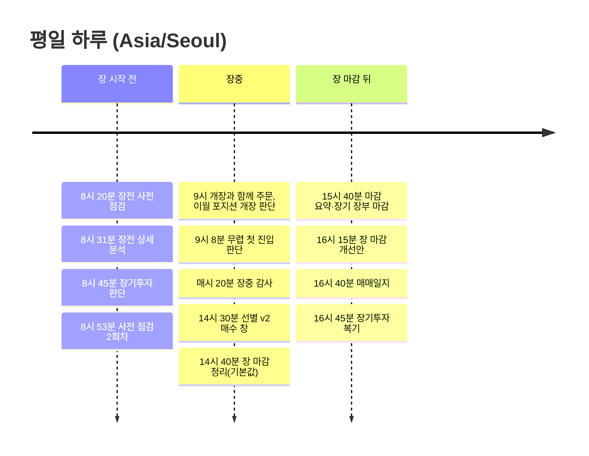

<details>
<summary><strong>전체 일정 표 (launchd 서비스 17개 · AI 예약 작업 15개)</strong></summary>

| 시각 | 종류 | 작업 | 하는 일 |
| --- | --- | --- | --- |
| 로그인 시 | 서비스 | 대시보드, 알림(Discord·Telegram·Slack), 데이터 관찰기, 시황 국면 관찰기, 공유 모의 실행기, NXT 가상 실행기 | 늘 떠 있음(실행기는 장 밖에서 기다림) |
| 금 07:00·07:30 | 서비스 | `us-ideas` | 미국 종목 아이디어 스크린(참고 정보, 주문 없음) |
| 07:40\~09:10 | 서비스 | `premarket` | 장전 자료 수집(08:00\~08:55 매 5분, NXT 프리마켓 요약 포함) |
| 07:55·15:35 | 서비스 | `nxt-virtual` | NXT 종가매매 가상 청산·판단 |
| 08:20·08:53 | 서비스 | `preflight` | 장전 사전 점검(실패는 알림 채널로) |
| 08:25 | AI | `trading-preflight` | 점검 실패 보완 뒤 다시 점검 |
| 08:31 | AI | `premarket-analysis-daily` | 장전 상세 분석 리포트 |
| 08:40 | 서비스 | `vibe-longterm` | 장기 엔진(08:45 판단, 09:40\~14:30 가상 체결·적립식, 15:40 마감) |
| 08:50 | 서비스 | `market-movers` | 순위·관심종목 계산(09:00\~15:05) |
| 08:50 | AI | `longterm-strategy-daily` | 장기투자 일일 전략 리포트 |
| 08:55 | 서비스 | `trading-day-start` | 거래일 확인 뒤 실행기·관찰기 준비, 주문은 개장부터 |
| 08:58 | 서비스 | `live-follow-1` | 실계좌 1 미러 실행기 |
| 09:20\~15:20 매시 20분 | AI | `intraday-audit-hourly` | 장중 매매·차단 감사 |
| 09:35 | 서비스 | `longterm-live-2` | 실계좌 2 장기투자 실행기(09:40\~14:30 주문 창) |
| 11:30·13:30·14:30 | AI | `trading-intraday-report` | 장중 진행 보고 |
| 15:40 | 서비스 | `discord-notify` | 계좌별 마감 요약 |
| 15:45 | AI | `trading-close-report` | 장 마감 후 보고 |
| 15:50 | 서비스 | `trading-backup` | 원장·설정 일일 사본 |
| 실행기 종료 7분 뒤 | 서비스 | 데이터 관찰기 | 복기, 사후 결과, 낙폭과대 사례, 매매일지 레코드 |
| 금 16:10 | 서비스 | `exit-replay` | 청산 규칙 사후 재현 |
| 16:15 | AI | `trading-daily-improvement` | 장 마감 개선안(제안만) |
| 16:40 | AI | `trading-journal` | 매매일지 |
| 16:45 | AI | `longterm-review-daily` | 장기투자 일일 복기·감사 |
| 금 16:45·16:50·17:40 | AI | `oversold-weekly-audit`, `longterm-strategy-weekly`, `longterm-audit-weekly` | 낙폭과대 주간 감사, 장기 주간 리포트·감사 |
| 16:55 | 서비스 | `state-sync` | 설정 정리본·전체 백업 아카이브 |
| 매월 1일 17:10·17:20·17:45 | AI | `trading-journal-period`, `longterm-strategy-monthly`, `longterm-audit-monthly` | 기간 매매일지, 장기 월간 리포트·감사 |

서비스 정의는 `scripts/launchd_services.py`, AI 예약 작업의 지시문 요약과 등록 프롬프트는 [AI와 함께 쓰기](docs/ai-agents.md#6-예약-작업-등록), 전체 설명은 [자동 작업](docs/automation.md)에 있습니다.
</details>

## 동작 구조

<details>
<summary><strong>Jev 실시간 한 회차가 주문이 되는 과정</strong></summary>

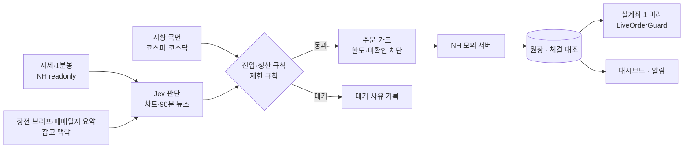

매 회차 증권사 잔고·주문을 원장과 먼저 맞춰 보고, 어긋나면 주문하지 않고 멈춥니다.
</details>

<details>
<summary><strong>장기투자 엔진의 하루</strong></summary>

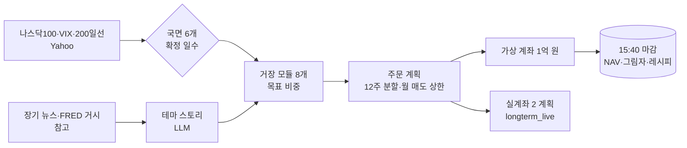
</details>

자세한 구성 요소와 데이터 위치는 [동작 구조](docs/architecture.md)에 있습니다.

## 알고리즘

매매 규칙의 요약입니다. 수치는 기본값이고 대부분 대시보드에서 범위 안으로 바꿉니다. 정확한 조건과 기록 이름은 각 가이드에 있습니다.

<details>
<summary><strong>① Jev 진입: 한 회차에 어떤 경로로 사나</strong></summary>

매분 아래 순서로 보고, 처음 후보가 나온 경로가 그 회차를 씁니다. 주문은 한 회차에 한 건입니다.

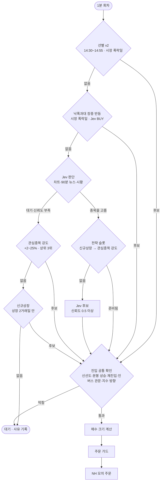

- **매수 크기:** 분할 1회 금액(기본 100만 원) × 경로 배율(신규상장 50%) × 보유·시황 배율(25\~100%) × 추가 매수 50% × 신중 재진입 50%. 회당 한도·1회 100주·종목당 최대로 자릅니다.
- **추가 매수:** 직전 매수보다 신뢰도가 높거나, 한 단계(0.7%) 싸거나, 한 단계 수익 중일 때만. 첫 매수 뒤 최대 `scale_max_adds`회, 장 마감 정리 30분 전부터는 없음.
- **막힘 방지:** 1주도 못 사는 강도 후보는 고르지 않고, 주문 단계에서 사지 못한 후보는 3분부터 최대 30분까지 쉬게 해 다른 후보에 차례를 넘깁니다.
- **신중 재진입:** 그날 사고판 종목을 불리한 국면에서 다시 살 때는 추격·약세 받기 금지, Jev 재검토(BUY 0.6 이상), 크기 50%.

[매매 전략 · 진입 경로](docs/strategy.md#진입-경로)
</details>

<details>
<summary><strong>② 보유와 청산: 언제 파나</strong></summary>

포지션마다 진입할 때 청산 계획을 정해 고정합니다.

| 프로필 | 언제 | 익절 | 손절 |
| --- | --- | --- | --- |
| 방어형 | 기본 | 데이터 목표에서 전량(없으면 +1% 절반·+2% 전량) | −2% |
| 추세형 | 지수가 포지션 방향으로 강할 때 | +2% 절반 뒤 고점 대비 −1.5% 추적 | −2% |
| 신규주형 | 신규상장 경로 | +3% 절반 뒤 −2% 추적, 60분 시간 손절 | 신규주 손절 % |
| 인버스 빠른 익절 | 진입 시 지수 등락률이 −1.5%보다 높음 | +0.3% 전량 | −1% |
| 인버스 폭락일 청산 | 진입 시 지수 등락률이 −1.5% 이하 | +1% 전량 | −1% |
| 낙폭과대 | 장중 반등·선별 v2 | 자기 계획 | 자기 계획 |

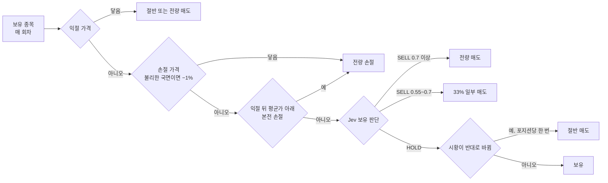

장 마감 정리(기본 14:40)에 당일 포지션을 팝니다. 추세형·상승장·수익 중이고 이월 조건을 모두 통과한 포지션만 정한 한도 안에서 다음 날로 넘기고, 다음 날 09:00\~09:07 개장 판단에서 Jev에게 다시 묻습니다.

[매매 전략 · 청산 프로필](docs/strategy.md#청산-프로필) · [장 마감과 이월](docs/strategy.md#장-마감과-이월스윙)
</details>

<details>
<summary><strong>③ 인버스 관문: 지수 하락과 추격 여부 확인</strong></summary>

인버스(114800·251340)는 시장·수급·가격 기준을 확인한 뒤에만 새로 사거나 더 삽니다. 자료가 부족하면 대기합니다.

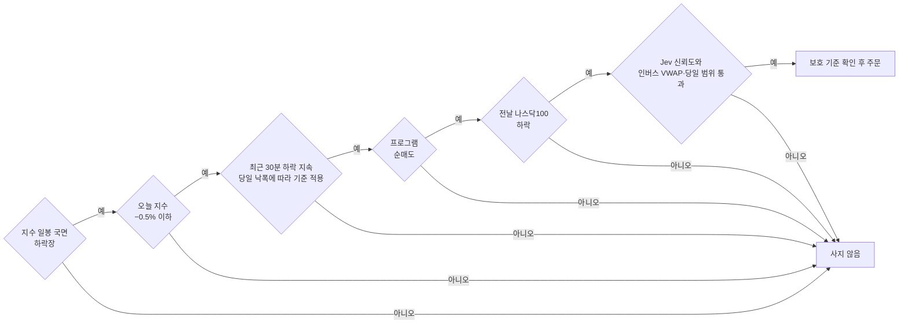

[매매 전략 · 인버스 관문](docs/strategy.md#인버스-관문)
</details>

<details>
<summary><strong>④ 낙폭과대: 시장이 크게 빠진 날의 반등</strong></summary>

| 경로 | 사는 조건 | 파는 조건 |
| --- | --- | --- |
| 장중 반등 | 종목 저가가 개별주·1배 ETF −6%(2배 ETF −8%)이면서 ATR 1.5배 이상, 20분 동안 저가 갱신 없음, 그 시장 저가 −3% 이상, Jev BUY 0.5 이상 | +1.5%와 낙폭 회복 중 낮은 가격 전량, 당일 저가 −0.5% 손절, 최대 1거래일 |
| 선별 v2 | KODEX 200·코스닥150 저가 −8%(또는 직전 5일 −5% 뒤 −5%), 전날 나스닥 상승 아님, 시장과 같이 빠진 종목, Jev 리서치 WAIT 0.7 미만. 14:30\~14:55에 절반, 다음 거래일 더 싸면 나머지 절반, 하루 3종목 | 평균가 +8% 절반·+15% 나머지, −2% 손절 뒤 새 저점이 20분 지켜지고 +1% 반등하면 다시 판단해 재매수(2번까지), 3번째 거래일 정리 |

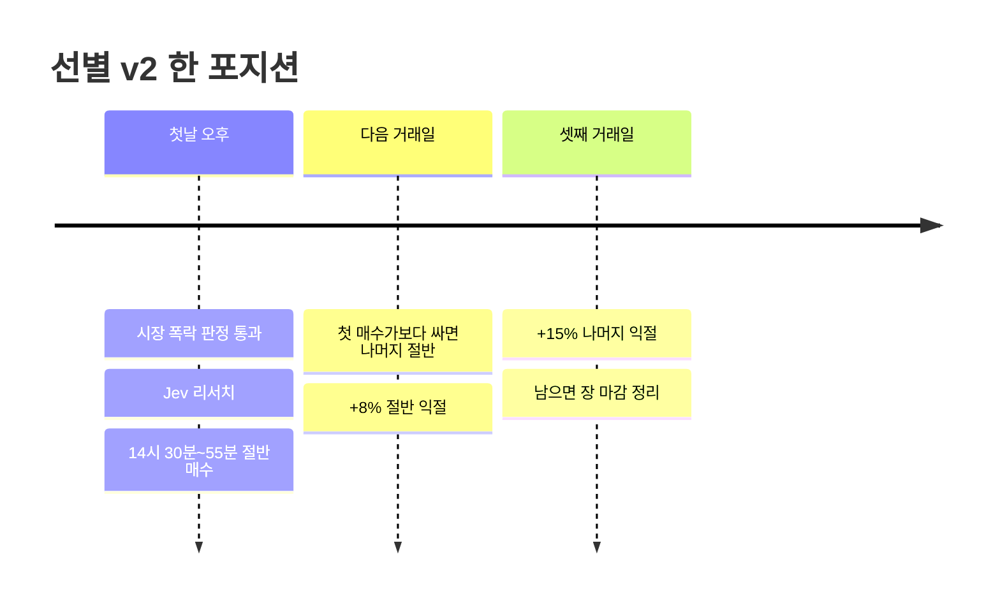

[낙폭과대](docs/oversold.md)
</details>

<details>
<summary><strong>⑤ 실계좌 미러: 모의를 비율대로 따라가기</strong></summary>

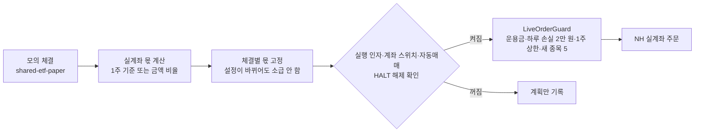

- 모의가 포지션을 다 팔면 실계좌도 다 팝니다. 손절은 모의 손절·계좌 손절·상한 2% 중 좁은 값이고, 낙폭과대·신규주는 모의 계획의 손절을 씁니다.
- 장기투자 실계좌는 장기 엔진의 당일 계획을 계좌의 전략·운용금·보유에 맞게 다시 계산합니다. 주문 창은 09:40\~14:30이며, 계좌별 실주문 조건과 보호 기준을 거칩니다.

[실계좌](docs/live-accounts.md) · [안전장치](docs/safety.md)
</details>

<details>
<summary><strong>⑥ 장기투자: 국면 → 거장 전략 → 목표 비중 → 주문</strong></summary>

매일 08:45에 나스닥100 낙폭·200일선·VIX로 국면을 정하고(같은 판정이 10거래일, 투매는 2거래일 이어져야 확정), 켜진 거장 전략이 기준 비중(코어 60 · 위성 25 · 저수지 15)을 조정합니다.

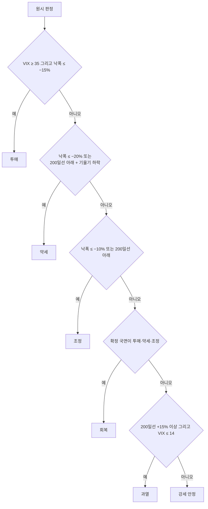

| 거장 전략 | 하는 일 | 기본 |
| --- | --- | --- |
| 기준 비중 · 코어·위성 유지 | 기준 비중을 들고 감 | 켬 |
| 레이 달리오 · 월 밴드 리밸런싱 | 매월 ±5%p를 벗어나면 목표로 되돌림 | 켬 |
| 피터 린치 · 테마 스토리 점검 | LLM이 위성 테마를 유지·주의·훼손으로 판정해 비중 조정 | 켬 |
| 워런 버핏·필립 피셔 · 저회전 | 손절 없음, 월 매도 상한 | 켬 |
| 저수지 분할(일반) | 나스닥100 −20%·−30%에서 저수지를 코어로 | 끔 |
| 하워드 막스 · 시계추 | 과열이면 덜고, 투매면 단계를 앞당김 | 끔 |
| 래리 윌리엄스 · 위성 추세 점검 | 200일선 −2% 아래 5일이면 위성 절반 | 끔 |
| 래리 윌리엄스 · 급락 단기 반등 | 하루 −3%·VIX 25 이상이면 저수지 5%를 나스닥100으로 | 끔 |

목표 비중과 보유의 차이로 주문 계획을 만들고, 초기 투입은 12주에 나눠 삽니다. 가상 1억 원 계좌, 비교용 그림자 장부, 레시피별 가상 장부가 매일 15:40에 순자산을 남깁니다.

[장기투자](docs/longterm.md)
</details>

<details>
<summary><strong>⑦ 적립식과 여운봉 저수지 매매법</strong></summary>

**적립식**은 새로 넣는 적립금만 삽니다. 장부마다 "언제"와 "얼마나"를 각각 거장 자동 또는 내가 정합니다. 사기만 하고, 매도는 거장 전략 몫입니다.

| 항목 | 거장 자동 | 내가 |
| --- | --- | --- |
| 언제 | 매 거래일 확인, 매수 빈도마다 한 번까지(거장마다 정한 주기 또는 하락일 우선) | 정한 날, 또는 하락일 우선(최대 7일) |
| 얼마나 | 적립금 속도 × 0.7 × 국면 배수(0.5\~1.5)에 따라잡기, 상한 1.5배, 현금 하한 | 정한 금액 또는 종목별 N주 |
| 몇 시 | 09:40부터 5분마다, 전일 종가 이하가 되면(없으면 14:20) | 정한 시각 |

**여운봉 저수지 매매법**은 계좌 전략입니다. 전부 저수지에서 시작해 나스닥100이 전고점 대비 크게 빠질 때 단계별로 나눠 사고, 위험 ETF와 나스닥100·채권 혼합 ETF를 70:30으로 맞춥니다.

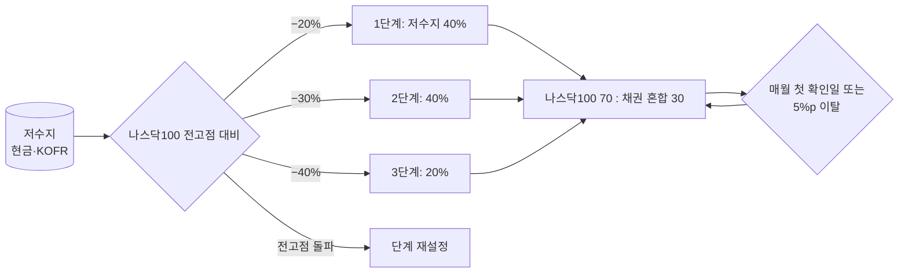

[적립식](docs/longterm-dca.md) · [여운봉 매매법](docs/yeo-method.md)
</details>

<details>
<summary><strong>⑧ NXT 종가매매 · 기록과 알림</strong></summary>

- **NXT 종가매매(가상 체결):** 15:35에 지수가 상승장·강세이고 수급·미국 선물·야간선물이 받쳐 주는 날, 종가 강세·거래량·거래대금 조건을 통과한 종목을 애프터마켓 가격으로 산 것처럼 기록하고, 다음 날 +1% 절반·+2% 전량·−2% 손절·10:00 정리로 청산합니다. 실제 주문은 내지 않습니다. [NXT](docs/nxt.md)
- **기록과 알림:** 모든 판단·주문·체결이 거래 기록(SQLite)과 이벤트 파일에 남고, 장 마감 뒤 매매일지·개선안·장기 리포트가 쌓입니다. 리포트는 HTML로 [리포트 목록](https://roadkwonai.github.io/omni-ai-trading/reports/)에 올라가고 Discord·Telegram·Slack으로 링크가 갑니다.

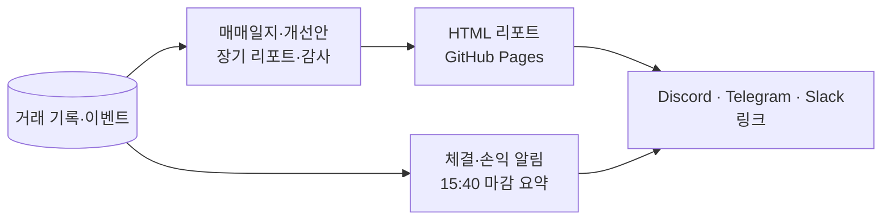

[매매일지](docs/journal.md) · [리포트 발행](docs/report-pages.md) · [알림](docs/notifications.md)
</details>

## 빠른 시작

Python 3.11, Node.js 22 이상, NH 나무 PLUG 앱 키(모의투자 계좌 포함)가 필요합니다. 서비스 일정은 macOS launchd 기준입니다.

```bash
git clone https://github.com/roadkwonai/omni-ai-trading.git
cd omni-ai-trading
python3.11 -m venv .venv
.venv/bin/pip install -e . -r requirements-nh.txt
cp .env.example .env && chmod 600 .env   # 키 이름은 .env.example 참고, 값은 출력하지 않습니다
```

| 다음 단계 | 명령·문서 |
| --- | --- |
| NH 공식 MCP 연결 | [시작하기](docs/getting-started.md) |
| 시세 연결 확인 | `PYTHONPATH=agent:scripts .venv/bin/python scripts/vibe_market_brief.py` |
| 대시보드 | `.venv/bin/streamlit run streamlit_namuh/app.py --server.address 127.0.0.1` |
| 서비스 정의 생성 | `PYTHONPATH=agent:scripts .venv/bin/python scripts/launchd_services.py --out ~/vibe-launchd` |
| 테스트 | `PYTHONPATH=agent:scripts .venv/bin/python -m pytest -q scripts streamlit_namuh` |

설치를 Claude Code나 Codex에게 맡기려면 맨 위 [바로 설치하기](#바로-설치하기)의 프롬프트를 쓰세요.

> [!TIP]
> 대시보드나 직접 API로 공유 모의계좌에 주문하지 마세요. 실행기가 원장 불일치로 멈춥니다. 정리는 대시보드의 [정리 요청](docs/operations.md)을 씁니다.

## 대시보드

<p align="center">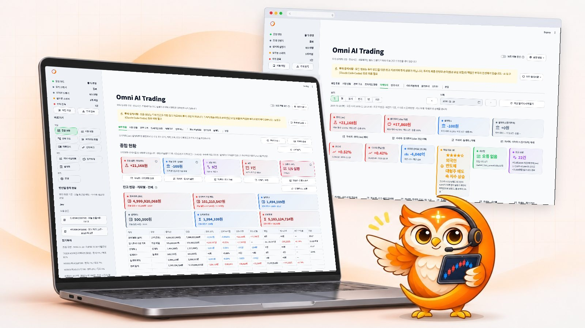</p>

로컬에서만 여는 Streamlit 대시보드입니다. 화면은 보기와 설정만 하고 실주문을 직접 내지 않습니다(정리·수동 매수 요청은 실행기가 보호 경로로 처리).

<table>
<tr>
<td width="50%"><br><sub><strong>종합 현황</strong> · 계좌별 오늘 손익·잔고·실행기 상태</sub></td>
<td width="50%"><br><sub><strong>전략 구조</strong> · 오늘 설정이 반영된 Archify 흐름도</sub></td>
</tr>
<tr>
<td>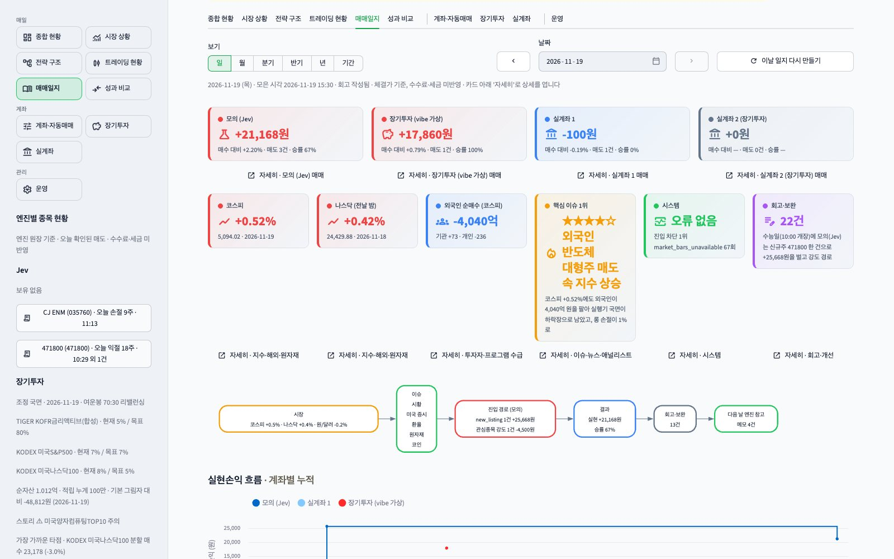<br><sub><strong>매매일지</strong> · 계좌 성과, 시장·수급, 이슈 별점</sub></td>
<td>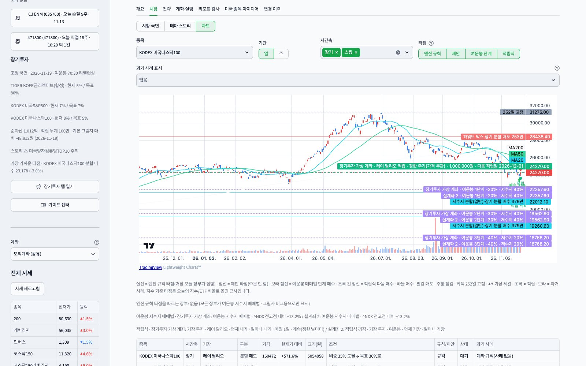<br><sub><strong>장기투자 차트</strong> · 이동평균선, 엔진 타점, 적립식·여운봉 단계</sub></td>
</tr>
</table>

탭은 10개이고 세 묶음으로 나뉩니다. 매일(종합 현황 · 시장 상황 · 전략 구조 · 트레이딩 현황 · 매매일지 · 성과 비교), 계좌(계좌·자동매매 · 장기투자 · 실계좌), 관리(운영)입니다. 예전의 주문·정리 탭은 실계좌 탭의 '주문·정리 종합' 보기로, 운영 상태·AI·실행 기록·API 연동·백업·이식 탭은 운영 탭의 하위 보기로 옮겼습니다. [대시보드 가이드](docs/dashboard.md)

## AI 검색

대시보드 상단 **AI 검색**에서 종목·시장 이슈의 기사와 공시 원문을 찾을 수 있습니다. **투자 AI 채팅**에는 뉴스가 주식시장에 미칠 영향, 투자 용어, 대시보드 사용법을 물어보세요. 웹 답변에는 Liner가 찾은 원문을, 서비스 사용법 답변에는 참고한 프로젝트 가이드를 표시합니다.

채팅의 **내부 데이터**를 선택하고 "이번 주 Jev 수익률과 최대 낙폭은?" 또는 "실계좌 1의 현재 보유 종목과 잔고는?"이라고 물을 수 있습니다. 실계좌 잔고는 NH 나무 PLUG에서 읽기 전용으로 조회하고, 마지막 응답을 받은 한국시간을 표시합니다. 내부 조회의 질문과 답변은 대시보드의 대화 안에서 처리합니다.

프로젝트 `.env`에 `LINER_API_KEY`를 설정하면 **AI 검색** 버튼이 표시됩니다. 웹 검색과 웹·가이드 답변에는 Liner API 요금이 적용됩니다. [AI 검색 사용 가이드](docs/ai-search.md) · [Liner 연동 설정](docs/integrations.md#liner)

## 안전장치

<table>
<tr>
<td width="200" valign="top"></td>
<td valign="top">

| 구분 | 한도 |
| --- | --- |
| 공유 모의계좌 | 회당 매수·하루 매수·보유 금액·하루 새 종목·하루 손실을 대시보드에서 범위 안으로 설정 |
| 실계좌 | 운용금(잔고 안에서) · 하루 손실 차단 기준 계좌별 최대 2만 원 · 1주 가격 상한 · 하루 새 종목 최대 5개(장기투자 첫 투입일 최대 6개) · 미체결·미확인 차단 |
| 공통 | 계좌 소유 확인 · KRX 장 시간 확인 · 원장 대조 뒤에만 주문 |

실계좌는 **관찰 → 가상 실행 → 보호된 실주문** 순서로 확인합니다. 공유 모의 `STOP`은 미확인 주문 대조 뒤 실행기를 종료하고, 실계좌 `HALT`는 해당 실주문 경로를 차단합니다. [안전장치](docs/safety.md) · [실계좌](docs/live-accounts.md)
</td>
</tr>
</table>

> [!WARNING]
> 키와 계좌번호는 `.env`에만 둡니다. 화면·기록·리포트·알림은 계좌번호를 가리고, 저장소에는 키·런타임 원장(`~/.vibe-trading`)이 들어가지 않습니다.

## 가이드 문서

[전체 문서 지도 →](docs/README.md)

| 목적 | 바로가기 |
| --- | --- |
| 설치·설정 | [시작하기](docs/getting-started.md) · [연동 서비스](docs/integrations.md) · [설정 레퍼런스](docs/configuration.md) · [이식](docs/portability.md) |
| 구조·화면 | [동작 구조](docs/architecture.md) · [대시보드](docs/dashboard.md) · [AI 검색](docs/ai-search.md) |
| Jev 실시간 | [매매 전략](docs/strategy.md) · [낙폭과대](docs/oversold.md) · [NXT](docs/nxt.md) · [실계좌](docs/live-accounts.md) · [안전장치](docs/safety.md) |
| 장기투자 | [장기투자](docs/longterm.md) · [적립식](docs/longterm-dca.md) · [여운봉 매매법](docs/yeo-method.md) |
| 기록·알림 | [매매일지](docs/journal.md) · [장전 분석](docs/premarket.md) · [리포트 발행](docs/report-pages.md) · [알림](docs/notifications.md) |
| AI·운영 | [AI와 함께 쓰기](docs/ai-agents.md) · [운영](docs/operations.md) · [자동 작업](docs/automation.md) · [FAQ](docs/faq.md) |
| 원본 Vibe-Trading | [README (English)](docs/vibe-trading/README_upstream.md) · [한국어](docs/vibe-trading/README_ko.md) |

## 개발

서비스의 요구사항과 아키텍처는 [기획서](PRD/README.md)에 있습니다. Claude Code나 Codex에서 기능을 개발하거나 보완할 때는 [개발 시작 프롬프트](PRD/03_PHASES.md#개발-시작-프롬프트)에서 단계별 범위와 완료 기준을 확인하세요.

| 위치 | 내용 |
| --- | --- |
| `scripts/` | 실행기·전략·원장·장기 엔진·리포트·알림 |
| `streamlit_namuh/` | 대시보드 |
| `agent/src/tools/nhplug_*.py` | 주문 가드(모의·실계좌) |
| `landing/` | GitHub Pages 소개 페이지(Vite + React, 대시보드와 별도) |
| `.claude/skills/` | 프로젝트 스킬(매매일지·장기 리포트·리포트 발행·대시보드 검증 등) |

### 버전과 릴리스

버전은 [Semantic Versioning](https://semver.org/lang/ko/)을 따르고 저장소 루트 [`VERSION`](VERSION)이 기준입니다. 릴리스 노트는 [`release/YYYY-MM-DD-<제목>.md`](release/)로 쓰고 같은 내용이 GitHub Release에 올라갑니다. 절차는 [`release/README.md`](release/README.md)에 있습니다.

테스트는 [빠른 시작](#빠른-시작)의 명령으로 돌립니다. 기여할 때 키·계좌번호·런타임 원장을 커밋하지 마세요(`.gitignore`가 막습니다).

## 투자 유의사항 및 면책 고지

1. 이 소프트웨어와 대시보드·리포트·알림이 제공하는 데이터, 분석, 차트, AI 판단은 정보 제공과 개인 학습을 위한 것이며, 특정 금융상품의 매수·매도를 권유하지 않습니다. 투자자문·투자일임 서비스가 아닙니다.
2. 정보는 공개 자료와 증권사 API를 바탕으로 만들지만 정확성·완전성·적시성을 보장하지 않습니다. 데이터 지연·오류, 프로그램 결함, 통신 장애로 주문이 늦거나 잘못될 수 있습니다.
3. AI 판단(Jev·OpenAI·Claude 등), 모의 성과, 가상 체결, 과거 재현 결과는 과거 데이터와 알고리즘에 기반한 것으로 미래의 수익을 보장하지 않습니다.
4. 금융투자상품은 가격 변동에 따라 투자 원금의 손실(0~100%)이 생길 수 있고, 레버리지·인버스 ETF는 손실이 더 커질 수 있습니다. 그 손실은 투자자에게 귀속됩니다.
5. 실계좌 자동매매를 켜는 것은 사용자 본인의 결정입니다. 투자의 최종 판단과 그로 인한 모든 손익의 책임은 투자자 본인에게 있으며, 제작자와 기여자는 이 소프트웨어의 사용으로 생긴 직·간접 손해에 법적 책임을 지지 않습니다(MIT 라이선스의 무보증 조항).
6. NH투자증권 등 증권사·데이터 제공사와 제휴·후원 관계가 없는 비공식 오픈소스 프로젝트입니다.

**AI 도구 비용.** 이 서비스는 AI 도구와 함께 쓰는 AI 트레이딩 시스템입니다. 설치·운영·리포트 작성에 Claude Code나 Codex 같은 AI 코딩 에이전트가 필요하고, 이를 쓰려면 해당 서비스의 유료 요금제(Claude Pro·Max 또는 ChatGPT Plus·Pro 같은 구독, 또는 API 사용료)가 필요합니다. 매매 판단에 쓰는 Jev·OpenAI API도 각 서비스의 이용 조건과 요금을 따릅니다. 요금과 이용 조건은 각 서비스의 최신 안내를 확인하세요.

이 고지는 대시보드 맨 위(**투자 유의사항**), 주문 직전 화면(수동 매수·매도, 실주문 스위치), [소개 페이지](https://roadkwonai.github.io/omni-ai-trading/), 모든 [리포트](https://roadkwonai.github.io/omni-ai-trading/reports/) 페이지에 함께 표시됩니다.

## 라이선스

원본 [Vibe-Trading](https://github.com/HKUDS/Vibe-Trading)(HKUDS)의 [MIT LICENSE](LICENSE)와 [NOTICE](NOTICE)를 유지합니다. `scripts/nhplug-*.patch`는 NH투자증권의 [nhplug-mcp](https://github.com/PLUG-OpenAPI/nhplug-mcp)(MIT)를 수정합니다. '나무(Namuh)'·'PLUG'는 NH투자증권의 서비스 이름이며 연동 대상을 설명하려고만 씁니다.

> [!CAUTION]
> 이 소프트웨어는 투자 조언이 아니며 수익을 보장하지 않습니다. 모의 성과와 가상 체결은 실제 체결이나 수익성 검증이 아닙니다. 실계좌 사용에 따른 손실은 사용자 책임입니다. 자세한 내용은 [투자 유의사항 및 면책 고지](#투자-유의사항-및-면책-고지)를 보세요.
