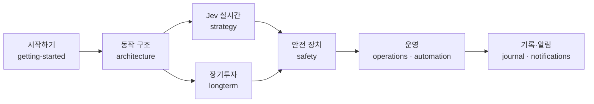

# 가이드 문서 지도

Omni AI Trading의 설치·전략·운영 가이드입니다. 처음이라면 **시작** 묶음부터 차례로 읽고, 이후에는 궁금한 기능의 가이드로 바로 가세요.

> [!TIP]
> 한 줄 요약이 필요하면 [README](../README.md)의 기능 표를, 화면에서 어디를 눌러야 하는지 궁금하면 [대시보드 가이드](dashboard.md)를 먼저 봅니다.

## 어떤 순서로 읽나

## 시작

| 문서 | 내용 |
| --- | --- |
| [시작하기](getting-started.md) | 설치, `.env` 키 이름, NH 공식 MCP 연결, 대시보드 실행, 서비스 정의, 첫 모의 회차 확인, AI에게 맡기는 프롬프트 |
| [설정 레퍼런스](configuration.md) | 설정 JSON 파일별 역할·범위·기본값, 변경 이력, `.env` 키 이름 |
| [이식](portability.md) | 설정 정리본·전체 백업, 다른 계정·새 컴퓨터로 옮기는 순서 |

## 구조와 화면

| 문서 | 내용 |
| --- | --- |
| [동작 구조](architecture.md) | 두 엔진과 계좌, 데이터 출처, 한 회차의 흐름, 데이터 위치, 원본 Vibe-Trading과의 경계 |
| [대시보드](dashboard.md) | 14개 탭과 하위 탭, 상태 카드 색, 가이드 팝업과 흐름도 |

## Jev 실시간 트레이딩

| 문서 | 내용 |
| --- | --- |
| [매매 전략](strategy.md) | 한 회차, Jev 입력, 진입 경로와 전략 슬롯, 분할·추가 매수, 청산 프로필, 인버스 관문, 신중 재진입, 제한 규칙 |
| [낙폭과대](oversold.md) | 장중 반등, 선별 v2(분할 진입·분할 익절·저점 재매수), 사례집과 재현 기록, 주간 감사 |
| [NXT 종가매매](nxt.md) | 강세장 애프터마켓 종가매매의 가상 체결과 학습 데이터 |
| [실계좌](live-accounts.md) | 실계좌 1 Jev 미러와 실계좌 2 장기투자, 실주문 조건, 크기 계산, 수동 매매, 가드 한도 |
| [안전 장치](safety.md) | 모의·실계좌 주문 가드, 미확인 주문·원장 대조, STOP·HALT, 관찰 → 가상 → 보호 실주문 |

## 장기투자

| 문서 | 내용 |
| --- | --- |
| [장기투자](longterm.md) | 대상 ETF·비중, 국면 6개, 거장 모듈 8개와 등급, 운용 모드, 장부·레시피 비교, 계좌별 전략, 리포트·감사 |
| [적립식](longterm-dca.md) | 적립식 v3: 언제·얼마나를 거장 자동 또는 내가, 거장 표, 매수 시각, 금액·N주, 제한 옵션 |
| [여운봉 저수지 매매법](yeo-method.md) | 전고점 대비 단계 매수, 70:30 리밸런싱, 조정 수치, 저수지 분할 모듈과의 차이 |

## 기록·리포트·알림

| 문서 | 내용 |
| --- | --- |
| [매매일지](journal.md) | 하루 레코드, 16:40 분석 리포트, 기간 일지, 장 마감 개선안, 대시보드 매매일지 탭 |
| [장전 분석](premarket.md) | 장전 자료 수집, 엔진 참고 맥락, 상세 분석 리포트, 사전 점검과의 관계 |
| [리포트 발행](report-pages.md) | HTML 리포트 생성·게시·발송, GitHub Pages(`/reports/`), 실패와 재시도 |
| [알림](notifications.md) | Discord 실시간·장기 채널, 매도 손익, 마감 요약, 중복 방지 |

## 운영

| 문서 | 내용 |
| --- | --- |
| [운영](operations.md) | launchd 서비스와 일정, 재시작 절차, 정리 요청, 백업·감사 |
| [자동 작업](automation.md) | 서비스·예약 작업 시간표, 장전 사전 점검, 매시 장중 감사, 문제 이력, 읽기 전용 실행기, 프로젝트 스킬 |
| [FAQ·문제 해결](faq.md) | 뉴스 429, NH 유량 초과, 대시보드 ImportError, 재부팅 뒤 서비스, 원장 불일치 정지 |

## 더 깊이

- 설계 기록과 검증 메모는 `docs/*-plan.md`, `docs/*-design.md`, `docs/audit/`에 있습니다(저장소 공개 범위에서는 빠질 수 있습니다).
- 나무증권 MCP 연동과 주문 안전 규칙: [`guides/nhplug-local.md`](../guides/nhplug-local.md), [`guides/nhplug-order-safety.md`](../guides/nhplug-order-safety.md), [`guides/trading-data-architecture.md`](../guides/trading-data-architecture.md)
- 소개 페이지: [roadkwonai.github.io/omni-ai-trading](https://roadkwonai.github.io/omni-ai-trading/) (소스는 [`landing/`](../landing/))
