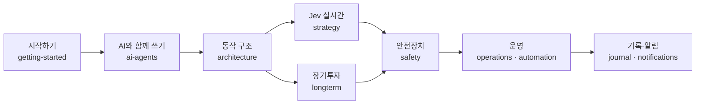

# 가이드 문서 지도

Omni AI Trading의 설치·전략·운영 가이드입니다. 처음이라면 **시작** 묶음부터 차례로 읽고, 이후에는 궁금한 기능의 가이드로 바로 가세요.

> [!CAUTION]
> 모든 정보는 투자 판단을 위한 참고 자료이며 투자 권유가 아닙니다. 투자의 최종 판단과 손익(원금 손실 포함)의 책임은 투자자 본인에게 있습니다. 이 서비스는 Claude Code·Codex 같은 AI 도구의 유료 이용이 필요합니다. [README · 투자 유의사항 및 면책 고지](../README.md#투자-유의사항-및-면책-고지)

> [!TIP]
> 한 줄 요약이 필요하면 [README](../README.md)의 기능 표를, 화면에서 어디를 눌러야 하는지 궁금하면 [대시보드 가이드](dashboard.md)를 먼저 보세요.

## 목적에 따라 시작하기

Omni는 투자 경험이나 시간이 부족해도 시장을 읽고 자기 기준으로 자금을 관리하는 과정을 연습하도록 돕습니다. 장중 분석은 Jev가 본 자료와 판단을 모의로 살피는 데서, 노후를 위한 장기 운용은 적립 계획과 자산 비중을 가상 장부에서 비교하는 데서 시작할 수 있습니다. 한국의 금융이해력 조사, 노후 소득 격차와 국내 사례는 [서비스를 만든 이유](../README.md#누구나-노후를-준비할-수-있도록)에 정리했습니다.

| 처음 하고 싶은 일 | 무엇을 확인하면 되나 | 읽을 가이드 |
| --- | --- | --- |
| AI로 시장을 읽는 법을 익히기 | 장전 자료를 보고 Jev의 후보 한 건을 골라 차트·뉴스·수급 중 어떤 정보가 판단에 쓰였는지 확인합니다. | [장전 분석](premarket.md) · [Jev 입력 자료](strategy.md#jev가-받는-자료) |
| 추격 매수와 손절 지연에 대응할 기준을 살피기 | 모의계좌에서 진입 조건, 차단 이유, 주문 접수와 체결을 구분합니다. | [첫 모의 회차](getting-started.md#7-첫-모의-회차-확인) · [주문 가드](safety.md#주문-가드) |
| 매일 시세를 보지 않고 장기 계획을 세우기 | 가상 장부에서 목표 비중과 적립 계획을 확인합니다. 시장이 바뀔 때 매수·대기·비중 조정 중 무엇을 계획하는지 봅니다. | [장기 운용 첫 점검](longterm.md#가상-장부로-장기-계획-점검하기) · [적립식](longterm-dca.md) |
| 결과를 돌아보고 기준을 고치기 | 일지와 전략 리포트에서 판단 근거, 계좌별 체결, 비용과 낙폭을 읽고 바꿀 조건을 검토합니다. | [매매일지](journal.md) · [장기 리포트와 감사](longterm.md#리포트와-감사) |

## 어떤 순서로 읽나

## 시작

| 문서 | 내용 |
| --- | --- |
| [시작하기](getting-started.md) | 설치, `.env` 키 이름, NH 공식 MCP 연결, 대시보드 실행, 서비스 정의, 첫 모의 회차 확인 |
| [AI와 함께 쓰기](ai-agents.md) | Claude Code·Codex 설치, 지침 파일 템플릿, 프로젝트 스킬 설치, MCP 연결, 읽기 전용 권한, 예약 작업 등록, 상황별 프롬프트 예시 |
| [연동 서비스](integrations.md) | NH 나무 PLUG·키움·토스·Jev·OpenAI·KRX·OpenDART·FRED 키 발급과 `.env` 키, Discord·Telegram·Slack 알림 설정, GitHub Pages |
| [설정 레퍼런스](configuration.md) | 설정 JSON 파일별 역할·범위·기본값, 변경 이력, `.env` 키 이름 |
| [이식](portability.md) | 설정 정리본·전체 백업, 다른 계정·새 컴퓨터로 옮기는 순서 |

## 구조와 화면

| 문서 | 내용 |
| --- | --- |
| [동작 구조](architecture.md) | 두 엔진과 계좌, 데이터 출처, 한 회차의 흐름, 데이터 위치, 원본 Vibe-Trading과의 경계 |
| [대시보드](dashboard.md) | 10개 탭(세 묶음)과 하위 탭, 상태 카드 색, 가이드 팝업과 흐름도 |

## Jev 실시간 트레이딩

| 문서 | 내용 |
| --- | --- |
| [매매 전략](strategy.md) | 한 회차, Jev 입력, 진입 경로와 전략 슬롯, 분할·추가 매수, 청산 프로필, 인버스 관문, 신중 재진입, 제한 규칙 |
| [낙폭과대](oversold.md) | 장중 반등, 선별 v2(분할 진입·분할 익절·저점 재매수), 사례집과 재현 기록, 주간 감사 |
| [NXT 종가매매](nxt.md) | 강세장 애프터마켓 종가매매의 가상 체결과 학습 데이터 |
| [실계좌](live-accounts.md) | 실계좌 1 Jev 미러와 실계좌 2 장기투자, 실주문 조건, 크기 계산, 수동 매매, 가드 한도 |
| [안전장치](safety.md) | 모의·실계좌 주문 가드, 미확인 주문·원장 대조, STOP·HALT, 관찰 → 가상 → 보호 실주문 |

## 장기투자

| 문서 | 내용 |
| --- | --- |
| [장기투자](longterm.md) | 장기 계획에 필요한 자금 투입·보유·비중 조정, 거장 모듈, 계좌별 전략과 가상 장부 비교 |
| [적립식](longterm-dca.md) | 정기·입금형 적립식, 매수할 날·시각·금액·종목, 이월과 알림 |
| [여운봉 저수지 매매법](yeo-method.md) | 전고점 대비 단계 매수, 70:30 리밸런싱, 조정 수치, 저수지 분할 모듈과의 차이 |

## 기록·리포트·알림

| 문서 | 내용 |
| --- | --- |
| [매매일지](journal.md) | 하루 레코드, 16:40 분석 리포트, 기간 일지, 장 마감 개선안, 대시보드 매매일지 탭 |
| [장전 분석](premarket.md) | 장전 자료 수집, 엔진 참고 맥락, 상세 분석 리포트, 사전 점검과의 관계 |
| [리포트 발행](report-pages.md) | HTML 리포트 생성·게시·발송, GitHub Pages(`/reports/`), 실패와 재시도 |
| [알림](notifications.md) | Discord·Telegram·Slack 실시간·장기 채널, 매도 손익, 마감 요약, 중복 방지 (설정 절차는 [연동 서비스](integrations.md#알림-채널-두-개)) |

## 운영

| 문서 | 내용 |
| --- | --- |
| [운영](operations.md) | launchd 서비스와 일정, 재시작 절차, 정리 요청, 백업·감사 |
| [자동 작업](automation.md) | 서비스·예약 작업 시간표, 장전 사전 점검, 매시 장중 감사, 문제 이력, 읽기 전용 실행기, 프로젝트 스킬 |
| [FAQ·문제 해결](faq.md) | 뉴스 429, NH 유량 초과, 대시보드 ImportError, 재부팅 뒤 서비스, 원장 불일치 정지 |

## 더 깊이

- [기획서](../PRD/README.md)에서 서비스 목적, 요구사항, 아키텍처와 검증 기준을 확인합니다. 저장소에서 개발을 시작할 때는 [개발 시작 프롬프트](../PRD/03_PHASES.md#개발-시작-프롬프트)를 이용합니다.

- 설계 기록과 검증 메모는 `docs/*-plan.md`, `docs/*-design.md`, `docs/audit/`에 있습니다(저장소 공개 범위에서는 빠질 수 있습니다).
- 나무증권 MCP 연동과 주문 안전 규칙: [`guides/nhplug-local.md`](../guides/nhplug-local.md), [`guides/nhplug-order-safety.md`](../guides/nhplug-order-safety.md), [`guides/trading-data-architecture.md`](../guides/trading-data-architecture.md)
- 소개 페이지: [roadkwonai.github.io/omni-ai-trading](https://roadkwonai.github.io/omni-ai-trading/) (소스는 [`landing/`](../landing/))
