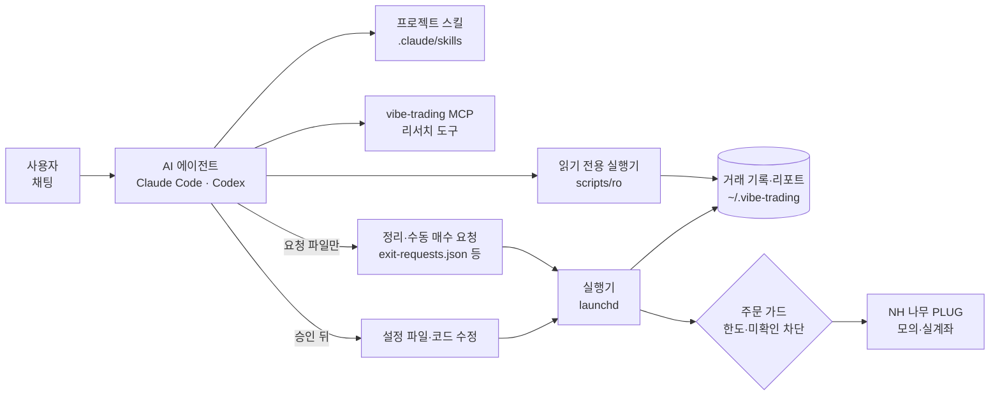
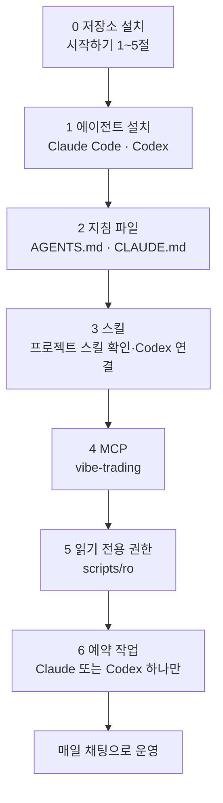
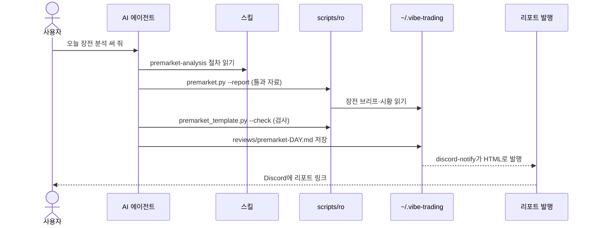

# AI와 함께 쓰기 (Claude Code · Codex)

<p align="center"></p>

Omni AI Trading은 채팅으로 운영합니다. Claude Code나 Codex 같은 코딩 에이전트에게 이 저장소를 열어 두고 "오늘 매매 어땠어?", "장전 분석 써 줘", "이 종목 정리해 줘"처럼 말하면, 에이전트가 프로젝트 스킬과 읽기 전용 도구로 기록을 읽고, 리포트를 쓰고, 정해진 경로로 요청을 남깁니다. 이 문서는 설치 프롬프트, 스킬 설치, 예약 작업 등록, 상황별 프롬프트 예시를 한곳에 모은 안내입니다.

- [바로 설치하기](#바로-설치하기)
- [먼저 알아 둘 것: 채팅은 주문하지 않습니다](#먼저-알아-둘-것-채팅은-주문하지-않습니다)
- [설치 순서](#설치-순서)
- [1. 에이전트 설치](#1-에이전트-설치)
- [2. 지침 파일 만들기](#2-지침-파일-만들기)
- [3. 스킬 설치](#3-스킬-설치)
- [4. MCP 연결](#4-mcp-연결)
- [5. 읽기 전용 권한](#5-읽기-전용-권한)
- [6. 예약 작업 등록](#6-예약-작업-등록)
- [기능별 사용 지도](#기능별-사용-지도)
- [프롬프트 예시](#프롬프트-예시)
- [AI에게 맡기지 않는 것](#ai에게-맡기지-않는-것)
- [문제가 생길 때](#문제가-생길-때)

## 바로 설치하기

```bash
npm install -g @anthropic-ai/claude-code   # Codex를 쓰면: npm install -g @openai/codex
git clone https://github.com/roadkwonai/omni-ai-trading.git
cd omni-ai-trading
claude                                     # Codex를 쓰면: codex
```

열린 에이전트에 아래 프롬프트를 그대로 붙여 넣습니다. 에이전트가 [설치 순서](#설치-순서)를 따라 진행하고, 키 입력과 주문 관련 단계에서는 멈춰서 묻습니다.

```text
이 저장소는 Omni AI Trading(NH 나무 PLUG 모의·실계좌 자동매매)이다.
docs/getting-started.md와 docs/ai-agents.md를 읽고 그 순서대로 설치를 도와줘.
- 답변은 한국어, 시각은 Asia/Seoul로 쓴다.
- .env 값과 계좌번호는 출력하지 말고, 키는 내가 직접 넣게 키 이름만 안내해.
- Python 가상환경, NH 공식 MCP 설치·패치·빌드, agent.json 등록, vibe_market_brief.py 연결 확인까지 해 줘.
- docs/ai-agents.md의 템플릿으로 AGENTS.md와 CLAUDE.md를 만들고, 프로젝트 스킬과 vibe-trading MCP를 연결하고,
  .claude/settings.local.json에 읽기 전용 권한 4개를 넣어 줘.
- launchd 서비스는 plist를 만들어 보여 주기만 하고, 등록은 대시보드·읽기 전용 서비스부터 내가 승인한 것만 해.
- shared-etf-paper(모의 주문), 실계좌 서비스, 실주문 스위치, 장기 엔진 --execute는 켜지 마.
- 끝나면 있는 것과 없는 것(키 이름, 서비스, 스킬, MCP, 실패한 점검)을 표로 보고해.
```

> [!IMPORTANT]
> **AI 도구 유료 이용이 필요합니다.** 이 서비스는 AI 도구와 함께 쓰는 AI 트레이딩 시스템입니다. 설치·운영·리포트 작성에 Claude Code나 Codex 같은 AI 코딩 에이전트가 필요하고, 이를 쓰려면 해당 서비스의 유료 요금제(Claude Pro·Max 또는 ChatGPT Plus·Pro 같은 구독, 또는 API 사용료)가 필요합니다. 매매 판단에 쓰는 Jev·OpenAI API도 각 서비스의 이용 조건과 요금을 따릅니다.

> [!CAUTION]
> 모든 정보는 투자 판단을 위한 참고 자료이며 투자 권유가 아닙니다. 투자의 최종 판단과 손익(원금 손실 포함)의 책임은 투자자 본인에게 있습니다. AI 판단은 미래 수익을 보장하지 않습니다. [README · 투자 유의사항 및 면책 고지](../README.md#투자-유의사항-및-면책-고지)

> [!IMPORTANT]
> 키와 계좌번호는 사람이 `.env`에 직접 넣습니다. 에이전트에게 값을 붙여 넣거나 출력하게 하지 마세요. 실계좌 실주문 스위치, `--execute`, 한도 변경은 사람이 승인한 뒤에만 합니다.

## 먼저 알아 둘 것: 채팅은 주문하지 않습니다

AI를 붙인 이유는 사용자가 시황·뉴스·수급과 거래 기록을 여러 화면에서 직접 모으는 부담을 줄이기 위해서입니다. 장중에는 Jev가 차트 이미지와 시장 자료에서 후보나 보유 의견을 냅니다. 장기 엔진은 수치 규칙으로 국면과 비중을 계산하고, AI 테마 점검은 해당 전략의 참고 입력으로 사용합니다. Claude Code·Codex는 이 두 경로의 자료를 읽고 오늘 왜 거래하거나 기다렸는지 설명하고, 다음에 검토할 질문을 정리하는 데 씁니다. [장중 판단 자료](strategy.md#jev가-받는-자료) · [장기 국면과 모듈](longterm.md#국면-판정)

주문은 launchd로 도는 실행기만 냅니다. 실행기는 매 회차 증권사 잔고와 거래 기록을 맞춰 보고, 주문 가드를 거쳐서만 주문합니다. 채팅하는 에이전트는 이 경로 밖에 있습니다.



| 에이전트가 하는 일 | 방법 |
| --- | --- |
| 상태·체결·손익 조회와 보고 | `scripts/ro`, 대시보드 기록, 스킬의 보고 절차 |
| 장전 분석·매매일지·장기 리포트·감사 작성 | 프로젝트 스킬과 템플릿 검사 |
| 시황·종목 리서치, 백테스트 | vibe-trading MCP 도구 |
| 종목 정리·수동 매수 요청 | 요청 파일에 쓰기. 실행기가 다음 회차에 가드를 거쳐 처리합니다 |
| 설정 변경·코드 수정·서비스 재시작 | 사용자가 승인한 것만. 재시작은 `restart_runner.py` 절차 |

> [!WARNING]
> 대시보드나 MCP의 주문 도구로 공유 모의계좌에 직접 주문하지 마세요. 실행기의 거래 기록과 증권사 잔고가 어긋나 실행기가 멈춥니다. 정리는 요청 파일이나 대시보드 **트레이딩 현황 → 수동 매수·매도**를 씁니다.

## 설치 순서



저장소 설치(Python·NH 공식 MCP·`.env`·대시보드)는 [시작하기](getting-started.md)를 먼저 따릅니다. 아래 단계는 그 뒤에 에이전트를 붙이는 순서이고, 단계마다 에이전트에게 그대로 줄 수 있는 프롬프트를 함께 적었습니다.

## 1. 에이전트 설치

둘 중 하나만 써도 됩니다. 둘 다 쓴다면 예약 작업은 한쪽에만 둡니다([6절](#6-예약-작업-등록)).

| 도구 | 설치 | 저장소에서 여는 법 | 읽는 지침 파일 | 스킬 폴더 |
| --- | --- | --- | --- | --- |
| Claude Code | `npm install -g @anthropic-ai/claude-code` 또는 Claude 데스크톱 앱 (Claude Pro·Max 또는 API 사용료 필요) | 저장소 폴더에서 `claude` | `CLAUDE.md` | `.claude/skills/` |
| Codex | `npm install -g @openai/codex` 또는 Codex 앱 (ChatGPT Plus·Pro 등 또는 API 사용료 필요) | 저장소 폴더에서 `codex` | `AGENTS.md` | `.agents/skills/` |

예약 작업(사람이 없을 때 도는 리포트·감사)은 Claude는 데스크톱 앱의 예약 작업, Codex는 Codex 앱의 자동화로 만듭니다. 둘 다 이 Mac에서 돌아야 `~/.vibe-trading`의 기록을 읽을 수 있습니다. 클라우드에서 도는 예약 실행은 로컬 기록을 볼 수 없으니 쓰지 않습니다.

## 2. 지침 파일 만들기

운영자가 쓰던 `AGENTS.md`(사용자 결정 기록)는 개인 운영 기록이라 공개 저장소에 없습니다. 새로 설치한 곳에서는 아래 템플릿으로 시작하고, 운영하면서 내가 정한 규칙을 한 줄씩 더합니다. 두 파일 모두 `.gitignore`에 있어 커밋되지 않습니다.

`AGENTS.md` (Codex가 읽고, Claude는 `CLAUDE.md`가 불러옵니다):

```markdown
# Omni AI Trading 운영 지침

- 답변과 보고는 한국어, 시각은 Asia/Seoul로 쓴다.
- .env 값, 계좌번호, 토큰, 웹훅 주소를 출력하거나 파일·커밋에 남기지 않는다.
- 주문은 launchd 실행기만 낸다. 대시보드·MCP 주문 도구·직접 API로 공유 모의계좌에 주문하지 않는다.
  종목 정리는 exit-requests.json(또는 대시보드 수동 매수·매도), 실계좌는 live-exit-requests-<키>.json을 쓴다.
- 실주문 스위치, --execute, 실계좌 한도, 매매 기준 수치는 내가 대화에서 승인한 것만 바꾼다.
  바꾸면 날짜와 내용, 이유를 이 파일 끝에 한 줄로 적는다.
- 설정은 scripts/config_store.py를 거쳐 저장해 변경 이력(settings-history.sqlite3)을 남긴다.
- 원장·이벤트 파일을 지우거나 고치지 않는다. 오류·미확인 주문은 재전송하지 말고 증권사 조회로 대조한다.
- 실행기 재시작은 scripts/restart_runner.py 절차로 하고, 장중에는 손절 감시가 멈춘다고 먼저 알린다.
- 조회는 scripts/ro를 우선 쓴다. 체결·수익은 기록으로 확인한 것만 말하고, 모델 신뢰도를 수익 확률로 말하지 않는다.
- 문서는 docs/README.md, 운영은 docs/operations.md, 자동 작업은 docs/automation.md를 따른다.

## 내가 정한 운영 값 (예시, 직접 고쳐 쓴다)
- 실계좌 하루 손실 한도: 계좌별 2만 원
- 실계좌 실주문: 꺼짐 (켤 때 날짜와 함께 기록)
```

`CLAUDE.md` (Claude Code용, 한 줄이면 됩니다):

```markdown
@AGENTS.md
```

설치 프롬프트:

```text
docs/ai-agents.md 2절 템플릿으로 저장소 루트에 AGENTS.md와 CLAUDE.md를 만들어 줘.
'내가 정한 운영 값'은 지금 accounts.json과 strategy-settings.json 값을 읽어 채우되 계좌번호는 쓰지 마.
두 파일이 git에 잡히지 않는지 git check-ignore로 확인해 줘.
```

## 3. 스킬 설치

### 프로젝트 스킬 (저장소에 들어 있음)

`.claude/skills/` 아래 9개는 저장소에 들어 있습니다. Claude Code는 이 폴더를 자동으로 읽으므로 따로 설치할 것이 없습니다.

| 스킬 | 하는 일 | 쓰는 때 | 결과 |
| --- | --- | --- | --- |
| `vibe-trading` | 운영 규칙, 진행·마감 보고, 시황·종목 분석, 정리 요청, 리서치 도구 안내 | "진행 상황 알려줘", "이 종목 정리해", 예약 보고·개선안 | 대화 보고, `reviews/improvement-DAY.md` |
| `premarket-analysis` | 장전 상세 분석을 템플릿대로 쓰고 검사 | 평일 08:31, "오늘 장 전망" | `reviews/premarket-DAY.md` |
| `intraday-audit` | 장중 매매·차단·시세·체결 감사 | 매시 20분, "장중 감사" | `reviews/operations-audit-DAY.md` |
| `trading-journal-writer` | 하루·월·분기·반기·연 매매일지 | 16:40, 매월 1일 | `reviews/journal-DAY.md·json` |
| `longterm-strategy-writer` | 장기투자 일일·주간·월간 전략 리포트와 거장별 의견 | 08:50, 금 16:50, 매월 1일 | `vibe-longterm/reports/strategy-KEY.md` |
| `report-html-publisher` | 리포트를 HTML로 만들어 GitHub Pages에 올리고 Discord로 링크 | 리포트가 생길 때 | 리포트 페이지 |
| `ops-bootstrap` | 새 계정·새 기기에서 이어 가기, 백업 복원 | "다른 계정에서 이어서" | 점검 보고 |
| `verify-dashboard` | 대시보드 변경을 실제 화면으로 확인 | 대시보드 수정 뒤 | 화면 확인 보고 |
| `automation-guideline-review` | 예약 작업·자동화 지침 검수 | 지침을 고칠 때 | 검수 결과 |

`reviews/`는 `~/.vibe-trading/nhplug/shared-etf-paper/reviews/`, `vibe-longterm/`은 `~/.vibe-trading/nhplug/vibe-longterm/`입니다. 스킬별 구동 시점과 화면은 `scripts/skill_catalog.py`(대시보드 **운영 → 스킬**)에도 있습니다.

### Codex에 연결하기

Codex는 저장소의 `.agents/skills/`에서 스킬을 찾습니다. 같은 스킬을 두 벌 두지 않도록 링크로 연결합니다(`.agents/`는 git에 들어가지 않습니다).

```bash
mkdir -p .agents/skills
for s in vibe-trading premarket-analysis intraday-audit trading-journal-writer longterm-strategy-writer report-html-publisher ops-bootstrap verify-dashboard automation-guideline-review; do
  ln -sfn "../../.claude/skills/$s" ".agents/skills/$s"
done
```

프롬프트로 맡길 때:

```text
.claude/skills/의 프로젝트 스킬 9개를 Codex가 읽도록 .agents/skills/에 상대 경로 링크로 연결하고,
각 링크의 SKILL.md가 열리는지 확인해 줘. .agents/가 git에 잡히지 않는지도 확인해.
```

### 선택 스킬

없어도 매매와 리포트는 그대로 돌아갑니다. 화면·디자인 작업을 할 때만 필요합니다.

| 스킬 | 쓰임 | 설치 |
| --- | --- | --- |
| `developing-with-streamlit` | 대시보드 개발 | Streamlit 패키지에 들어 있습니다. `ln -s ../../.venv/lib/python3.*/site-packages/streamlit/.agents/skills/developing-with-streamlit .claude/skills/` (경로의 `python3.*`는 실제 버전으로) |
| `design-taste-frontend` | 리포트 템플릿·CSS 디자인 검사 | `git clone --depth 1 --branch v2.5.1 https://github.com/Leonxlnx/taste-skill /tmp/taste && cp -R /tmp/taste/skills/taste-skill .claude/skills/design-taste-frontend` (Node 22+·Chrome 필요) |
| Archify | 대시보드·리포트의 흐름도 | `~/.claude/skills/archify/bin/archify.mjs`(또는 `ARCHIFY_BIN`)가 있으면 씁니다. 없으면 같은 내용의 Graphviz 도식으로 대신 그립니다 |

> [!NOTE]
> 장전 분석과 매매일지가 참고하는 『실전 시황 트레이딩』 판단표 스킬(`danswer-market-trading`)은 운영자 개인 자료라 배포하지 않습니다. Jev 판단에 들어가는 점검 질문은 저장소의 `scripts/market_playbook.py`에 자체 문장으로 요약돼 있어, 이 스킬이 없어도 실행기는 똑같이 돌아갑니다.

## 4. MCP 연결

| MCP | 쓰는 쪽 | 역할 |
| --- | --- | --- |
| `nhplug_readonly`, `nhplug_paper` (NH 공식 MCP) | 실행기와 vibe-trading 에이전트(`~/.vibe-trading/agent.json`) | 시세·잔고·모의 주문. 설치는 [시작하기 4절](getting-started.md#4-nh-공식-mcp-연결) |
| `vibe-trading` | 채팅 에이전트(Claude Code·Codex) | 시세·재무·뉴스·백테스트·팩터 같은 리서치 도구 |

채팅 에이전트에는 `vibe-trading` MCP만 붙입니다. NH 주문 도구를 채팅에 직접 붙이면 실행기 밖에서 주문할 수 있게 되므로 붙이지 않습니다.

Claude Code (이 저장소에만):

```bash
claude mcp add --scope project vibe-trading -- "$PWD/.venv/bin/vibe-trading-mcp"
```

Codex (`~/.codex/config.toml`):

```toml
[mcp_servers.vibe-trading]
command = "/절대/경로/omni-ai-trading/.venv/bin/vibe-trading-mcp"
```

```text
vibe-trading MCP를 이 저장소의 .venv/bin/vibe-trading-mcp로 연결하고(Claude는 project 범위, Codex는 config.toml),
search_symbol로 KODEX 200을 찾아 연결을 확인해 줘. NH 주문 MCP는 채팅에 붙이지 마.
```

> [!CAUTION]
> vibe-trading MCP에도 `trading_*` 주문 도구가 있습니다. 공유 모의계좌와 실계좌에는 쓰지 않습니다. 리서치 결과는 실주문 근거나 수익성 검증이 아닙니다.

## 5. 읽기 전용 권한

예약 작업은 사람이 없을 때 돌아갑니다. 셸 명령마다 승인을 기다리면 멈추므로, 허용된 읽기 전용 명령만 `scripts/ro` 하나로 묶었습니다. 주문·실주문 스크립트와 `--execute`·`--live`·`--watch`는 `scripts/ro`가 거절합니다(허용 목록은 [자동 작업](automation.md#읽기-전용-실행기-scriptsro)).

`.claude/settings.local.json` (git에 들어가지 않음):

```json
{
  "permissions": {
    "allow": [
      "Bash(scripts/ro *)",
      "Edit(.scratch/**)",
      "Edit(~/.vibe-trading/nhplug/shared-etf-paper/reviews/**)",
      "Read(~/.vibe-trading/**)"
    ]
  }
}
```

| 규칙 | 뜻 |
| --- | --- |
| `Bash(scripts/ro *)` | 읽기 전용 실행기 |
| `Edit(.scratch/**)` | 리포트 초안 작업 폴더 |
| `Edit(~/.vibe-trading/nhplug/shared-etf-paper/reviews/**)` | 장전 분석·매매일지·감사 리포트 쓰기 |
| `Read(~/.vibe-trading/**)` | 실행 데이터 읽기 |

Codex는 승인 정책(`approval_policy`)과 샌드박스로 같은 일을 합니다. 예약 자동화는 `scripts/ro`만 쓰도록 지시문에 적고, 쓰기 권한은 위 두 폴더로 좁힙니다.

예시 조회:

```bash
scripts/ro services                                   # 서비스 상태
scripts/ro intraday_audit.py --since 09:20            # 장중 감사 수집
scripts/ro sql ~/.vibe-trading/nhplug/shared-etf-paper/orders.sqlite3 "SELECT * FROM fills ORDER BY rowid DESC LIMIT 5"
scripts/ro vibe-status                                # 장기 엔진 켜짐 여부
```

## 6. 예약 작업 등록

리포트·감사·점검은 예약 작업이 씁니다. **Claude 예약 작업과 Codex 자동화 중 한쪽만** 켭니다. 둘 다 켜면 같은 리포트가 두 번 생깁니다.

```mermaid
gantt
  title 평일 AI 예약 작업 (KST)
  dateFormat HH:mm
  axisFormat %H:%M
  section 장전
  사전 점검 보완 :a1, 08:25, 6m
  장전 상세 분석 :a2, 08:31, 15m
  장기 전략 리포트 :a3, 08:50, 10m
  section 장중
  장중 감사(매시 20분) :b1, 09:20, 361m
  진행 보고 11:30 :b2, 11:30, 5m
  진행 보고 13:30 :b3, 13:30, 5m
  진행 보고 14:30 :b4, 14:30, 5m
  section 장후
  마감 보고 :c1, 15:45, 10m
  장 마감 개선안 :c2, 16:15, 20m
  매매일지 :c3, 16:40, 5m
  장기 복기·감사 :c4, 16:45, 15m
```



| taskId | 일정 (cron, KST) | 스킬 | 지시문 요약 | 결과 |
| --- | --- | --- | --- | --- |
| `trading-preflight` | `25 8 * * 1-5` | vibe-trading | `scripts/ro preflight.py` 결과를 읽고 고칠 수 있는 개장 준비(빠진 서비스 등)를 보완해 다시 점검. 매매 규칙·한도·실주문·STOP/HALT는 건드리지 않음 | 대화 보고 |
| `premarket-analysis-daily` | `31 8 * * 1-5` | premarket-analysis | 장전 상세 분석을 템플릿으로 쓰고 검사 통과까지 | `reviews/premarket-DAY.md` |
| `longterm-strategy-daily` | `50 8 * * 1-5` | longterm-strategy-writer | 장기투자 일일 전략 리포트(장기 엔진이 꺼져 있으면 쓰지 않음) | `vibe-longterm/reports/strategy-DAY.md` |
| `intraday-audit-hourly` | `20 9-15 * * 1-5` | intraday-audit | 직전 회차 뒤 장중 실행·체결·차단 감사, 같은 문제는 다시 쓰지 않음 | `reviews/operations-audit-DAY.md` |
| `trading-intraday-report` | `30 11,13,14 * * 1-5` | vibe-trading | 장중 진행 보고(조회 시각, 체결과 판단 구분, 미확인 주문 수) | 대화 보고 |
| `trading-close-report` | `45 15 * * 1-5` | vibe-trading | 장 마감 후 보고 | 대화 보고 |
| `trading-daily-improvement` | `15 16 * * 1-5` | vibe-trading | `daily_improvement.py` 데이터로 개선안 제안(적용은 사용자 승인) | `reviews/improvement-DAY.md` |
| `trading-journal` | `40 16 * * 1-5` | trading-journal-writer | 하루 매매일지 작성·검사·병합 | `reviews/journal-DAY.md·json` |
| `longterm-review-daily` | `45 16 * * 1-5` | vibe-trading | `longterm_audit.py`로 장기투자 일일 복기·감사 | `vibe-longterm/reviews/audit-DAY.md` |
| `oversold-weekly-audit` | `45 16 * * 5` | vibe-trading | 낙폭과대 주간 감사와 보완안 | `reviews/oversold-weekly-DAY.md` |
| `longterm-strategy-weekly` | `50 16 * * 5` | longterm-strategy-writer | 주간 리포트(`longterm_cases.py --refresh` 포함) | 주간 리포트 |
| `longterm-audit-weekly` | `40 17 * * 5` | vibe-trading | 장기투자 주간 감사 | `audit-YYYY-Www.md` |
| `trading-journal-period` | `10 17 1 * *` | trading-journal-writer | 지난달과 끝난 분기·반기·연 매매일지 | 기간 매매일지 |
| `longterm-strategy-monthly` | `20 17 1 * *` | longterm-strategy-writer | 월간 전략 리포트 | 월간 리포트 |
| `longterm-audit-monthly` | `45 17 1 * *` | vibe-trading | 장기투자 월간 감사 | `audit-YYYY-MM.md` |

모든 지시문은 공통 머리말로 시작합니다.

```text
저장소 루트 AGENTS.md(있으면)와 <스킬> 스킬을 따른다. 읽기 전용 작업이다: 주문, 설정·스위치 변경,
서비스 조작, 원장·이벤트 수정을 하지 않고 제안만 한다. 셸 명령은 scripts/ro로 하나씩 실행하고,
초안은 .scratch/에 쓴다. 키·계좌번호는 출력하지 않는다. 시각은 Asia/Seoul.
```

Claude 데스크톱 앱에서 한 번에 만들 때:

```text
docs/ai-agents.md 6절 표의 15개 작업을 Claude 예약 작업으로 만들어 줘.
- 작업 폴더는 이 저장소, cron은 표 그대로, 지시문은 공통 머리말 + 표의 지시문 요약 + 결과 파일 경로.
- 만들기 전에 이 Mac 시간대가 Asia/Seoul인지 확인하고, 만든 뒤 목록을 표로 보여 줘.
- 이미 같은 일을 하는 Codex 자동화가 켜져 있으면 만들지 말고 알려 줘.
- 다 만들면 PYTHONPATH=agent:scripts .venv/bin/python scripts/state_sync.py tasks-export로 ops/scheduled-tasks/에 백업해.
```

Codex 자동화로 만들 때:

```text
docs/ai-agents.md 6절 표의 작업을 Codex 자동화로 만들어 줘(같은 일정, 같은 지시문).
같은 일을 하는 Claude 예약 작업이 있으면 만들지 말고 목록만 보여 줘.
```

> [!TIP]
> 예약 작업을 고쳤으면 `state_sync.py tasks-export`로 `ops/scheduled-tasks/` 복사본을 갱신합니다. 이 복사본과 `ops-bootstrap` 스킬로 다른 계정에서 같은 일정을 다시 만듭니다([이식](portability.md)). 지금 켜진 작업은 대시보드 **운영 → 자동 작업**에서 봅니다.

launchd 서비스(실행기·수집기·알림)는 예약 작업과 별개입니다. 서비스 목록과 등록은 [자동 작업](automation.md#launchd-서비스)과 [운영](operations.md)에 있습니다.

## 기능별 사용 지도

기능마다 대시보드에서 하는 곳과 AI에게 맡기는 말을 짝지었습니다. 화면에서 직접 해도 되고, 프롬프트로 물어도 됩니다. 실주문 스위치처럼 사람이 확인 문구를 넣어야 하는 일은 화면에서만 합니다.

| 기능 | 대시보드에서 | AI에게 이렇게 | 가이드 |
| --- | --- | --- | --- |
| 오늘 손익·잔고 한눈에 | 종합 현황 | "오늘 계좌별 손익과 잔고, 주의 항목을 보여 줘" | [대시보드](dashboard.md#종합-현황) |
| 시황·수급·장전 분석 | 시장 상황 | "지금 시황 국면과 수급, 오늘 장전 분석 요약해 줘" | [장전 분석](premarket.md) |
| 지금 적용 중인 매매 규칙 | 전략 구조 | "지금 매수·매도 규칙을 설정값 그대로 표로 설명해 줘" | [매매 전략](strategy.md) |
| 보유·체결·판단 근거 | 트레이딩 현황 | "보유 종목별 평균가, 손절·익절 가격, Jev 마지막 판단을 보여 줘" | [매매 전략](strategy.md#보유-중-판단) |
| 종목 정리·수동 매수 | 트레이딩 현황 → 수동 매수·매도 | "069500 50주만 팔아 줘", "229200 10주 추가 매수 요청해 줘" | [운영](operations.md#정리-요청과-수동-매매) |
| 운영 엔진 켜고 끄기 | 계좌·자동매매 → 운영 엔진 | "지금 운영 엔진 상태와 Jev만 켜면 무엇이 멈추는지 알려 줘" | [동작 구조](architecture.md#운영-엔진-모드) |
| 계좌 금액·한도 | 계좌·자동매매 → 계좌 카드 | "모의계좌 회당·하루 매수 한도와 지금 사용량을 보여 줘" | [설정 레퍼런스](configuration.md) |
| 매매 기준·제한 규칙 | 계좌·자동매매 → 매매 기준 / 제한 규칙 | "같은 날 재진입 규칙이 지금 어떻게 켜져 있는지 설명해 줘" | [매매 전략](strategy.md#제한-규칙) |
| 관심종목 더하기·빼기 | 사이드바 → 관심종목 편집 | "관심종목에 005930을 더하고 035720을 빼 줘" | [대시보드](dashboard.md#사이드바) |
| 실계좌 상태·실주문 스위치 | 실계좌 / 계좌·자동매매 | "실계좌 1이 오늘 무엇을 따라 사려 했는지 가상 실행 결과를 보여 줘" | [실계좌](live-accounts.md) |
| 멈추기 | 운영 → 운영 상태 → 모의 실행기 중단, 실계좌 → 신규 매수 중단 | "지금 모든 실계좌 주문을 멈추는 방법을 알려 줘" | [안전장치](safety.md#멈추는-방법-stop--halt--매수-중단) |
| 낙폭과대·선별 v2 | 전략 구조 → 낙폭과대 알고리즘 · FLOW | "오늘 선별 v2 시장 판정이 통과했는지, 감시 종목이 어땠는지 알려 줘" | [낙폭과대](oversold.md) |
| NXT 종가매매(가상) | (기록 파일 `nxt-virtual/`) | "어제 NXT 가상 종가매매 결과와 막힌 이유를 정리해 줘" | [NXT](nxt.md) |
| 매매일지·개선안 | 매매일지 | "이번 주 매매일지를 묶어 손익 곡선과 반복된 실수를 정리해 줘" | [매매일지](journal.md) |
| 엔진 성과 비교 | 성과 비교 | "Jev와 장기투자의 이번 달 성과를 비교해 줘" | [대시보드](dashboard.md#성과-비교) |
| 장기투자 판단·설정 | 장기투자 → 개요 / 시장 / 전략 | "장기투자 국면과 켜진 거장 전략, 다음 리밸런싱 조건을 알려 줘" | [장기투자](longterm.md) |
| 적립식 | 장기투자 → 전략 → 적립식 | "가상 계좌 적립식이 다음에 언제 얼마를 사는지 보여 줘" | [적립식](longterm-dca.md) |
| 여운봉 저수지 매매법 | 계좌·자동매매 → 장기투자 계좌 → 전략 | "나스닥100이 전고점 대비 지금 몇 %이고 다음 단계까지 얼마 남았는지 알려 줘" | [여운봉 매매법](yeo-method.md) |
| 레시피 비교 | 장기투자 → 전략 → 레시피 비교 | "레시피별 순자산과 최대 낙폭을 표로 보여 줘" | [장기투자](longterm.md#장부와-비교) |
| 미국 종목 아이디어 | 장기투자 → 미국 종목 아이디어 | "이번 주 버핏·린치 스크린 상위 종목과 그 종목이 든 국내 ETF를 알려 줘" | [장기투자](longterm.md#미국-종목-아이디어) |
| 리포트·Discord | 운영 → 리포트 발행 | "리포트 발행 상태와 실패한 것이 있는지 보여 줘" | [리포트 발행](report-pages.md) · [알림](notifications.md) |
| 외부 API·예약 작업 상태 | 운영 → API 연동 | "오늘 실패하거나 지연된 API와 꺼진 예약 작업을 알려 줘" | [자동 작업](automation.md) |
| 서비스·운영 조정값·설정 이력 | 운영 → 운영 상태 | "오늘 바뀐 설정을 변경 이력에서 시간순으로 보여 줘" | [운영](operations.md) |
| 백업·이식 | 운영 → 백업·이식 | "오늘 백업 아카이브가 만들어졌는지 확인해 줘" | [이식](portability.md) |

## 프롬프트 예시

이 저장소를 연 에이전트에게 그대로 쓸 수 있는 예시입니다. 프로젝트 스킬이 있으면 에이전트가 알맞은 스킬을 골라 씁니다. 스킬 이름을 직접 말해도 됩니다(예: "trading-journal-writer 스킬로").

묶음: [설치 뒤 서비스 켜기](#설치-뒤-서비스-켜기) · [새 세션 시작](#새-세션-시작) · [장 시작 전](#장-시작-전) · [장중](#장중) · [장 마감 뒤](#장-마감-뒤) · [멈추기와 다시 켜기](#멈추기와-다시-켜기) · [엔진과 계좌 설정](#엔진과-계좌-설정) · [설정 바꾸기 (승인 절차)](#설정-바꾸기-승인-절차) · [실계좌 단계적으로 열기](#실계좌-단계적으로-열기) · [낙폭과대·NXT](#낙폭과대nxt) · [장기투자·적립식](#장기투자적립식) · [적립식·여운봉 매매법·아이디어](#적립식여운봉-매매법아이디어) · [리서치](#리서치) · [리포트·알림 설정](#리포트알림-설정) · [주간·월간 돌아보기](#주간월간-돌아보기) · [문제 조사](#문제-조사) · [백업·이식](#백업이식) · [코드 업데이트 받기](#코드-업데이트-받기) · [개발](#개발)



### 설치 뒤 서비스 켜기

```text
launchd 서비스를 순서대로 켜자. 먼저 대시보드, 알림, 관찰기, 장전 수집, 사전 점검처럼 주문하지 않는 서비스만
등록하고 상태를 보여 줘. shared-etf-paper(모의 주문)는 내가 "모의 주문 켜"라고 하면 등록해.
실계좌 서비스와 --execute는 등록하지 마.
```

```text
모의 주문 켜. shared-etf-paper를 등록하고, 다음 거래일 09:00 첫 회차가 돌면 계좌 확인·원장 대조·첫 판단이
정상인지 events.jsonl과 로그로 확인해서 알려 줘. 장 밖이면 기다리는 상태인지만 확인해.
```

```text
오늘 처음 돈 회차를 점검해 줘. 계좌 소유 확인, 미확인 주문, 시세·분봉 신선도, Jev 응답, 대기 사유를 표로.
```

### 새 세션 시작

```text
이 저장소의 AGENTS.md, docs/README.md, docs/operations.md를 읽고 지금 상태를 조회만 해서 보고해 줘.
서비스 상태, 오늘 판단·체결, 미확인 주문, 보유와 손익, 장기 엔진 상태를 한국시간으로.
주문·재시작·설정 변경은 내가 요청할 때만 해.
```

### 장 시작 전

```text
오늘 장전 사전 점검 결과(scripts/ro preflight.py)를 읽고 실패 항목과 고칠 방법을 알려 줘. 고치기 전에 물어봐.
```

```text
오늘 장전 상세 분석 써 줘. 야간선물, NXT 프리마켓, 미국 시장, 공시를 근거로 하고 템플릿 검사까지 통과시켜.
```

```text
장기투자 오늘 아침 판단을 설명해 줘. 국면, 켜진 거장 전략, 오늘 주문 계획, 적립식 다음 매수를 표로.
```

### 장중

```text
지금까지 매매 진행 상황 알려 줘. 증권사 확인 체결과 Jev 판단을 구분하고, 미확인 주문 수와 조회 시각을 같이 적어.
```

```text
10시 이후 진입이 막힌 이유를 종목별로 정리해 줘. 같은 이유로 3분 넘게 막힌 것이 있으면 따로 표시해.
```

```text
114800 지금 보유분 전량 정리 요청해 줘. 요청 파일에 쓰고, 다음 회차에 실제로 팔렸는지 확인해서 알려 줘.
```

```text
Jev가 방금 산 종목을 왜 샀는지 설명해 줘(jev_explain.py로 판단 근거와 입력 자료).
```

### 장 마감 뒤

```text
오늘 매매 복기해 줘. 계좌별 실현손익, 왕복 매매, 잘한 매매와 아쉬운 매매, 막힌 후보의 사후 결과까지.
```

```text
오늘 매매일지 써 줘. trading-journal-writer 스킬 템플릿대로, 출처는 링크로 남기고 검사 통과까지.
```

```text
오늘 장 마감 개선안을 읽고 1번 제안의 근거 데이터를 보여 줘. 적용은 내가 승인하면 할게.
```

### 멈추기와 다시 켜기

```text
지금 공유 모의 실행기를 멈춰야 해. 미확인 주문이 없는지 먼저 보고, STOP 파일로 멈춘 뒤 stopped 기록을 확인해 줘.
멈춘 동안 손절·익절 감시도 없다는 점과 보유 종목·손절 가격을 같이 알려 줘.
```

```text
실계좌 주문 경로를 전부 막는 방법(HALT 파일, 실주문 스위치, 신규 매수 중단)의 차이를 설명하고,
지금 켜져 있는 것이 무엇인지 조회만 해 줘. 파일은 내가 만들게.
```

```text
STOP을 지우고 공유 모의 실행기를 다시 켜 줘. restart_runner.py 절차를 따르고 첫 회차 결과를 확인해.
```

### 엔진과 계좌 설정

```text
운영 엔진을 "장기투자만"으로 바꾸면 Jev 쪽에서 무엇이 멈추고 무엇이 계속 도는지 설명해 줘. 바꾸는 건 내가 화면에서 할게.
```

```text
모의계좌 금액·주문 보호 한도와 오늘 사용량, 남은 한도를 표로 보여 줘. 바꿀 만한 값이 있으면 이유와 함께 제안만 해.
```

```text
제한 규칙 목록에서 끌 수 있는 것과 끌 수 없는 것을 나눠 보여 주고, 지금 꺼진 규칙이 있으면 언제 누가 껐는지
설정 변경 이력에서 찾아 줘.
```

```text
관심종목에 005930을 더하고 035720을 빼 줘. 관심종목 편집 경로(watchlist-manual.json)로 바꾸고 변경 이력을 남겨.
```

### 설정 바꾸기 (승인 절차)

```text
신규 매수 마감을 14:30에서 14:00으로 바꾸면 무엇이 달라지는지 먼저 설명해 줘.
내가 승인하면 config_store로 저장해 변경 이력을 남기고, AGENTS.md에 날짜와 이유를 한 줄 적어.
```

```text
실계좌 1의 하루 새 종목 수를 3으로 줄여 줘. 승인된 상한보다 넓히는 변경이면 하지 말고 알려 줘.
```

### 실계좌 단계적으로 열기

실계좌는 관찰 → 가상 실행 → 보호된 실주문 순서로 한 단계씩 넘어갑니다. 실주문 스위치는 사람이 대시보드에서 확인 문구를 넣어 켭니다.

```text
실계좌 1을 실주문으로 열기 전에 확인할 것을 점검해 줘: 운용금, 하루 손실 한도, 1주 가격 상한, 하루 새 종목,
최근 5거래일 가상 실행 결과와 모의 체결과의 차이, 미체결·미확인 주문. 부족한 것을 표로 알려 줘.
```

```text
실계좌 1의 오늘 가상 실행 결과를 모의 체결과 나란히 보여 줘. 실계좌 몫이 0인 체결이 있으면 이유를 적어.
```

```text
실계좌 2(장기투자)의 오늘 주문 계획과 실주문이 꺼져 있어 계획만 남은 것을 보여 줘.
```

### 낙폭과대·NXT

```text
오늘 낙폭과대 감시 종목과 선별 v2 시장 판정 결과를 보여 줘. 판정이 통과하지 않았다면 어느 조건에서 막혔는지.
```

```text
낙폭과대 사례집에서 지금 시장과 비슷한 과거 급락 사례를 찾아 다음 1·3·5일 결과를 정리해 줘. 참고 자료로만 써.
```

```text
선별 v2 표본이 얼마나 쌓였는지, 통과일과 나머지 날의 재현 성적을 비교해 줘.
```

```text
어제 NXT 가상 종가매매 판단과 오늘 아침 청산 결과를 정리해 줘. 막힌 종목은 막힌 조건 코드와 함께.
```

### 장기투자·적립식

```text
장기투자 레시피 비교에서 지난 2주 성적을 표로 보여 주고, 가상 계좌와 가장 차이 나는 레시피를 설명해 줘.
```

```text
실계좌 2를 여운봉 저수지 매매법으로 운용하면 지금 저수지에서 단계별로 얼마씩 사는지 계산만 해 줘. 저장하지 마.
```

### 적립식·여운봉 매매법·아이디어

```text
가상 계좌와 실계좌 2의 적립식 설정을 나란히 보여 줘: 언제·얼마나를 누가 정하는지, 다음 매수일과 금액, 매수 시각.
```

```text
적립식을 '언제 · 거장 자동, 얼마나 · 내가 월 50만 원'으로 바꾸면 이번 달에 어떻게 사는지 예시로 계산만 해 줘.
```

```text
여운봉 저수지 매매법 장부의 지금 상태를 보여 줘: 전고점, 지금 낙폭, 다음 단계 가격, 단계별로 살 금액, 70:30 이탈 정도.
```

```text
이번 주 미국 종목 아이디어 스크린 결과를 버핏·린치·피셔 렌즈별로 보여 주고, 그 종목이 든 국내 상장 ETF를 연결해 줘.
참고 정보이고 주문하지 않는다는 점을 표 위에 적어.
```

### 리서치

```text
vibe-trading MCP로 반도체 레버리지 ETF의 최근 60일 일봉과 거래대금을 보고, 지금 국면에서 위험 요인을 정리해 줘.
결과는 참고 정보로만 쓰고 매매 설정은 바꾸지 마.
```

### 리포트·알림 설정

```text
리포트 발행에 필요한 .env 키 이름(DISCORD_WEBHOOK_REALTIME, DISCORD_WEBHOOK_LONGTERM, REPORT_PAGES_REPO, REPORT_PAGES_PUSH 등)
중 비어 있는 것을 이름만 알려 줘. 값은 내가 넣을게. 다 넣으면 report_pages.py --test-send로 채널마다 테스트해 줘.
```

```text
최근 리포트 발행 상태를 보여 줘. 대기·실패한 리포트가 있으면 이유와 다시 보내는 방법을 알려 줘.
```

### 주간·월간 돌아보기

```text
이번 주 금요일 낙폭과대 주간 감사와 장기투자 주간 감사를 요약하고, 제안 중 내가 결정할 것만 골라 줘.
```

```text
지난달 기간 매매일지를 읽고 계좌별 성적, 경로별 성적, 가장 많이 막힌 이유, 다음 달에 바꿔 볼 만한 설정을 정리해 줘.
```

```text
최근 10거래일 Jev 신뢰도 구간별 적중률과 추가 매수 성적(add_sizing), 막힌 후보의 사후 결과를 한 표로 보여 줘.
설정을 바꾸자는 결론이면 근거와 함께 제안만 해.
```

### 문제 조사

```text
실행기가 멈췄어. 로그와 events.jsonl 끝부분, 미확인 주문, STOP·HALT 파일을 조회만 해서 원인을 찾아 줘.
재시작이 필요하면 restart_runner.py 절차와 손절 감시가 멈추는 시간을 먼저 알려 줘.
```

```text
오늘 장중 감사에서 다시 생긴 문제(recurred)가 있는지 audit_incidents.py로 보고, 원인과 고친 곳을 정리해 줘.
```

### 백업·이식

```text
ops-bootstrap 스킬대로 이 Mac의 설치 상태를 점검해 줘. 백업 아카이브, 예약 작업 백업, 서비스, 스킬, MCP를 확인하고
없는 것만 표로 보여 줘. 실주문 서비스와 --execute는 건드리지 마.
```

### 코드 업데이트 받기

```text
저장소를 최신으로 받았어. 바뀐 파일 중 실행 중인 서비스에 영향을 주는 것을 골라 주고, 장 밖에 재시작이 필요한 서비스와
대시보드만 다시 띄우면 되는 것을 나눠 줘. 테스트를 먼저 돌리고, 재시작은 내가 승인하면 해.
```

### 개발

```text
대시보드 장기투자 탭의 표 정렬을 고쳐 줘. 고친 뒤 verify-dashboard 스킬로 8599 포트에서 실제 화면을 열어 확인하고
스크린샷으로 보여 줘. 8501(내 대시보드)은 열지 마.
```

```text
nh_paper_isolated.py를 고치기 전에 실패하는 테스트부터 써 줘. 고친 뒤 관련 테스트를 돌리고,
실행 중인 실행기에는 다음 시작부터 적용된다고 알려 줘.
```

## AI에게 맡기지 않는 것

| 하지 않는 것 | 이유 | 대신 |
| --- | --- | --- |
| 키·계좌번호 붙여 넣기, 출력 | 대화·기록에 남음 | 사람이 `.env`에 직접 |
| 공유 모의계좌에 직접 주문 | 거래 기록과 잔고가 어긋나 실행기가 멈춤 | 요청 파일, 대시보드 수동 매수·매도 |
| 실주문 스위치 켜기, `--execute` 재등록 | 실제 돈이 움직임 | 사람이 대시보드에서 확인 문구로 |
| 승인 없이 한도·매매 기준 바꾸기 | 승인된 값이 근거 | 설명을 듣고 승인한 뒤 저장 |
| 원장·이벤트 파일 지우기·고치기 | 대조 근거가 사라짐 | 증권사 조회로 대조 |
| 장중 무계획 재시작 | 그동안 손절 감시가 멈춤 | `restart_runner.py`, 가능하면 장 전 |
| 모델 신뢰도를 수익 확률로 해석 | 실제 적중률과 다름 | 장 마감 개선안의 신호 적중률 표 |

## 문제가 생길 때

| 증상 | 확인 |
| --- | --- |
| 예약 작업이 승인 대기로 멈춤 | 지시문의 셸 명령이 `scripts/ro`인지, `.claude/settings.local.json`에 규칙 4개가 있는지 |
| 스킬을 못 찾음 | Claude는 `.claude/skills/<이름>/SKILL.md`, Codex는 `.agents/skills/<이름>` 링크가 열리는지 |
| 같은 리포트가 두 번 옴 | Claude 예약 작업과 Codex 자동화가 둘 다 켜졌는지([자동 작업](automation.md#codex-자동화와의-중복)) |
| 리포트가 Discord에 안 옴 | 리포트 발행 설정과 상태(대시보드 **운영 → 리포트 발행**, [리포트 발행](report-pages.md)) |
| 에이전트가 오래된 규칙으로 답함 | 지침 파일에 바뀐 결정을 적었는지, 스킬 문서가 최신인지 |

## 다음에 읽을 것

[시작하기](getting-started.md) · [자동 작업](automation.md) · [운영](operations.md) · [안전장치](safety.md) · [매매일지](journal.md) · [장전 분석](premarket.md) · [장기투자](longterm.md) · [이식](portability.md)
