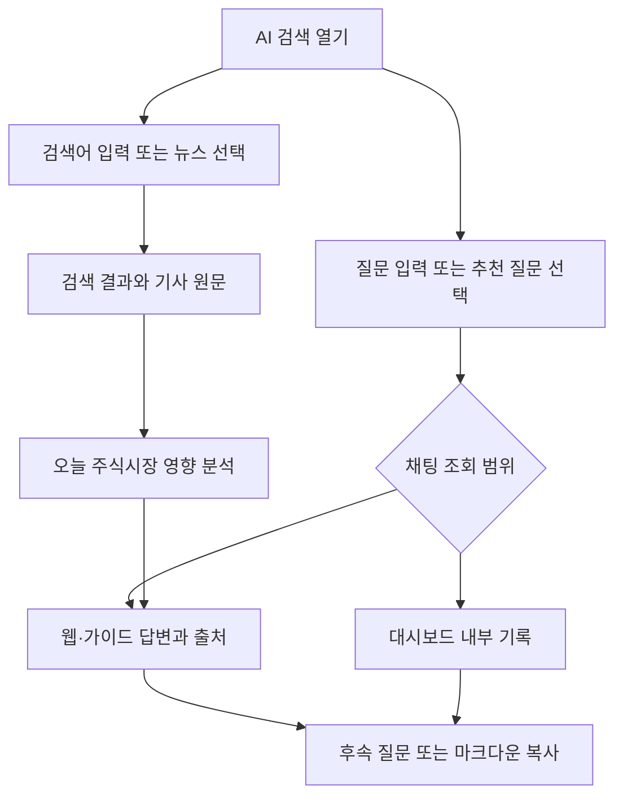

# AI 검색 사용 가이드

대시보드 위쪽 **AI 검색**에서 기사·공시 원문을 찾고, 투자 개념이나 대시보드 사용법을 질문할 수 있습니다. 사용 가이드에서 돌아오면 같은 창의 검색 결과와 대화를 이어서 볼 수 있습니다.

## 빠른 시작

프로젝트 `.env`에 `LINER_API_KEY`를 설정하고 대시보드 상단의 **AI 검색**을 엽니다.

1. **관련 자료 찾기** → 종목명, 종목코드, 이슈를 입력하고 **검색**을 누릅니다. 예를 들어 ‘삼성전자 실적 가이던스’를 찾아보세요.
2. **투자·사용법 질문하기** → **투자 AI 채팅**에 바로 질문하거나 **추천 질문**을 고릅니다. 예를 들어 “성과 비교에서 Jev의 최대 낙폭을 어떻게 읽어?”처럼 화면 이름을 적어 보세요.
3. **뉴스 영향 분석하기** → **최근 주요 뉴스**에서 제목을 고른 뒤 **오늘 주식시장 영향 분석**을 누릅니다. 관련 업종이나 확인할 지표를 이어서 질문할 수 있습니다.
4. **실계좌 잔고 조회하기** → 채팅의 **내부 데이터**를 고르고 "실계좌 1의 현재 보유 종목과 잔고는?"이라고 물어보세요. 답변에서 종목별 보유 수량과 **조회 완료** 시각을 확인합니다.

### 검색·채팅 흐름도

## 기능별 사용법

### 웹 검색과 최근 주요 뉴스

- **검색창**에는 최대 300자를 입력할 수 있습니다. 시점이나 지표를 같이 적으면 원하는 기사를 찾기 쉽습니다.
- **최근 주요 뉴스**는 오늘 기준 3일 전까지의 매매일지 중 가장 최근 기록에서 중요도 상위 5개까지 보여 줍니다. **별 1~5개와 색상**은 매매일지의 중요도 점수입니다. 제목을 누르면 그 제목으로 웹 검색을 실행합니다.
- **검색 결과**는 제목, 제공된 발행일과 요약, 원문 링크를 최대 10개 보여 줍니다. 요약의 **형광펜**은 검색어와 등락률 등 주요 숫자를 표시합니다. **원문 열기**를 눌러 새 탭에서 전체 문맥을 확인하세요.
- **오늘 주식시장 영향 분석**은 선택한 뉴스나 검색어로 새 분석 대화를 시작합니다. 관련 지수·업종, 상승·하락 요인, 추가로 볼 지표를 확인할 수 있습니다.

### 투자 AI 채팅과 출처

- **질문 입력창**은 답변 목록 아래에 있습니다. 최대 1,000자로 주식·ETF·투자법·화면 사용법을 질문하고, 이전 답변에 이어서 물어볼 수 있습니다. **자동**은 지원하는 내부 기록 질문을 대시보드에서 처리합니다.
- **답변**은 핵심 요약, 굵은 글씨, 소제목, 목록과 형광펜으로 구성됩니다.
- **출처**를 펼치면 AI가 참고한 웹 원문을 열 수 있습니다. **서비스 가이드**를 펼치면 사용법 답변에 참고한 프로젝트 문서 이름과 발췌가 표시됩니다.
- **서비스 가이드**는 화면 경로와 지표를 읽는 법을 설명합니다. 현재 계좌 잔고와 체결은 **실계좌** 또는 **트레이딩 현황**, 기록된 수익률과 최대 낙폭은 **성과 비교**에서 확인하세요.
- **마크다운 복사**는 채팅 오른쪽 위에 있습니다. 가장 최근 답변의 본문과 웹 출처, 서비스 가이드 목록을 복사합니다. 클립보드 접근이 제한되면 선택된 텍스트를 키보드로 복사할 수 있습니다.

### 내부 데이터 읽기

- **내부 데이터**를 고르면 입력한 질문과 답변을 대시보드에서 처리합니다. 내부 조회의 질문과 답변은 현재 대화에 표시되며, 웹 요청에는 웹 대화만 사용합니다.
- “이번 주 Jev 수익률은?”은 **성과 비교**에 저장된 일별 기록을 바탕으로 계산 시각, 기록 범위, 수익률과 최대 낙폭을 표시합니다. “지난주는?”처럼 기간을 바꾸거나 KODEX 200과 같은 기록일을 비교해 달라고 물을 수 있습니다.
- “오늘 모의 체결 내역은?” 또는 “오늘 실계좌 1 체결 내역은?”은 각 원장에서 기록을 조회합니다. 체결은 기간 내 최근 20건까지 표시합니다. 실계좌 기록의 시각은 원장에 저장된 주문 시각입니다.
- “모의계좌 보유 현황은?”은 마지막으로 저장된 모의 보유 스냅숏과 기준 시각을 보여 줍니다.
- “실계좌 1의 현재 보유 종목과 잔고는?”은 등록된 계좌의 예수금, 주문가능금액, 총자산, 보유 평가금액과 종목별 수량을 NH 나무 PLUG에서 조회합니다. **조회 완료**에는 마지막 응답을 받은 한국시간을 표시합니다. “다시 조회해줘”라고 물으면 새로 조회합니다.
- 실계좌 번호가 빠지면 **실계좌 1**처럼 대시보드에서 사용하는 번호를 고르도록 안내합니다. 잔고와 보유 종목은 채팅에 표시되며 Liner 요청과 웹 검색 이력에서 제외됩니다.
- “실행기 상태는?”은 요청 시점의 운영 상태를 조회합니다.

### 추천 질문

- **추천 태그**를 누르면 질문이 바로 전송됩니다. 상단의 **AI 검색**을 다시 열거나 **다른 질문**을 누르면 화면에 표시되는 추천이 바뀝니다.
- **추천 질문 전체**에서는 서비스 사용법, 서비스 용어, Jev·투자 성과, 투자 거장, 투자 기초, 시장·데이터, 전략·위험 관리의 7개 분류를 고를 수 있습니다. 질문을 고른 뒤 **선택한 질문 보내기**를 누릅니다.

### 화면 배치와 스크롤

- AI 검색 창은 화면 하단 가까이까지 열립니다. 채팅은 첫 질문 전부터 넓게 표시되며, 긴 답변을 읽으려면 **채팅 답변 목록 안에서** 스크롤합니다.
- 뉴스·추천 질문·이력은 오른쪽에 있고, 좁은 화면에서는 채팅 아래에 이어집니다. 화면 아래쪽의 섹션은 **대화상자 전체를** 스크롤해 볼 수 있습니다.
- **사용 가이드**는 같은 대화상자 안에서 열립니다. **검색·채팅**을 눌러 돌아가고, 오른쪽 위 **닫기** 또는 **Esc**로 창을 닫습니다.

## 이력·연동

### 최근 검색·질문

- 성공한 웹 검색어와 웹 질문을 중복 없이 최대 8개 표시합니다. **돋보기**는 검색, **말풍선**은 질문입니다. 항목을 누르면 같은 요청을 다시 전송합니다.
- 웹 검색어와 웹 질문 이력은 로컬 런타임의 `nhplug/ai-search-history.sqlite3`에 저장합니다. 답변과 출처는 채팅의 **마크다운 복사**로 가져갈 수 있습니다.

### 진행 상태와 오류

- 요청 중에는 상단에 **작업 내용과 경과 시간**이 표시됩니다. 경과 시간은 요청을 시작한 뒤 지난 시간입니다.
- 처리가 끝나면 결과가 자동으로 표시됩니다. 기다리는 동안 사용 가이드나 이전 답변을 읽을 수 있습니다. 새 검색과 질문은 진행 중인 요청이 끝난 뒤 보낼 수 있습니다.
- 요청이 실패하면 오류 메시지가 표시됩니다. 이전에 완료한 결과를 계속 볼 수 있고, 다른 검색어 또는 같은 질문으로 다시 요청할 수 있습니다.

### 키 설정과 요금

- 프로젝트 환경 설정에 **LINER_API_KEY**가 있으면 대시보드 상단에 **AI 검색** 버튼이 표시됩니다. **운영 → API 연동 → API 상세 → Liner → 웹 검색**에서도 열 수 있습니다.
- 웹 검색은 **Liner Search API**, 웹·가이드 채팅과 시장 영향 분석은 **Liner Search Agent API**를 사용합니다. 웹 요청은 Liner에 전송되며, 이력에서 다시 보낸 요청에도 각 API 요금이 적용됩니다.
- 연결 상태와 실패 이력은 **운영 → API 연동 → Liner**에서 확인할 수 있습니다.
