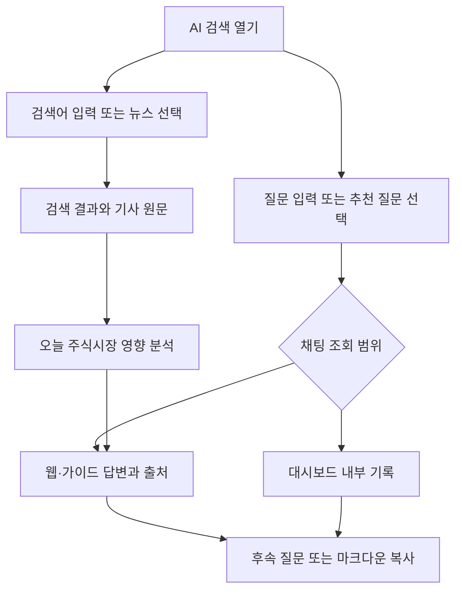

# AI 검색 사용 가이드

대시보드 위쪽 **AI 검색**에서 기사·공시 원문을 찾고, 투자 개념이나 대시보드 사용법을 질문할 수 있습니다. 사용 가이드에서 돌아오면 같은 창의 검색 결과와 대화를 이어서 볼 수 있습니다.

## 빠른 시작

프로젝트 `.env`에 `LINER_API_KEY`를 설정하고 대시보드 상단의 **AI 검색**을 엽니다.

1. **관련 자료 찾기** → 종목명, 종목코드, 이슈를 입력하고 **검색**을 누릅니다. 예를 들어 ‘삼성전자 실적 가이던스’를 찾아보세요.
2. **투자·사용법 질문하기** → 채팅 입력칸에 바로 질문하거나 **추천 질문**을 고릅니다. 예를 들어 “성과 비교에서 Jev의 최대 낙폭을 어떻게 읽어?”처럼 화면 이름을 적어 보세요.
3. **뉴스 영향 분석하기** → **최근 주요 뉴스**에서 제목을 고른 뒤 **오늘 주식시장 영향 분석**을 누릅니다. 관련 업종이나 확인할 지표를 이어서 질문할 수 있습니다.
4. **실계좌 잔고 조회하기** → 채팅의 **내부 데이터**를 고르고 "실계좌 1의 현재 보유 종목과 잔고는?"이라고 물어보세요. 답변에서 종목별 보유 수량과 **조회 완료** 시각을 확인합니다.

### 검색·채팅 흐름도



## 기능별 사용법

### 웹 검색과 최근 주요 뉴스

- **검색창**에는 최대 300자를 입력할 수 있습니다. 시점이나 지표를 같이 적으면 원하는 기사를 찾기 쉽습니다.
- **최근 주요 뉴스**는 오늘 기준 3일 전까지의 매매일지 중 가장 최근 기록에서 중요도 상위 5개까지 보여 줍니다. **별 1~5개와 색상**은 매매일지의 중요도 점수입니다. 제목을 누르면 그 제목으로 웹 검색을 실행합니다.
- **검색 결과**는 제목, 제공된 발행일과 요약, 원문 링크를 최대 10개 보여 줍니다. 요약의 **형광펜**은 검색어와 등락률 등 주요 숫자를 표시합니다. **원문 열기**를 눌러 새 탭에서 전체 문맥을 확인하세요.
- 검색 결과 위의 **오늘 주식시장 영향 분석**은 선택한 뉴스나 검색어로 새 분석 대화를 시작합니다. 관련 지수·업종, 상승·하락 요인, 추가로 볼 지표를 확인할 수 있습니다.

### 투자 AI 채팅과 출처

- **질문 입력창**은 답변 목록 아래에 있습니다. 최대 1,000자로 주식·ETF·투자법·화면 사용법을 질문하고, 이전 답변에 이어서 물어볼 수 있습니다. **자동**은 지원하는 내부 기록 질문을 대시보드에서 처리합니다.
- **답변**은 핵심 요약, 굵은 글씨, 소제목, 목록과 형광펜으로 구성됩니다.
- **출처**를 펼치면 AI가 참고한 웹 원문을 열 수 있습니다. **서비스 가이드**를 펼치면 사용법 답변에 참고한 프로젝트 문서 이름과 발췌가 표시됩니다.
- **서비스 가이드**는 화면 경로와 지표를 읽는 법을 설명합니다. 현재 계좌 잔고와 체결은 **실계좌** 또는 **트레이딩 현황**, 기록된 수익률과 최대 낙폭은 **성과 비교**에서 확인하세요.
- **새 대화**는 화면의 대화, 분석 주제와 검색 결과를 비우고 처음부터 질문합니다. 이전 대화는 왼쪽 **지난 대화**에서 다시 열 수 있습니다.
- **마크다운 복사**는 채팅 위 **자동·내부 데이터** 옆에 있습니다. 가장 최근 답변의 본문과 웹 출처, 서비스 가이드 목록을 복사합니다. 답이 두 개 이상이면 옆의 **대화 전체 복사**로 대화를 모두 복사합니다. 클립보드 접근이 제한되면 선택된 텍스트를 키보드로 복사할 수 있습니다.

### 내부 데이터 읽기

- **내부 데이터**를 고르면 입력한 질문과 답변을 대시보드에서 처리합니다. 내부 조회의 질문과 답변은 대화에 표시되고 이 PC의 지난 대화에만 남으며, 웹 요청에는 웹 대화만 사용합니다.
- “이번 주 Jev 수익률은?”은 **성과 비교**에 저장된 일별 기록을 바탕으로 계산 시각, 기록 범위, 수익률과 최대 낙폭을 표시합니다. “지난주는?”처럼 기간을 바꾸거나 KODEX 200과 같은 기록일을 비교해 달라고 물을 수 있습니다.
- “오늘 모의 체결 내역은?” 또는 “오늘 실계좌 1 체결 내역은?”은 각 원장에서 기록을 조회합니다. 체결은 기간 내 최근 20건까지 표시합니다. 실계좌 기록의 시각은 원장에 저장된 주문 시각입니다.
- “모의계좌 보유 현황은?”은 마지막으로 저장된 모의 보유 스냅숏과 기준 시각을 보여 줍니다.
- “실계좌 1의 현재 보유 종목과 잔고는?”은 등록된 계좌의 예수금, 주문가능금액, 총자산, 보유 평가금액과 종목별 수량을 NH 나무 PLUG에서 조회합니다. **조회 완료**에는 마지막 응답을 받은 한국 시간을 표시합니다. “다시 조회해 줘”라고 물으면 새로 조회합니다.
- 실계좌 번호가 빠지면 **실계좌 1**처럼 대시보드에서 사용하는 번호를 고르도록 안내합니다. 잔고와 보유 종목은 채팅에 표시되고 이 PC의 지난 대화에만 남으며, Liner 요청과 다시 요청하기 목록에서 제외됩니다.
- “실행기 상태는?”은 요청 시점의 운영 상태를 조회합니다.
- 조회할 수 있는 기간은 오늘·어제·이번 주·지난주·이번 달·지난달이고, 계좌는 한 번에 하나입니다. 성과는 공유 모의계좌 전체 기준이며 종목·전략별 성과와 미체결 주문은 해당 화면에서 확인합니다.

### 추천 질문

- **추천 태그**를 누르면 질문이 바로 전송됩니다. 상단의 **AI 검색**을 다시 열거나 **다른 질문**을 누르면 화면에 표시되는 추천이 바뀝니다.
- **전체**를 누르면 서비스 사용법, 서비스 용어, Jev·투자 성과, 투자 거장, 투자 기초, 시장·데이터, 전략·위험 관리, 노후 자금·투자 권유, 창업 준비의 9개 분류를 고를 수 있습니다. 질문을 고른 뒤 **선택한 질문 보내기**를 누릅니다.

### 투자 공부 순서

투자가 처음이라면 추천 질문을 다음 순서로 눌러 보세요. 답변에 모르는 말이 나오면 이어서 "더 쉽게 예를 들어 줘"라고 물을 수 있습니다.

1. **용어**: 투자 기초에서 "ETF와 일반 펀드는 어떻게 다른가요?"
2. **화면의 숫자**: 시장·데이터에서 "VWAP과 거래량 배율은 어떤 정보를 주나요?"
3. **투자 원칙**: 투자 거장에서 "존 보글은 왜 저비용 인덱스 펀드를 강조했나요?"
4. **내 기록 복기**: 전략·위험 관리에서 "매매일지에서 진입 근거와 청산 결과를 어떻게 복기하나요?"

도움이 된 답변은 **마크다운 복사**로 공부 노트에 모아 두세요. 답변은 참고 자료이므로 중요한 내용은 **출처**의 원문에서 확인합니다.

### 투자 권유 확인

돈을 보내기 전에 권유의 근거를 확인할 때 씁니다. **노후 자금·투자 권유** 분류에는 권유, 사칭 대화방, 정식 등록 여부, 앱 설치 요구, 퇴직금을 물어볼 질문 7개가 있습니다.

1. **물어보기**: "원금을 보장하고 월 5% 수익을 준다는 투자 권유를 받았습니다. 보내기 전에 확인할 점과 공식 확인처를 알려 주세요."처럼 들은 말을 그대로 적습니다. 질문은 Liner로 전송되므로 이름, 연락처, 계좌번호, 대화방 주소는 빼고 적습니다.
2. **출처 열기**: 답변 아래 **출처**에서 기관의 원문을 엽니다. 상대가 보낸 링크가 아니라 금융감독원 파인처럼 공식 사이트를 직접 찾아 확인하세요.
3. **멈추기**: 확인되지 않으면 보내지 않습니다. 이미 보냈다면 송금한 은행에 지급정지를 요청하고 경찰과 금융감독원(1332)에 알립니다.

AI 검색은 사기인지, 투자해도 되는지 판정하지 않습니다. 신고 이력이 조회되지 않아도 안전하다는 뜻은 아닙니다. 퇴직금의 세금은 출처마다 설명이 다를 수 있으므로 국세청이나 금융회사의 계산으로 확인하세요.

### 창업 준비 점검

투자가 아닌 결정에도 같은 방식을 쓸 수 있습니다. **창업 준비** 분류에는 퇴직 후 가게를 준비할 때 물어볼 질문 8개가 있고, 답변을 정리하는 점검표가 함께 있습니다.

1. **묻기**: 창업 준비에서 "업종별 생존율과 폐업 통계는 어디에서 보고 어떻게 읽나요?"처럼 질문하고 **출처**의 원문을 엽니다. 질문은 Liner로 전송되므로 이름, 계좌번호, 실제 주소와 같은 개인정보는 넣지 않습니다.
2. **적기**: 빈 점검표를 만들어 채웁니다. 들은 말마다 **확인됨·다름·모름** 중 하나를 적고, 확인됨과 다름에는 출처 링크를 붙입니다.

   ```bash
   .venv/bin/python scripts/startup_template.py --blank > .scratch/startup.md
   ```

3. **검사하기**: 빠진 항목을 알려 줍니다.

   ```bash
   .venv/bin/python scripts/startup_template.py --check .scratch/startup.md
   ```

점검표는 8절로 되어 있습니다. 지금 상황, 들은 말과 계획, 확인한 자료, 돈 나누기, 작게 시험하기, 멈출 기준, 아직 모르는 것, 사람의 결정 순서입니다. 검사는 출처 링크, 생활비와 비상금, 합계, 멈출 날짜와 숫자, 사람이 적은 결정이 있는지를 봅니다. 사업이 잘될지는 판단하지 않습니다. 점검 도구는 인터넷이나 매매 기록을 읽지 않고, 입력한 파일을 바꾸지 않습니다.

### 작은 창으로 묻기

- 모든 화면의 오른쪽 아래 **AI에게 묻기**를 누르면 스마트폰 크기의 채팅창이 열립니다. 대시보드를 보면서 물어볼 수 있고, 질문을 보내도 뒤 화면은 그대로입니다. 답이 도착하면 화면을 한 번 새로 그립니다.
- **채팅**, **검색**(웹 검색과 최근 뉴스), **추천**(추천 질문), **이력**(지난 대화와 다시 요청하기)을 위쪽에서 고릅니다.
- **크게**를 누르면 넓은 AI 검색 창으로, 넓은 창의 **작은 창**을 누르면 다시 작은 창으로 옮깁니다. 대화, 검색 결과, 진행 중인 요청은 두 창이 같이 씁니다.
- **닫기**는 창만 접습니다. 다시 열면 대화가 이어집니다. 답을 기다리는 동안 닫으면 버튼이 **답변 작성 중**, 도착하면 **AI 답 확인**, 실패하면 **AI 요청 실패**로 바뀝니다. 사용 가이드는 넓은 창에서 봅니다.

### 화면에서 바로 묻기

- **글자를 드래그**하면 옆에 **AI에게 묻기** 버튼이 뜹니다. 카드의 숫자를 드래그하면 그 카드 이름으로 묻습니다. 끄려면 **화면 설정 → 글자를 드래그해 AI에게 묻기**를 끕니다.
- 종합 현황·트레이딩 현황·장기투자의 **상태 카드 아래**에서 카드 이름을 누르거나, 각 탭의 **화면 안내**에서 **이 화면을 AI에게 묻기**나 용어를 누릅니다.
- 빈 작은 창에는 지금 화면에 맞는 질문 3개가 보입니다.
- 어느 길이든 작은 창에 **질문을 채우기만** 합니다. 고친 뒤 보내기를 눌러야 전송되고 요금이 적용됩니다. 서비스에 적힌 설명이 있으면 요청 없이 먼저 보여 줍니다.
- 드래그한 글의 금액·수량·비율과 6자리 이상 숫자(쉼표가 든 숫자, 줄표로 이은 번호 포함)는 **○**로 가린 채 채웁니다. 보내기 전에 입력칸에서 확인하세요.
- 표(데이터 표)와 도식 안의 글자는 브라우저가 선택을 지원하지 않아 드래그할 수 없습니다.

### 화면 배치와 스크롤

- AI 검색 창은 화면 하단 가까이까지 열립니다. 채팅은 첫 질문 전부터 넓게 표시되며, 긴 답변을 읽으려면 **채팅 답변 목록 안에서** 스크롤합니다.
- 왼쪽에는 **지난 대화**, 오른쪽에는 뉴스·추천 질문·이력이 있습니다. 좁은 화면에서는 지난 대화가 채팅 위에, 나머지가 아래에 이어지고 **대화상자 전체를** 스크롤합니다.
- 위쪽 왼쪽 끝의 **지난 대화**와 오른쪽 끝의 **뉴스·추천** 버튼으로 양쪽을 접고 펼칩니다. **최근 주요 뉴스**, **추천 질문**, **이력 · 다시 요청하기** 카드는 제목을 눌러 하나씩 접습니다. 접은 상태는 브라우저를 새로고침할 때까지 유지됩니다.
- 검색했거나 저장된 검색을 열면 검색 결과가 채팅 위에, 그 밖에는 채팅 아래에 있습니다.
- **사용 가이드**는 같은 대화상자 안에서 열립니다. 같은 자리의 **검색·채팅**을 눌러 돌아가고, 오른쪽 위 **닫기** 또는 **Esc**로 창을 닫습니다.

## 이력·연동

### 지난 대화

- 받은 답은 도착한 순간 이 PC의 `nhplug/ai-search-history.sqlite3`에 저장됩니다. 채팅의 질문·답변·출처·서비스 가이드, 시장 영향 분석의 주제, 웹 검색 결과, 내부 데이터 조회가 남습니다. 답을 기다리는 동안 창을 닫거나 새로고침해도 남습니다.
- 넓은 창의 왼쪽 **지난 대화**(작은 창은 **이력**)에서 하나를 누르면 채팅이나 검색 결과로 바로 열립니다. 위 입력칸은 제목·질문·답변에서 찾습니다.
- 연 대화의 아래 입력창에 물으면 답이 그 대화에 붙고, 대화 일시가 최근으로 바뀌어 목록 맨 위로 올라갑니다.
- 여는 것은 요청이 아니므로 요금이 없습니다. 답을 기다리는 동안에도 다른 대화를 열어 읽을 수 있고, 답이 도착하면 위쪽에 **열기** 버튼이 보입니다. 새 질문은 진행 중인 요청이 끝난 뒤 보냅니다. 그 전에 보내면 글이 입력칸에 그대로 남습니다.
- 줄에 마우스를 올리면 **보관**과 **지우기** 아이콘이 보입니다(터치 화면에서는 늘 보임). **보관**을 누르면 목록에서 빠지고 아래 **보관함**에서 봅니다. **보관 해제**로 되돌립니다. 보관한 대화에 이어 물어도 보관함에 남습니다.
- 저장은 지울 때까지 남습니다. **지우기**는 두 번 눌러 그 대화를, 목록 아래 **모두 지우기**는 보관하지 않은 지난 대화와 다시 요청하기 목록을 지우며 되돌릴 수 없습니다. 보관함은 남습니다. 이 기능 이전에 받은 답은 저장되지 않아 볼 수 없습니다.

### 다시 요청하기

- **이력 · 다시 요청하기** 카드(작은 창은 **이력** 아래)를 열면 성공한 웹 검색어와 웹 질문을 중복 없이 최대 8개 표시합니다. **돋보기**는 검색, **말풍선**은 질문입니다. 항목을 누르면 같은 요청을 다시 전송하며 요금이 적용됩니다. 받은 답을 보려면 **지난 대화**를 여세요.
- **다시 요청하기** 목록은 최근 1,000건까지 남습니다.

### 진행 상태와 오류

- 요청 중에는 상단에 **작업 내용과 경과 시간**이 표시됩니다. 경과 시간은 요청을 시작한 뒤 지난 시간입니다.
- 처리가 끝나면 결과가 자동으로 표시됩니다. 기다리는 동안 사용 가이드나 이전 답변을 읽을 수 있습니다. 새 검색과 질문은 진행 중인 요청이 끝난 뒤 보낼 수 있습니다.
- 요청이 실패하면 이유와 보낸 검색어·질문이 표시됩니다. **다시 요청**을 누르면 다시 입력하지 않고 보낼 수 있고, 이전에 완료한 결과는 계속 볼 수 있습니다.

### 키 설정과 요금

- 프로젝트 환경 설정에 **LINER_API_KEY**가 있으면 대시보드 상단에 **AI 검색** 버튼이 표시됩니다. **운영 → API 연동 → API 상세 → Liner → 웹 검색**에서도 열 수 있습니다.
- 웹 검색은 **Liner Search API**, 웹·가이드 채팅과 시장 영향 분석은 **Liner Search Agent API**를 사용합니다. 웹 요청은 Liner에 전송되며, 이력에서 다시 보낸 요청에도 각 API 요금이 적용됩니다.
- 연결 상태와 실패 이력은 **운영 → API 연동 → Liner**에서 확인할 수 있습니다.
