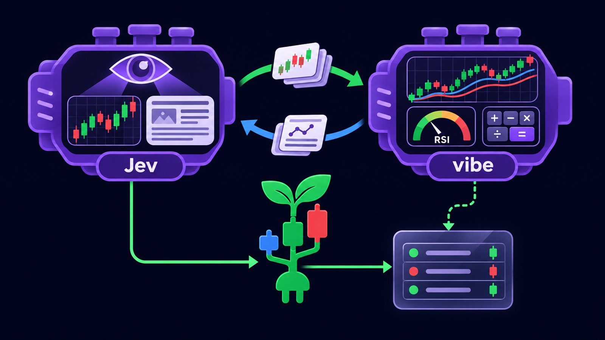
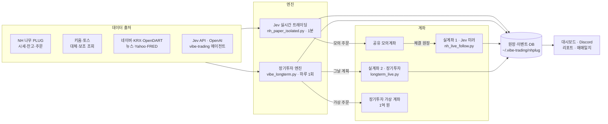
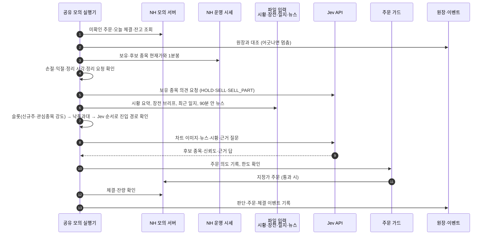
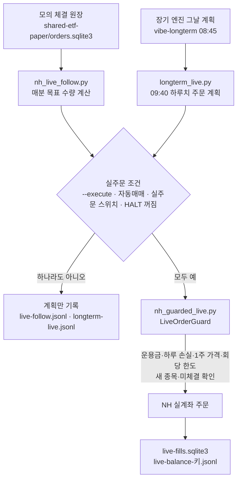
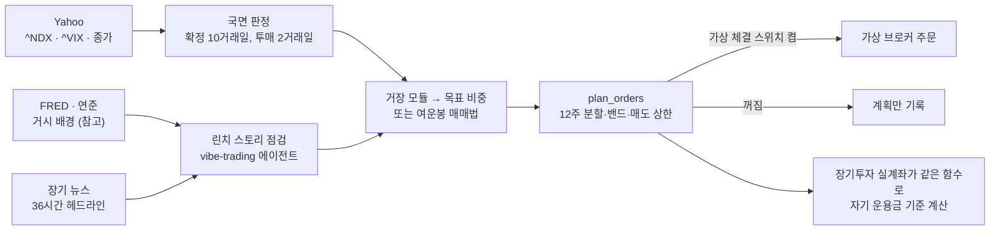

# 동작 구조

Omni AI Trading은 두 엔진으로 움직입니다. **Jev 실시간 트레이딩**은 국내 ETF·개별주를 1분 주기로 판단해 공유 모의계좌에서 매매하고, **장기투자 엔진(vibe)**은 KRX에 상장된 미국 지수·테마 ETF를 하루 한 번 판단해 가상 계좌에서 운용합니다. 실계좌는 계좌마다 둘 중 하나를 따릅니다. 이 문서는 구성 요소, 데이터가 오가는 길, 기록이 쌓이는 곳을 설명합니다.

- [한눈에 보기](#한눈에-보기)
- [두 엔진](#두-엔진)
- [계좌](#계좌)
- [구성 요소](#구성-요소)
- [데이터 출처](#데이터-출처)
- [Jev 한 회차의 흐름](#jev-한-회차의-흐름)
- [실계좌가 따라가는 길](#실계좌가-따라가는-길)
- [장기 엔진의 하루](#장기-엔진의-하루)
- [데이터 위치](#데이터-위치)
- [설정 저장과 변경 이력](#설정-저장과-변경-이력)
- [외부 API 호출 기록](#외부-api-호출-기록)
- [원본 Vibe-Trading과 이 확장의 경계](#원본-vibe-trading과-이-확장의-경계)

## 한눈에 보기





> [!IMPORTANT]
> 주문은 실행기만 냅니다. 대시보드·리포트·예약 작업은 기록을 읽고 설정을 바꿀 뿐 주문을 보내지 않습니다(예외는 [대시보드 가이드](dashboard.md#주문을-내지-않는-원칙과-예외)에 정리). 실계좌 주문은 계좌별 실주문 스위치와 보호 경로(`scripts/nh_guarded_live.py`)를 거쳐야만 실행됩니다.

## 두 엔진

| 항목 | Jev 실시간 트레이딩 | 장기투자 엔진 (vibe) |
| --- | --- | --- |
| 대상 | 국내 ETF 7종(KODEX 200·레버리지·인버스 등), 관심종목·신규상장주·낙폭과대 종목 | KRX 상장 미국 ETF 5종(나스닥100·S&P500·반도체·양자·우주)과 저수지 ETF(KOFR 금리) |
| 판단 주기 | 장중 약 1분 | 평일 하루 1회(08:45 판단, 09:40 주문, 15:40 마감) |
| 판단 방식 | Jev 이미지 모델이 분봉 차트·뉴스·시황을 보고 후보와 신뢰도를 냄. 진입·청산 규칙이 주문을 정함 | 나스닥100 낙폭·200일선·VIX로 국면을 정하고, 거장 모듈(기준 비중·달리오·막스·린치 등)이 목표 비중을 만듦 |
| 실행기 | `scripts/nh_paper_isolated.py --run --shared-default --execute` | `scripts/vibe_longterm.py --run` |
| 계좌 | 공유 모의계좌(NH 모의 서버), 실계좌 1 미러 | 가상 계좌(`virtual_paper_broker`, 1억 원), 실계좌 2 |
| 원장 | `shared-etf-paper/orders.sqlite3`·`events.jsonl` | `vibe-longterm/longterm.sqlite3`·`virtual-account.sqlite3` |
| 자세한 규칙 | [매매 전략](strategy.md) | [장기투자](longterm.md) |

두 엔진은 서로의 주문에 관여하지 않습니다. 장기 엔진은 Jev 쪽 자료를 매매일지·장전 브리프의 하루 요약으로만 참고합니다.

### 운영 엔진 모드

대시보드 **계좌·자동매매 → 운영 엔진**에서 두 엔진을 따로 켜고 끕니다(`scripts/engine_ops.py`). 값은 새 파일을 만들지 않고 각 엔진의 기존 설정에 씁니다.

| 모드 | Jev (`accounts.json` `paper-shared.auto`) | 장기투자 (`vibe-longterm/settings.json` `enabled`) |
| --- | --- | --- |
| 둘 다 운영 | 켬 | 켬 |
| Jev만 | 켬 | 끔 |
| 장기투자만 | 끔 | 켬 |
| 모두 끔 | 끔 | 끔 |

- **Jev를 끄면** 새 진입과 추가 매수만 멈춥니다. 보유 종목의 손절·익절·장 마감 정리는 계속하고, 실계좌 미러도 새로 사지 않습니다.
- **장기투자를 끄면** 다음 확인 때부터 판단·주문·마감 기록을 하지 않습니다. 가상 계좌 보유는 그대로 둡니다.

### 엔진 역할과 원장 위치

`scripts/engine_roles.py`가 "어느 엔진의 체결 원장이 어디 있나"를 정하는 유일한 곳입니다. 실계좌 미러·대시보드는 폴더를 직접 적지 않고 이 모듈에 묻습니다. 2026-11-17부터 공유 모의계좌의 엔진은 Jev로 고정이고(`accounts.problems()`가 다른 값을 거부), 예전 보조 원장 폴더 `jev-virtual`(체결 0건)과 `vibe-paper`(장중 vibe, 동결)는 기록 보관용으로만 남아 있습니다.

## 계좌

`accounts.json`의 계좌마다 `engine`이 `jev`(Jev 트레이딩) 또는 `longterm`(장기투자)입니다(`scripts/accounts.py` `ENGINES`). 공유 모의계좌는 `jev`만 됩니다.

| 계좌 | 키 | 운용 | 실행기 (launchd) | 주문 방식 |
| --- | --- | --- | --- | --- |
| 모의계좌 (공유) | `paper-shared` | Jev | `shared-etf-paper` | NH 모의 서버에 모의 주문, 주문 가드 `nhplug_order_guard` |
| 실계좌 1 | `live-1` | Jev 미러 | `live-follow-1` (평일 08:58) | 모의 체결을 계좌 크기로 따라감, `LiveOrderGuard` |
| 실계좌 2 | `live-2` | 장기투자 | `longterm-live-2` (평일 09:35) | 장기 엔진의 그날 계획을 계좌 운용금으로 집행 |
| 장기투자 가상 계좌 | (vibe-longterm) | 장기투자 | `vibe-longterm` (평일 08:40) | 가상 브로커, 수수료 0.015% |

> [!NOTE]
> 실계좌 1·2의 운용 방식은 2026-11-17 사용자 결정 기준이며 대시보드 **계좌·자동매매**에서 계좌마다 바꿀 수 있습니다. 실계좌에서 실제 주문이 나가려면 네 가지가 모두 필요합니다. ① 서비스가 `--execute`로 등록됨 ② 계좌 자동매매 켬 ③ 계좌 실주문 스위치 켬(확인 문구 입력) ④ HALT 꺼짐. 하나라도 빠지면 계획만 기록합니다. 한도와 보호 규칙은 [안전장치](safety.md)와 [실계좌](live-accounts.md)를 보세요.

## 구성 요소

<details>
<summary>실행기·수집기·기록 도구 전체 표 (펼치기)</summary>

| 구성 요소 | 파일 | 하는 일 |
| --- | --- | --- |
| 공유 모의 실행기 | `scripts/nh_paper_isolated.py` | 장중 1분 주기로 잔고 대조, 보유 관리(손절·익절·Jev 보유 의견), 진입(Jev·관심종목 강도·신규주·낙폭과대) |
| Jev 입력 묶음 | `scripts/nh_etf_auto_v2.py`, `scripts/jev_context.py`, `scripts/market_playbook.py` | 차트 이미지·당일 요약·근거 질문 7개, 시황 점검 질문 |
| 거래일 시작 | `scripts/trading_day_start.py` | 09:00 휴장·STOP·중복 확인 뒤 실행기·학습기·국면 관측기 시작, 30초 뒤 살아 있는지 확인(최대 5번 재시작) |
| 장전 사전 점검 | `scripts/preflight.py` | 08:20·08:53 서비스·계좌·설정·장전 자료 점검(읽기 전용), 실패는 Discord |
| 시황 | `scripts/market_context.py`, `scripts/etf_regime_observer.py --watch` | 코스피·코스닥 국면, 투자자·프로그램 수급, 테마, 해외 지표, 장중 해외 선물 |
| 후보 종목 | `scripts/market_movers.py`, `scripts/new_listings.py`, `scripts/issue_candidates.py` | 순위 후보(키움 선별 → NH 현재가), 신규상장, 이슈·테마 그림자 후보 |
| 뉴스 | `scripts/etf_news.py` | Google·네이버·Bing 순환, 3분 공유 캐시, 90분 안 기사만 |
| 장전 자료 | `scripts/premarket.py` | 장전 뉴스·공시·야간선물·NXT를 모아 `premarket_context`로 전달 |
| 학습 관찰기 | `scripts/isolated_paper_learning_watch.py` | 사후 관측, 장 마감 뒤 매매일지·사례집·막힌 후보 결과 갱신 |
| 실계좌 미러 | `scripts/nh_live_follow.py` | Jev 계좌: 모의 체결 원장을 계좌 크기로 미러 |
| 장기투자 실계좌 | `scripts/longterm_live.py` | 장기투자 계좌: 엔진 계획을 계좌 운용금으로 집행 |
| 보호 주문 경로 | `scripts/nh_guarded_live.py` | 실계좌 주문의 유일한 출구 |
| 주문 가드 | `agent/src/tools/nhplug_order_guard.py`, `nhplug_live_guard.py`, `nhplug_loss.py`, `nhplug_calendar.py` | 모의·실계좌 한도, 미체결·중복 차단, 하루 손실 래치, 장 시간 |
| 장기 엔진 | `scripts/vibe_longterm.py`, `scripts/longterm_dca.py`, `scripts/yeo_method.py` | 국면·거장 모듈·적립식·여운봉 매매법 |
| 장기 보조 | `scripts/longterm_macro.py`, `scripts/longterm_news.py`, `scripts/us_ideas.py`, `scripts/longterm_evidence.py` | FRED·연준 거시 배경, 장기 뉴스, 미국 종목 아이디어(참고), 주문별 근거 |
| 원장 | `scripts/trading_ledger.py` | 이벤트 JSONL을 SQLite `events_v2`로 적재 |
| 매매일지 | `scripts/trading_journal.py`, `scripts/journal_template.py` | 하루·기간 일지, 템플릿 검사 |
| 알림·리포트 | `scripts/discord_notify.py`, `scripts/report_pages.py` | Discord 두 채널, 리포트 HTML 발행 |
| 감사 | `scripts/intraday_audit.py`, `scripts/audit_incidents.py`, `scripts/longterm_audit.py` | 장중 점검, 문제 이력, 장기 복기 |
| 백업·이식 | `scripts/state_sync.py`, `scripts/backup_trading_data.py` | 설정 정리본·전체 백업 |
| 대시보드 | `streamlit_namuh/app.py` | 10개 탭, 설정 화면 |

</details>

서비스 일정은 [운영 가이드](operations.md), 예약 작업(Claude)은 [자동 작업](automation.md)에 있습니다.

## 데이터 출처

| 출처 | 받는 것 | 쓰는 곳 | `.env` 키 | 실패하면 |
| --- | --- | --- | --- | --- |
| NH 나무 PLUG (MCP `nhplug_readonly`) | 현재가·호가·1분봉, 실계좌 잔고·주문 | 모든 실행기, 대시보드 | `APP_KEY`, `APP_SECRET` | 그 회차 대기, 연속 실패 시 실행기 정지 |
| NH 나무 PLUG (MCP `nhplug_paper`) | 모의 잔고·주문·취소 | 공유 모의 실행기 | 같음 | 주문 안 함 |
| 키움 REST (조회 전용) | 순위(거래대금·거래량·등락), 업종 지수, 프로그램매매, 테마그룹 | 순위 후보 선별, 시황 대체 출처 | `KIWOOM_APP_KEY`, `KIWOOM_APP_SECRET` | 그 입력만 빠짐 또는 NH 전체 스캔 |
| 토스증권 Open API (조회 전용) | 지수 일봉, 투자자별 매매대금, 종목 마스터(상장일) | 시황·신규상장 대체 출처 | `TOSS_CLIENT_ID`, `TOSS_CLIENT_SECRET` | 그 입력만 빠짐 |
| 네이버 증권 | 지수·수급·테마, 종목 수급, 애널리스트 컨센서스·리포트, 주요 뉴스 | 시황, 낙폭과대, 매매일지, 뉴스 순환 | (없음) | 키움·토스 대체 → 20분 안 직전 값 |
| KRX KIND · KRX OpenAPI | 신규상장, 일별 시세 | 신규주 후보, 에이전트 도구 | `KRX_API_KEY` | KIND 실패 시 토스 상장일 |
| OpenDART | 공시(경영권·최대주주 변경 등) | 이슈 그림자 후보, 장전 자료 | `OPENDART_API_KEY` | 그 출처만 빠짐 |
| Google·Bing 뉴스 RSS | 시장·종목 헤드라인 | Jev 입력, 장기 뉴스 | (없음) | 다음 출처, 모두 실패 시 30분 안 캐시, 5분 재시도 대기 |
| Yahoo Finance | 해외 지수·원자재·코인, ^NDX·^VIX, KRX 종가(.KS), 장중 선물 5분봉 | 시황, 장기 국면, 사례집, 매매일지 차트 | (없음) | 그 지표 비움 |
| TradingView 스캐너 | 코스피200 야간선물 | 장전 자료 | (없음) | 장전 자료에 '미확인' |
| FRED · 연준 일정 | 금리차·실질금리·하이일드 스프레드, 경제지표·FOMC 일정 | 장기 엔진 거시 배경(참고) | `FRED_API_KEY` | 그 입력만 빠짐 |
| SEC EDGAR | 미국 공시, 13F | 미국 종목 아이디어(참고) | (없음, User-Agent) | 그 화면만 비움 |
| TypeSafe Jev | 차트 이미지·뉴스 기반 후보·보유 의견 | Jev 진입·보유 판단 | `JEV_API_KEY` | 그 회차 대기 |
| OpenAI | Decisions 빠른 판단, 실계좌 AI 관찰 | 일부 실행기 | `OPENAI_API_KEY` | 그 판단만 빠짐 |
| vibe-trading 에이전트(원본 CLI) | 위성 테마 스토리 판정 | 장기 엔진 린치 모듈 | `~/.vibe-trading/.env`의 LLM 설정 | 스토리 단계 건너뜀 |
| Discord 웹훅 · GitHub Pages | 알림 발송, 리포트 게시 | `discord_notify`, `report_pages` | `DISCORD_WEBHOOK_*`, `REPORT_PAGES_*`, `GH_TOKEN` | 다음 회차 재시도 |

> [!NOTE]
> NH 모의 서버는 시세 API를 주지 않습니다(`IGW40023`). 시세는 항상 운영 서버(`nhplug_readonly`)에서 읽고, 모의 서버는 잔고·주문에만 씁니다. 키움·토스는 조회 전용이며 주문 경로가 없습니다. 같은 NH 앱 키를 여러 프로그램이 나눠 쓰므로 몰리면 유량 초과가 납니다([FAQ](faq.md#nh-유량-초과가-납니다)).

## Jev 한 회차의 흐름

공유 모의 실행기는 장중 약 60초마다 아래 순서대로 돌아갑니다. 개장(09:00)부터 주문합니다(2026-11-19 사용자 결정, 예전에는 09:00~09:09 관찰). 첫 Jev 진입은 완료 분봉 6개가 쌓인 09:08 무렵이고, 전날부터 들고 온 포지션은 09:00~09:07에 개장 판단을 받습니다.



- 실행기는 **증권사 잔고·주문을 자기 원장과 맞춰 본 뒤에만** 주문합니다. 다른 앱이나 대시보드에서 이 계좌에 직접 주문하면 원장이 어긋나 실행기가 스스로 멈춥니다.
- 미확인 주문(`intents`의 종결되지 않은 행)이 있으면 그 회차는 대조만 하고 새 주문을 내지 않습니다.
- Jev에게 넘기는 시황·장전·일지·시황 점검 질문은 참고 맥락입니다. 주문은 승인된 진입·청산 규칙과 주문 가드가 정합니다. Jev 신뢰도는 수익 확률이 아닙니다.
- 진입 경로·청산 프로필·제한 규칙은 [매매 전략](strategy.md), 낙폭과대 경로는 [낙폭과대 반등](oversold.md)에 있습니다.

## 실계좌가 따라가는 길



미러 계좌는 모의가 사면 계좌 크기(1주 기준 또는 금액 기준)로 따라 사고, 모의가 다 팔면 같이 다 팝니다. 장기투자 계좌는 매도부터 한 건씩 내고 미체결이 있으면 기다립니다. 자세한 규칙은 [실계좌](live-accounts.md)에 있습니다.

## 장기 엔진의 하루

```mermaid
gantt
  title 장기 엔진 평일 일정 (Asia/Seoul)
  dateFormat HH:mm
  axisFormat %H:%M
  section 가상 계좌
  서비스 시작 vibe-longterm    :milestone, 08:40, 0m
  판단 국면·거시·뉴스·스토리·계획 :08:45, 45m
  주문과 적립식 · 14시 30분까지 재시도 :09:40, 290m
  마감 순자산·그림자·레시피 장부 :15:40, 50m
  section 실계좌 2
  서비스 시작 longterm-live-2  :milestone, 09:35, 0m
  주문 창                      :09:40, 290m
  미체결 정리                  :14:30, 10m
  section 리포트 (예약 작업)
  일일 전략 리포트              :milestone, 08:50, 0m
  일일 복기·감사                :milestone, 16:45, 0m
```





- 하루 한 번만 주문·입금되도록 `claims` 표(`trade:<날짜>`, `dca:<날짜>`)로 막습니다. 재시도하거나 두 번 실행돼도 같은 날 두 번 사지 않습니다.
- 판단 기록은 모두 `longterm.sqlite3`의 `decisions`(국면·거시·스토리·계획·주문·적립식·오류·시간 놓침·뉴스)에 남고, 주문마다 근거 묶음이 `evidence`에 남습니다.
- 실행 방식은 대시보드 **장기투자 → 계좌·실행 → 실행**의 '가상 체결' 스위치(`settings.json` `execute`)가 정합니다. launchd에는 `--execute`를 넣지 않습니다.
- 국면·모듈·적립식 규칙은 [장기투자](longterm.md), [적립식](longterm-dca.md), [여운봉 저수지 매매법](yeo-method.md)에 있습니다.

## 데이터 위치

저장소에는 코드·문서·설정 정리본만 있고, 실행 데이터는 `~/.vibe-trading/`(환경변수 `VIBE_TRADING_HOME`으로 바꿀 수 있음) 아래에 쌓입니다.

```text
~/.vibe-trading/
├── agent.json                 # MCP 서버 연결(nhplug_readonly · nhplug_paper)
├── integrations/nhplug-mcp/   # NH 공식 MCP 설치본(패치 적용)
├── integrations/nhplug-mcp-etf7/  # 공유 모의 주문 통로용 사본(deadline 패치 추가)
├── live/                      # 실계좌 HALT 표시(원본 Vibe-Trading 장치)
└── nhplug/
    ├── accounts.json  tunables.json  dashboard-prefs.json
    ├── settings-history.sqlite3        # 모든 설정 변경 이력
    ├── orders.sqlite3  loss.sqlite3     # 모의 주문 가드, 손실 정지
    ├── live-orders.sqlite3  live-fills.sqlite3  live-balance-<키>.jsonl
    ├── live-follow.jsonl  live-follow/  longterm-live.jsonl  longterm-live/
    ├── api-calls.sqlite3  audit-incidents.sqlite3  report-pages.sqlite3
    ├── news-cache.json  discord-notify.json  preflight/<날짜>.jsonl
    ├── shared-etf-paper/              # Jev 공유 모의
    └── vibe-longterm/                 # 장기 엔진
```

<details>
<summary>파일별 내용 (펼치기)</summary>

| 경로 (`nhplug/` 아래) | 내용 |
| --- | --- |
| `accounts.json` | 계좌 목록, 엔진, 자동매매, 금액·한도, 실계좌 규칙, 실주문 스위치, 원금 |
| `tunables.json` | 운영 조정값(장 시간, 1회 최대 수량, 캐시 초 등) |
| `dashboard-prefs.json` | 화면 설정(테마·글씨 크기·처음 여는 탭·갱신 간격) |
| `settings-history.sqlite3` | 설정 변경 이력 한 표 |
| `orders.sqlite3` | 모의 주문 가드의 의도·접수·종결 |
| `live-orders.sqlite3` | 실계좌 가드 원장(예약·전송·종결, 하루 손실 래치) |
| `live-fills.sqlite3` | 실계좌 증권사 체결(계좌 키 기준, 계좌번호 없음) |
| `live-balance-<키>.jsonl` | 실계좌 잔고 기록(5분마다) |
| `live-follow.jsonl`, `live-follow/` | 미러 회차 기록, 고정한 실계좌 몫(`units-*`), 수동 오프셋(`manual-*`) |
| `live-exit-requests-<키>.json`, `live-manual-buys-<키>.json` | 대시보드의 실계좌 매도·추가 매수 요청 |
| `longterm-live.jsonl`, `longterm-live/state-<키>.json` | 장기투자 실계좌 계획·주문 기록, 하루 상태 |
| `api-calls.sqlite3` | 외부 API 호출 집계(30일) |
| `audit-incidents.sqlite3` | 장중 감사가 찾은 문제 이력(new·open·resolved·recurred) |
| `shared-etf-paper/events.jsonl` | 공유 실행기의 판단·주문·체결 이벤트 |
| `shared-etf-paper/orders.sqlite3` | 공유 실행기 원장(의도·체결·매수 신뢰도) |
| `shared-etf-paper/trading-ledger.sqlite3` | 이벤트를 적재한 조회용 원장(`events_v2`) |
| `shared-etf-paper/strategy-settings.json`, `ai-modes.json`, `watchlist-manual.json` | 매매 기준·제한 규칙, AI 사용 여부, 관심종목 수동 편집 |
| `shared-etf-paper/exit-plans.json`, `regime-trims.json` | 보유 종목별 청산 계획, 국면 절반 매도 기록 |
| `shared-etf-paper/exit-requests.json`, `manual-buys.json`, `STOP` | 정리 요청, 수동 매수 요청, 실행기 중단 요청 |
| `shared-etf-paper/market-context.json`, `regime-observation.json`, `premarket-brief.json` | 시황 요약, 국면 판정, 장전 자료 |
| `shared-etf-paper/movers.json`, `watchlist.json`, `new-listings.json` | 순위 후보, 관심종목, 신규상장 |
| `shared-etf-paper/market-research.sqlite3` | Jev 입력·근거·판단 결과 연구 기록 |
| `shared-etf-paper/trading-journal.sqlite3`, `reviews/` | 매매일지(하루·기간), 개선안·일지·장전 분석 보고서 |
| `shared-etf-paper/oversold-cases.sqlite3` | 낙폭 사례집과 재현 기록 |
| `vibe-longterm/settings.json` | 장기 엔진 설정(모드·모듈·비중·수치·적립식·장부별 전략) |
| `vibe-longterm/longterm.sqlite3` | 판단 기록·순자산·상태·근거·하루 1회 표시 |
| `vibe-longterm/virtual-account.sqlite3` | 가상 브로커 원장 |
| `vibe-longterm/cases.sqlite3`, `ideas.sqlite3`, `reports/`, `reviews/` | 과거 사례, 미국 종목 아이디어, 전략 리포트, 복기·감사 |

</details>

> [!CAUTION]
> 원장·이벤트 파일은 지우거나 손으로 고치지 않습니다. 실행기는 매 회차 이 기록으로 증권사와 대조합니다. 바로잡을 일이 있으면 새 이벤트를 남기는 방식으로만 고칩니다. 옮기거나 되살릴 때는 [이식](portability.md) 절차를 씁니다.

## 설정 저장과 변경 이력

대시보드에서 바꾸는 값은 모두 작은 JSON 파일에 있고, 실행기가 매 회차 다시 읽습니다. 저장은 모두 `scripts/config_store.py`를 거칩니다.

- `write_json`: 같은 폴더의 임시 파일에 쓰고 `fsync` 뒤 이름을 바꿉니다. 다른 프로세스는 옛 파일이나 새 파일만 보고, 반쯤 쓴 파일은 보지 않습니다. 권한은 0600입니다.
- `record`: 무엇이 언제 어디서(대시보드·대화 승인 등) 바뀌었는지 이전 값과 새 값을 `settings-history.sqlite3` 한 표에 남깁니다.
- 이력 기록이 실패해도 저장은 됩니다. 예외는 **실주문 스위치**로, 이력을 남기지 못하면 스위치 변경도 실패합니다.

파일별 항목과 범위는 [설정 레퍼런스](configuration.md)에 있습니다.

## 외부 API 호출 기록

`scripts/api_calls.py`를 import한 프로세스는 `requests`·`urllib` HTTP 호출과 NH MCP 도구 호출(`agent/src/tools/mcp.py`)을 10분 단위·API별·엔드포인트별·호출 프로그램별로 `api-calls.sqlite3`에 셉니다. 실패는 건별로 남기고 30일 보관합니다.

| 남기는 것 | 남기지 않는 것 |
| --- | --- |
| 호출 수, 실패 수, 응답 시간, 받은 양, 마지막 성공·실패 시각, 실패 종류·HTTP 상태 | 쿼리 문자열, 요청·응답 본문, 헤더, 키, 예외 메시지. 6자리 이상 숫자는 가림 |

호스트 → API 대응은 `api_calls.HOSTS`, API별 용도 지도(데이터·엔드포인트·주기·쓰는 화면·인증 키 이름·예상 주기 `expect_min`)는 `scripts/api_catalog.py`입니다. 새 외부 API를 붙이면 두 곳을 같이 고칩니다. 기록 실패는 호출에 영향을 주지 않고, pytest 중에는 꺼집니다. 대시보드 **운영 → API 연동**이 이 기록을 보여 줍니다.

## 원본 Vibe-Trading과 이 확장의 경계

이 저장소는 [HKUDS Vibe-Trading](https://github.com/HKUDS/Vibe-Trading) 위에 국내 시장 자동매매를 더한 확장입니다.

| 영역 | 원본 Vibe-Trading | 이 확장 (Omni AI Trading) |
| --- | --- | --- |
| 위치 | `agent/`(CLI·웹·MCP 서버·스킬·백테스트), `frontend/` | `scripts/`, `streamlit_namuh/`, `guides/`, `docs/`, `ops/`, `state/` |
| `agent/` 안에 더한 것 | — | `agent/src/tools/nhplug_order_guard.py`·`nhplug_live_guard.py`·`nhplug_loss.py`·`nhplug_calendar.py`·`nhplug_live_execution.py`, `krx_daily_tool.py`, `opendart_tool.py`, `mcp.py`의 호출 기록·구조화 응답, 관련 테스트 |
| 키 | `~/.vibe-trading/.env`(LLM 공급자·모델) | 저장소 루트 `.env`(증권사·데이터·알림 키) |
| 실행 방식 | 대화형 에이전트 | launchd 서비스·예약 작업 |

확장이 원본에서 빌려 쓰는 것은 다음과 같습니다.

- **MCP 어댑터와 설정**: `src.tools.mcp.MCPServerAdapter`, `src.config.loader.load_agent_config`로 `agent.json`의 NH 서버를 엽니다.
- **런타임 폴더 규칙**: `src.config.paths.get_runtime_root`(`VIBE_TRADING_HOME`, 기본 `~/.vibe-trading`).
- **HALT 장치**: `src.live.halt.halt_flag_set`.
- **에이전트**: 장기 엔진의 테마 스토리 점검은 `scripts/vibe_agent_safe.py`로 원본 CLI를 돌립니다. 이 실행기는 셸·코드·파일·주문·브로커 도구를 빼고 띄웁니다. 주간 미국 종목 아이디어 리포트도 vibe-trading MCP의 읽기 전용 도구만 씁니다.

> [!NOTE]
> 루트 `.env`는 `scripts/local_env.py`가 **파싱만** 합니다. 셸로 실행하지 않고 `os.environ`으로 내보내지도 않으므로, 증권사 키가 LLM 에이전트 프로세스에 들어가지 않습니다.

## 변경 이력

| 날짜 | 바뀐 점 |
| --- | --- |
| 2026-11-17 | vibe를 장중 보조 엔진에서 미국 ETF 장기 엔진으로 전환. 공유 모의 엔진 Jev 고정, `jev-virtual`·`vibe-paper` 서비스 퇴역 |
| 2026-11-17 | 실계좌마다 운용 방식(Jev 미러·장기투자) 선택, 운영 엔진 모드, API 호출 기록 |
| 2026-11-18 | 뉴스 90분 제한, Jev 근거 질문·시황 점검 질문, 장전 사전 점검 |

설계 기록: 장기 엔진 설계(`docs/vibe-longterm-plan.md`, 비공개), 장기투자 실계좌 설계(`docs/longterm-live-account-plan.md`, 비공개), [거래 데이터 구조](../guides/trading-data-architecture.md).
