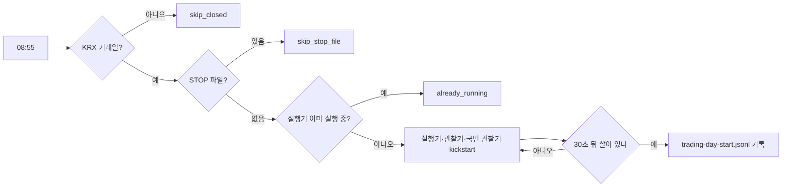
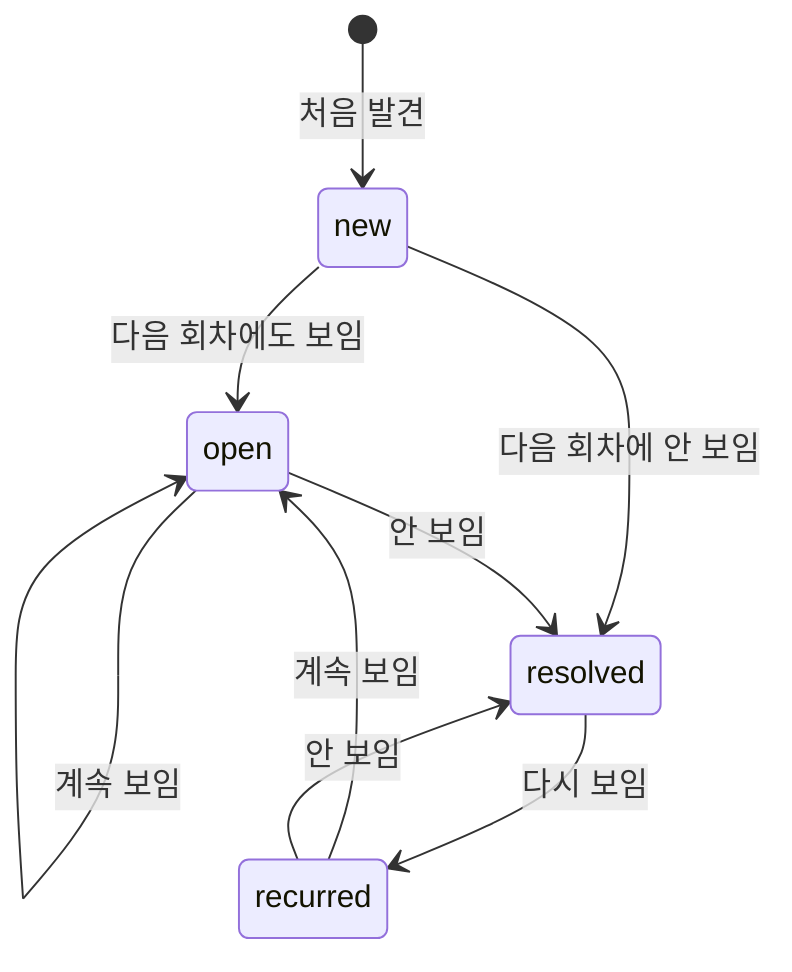

# 자동 작업

무엇이 언제 저절로 도는지 한곳에 모은 지도입니다. 자동 작업은 두 종류입니다. macOS launchd 서비스(실행기·수집기·알림)와 Claude 예약 작업(리포트·감사·점검을 쓰는 에이전트)입니다. 장중 감사, 장전 사전 점검, 예약 작업이 쓰는 읽기 전용 실행기 `scripts/ro`, 프로젝트 스킬 목록도 여기서 다룹니다.

- [평일 하루 일정](#평일-하루-일정)
- [launchd 서비스](#launchd-서비스)
- [Claude 예약 작업](#claude-예약-작업)
- [Codex 자동화와의 중복](#codex-자동화와의-중복)
- [장전 사전 점검](#장전-사전-점검)
- [거래일 시작](#거래일-시작)
- [장중 감사](#장중-감사)
- [읽기 전용 실행기 scripts/ro](#읽기-전용-실행기-scriptsro)
- [프로젝트 스킬](#프로젝트-스킬)
- [작업을 더하거나 바꿀 때](#작업을-더하거나-바꿀-때)

> [!NOTE]
> 시각은 모두 한국시간입니다. launchd는 Mac 시계를 그대로 쓰므로 Mac이 KST여야 합니다. 서비스 등록·재시작 절차는 [운영 가이드](operations.md)에 있습니다.

## 평일 하루 일정

```mermaid
gantt
  title 평일 자동 작업 (KST)
  dateFormat HH:mm
  axisFormat %H:%M
  section 장전
  장전 브리프 수집 :a1, 07:40, 90m
  사전 점검과 보완 :a2, 08:20, 33m
  장전 상세 분석 :a3, 08:31, 14m
  장기 엔진 아침 판단 :a4, 08:40, 10m
  장기 전략 리포트 :a5, 08:50, 10m
  section 장중
  이월 포지션 개장 판단 :b1, 09:00, 8m
  Jev 공유 모의와 실계좌 1 미러 :b2, 09:00, 360m
  장기투자 주문 창 :b3, 09:40, 290m
  매시 장중 감사 :b4, 09:20, 360m
  section 장후
  마감 요약과 장기 마감 :c1, 15:40, 10m
  개선안과 매매일지 :c2, 16:15, 35m
  장기 복기와 백업 :c3, 16:45, 15m
```



| 시각 | 종류 | 작업 | 하는 일 |
| --- | --- | --- | --- |
| 로그인 시 | launchd | `shared-etf-dashboard`, `discord-notify`, `shared-etf-learning`, `shared-etf-regime`, `shared-etf-paper`, `nxt-virtual` | 대시보드, 알림 감시, 관찰기, 실행기(장 밖에서는 기다림) |
| 금 07:00·07:30 | launchd | `us-ideas` | 미국 종목 아이디어: 07:30 주간 스크린, 07:00 분기 갱신(2·5·8·11월 셋째 금요일만) |
| 07:40\~09:10 | launchd | `premarket` | 장전 브리프 수집(07:40, 08:00\~08:55 매 5분, 09:00, 09:10). NXT 프리마켓 체결 요약 포함 |
| 07:55 | launchd | `nxt-virtual` | NXT 종가매매 가상 아침 청산 |
| 08:20 | launchd | `preflight` | 장전 사전 점검 1차 |
| 08:25 | Claude | `trading-preflight` | 점검 실패 보완 뒤 다시 점검 |
| 08:31 | Claude | `premarket-analysis-daily` | 장전 상세 분석 리포트 |
| 08:40 | launchd | `vibe-longterm` | 장기 엔진 시작(08:45 판단, 09:40\~14:30 가상 체결·적립식, 15:40 마감) |
| 08:50 | launchd | `market-movers` | 순위·관심종목 계산(09:00 개장을 기다렸다가 15:05까지) |
| 08:50 | Claude | `longterm-strategy-daily` | 장기투자 일일 전략 리포트 |
| 08:53 | launchd | `preflight` | 장전 사전 점검 2차 |
| 08:55 | launchd | `trading-day-start` | 거래일 확인 뒤 실행기·관찰기 준비 |
| 08:58 | launchd | `live-follow-1` | 실계좌 1 미러 실행기 |
| 09:20\~15:20 매시 20분 | Claude | `intraday-audit-hourly` | 장중 매매·차단 감사 |
| 09:35 | launchd | `longterm-live-2` | 실계좌 2 장기투자 실행기(09:40\~14:30 주문 창, 14:40까지 미체결 정리) |
| 11:30·13:30·14:30 | Claude | `trading-intraday-report` | 장중 진행 보고(대화) |
| 15:35 | launchd | `nxt-virtual` | NXT 종가매매 가상 저녁 판단 |
| 15:40 | launchd | `discord-notify` | 마감 요약 발송(늘 도는 감시 서비스) |
| 15:45 | Claude | `trading-close-report` | 장 마감 후 보고(대화) |
| 15:50 | launchd | `trading-backup` | 원장·설정 일일 사본 |
| 실행기 종료 7분 뒤 | launchd | `shared-etf-learning` | 복기, 사후 결과, 낙폭과대 사례, 매매일지 레코드 |
| 금 16:10 | launchd | `exit-replay` | 청산 규칙 사후 재현 |
| 16:15 | Claude | `trading-daily-improvement` | 장 마감 개선안 |
| 16:40 | Claude | `trading-journal` | 매매일지 |
| 16:45 | Claude | `longterm-review-daily` | 장기투자 일일 복기·감사 |
| 금 16:45 | Claude | `oversold-weekly-audit` | 낙폭과대 주간 감사 |
| 금 16:50 | Claude | `longterm-strategy-weekly` | 장기투자 주간 리포트(과거 사례 DB 갱신 포함) |
| 16:55 | launchd | `state-sync` | 설정 정리본·전체 백업 아카이브 |
| 금 17:40 | Claude | `longterm-audit-weekly` | 장기투자 주간 감사 |
| 매월 1일 17:10·17:20·17:45 | Claude | `trading-journal-period`, `longterm-strategy-monthly`, `longterm-audit-monthly` | 기간 매매일지, 장기 월간 리포트, 장기 월간 감사 |

## launchd 서비스

정의는 `scripts/launchd_services.py`의 `SERVICES` 한 곳입니다. 라벨은 `com.vibetrading.<이름>`이고, 화면 이름은 `streamlit_namuh/automation_status.py`의 `NAMES`입니다(테스트가 두 목록을 맞춰 봅니다). 로그는 `~/.vibe-trading/nhplug/<폴더>/com.vibetrading.<이름>.log`입니다.

| 이름 | 화면 이름 | 실행 | 일정 | 로그 폴더 |
| --- | --- | --- | --- | --- |
| `shared-etf-paper` | 공유 모의 ETF 실행기 | `nh_paper_isolated.py --run --shared-default --execute` (모의 주문) | 로그인 시 | `shared-etf-paper` |
| `shared-etf-learning` | 공유 모의 ETF 데이터 관찰기 | `isolated_paper_learning_watch.py --shared-default` | 로그인 시 | `shared-etf-paper` |
| `shared-etf-regime` | 시황 국면 관찰기 | `etf_regime_observer.py --watch` (15:00에 스스로 멈춤) | 로그인 시 | `shared-etf-paper` |
| `shared-etf-dashboard` | 대시보드 | `streamlit run streamlit_namuh/app.py` (127.0.0.1:8501, 새 탭 안 염) | 로그인 시 | `shared-etf-paper` (`streamlit.log`) |
| `discord-notify` | 디스코드 알림 | `discord_notify.py --watch` (30초마다) | 로그인 시 | `shared-etf-paper` |
| `nxt-virtual` | NXT 가상 실행기 | `nxt_virtual.py` (주문 없음) | 로그인 시 · 평일 07:55 · 15:35 | `nxt-virtual` |
| `premarket` | 장전 자료 수집 | `premarket.py --once` | 평일 07:40, 08:00\~08:55 매 5분, 09:00, 09:10 | `shared-etf-paper` |
| `preflight` | 장전 사전 점검 | `preflight.py` | 평일 08:20 · 08:53 | `shared-etf-paper` |
| `vibe-longterm` | 장기투자 실행기 | `vibe_longterm.py --run` | 평일 08:40 | `vibe-longterm` |
| `market-movers` | 순위·관심종목 계산기 | `market_movers.py` | 평일 08:50 | `shared-etf-paper` |
| `live-follow-1` | 실계좌 1 미러 실행기 | `nh_live_follow.py --execute --account live-1` | 평일 08:58 | `live-follow` |
| `trading-day-start` | 거래일 준비 | `trading_day_start.py` | 평일 08:55 | `shared-etf-paper` |
| `longterm-live-2` | 실계좌 2 장기투자 실행기 | `longterm_live.py --execute --account live-2` | 평일 09:35 | `longterm-live` |
| `trading-backup` | 거래 데이터 백업 | `backup_trading_data.py` | 평일 15:50 | `shared-etf-paper` |
| `state-sync` | 상태 백업 | `state_sync.py export` | 평일 16:55 | `shared-etf-paper` |
| `exit-replay` | 청산 재현 | `exit_replay.py` | 금 16:10 | `shared-etf-paper` |
| `us-ideas` | 미국 종목 아이디어 | `us_ideas.py --scheduled` (참고 정보, 주문 없음) | 금 07:00 · 07:30 | `vibe-longterm` |

> [!IMPORTANT]
> 저장소가 생성하는 `live-follow-1`과 `longterm-live-2` 정의에는 `--execute`가 들어 있습니다. 실제 설치에 등록된 인자는 다를 수 있습니다. 실주문은 실행 인자 외에도 계좌별 자동매매·실주문 스위치, HALT 상태와 주문 보호 조건을 확인합니다. [실주문이 나가는 조건](live-accounts.md#실주문이-나가는-조건)

**퇴역한 서비스** (2026-11-17, plist는 `~/.vibe-trading/nhplug/retired-launchd-2026-11-17/`에 보관): `vibe-advisor`, `vibe-paper`, `vibe-fast-exit-observer`, `vibe-event-advisor`, `vibe-event-replay`, `live-follow-2`, `jev-virtual`. 다시 쓰려면 별도 승인과 재등록이 필요합니다.

## Claude 예약 작업

Claude Code의 scheduled-tasks에 등록된 에이전트 작업입니다. 실제 정의는 `~/.claude/scheduled-tasks/<taskId>/SKILL.md`이고, 저장소에는 복사본 `ops/scheduled-tasks/<taskId>/SKILL.md`와 일정 목록 `ops/scheduled-tasks/manifest.json`이 있습니다.

| taskId | 일정 (cron) | 스킬 | 결과 |
| --- | --- | --- | --- |
| `trading-preflight` | 평일 08:25 (`25 8 * * 1-5`) | vibe-trading | 점검 보완 보고(대화) |
| `premarket-analysis-daily` | 평일 08:31 | premarket-analysis | `reviews/premarket-DAY.md` |
| `longterm-strategy-daily` | 평일 08:50 | longterm-strategy-writer | `vibe-longterm/reports/strategy-DAY.md·json` (장기투자 꺼짐이면 쓰지 않음) |
| `intraday-audit-hourly` | 평일 09\~15시 20분 (`20 9-15 * * 1-5`) | intraday-audit | `reviews/operations-audit-DAY.md` |
| `trading-intraday-report` | 평일 11:30·13:30·14:30 | vibe-trading | 대화 보고 |
| `trading-close-report` | 평일 15:45 | vibe-trading | 대화 보고 |
| `trading-daily-improvement` | 평일 16:15 | vibe-trading | `reviews/improvement-DAY.md` |
| `trading-journal` | 평일 16:40 | trading-journal-writer | `reviews/journal-DAY.json·md`, 일지 DB 병합 |
| `longterm-review-daily` | 평일 16:45 | vibe-trading (`longterm_audit.py`) | `vibe-longterm/reviews/audit-DAY.md` |
| `oversold-weekly-audit` | 금 16:45 | vibe-trading | `reviews/oversold-weekly-DAY.md` |
| `longterm-strategy-weekly` | 금 16:50 | longterm-strategy-writer | 주간 전략 리포트 |
| `longterm-audit-weekly` | 금 17:40 | vibe-trading | `audit-YYYY-Www.md` |
| `trading-journal-period` | 매월 1일 17:10 | trading-journal-writer | 월·분기·반기·연 매매일지 |
| `longterm-strategy-monthly` | 매월 1일 17:20 | longterm-strategy-writer | 월간 전략 리포트 |
| `longterm-audit-monthly` | 매월 1일 17:45 | vibe-trading | `audit-YYYY-MM.md` |

`reviews/`는 `~/.vibe-trading/nhplug/shared-etf-paper/reviews/`, `vibe-longterm/`은 `~/.vibe-trading/nhplug/vibe-longterm/`입니다.

일회성 작업도 같은 곳에 있습니다(예: 11-19 검수 수정분 점검 `longterm-fixes-check-2026-11-19`·`jev-review3-check-2026-11-19`·`longterm-intraday-audit-2026-11-19`, 11-30 `strength-shadow-10day-review`). 날짜가 지나면 정리 대상입니다.

모든 예약 작업은 공통 규칙을 따릅니다.

- 운영자 로컬의 `AGENTS.md`(사용자 결정 원문, 비공개·git 제외)를 먼저 읽습니다.
- **읽기 전용**: 주문, 설정·스위치 변경, 서비스 조작, 원장·이벤트 수정을 하지 않습니다. 개선안은 제안만 합니다. (예외: `trading-preflight`는 빠진 서비스 재등록처럼 개장 준비를 고칠 수 있지만, 매매 규칙·한도·실주문 스위치·STOP/HALT는 건드리지 않습니다.)
- 셸 명령은 [`scripts/ro`](#읽기-전용-실행기-scriptsro)로 하나씩만 실행합니다. 그래서 사람이 없어도 승인 대기로 멈추지 않습니다.

> [!TIP]
> 새 환경에서 이 작업들을 프롬프트로 만드는 법과 작업마다의 지시문 요약은 [AI와 함께 쓰기 6절](ai-agents.md#6-예약-작업-등록)에 있습니다.

> [!TIP]
> 예약 작업을 고쳤으면 `state_sync.py tasks-export`로 `ops/scheduled-tasks/` 복사본을 갱신합니다. 새 계정에서 다시 만드는 법은 [이식](portability.md)에 있습니다. 복사본은 내보낸 시점 기준이라 지금 등록된 목록과 다를 수 있습니다.

## Codex 자동화와의 중복

같은 일을 하는 Codex 자동화가 있습니다. 둘 다 켜면 같은 리포트·감사가 두 번 돌아갑니다.

| Codex 자동화 | 같은 일을 하는 Claude 예약 작업 | 상태 |
| --- | --- | --- |
| 장전 상세 분석 작성 (평일 08:42) | `premarket-analysis-daily` (08:31) | 2026-11-17부터 일시 정지 |
| 장중 매매·차단 감사 (평일 매시 20분) | `intraday-audit-hourly` | 2026-11-17부터 일시 정지 |

두 쪽은 같은 스킬 원본(`.agents/skills/premarket-analysis`, `.agents/skills/intraday-audit`)과 수집기를 쓰므로 결과 형식이 같습니다. **둘 중 하나만 켭니다.** 상태는 대시보드 **운영 → 자동 작업**에서 봅니다(Codex는 `~/.codex/automations/<id>/automation.toml`의 `status`를 읽음).

> [!NOTE]
> `scripts/report_pages.py`의 장전 분석 일정 표기는 아직 'Codex 08:42'로 남아 있습니다. 실제로 리포트를 쓰는 것은 08:31 Claude 예약 작업입니다.

## 장전 사전 점검

`scripts/preflight.py`가 개장 전에 필요한 것을 읽기 전용으로 확인합니다. launchd `preflight`가 평일 08:20·08:53에 돌리고, 기록은 `~/.vibe-trading/nhplug/preflight/<날짜>.jsonl`에 쌓입니다. 실패가 있으면 Discord 실시간 채널에 실패 항목만 보냅니다(`--no-send`면 보내지 않음).

| 점검 | 통과 조건 | 시작 |
| --- | --- | --- |
| 서비스 등록 | 거래일에 필요한 11개 서비스 등록(`NEEDED`) | 08:20 |
| 중단 파일·HALT | 공유 모의·장기·전역 `STOP`과 NH HALT가 없음 | 08:20 |
| NH 모의 계좌·계좌 목록 | 실행기 시작 검사와 같은 확인(정책·소유·계좌 목록) | 08:20 |
| 미확인 주문 | 끝나지 않은 주문 0건 | 08:20 |
| 계좌·매매 기준 설정 | `accounts.json`·`strategy-settings.json`이 유효 | 08:20 |
| `.env` 키 | `JEV_API_KEY`·`DISCORD_WEBHOOK_REALTIME`·`FRED_API_KEY`가 있음 | 08:20 |
| 장전 자료 수집 | 30분 안 수집, 실패 절 없음(09:00 뒤에는 야간선물·NXT 호가 제외) | 08:20 |
| 시황 자료 | `market-context.json`이 24시간 안 | 08:20 |
| 장기 엔진 아침 판단 | 오늘 `regime` 판단 기록(장기투자 꺼짐이면 통과) | 08:47 |
| 순위 후보 | 오늘 `movers.json`. 09:00 전에는 순위 서비스가 개장을 기다리며 떠 있으면 통과 | 08:51 |
| 장전 상세 분석 작성 | 오늘 리포트가 있고 템플릿 검사 통과 | 08:52 |

휴장일이면 점검 없이 통과로 끝납니다. 시작 시각 전인 항목은 "HH:MM 뒤 점검"으로 남습니다.

평일 08:25 예약 작업 `trading-preflight`가 이 결과를 읽고 고칠 수 있는 것을 고친 뒤 다시 점검합니다. STOP·HALT는 사람이 일부러 켠 것일 수 있어 지우지 않고, 미확인 주문은 재전송하지 않으며, 설정 값 변경은 사용자 승인으로 넘깁니다.

## 거래일 시작

launchd `trading-day-start`(평일 08:55, `scripts/trading_day_start.py`)가 그날 실행기를 준비합니다. 주문 판단은 개장부터 시작합니다.



- 다시 띄우기는 서비스마다 5번까지입니다(NH 계좌 목록 일시 오류로 시작 직후 멈춘 11-18 사례).
- 휴장 표를 읽지 못하면 기록에 남기고 시작합니다. 실행기는 실시간 시세 없이는 매매하지 못합니다.
- 끝나지 않은 주문은 기록만 하고 막지 않습니다. 실행기 첫 회차가 증권사와 대조하고, 풀릴 때까지 새 주문을 내지 않습니다.
- 주문은 개장(09:00)부터입니다. 손절 주문도 09:00부터 실행됩니다(2026-11-19 사용자 결정. 예전에는 09:00\~09:09에 관찰만 함).

## 장중 감사

평일 09:20부터 15:20까지 매시 20분에 예약 작업 `intraday-audit-hourly`가 스킬 `intraday-audit`(원본 `.agents/skills/intraday-audit/SKILL.md`)으로 Jev 공유 모의·실계좌 미러·장기투자 실행 상태를 감사합니다.

1. **수집**: `scripts/ro intraday_audit.py --since <직전 회차 HH:MM>`이 서비스 상태, 원장(체결·미종결 주문·회차 간격·진입 차단), 장전 입력, Jev 입력의 출처와 신선도, 실계좌 미러 모드, 날짜별 확인 진행을 JSON 하나로 냅니다. 기록 DB 6개의 `integrity_check`(손상이면 `db.corrupt`)와 학습 관찰기 연속 실패(`learning.error`), 같은 종목·같은 진입 거절 사유가 3분 연속인 경우(`entry.repeat_block`)도 봅니다. 증권사 API는 부르지 않습니다.
2. **발견**: 수집기가 이상을 키(`영역.종류:대상`, 예 `service.down:shared-etf-paper`)로 만들고, 그날 감사 파일과 비교해 `new`·`ongoing`·`resolved`를 붙입니다.
3. **기록**: `~/.vibe-trading/nhplug/shared-etf-paper/reviews/operations-audit-YYYY-MM-DD.md` 끝에 회차 절을 덧붙입니다. 같은 문제는 다시 쓰지 않습니다.
4. **날짜별 확인**: 새 기능이 실제 장에서 처음 도는지 한 번 볼 항목은 `.agents/skills/intraday-audit/references/checks.md`에 있습니다. 완료하면 `[check-done:<id>]`를 씁니다.
5. **알림**: 스킬의 알림 기준에 맞을 때만 대화로 알립니다.

### 감사 이력 (여러 날에 걸친 재발 추적)

`scripts/audit_incidents.py`가 수집기의 발견 키를 `~/.vibe-trading/nhplug/audit-incidents.sqlite3`에 날짜를 넘어 쌓습니다. 이 DB를 쓰는 것은 이 모듈뿐입니다.



- `REGISTRY`에 문제 종류마다 제목, 원인, 고친 곳, 고친 것을 지키는 테스트를 적어 둡니다.
- `recurred`(고쳤던 문제가 다시 생김)는 바로 알리고 보완합니다.
- 새 문제를 고치면 REGISTRY 항목과 감지기·테스트를 함께 더합니다.

```bash
scripts/ro audit_incidents.py                    # 모든 문제, 최근 순
scripts/ro audit_incidents.py --since 2026-11-18
```

## 읽기 전용 실행기 scripts/ro

예약 작업은 사람이 없을 때 돌아갑니다. 셸 명령마다 승인을 기다리면 멈추므로(11-18 08:50 장기 리포트가 30분 대기), 허용된 읽기 전용 명령만 `scripts/ro` 하나로 묶었습니다. 권한 규칙 하나(`Bash(scripts/ro *)`)로 승인 없이 돌아갑니다.

| 형식 | 하는 일 |
| --- | --- |
| `scripts/ro <스크립트.py> [인자]` | 허용 목록의 스크립트 실행(PYTHONPATH는 `ro`가 넣음) |
| `scripts/ro --out <파일> <스크립트.py> …` | 출력을 파일로(리다이렉트 대신) |
| `scripts/ro sql <~/.vibe-trading 아래 DB> "<SELECT…>"` | 읽기 전용 SQLite 질의 한 문장(SELECT·WITH·PRAGMA), 줄마다 JSON |
| `scripts/ro services` | `launchctl list`의 vibetrading 서비스 |
| `scripts/ro pytest <scripts/test_*.py…>` | `scripts/`·`streamlit_namuh/` 테스트(`-q -x -v -k -p no:cacheprovider`만) |
| `scripts/ro vibe-status` | 장기 엔진 켜짐 여부 |

<details>
<summary>허용 스크립트와 막는 것</summary>

허용 스크립트: `longterm_report.py`, `longterm_audit.py`, `longterm_cases.py`, `us_ideas.py`, `intraday_audit.py`, `oversold_outcomes.py`, `oversold_research.py`, `oversold_cases.py`, `daily_improvement.py`, `trading_journal.py`, `journal_template.py`, `premarket.py`, `premarket_template.py`, `preflight.py`, `launchd_services.py`, `nh_live_shadow.py`, `etf_regime_observer.py`, `market_movers.py`(`--once`만), `jev_explain.py`, `audit_incidents.py`

막는 것:
- `--execute`·`--live`·`--watch` 인자
- 주문·실주문 스크립트(목록에 없음)
- `..`이 든 경로, 허용 폴더 밖 경로. 파일 경로 인자와 `--out`은 `.scratch/`, `~/.vibe-trading/nhplug/vibe-longterm/reports/`·`reviews/`, `~/.vibe-trading/nhplug/shared-etf-paper/reviews/` 아래만 됩니다.

</details>

권한 규칙은 `.claude/settings.local.json`(git 제외)에 있습니다.

| 규칙 | 뜻 |
| --- | --- |
| `Bash(scripts/ro *)` | 위 실행기 |
| `Edit(.scratch/**)` | 작업 파일 |
| `Edit(~/.vibe-trading/nhplug/shared-etf-paper/reviews/**)` | 리포트 쓰기 |
| `Read(~/.vibe-trading/**)` | 실행 데이터 읽기 |

> [!WARNING]
> 서비스 등록·재시작, 코드 수정, 설정 변경은 실행기 밖이라 여전히 승인이 필요합니다. 예약 작업은 사람이 없으면 하지 않고 보고만 합니다. 작업 지시문에 `PYTHONPATH=… python scripts/X.py`로 적힌 명령은 `scripts/ro X.py`로 바꿔 실행합니다.

## 프로젝트 스킬

스킬은 `.claude/skills/`(git에 있음)에 있습니다. 일부는 `.agents/skills/`(개인 폴더, git 제외)를 가리키는 링크라 새 기기에서 다시 연결합니다. Codex에서 쓰려면 `.agents/skills/`에 링크로 연결합니다([AI와 함께 쓰기 3절](ai-agents.md#3-스킬-설치)). 역할과 구동 시점은 `scripts/skill_catalog.py`(대시보드 **운영 → 스킬**)에 정리돼 있습니다.

| 스킬 | 역할 | 구동 |
| --- | --- | --- |
| `trading-journal-writer` | 하루·기간 매매일지 작성 ([매매일지](journal.md)) | 16:40, 매월 1일 17:10, 요청 |
| `premarket-analysis` | 장전 상세 분석 ([장전 분석](premarket.md)) | 08:31, 요청 |
| `intraday-audit` | 장중 매매·차단 감사 | 매시 20분, 요청 |
| `longterm-strategy-writer` | 장기투자 일일·주간·월간 전략 리포트 | 08:50, 금 16:50, 매월 1일 17:20 |
| `report-html-publisher` | 리포트 HTML 발행 ([리포트 발행](report-pages.md)) | `discord-notify`가 30초마다, 요청 |
| `vibe-trading` | 이 저장소 운영 규칙·보고·리서치 도구 | 진행 보고·마감 보고·개선안·주간 감사 |
| `ops-bootstrap` | 새 계정·새 기기에서 이어 가기·복원 ([이식](portability.md)) | 요청 |
| `danswer-market-trading` | 『실전 시황 트레이딩』 판단표(장전 분석·매매일지 복기에서 참조, 운영자 개인 자료라 배포하지 않음) | 다른 스킬이 참조 |
| `verify-dashboard` | 대시보드 변경을 실제 화면으로 확인 | 개발할 때 |
| `automation-guideline-review` | 예약 작업·자동화 지침 검수 | 요청할 때만 |
| `developing-with-streamlit`, `ui-ux-pro-max`, `design-taste-frontend` | 대시보드·리포트 화면 개발 보조 | 개발할 때 |

이 밖의 디자인·애니메이션 스킬은 랜딩페이지 작업용입니다.

## 작업을 더하거나 바꿀 때

- **launchd 서비스**: `launchd_services.py`의 `SERVICES`에 넣고 `automation_status.NAMES`에 화면 이름을 더합니다. 거래일에 꼭 필요하면 `preflight.NEEDED`와 `intraday_audit.SERVICES`에도 넣습니다. 등록 절차는 [운영 가이드](operations.md)를 따릅니다.
- **예약 작업**: scheduled-tasks에서 만들고 `state_sync.py tasks-export`로 복사본을 갱신합니다. `skill_catalog.JOBS`에도 한 줄 더합니다.
- **스킬**: `.claude/skills/<이름>/SKILL.md`에 두고 `skill_catalog.SKILLS`에 역할·구동·결과·화면을 적습니다.
- **Codex 자동화**를 다시 켤 때는 같은 일을 하는 Claude 예약 작업을 먼저 끕니다.
