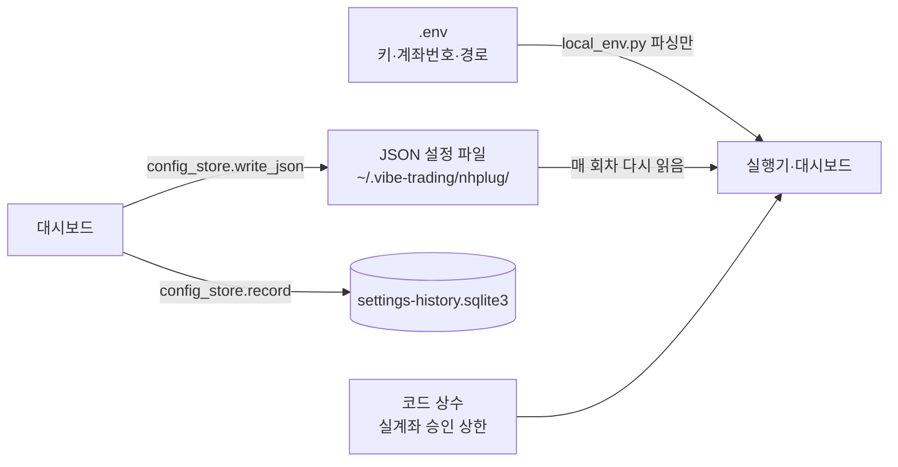

# 설정 레퍼런스

이 시스템의 설정은 세 곳에 나뉩니다. 비밀값과 경로는 `.env`, 대시보드에서 바꾸는 값은 런타임 폴더의 JSON 파일, 실계좌 승인 상한은 코드에 있습니다. 이 문서는 파일마다 무엇을 담는지, 기본값과 허용 범위, 저장과 이력 방식을 정리합니다.

- [설정이 있는 곳](#설정이-있는-곳)
- [1. `.env` (키)](#1-env-키)
- [2. 설정 파일 한눈에](#2-설정-파일-한눈에)
- [3. 저장 방식과 변경 이력](#3-저장-방식과-변경-이력)
- [4. 계좌 설정 (`accounts.json`)](#4-계좌-설정-accountsjson)
- [5. 매매 기준 (`strategy-settings.json`)](#5-매매-기준-strategy-settingsjson)
- [6. 운영 조정값 (`tunables.json`)](#6-운영-조정값-tunablesjson)
- [7. 장기 엔진 (`vibe-longterm/settings.json`)](#7-장기-엔진-vibe-longtermsettingsjson)
- [8. 그 밖의 설정 파일](#8-그-밖의-설정-파일)
- [9. 코드에 두는 승인 상한](#9-코드에-두는-승인-상한)

> [!IMPORTANT]
> 아래 '기본'은 **코드의 기본값**입니다. 대시보드에서 바꾼 값은 JSON 파일에 저장되므로 지금 운영 값은 대시보드나 해당 파일에서 확인합니다. 예를 들어 `scale_max_adds`(기본 2)나 종목당 최대 `per_symbol_krw`(기본 300만 원)는 운영 중에 여러 번 바뀌었습니다.

## 설정이 있는 곳

## 1. `.env` (키)

`.env.example`을 복사해 `.env`(권한 600)를 만듭니다. 키마다 자세한 설명과 발급처는 `.env.example`의 주석에 있습니다. 이 문서와 화면은 키 **이름**만 다루고 값을 보여 주지 않습니다.

| 키 | 필수 | 용도 | 주로 읽는 곳 |
| --- | --- | --- | --- |
| `APP_KEY`, `APP_SECRET` | 예 | NH 나무 PLUG 시세·잔고·주문(운영·모의 서버 공용) | `nhplug_mcp.py`, `nh_guarded_live.py`, `nh_live_follow.py` |
| `ACCOUNT_NUMBER`, `ACCOUNT_NUMBER_2` … | 실계좌를 쓸 때 | 실주문을 허용할 실계좌(같은 앱 키에 연결된 계좌) | 실계좌 보호 주문 경로 |
| `IMITATION_ACCOUNT_NUMBER` | 아니오 | 참고용. 모의계좌는 `agent.json`의 `--account`와 계좌 해시로 정함 | (읽지 않음) |
| `JEV_API_KEY` | Jev 사용 시 | 차트 이미지·뉴스 판단 | `nh_etf_auto_v2.py` → 공유 모의 실행기 |
| `OPENAI_API_KEY` | 권장 | Decisions 빠른 판단, 실계좌 AI 관찰 | `nh_etf_paper_runner.py`, `nh_live_ai_observer.py` |
| `KRX_API_KEY`, `OPENDART_API_KEY` | 아니오 | 일별 시세, 공시·재무 | 에이전트 도구, `issue_candidates.py` |
| `KIWOOM_APP_KEY`, `KIWOOM_APP_SECRET` | 아니오 | 키움 순위·업종·프로그램매매·테마(조회 전용, IP 등록 필요) | `kiwoom_data.py`, `market_movers.py`, `market_context.py` |
| `TOSS_CLIENT_ID`, `TOSS_CLIENT_SECRET` | 아니오 | 토스 지수 일봉·투자자 매매대금·종목 마스터(조회 전용, IP 허용 목록) | `toss_data.py` |
| `FRED_API_KEY` | 아니오 | 장기 엔진 거시 배경 | `longterm_macro.py` |
| `DISCORD_WEBHOOK_REALTIME`, `DISCORD_WEBHOOK_LONGTERM` | 아니오 | Jev·운영 알림 / 장기투자 알림 | `discord_notify.py` |
| `REPORT_PAGES_REPO`, `REPORT_PAGES_URL`, `REPORT_PAGES_BRANCH`, `REPORT_PAGES_PUSH`, `GH_TOKEN` | 아니오 | 리포트 HTML GitHub Pages 게시(`REPORT_PAGES_PUSH=on`일 때만 푸시) | `report_pages.py` |

찾는 순서(`scripts/local_env.py`): 환경변수 `VIBE_TRADING_ENV_FILE`에 적은 경로 → 저장소 루트 `.env` → 저장소 상위 폴더 `.envrc`(예전 방식, 새로 쓰지 않음). 셸로 실행하지 않고 `KEY=값` 줄만 읽으며, 값을 `os.environ`으로 내보내지 않습니다.

| 셸 환경변수 | 뜻 |
| --- | --- |
| `VIBE_TRADING_HOME` | 런타임 폴더(기본 `~/.vibe-trading`) |
| `VIBE_TRADING_ENV_FILE` | 읽을 `.env` 경로 |
| `VIBE_TRADING_TUNABLES`, `VIBE_TRADING_SETTINGS_HISTORY` | `tunables.json`·이력 DB 경로 바꾸기(테스트·리허설용) |
| `VIBE_TRADING_SEC_UA` | SEC EDGAR 요청의 User-Agent |

> [!NOTE]
> LLM 에이전트(원본 vibe-trading CLI·웹·MCP)의 공급자·모델 설정은 루트 `.env`가 아니라 `agent/.env.example`을 참고해 `~/.vibe-trading/.env`에 둡니다. 장기 엔진의 테마 스토리 점검이 이 설정을 씁니다. 에이전트 도구로 KRX·공시를 조회하려면 `KRX_API_KEY`·`OPENDART_API_KEY`를 그 파일에도 넣습니다.

## 2. 설정 파일 한눈에

모두 `~/.vibe-trading/nhplug/` 아래에 있습니다.

| 파일 | 담는 것 | 바꾸는 화면 | 반영 |
| --- | --- | --- | --- |
| `accounts.json` | 계좌 목록, 운용 방식, 자동매매, 금액, 주문 보호 한도, 실계좌 규칙, 실주문 스위치, 원금 | 계좌·자동매매, 종합 현황(원금) | 실행기 다음 회차 |
| `shared-etf-paper/strategy-settings.json` | 공유 모의 실행기의 진입·청산·분할·제한 규칙·낙폭과대·시각 | 계좌·자동매매 → 모의계좌, 트레이딩 현황 → 전략·AI 설정 | 실행기 다음 회차 |
| `tunables.json` | 운영 조정값(장 시간, 1회 최대 수량, 조회 실패 한도, 캐시 초 등) | 운영 상태 → 운영 조정값, 계좌·자동매매(수량) | 대시보드 값은 바로, 실행기 값은 재시작 뒤 |
| `dashboard-prefs.json` | 화면 설정(테마·글씨·처음 탭·갱신 간격·금액 단위) | 오른쪽 위 화면 설정 | 바로 |
| `shared-etf-paper/ai-modes.json` | Jev·Decision 사용 여부 | 트레이딩 현황 → 전략·AI 설정 | 다음 안전 주기(`ai-modes.pending.json`을 거침) |
| `shared-etf-paper/watchlist-manual.json` | 관심종목 수동 추가·제외(`{"add": {코드: 이름}, "remove": [코드]}`) | 사이드바 관심종목 편집 | 다음 관심종목 갱신 |
| `vibe-longterm/settings.json` | 장기 엔진 운영 스위치·모드·모듈·비중·수치·적립식·장부별 전략 | 장기투자 탭, 계좌·자동매매(장기투자 계좌) | 장기 엔진 다음 확인 |
| `vibe-longterm/longterm-watchlist.json` | 적립식 관심목록 슬리브(엔진 6종 밖 국내 종목) | 장기투자 → 전략 → 적립식 | 다음 적립 |

## 3. 저장 방식과 변경 이력

- 모든 설정 저장은 `scripts/config_store.py`를 거칩니다. `write_json`은 같은 폴더 임시 파일 → `fsync` → 이름 바꾸기 순서로 써서, 다른 프로세스가 반쯤 쓴 파일을 보지 않게 합니다. 파일 권한은 0600, 폴더는 0700입니다.
- `record`는 무엇이 언제 어디서 바뀌었는지(이전 → 이후, 출처: 대시보드·대화 승인 등)를 `nhplug/settings-history.sqlite3` 한 표에 남깁니다. 대시보드 **운영 상태 → 설정 변경 이력**에서 최신 300건을 봅니다.
- 이력 기록이 실패해도 저장은 됩니다. **실주문 스위치만은 예외**로, 이력을 남기지 못하면 스위치 변경도 실패합니다. 예전 `live-order-switch.jsonl`은 처음 스위치를 바꿀 때 이 이력으로 옮겨지고 `*.imported`로 이름이 바뀝니다.
- 값이 범위를 벗어났을 때의 처리는 파일마다 다릅니다.

| 파일 | 잘못된 값이 있으면 |
| --- | --- |
| `accounts.json` | 그 계좌를 안전한 기본값(자동매매 OFF)으로 표시하고 다시 저장하라고 알림 |
| `strategy-settings.json` | 파일 전체를 기본값으로 읽음(상태 `invalid`). 저장할 때는 범위·관계 검사를 통과해야 함 |
| `tunables.json` | 그 값만 가까운 경계값으로 맞춤(읽을 수 없으면 기본값) |
| `vibe-longterm/settings.json` | 그 항목만 기본값이나 경계값으로. 비중이 규칙을 어기면 비중 전체를 기본값으로 |

## 4. 계좌 설정 (`accounts.json`)

계좌마다 `label`, `kind`(`paper`·`live`), `engine`(`jev`·`longterm`), `auto`, `budget`이 있습니다. 공유 모의계좌는 `engine`이 `jev`로 고정입니다(`scripts/accounts.py` `problems()`). 실계좌 레코드는 계좌번호 대신 해시와 가린 번호만 저장합니다.

### 모의계좌 (공유)

| 항목 | 키 | 기본 | 범위 |
| --- | --- | --- | --- |
| 분할 1회 매수 금액 | `budget.first_buy_krw` | 1,000,000원 | 10만 ~ 1억 (회당 매수 한도 이하) |
| 종목당 최대 | `budget.per_symbol_krw` | 3,000,000원 | 10만 ~ 50억 (보유 금액 한도 이하) |

**주문 보호 한도**(`limits`, 계좌·자동매매 → 모의계좌 → 금액·주문 보호 한도). 주문 가드(`nhplug_order_guard.paper_limits`)·손실 정지(`nhplug_loss`)·실행기 주문 크기가 같은 값을 씁니다.

| 항목 | 키 | 기본 | 범위 (`PAPER_LIMITS`) | 뜻 |
| --- | --- | --- | --- | --- |
| 회당 매수 한도 | `order_max_krw` | 3,000,000원 | 10만 ~ 1억 | 매수 주문 1건(지정가 × 수량) |
| 하루 매수 한도 | `daily_buy_krw` | 6,000,000원 | 100만 ~ 10억 | 그날 매수 주문 금액 합(판 금액은 빼지 않음) |
| 보유 금액 한도 | `held_max_krw` | 21,000,000원 | 100만 ~ 50억 | 지금 보유 매입금액(미체결 매수 포함) + 새 매수 |
| 하루 새 종목 수 | `daily_new_symbols` | 5 | 1 ~ 50 | 그날 처음 사는 종목 수(그날 산 종목의 재매수는 세지 않음) |
| 하루 손실 한도 | `daily_loss_krw` | 300,000원 | 1만 ~ 1억 | 닿으면 신규 매수 중단(보유분 청산은 계속) |

회당 한도 ≤ 하루 한도, 분할 1회 금액 ≤ 회당 한도, 종목당 최대 ≤ 보유 금액 한도여야 저장됩니다. 1회 주문 최대 수량·총 보유 최대 수량은 `tunables.json`(`paper_max_order_qty` 100주, `paper_max_total_qty` 1,000주, 0은 제한 없음)에 있고 같은 화면에서 바꿉니다.

### 실계좌

| 항목 | 키 | 기본 | 범위 |
| --- | --- | --- | --- |
| 운용 방식 | `engine` | — | `jev`(Jev 트레이딩 미러) · `longterm`(장기투자) |
| 운용금 | `budget.capital_krw` | 1,000,000원 | 1만 ~ 계좌 잔고(총자산). 코드 상한 10억은 오타 방지용 |
| 1주 가격 상한(매수) | `budget.order_price_max_krw` | 10,000원(설정 없는 계좌) | 1,000 ~ 2,000,000 |
| 하루 손실 한도 | `budget.daily_loss_krw` | 20,000원 | 1,000 ~ 20,000 (계좌별) |
| 회당 매수 한도 | `limits.order_max_krw` | 1,000,000원 | 1만 ~ 운용금 |
| 하루 새 종목 수 | `limits.daily_new_symbols` | 5 | 1 ~ 5 |
| 실주문 스위치 | `live_orders` | 꺼짐 | 켜려면 확인 문구 |
| 원금 | `principal_krw` | 없음 | 종합 현황 → 원금 설정 |

**미러 규칙**(`rules`, Jev 계좌, 계좌·자동매매 → 실계좌 → 금액·한도·미러 규칙). 매수·매도 시점은 모의 체결 원장을 따르므로, 매도 쪽 계좌 설정은 사실상 손절 %뿐입니다.

| 항목 | 키 | 기본 | 범위 (`LIVE_RULE_LIMITS`) | 뜻 |
| --- | --- | --- | --- | --- |
| 매수 크기 기준 | `sizing` | `share`(1주 기준) | `share` · `amount` | 금액 기준은 모의 체결 금액을 운용금 비율로 줄여 삼 |
| 분할 1회 금액 | `tranche_krw` | 100,000원 | 1만 ~ 운용금 | 금액 기준에서 체결 1건당 상한 |
| 1회 매수 최대 수량 | `max_order_qty` | 100주 | 1 ~ 1,000 | 1주 기준에서만 씀 |
| 가격 추격 한도 | `chase_pct` | 1.0% | 0.1 ~ 5 | 매도호가가 모의 체결가 + 이 % 안이면 따라 삼 |
| 근거가 있으면 추격 | `evidence_chase` | 켬 | 켬·끔 | 한도를 넘어도 엔진이 최근 다시 고르고 1차 익절가 아래면 삼 |
| 손절 % | `stop_loss_pct` | 2.0% | 0.5 ~ 2 | 실계좌 평균가 기준, 모의 손절과 좁은 쪽 |
| 추가 매수 최대 횟수 | `max_adds` | 100(엔진 그대로) | 0 ~ 100 | 첫 매수 뒤 따라 살 모의 추가 매수 횟수 |
| 모의 따르기 | `follow_paper` | 켬 | 켬·끔 | 켜면 가상 실행 카드가 모의 매매 기준을 씀. `take_profit_pct`·`sell_confidence`·`flatten`·`regime_exits`·`overnight`는 꺼졌을 때만 쓰는 예전 규칙 |

장기투자 계좌는 미러 규칙 대신 **장기 전용 보호**를 씁니다. 종목 손절 2%를 쓰지 않고, 하루 손실 래치를 오늘 실현 손실 + 수수료로만 셉니다(`accounts.live_loss_realized_only`). 계좌 전략·적립식은 `vibe-longterm/settings.json`의 `books.<계좌 키>`·`dca.<계좌 키>`에 저장됩니다.

## 5. 매매 기준 (`strategy-settings.json`)

공유 모의 실행기의 매매 기준입니다. 계좌·자동매매 → 모의계좌 → '매매 기준'·'제한 규칙' 탭에서 바꾸고, 실행기가 다음 회차에 다시 읽습니다. 값은 모두 실수로 저장되며 스위치는 1=켬, 0=끔입니다. 저장할 때 범위 외에 관계도 검사합니다(1차 익절 < 2차 익절, 강도 최소 등락 < 최대, 신규 매수 마감 ≤ 장 마감 정리, 선별 v2 시작 < 마감 등).

진입·매도 신뢰도 (7개)

| 키 | 뜻 | 기본 | 범위 |
| --- | --- | --- | --- |
| `entry_confidence` | Jev 매수 신뢰도 | 0.5 | 0.3~0.95 |
| `sell_confidence` | Jev 매도 신뢰도 | 0.7 | 0.3~0.95 |
| `entry_volume_ratio` | 진입 거래량 배수 (최근 5분 ÷ 그 전 5분, 0=확인 안 함) | 1.2 | 0~3 |
| `partial_sell_conf` | 엔진 일부 매도 시작 신뢰도 | 0.55 | 0.5~0.95 |
| `partial_sell_pct` | 엔진 일부 매도 비율 % | 33 | 10~90 |
| `entry_cutoff_hhmm` | 신규 매수 마감 시각 | 1430 | 1000~1500 |
| `flatten_hhmm` | 장 마감 정리 시각 | 1440 | 1400~1505 |

익절·손절 (방어형·추세형·약세장) (7개)

| 키 | 뜻 | 기본 | 범위 |
| --- | --- | --- | --- |
| `take_profit_half_pct` | 방어형 1차 익절 % (데이터 목표 없을 때·절반) | 1 | 0.2~10 |
| `take_profit_all_pct` | 방어형 2차 익절 % (데이터 목표 없을 때·나머지) | 2 | 0.3~20 |
| `stop_loss_pct` | 손절 % | 2 | 0.5~10 |
| `trend_half_pct` | 추세형 1차 익절 % | 2 | 0.5~15 |
| `trend_trail_pct` | 추세형 고점 대비 추적 손절 % | 1.5 | 0.5~10 |
| `weak_half_pct` | 약세장: 절반 익절 % (늦어도) | 1 | 0.3~5 |
| `weak_all_pct` | 약세장: 전량 익절 % (늦어도) | 2 | 0.5~10 |

분할 추가 매수·비중 (11개)

| 키 | 뜻 | 기본 | 범위 |
| --- | --- | --- | --- |
| `add_step_pct` | 추가 매수 간격 % | 0.7 | 0.2~5 |
| `scale_signal_add_on` | 새 매수 판단으로 보유 종목 추가 매수 | 1 | 0~1 |
| `scale_step_add_on` | 가격 단계 도달 시 보유 종목 추가 매수 | 1 | 0~1 |
| `scale_profit_rebuy_on` | 일부 익절 후 재매수 | 1 | 0~1 |
| `scale_interval_min` | 가격 단계 추가 매수 최소 간격(분) | 5 | 1~60 |
| `scale_max_adds` | 종목당 추가 매수 최대 횟수(첫 매수 제외) | 2 | 0~100 |
| `add_conf_sizing_on` | 추가 매수는 직전보다 나은 조건일 때만 (1=켬) | 1 | 0~1 |
| `add_size_pct` | 추가 매수 크기 (새 판단·가격 단계, 분할 1회 대비 %) | 50 | 10~100 |
| `size_holding_on` | 매수 비중: 보유가 종목당 한도 절반을 넘으면 줄이기 (1=켬) | 1 | 0~1 |
| `size_market_on` | 매수 비중: 시황 방향 배율 (같음 100%·횡보 75%·반대 50%, 1=켬) | 1 | 0~1 |
| `regime_trim_on` | 시황 역전 시 보유 절반 매도 (포지션당 1번, 1=켬) | 1 | 0~1 |

이월·스윙 (2개)

| 키 | 뜻 | 기본 | 범위 |
| --- | --- | --- | --- |
| `overnight_max_manwon` | 장 마감 보유 한도 (만원) | 300 | 0~500,000 |
| `swing_max_days` | 스윙 최대 보유일 (거래일) | 5 | 1~10 |

관심종목 강도 (7개)

| 키 | 뜻 | 기본 | 범위 |
| --- | --- | --- | --- |
| `strength_top_n` | 관심종목 강도 진입: Jev 순위 상위 N위 (0=끔) | 3 | 0~10 |
| `strength_min_prob` | 관심종목 강도 진입: Jev 확률 최소 | 0.15 | 0.05~0.6 |
| `strength_change_min` | 관심종목 강도 진입: 전일 대비 최소 상승 % | 2 | 0~10 |
| `strength_change_max` | 관심종목 강도 진입: 전일 대비 최대 상승 % | 25 | 5~29 |
| `strength_slot_on` | 관심종목 강도 독립 슬롯 (Jev 선택과 별도) | 0 | 0~1 |
| `strength_slot_max` | 강도 슬롯 동시 보유 종목 수 | 2 | 1~5 |
| `strength_slot_daily` | 강도 슬롯 하루 매수 횟수 | 3 | 1~10 |

신규주 (11개)

| 키 | 뜻 | 기본 | 범위 |
| --- | --- | --- | --- |
| `ipo_days` | 신규주: 상장 후 거래일 수 (0=끔) | 2 | 0~5 |
| `ipo_size_pct` | 신규주: 분할 1회 매수 금액 대비 % | 50 | 10~100 |
| `ipo_near_high_pct` | 신규주: 당일 고가 대비 허용 % 이내 | 3 | 0.5~15 |
| `ipo_stop_pct` | 신규주: 손절 % | 3 | 1~10 |
| `ipo_half_pct` | 신규주: 절반 익절 % | 3 | 1~30 |
| `ipo_trail_pct` | 신규주: 고점 대비 추적 손절 % | 2 | 0.5~15 |
| `ipo_add_guard` | 신규주 추가 매수 금지 | 1 | 0~1 |
| `ipo_max_positions` | 신규주 동시 보유 종목 수 | 1 | 1~3 |
| `ipo_slot_on` | 신규주 독립 슬롯 (Jev 선택·인버스 보유와 별도) | 1 | 0~1 |
| `ipo_daily_max` | 신규주 하루 매수 횟수 | 2 | 1~10 |
| `ipo_time_stop_min` | 신규주 시간 손절 분 (0=끔) | 60 | 0~390 |

제한 규칙 스위치·신중 재진입 (13개)

| 키 | 뜻 | 기본 | 범위 |
| --- | --- | --- | --- |
| `direction_switch` | 방향 전환 (1=켬, 0=끔) | 1 | 0~1 |
| `reentry_guard` | 같은 날 재진입 제한 | 1 | 0~1 |
| `reentry_allow` | 같은 날 재진입 허용 | 1 | 0~1 |
| `careful_reentry_on` | 신중 재진입 (불리한 국면의 같은 날 재진입) | 1 | 0~1 |
| `careful_reentry_vwap_pct` | 신중 재진입: VWAP 대비 최대 % | 2 | 0.5~10 |
| `careful_reentry_range_pct` | 신중 재진입: 오늘 범위 위치 상한 % | 85 | 50~100 |
| `careful_reentry_conf` | 신중 재진입: Jev 재검토 매수 신뢰도 | 0.6 | 0.3~0.95 |
| `careful_reentry_size_pct` | 신중 재진입: 매수 크기 (평소 대비 %) | 50 | 10~100 |
| `losing_streak_guard` | 연속 손실 쉬기 | 1 | 0~1 |
| `averaging_down_guard` | 약세장 물타기 금지 | 1 | 0~1 |
| `opposite_guard` | 반대 방향 동시 보유 차단 | 1 | 0~1 |
| `direction_confirm` | 지수 방향 확인 (Jev 경로) | 1 | 0~1 |
| `rising_check` | 최근 분봉 상승 확인 | 1 | 0~1 |

낙폭과대 장중 반등 (16개)

| 키 | 뜻 | 기본 | 범위 |
| --- | --- | --- | --- |
| `oversold_on` | 낙폭과대 반등 매매 | 1 | 0~1 |
| `oversold_stock_drop_pct` | 낙폭과대: 개별주 낙폭 % (전일 대비 저가) | 6 | 1~30 |
| `oversold_etf_drop_pct` | 낙폭과대: ETF 낙폭 % | 6 | 0.5~15 |
| `oversold_lev_on` | 낙폭과대: 2배 ETF 포함 | 0 | 0~1 |
| `oversold_lev_drop_pct` | 낙폭과대: 2배 ETF 낙폭 % | 8 | 1~30 |
| `oversold_atr_mult` | 낙폭과대: 평소 변동폭(ATR) 배수 | 1.5 | 0~5 |
| `oversold_calm_min` | 낙폭과대: 저가 갱신 없는 분 | 20 | 1~25 |
| `oversold_rebound_pct` | 낙폭과대: 저가 대비 반등 % | 0.3 | 0~5 |
| `oversold_size_pct` | 낙폭과대: 매수 크기 (분할 1회 대비 %) | 100 | 50~1000 |
| `oversold_tp_pct` | 낙폭과대: 익절 % | 1.5 | 0.3~15 |
| `oversold_recover_pct` | 낙폭과대: 익절 (낙폭 회복 %, 둘 중 낮은 값) | 100 | 20~100 |
| `oversold_stop_pct` | 낙폭과대: 손절 (당일 저가 아래 %) | 0.5 | 0.1~5 |
| `oversold_market_drop_pct` | 낙폭과대: 시장 저가 하락 % 이상일 때만 (0=조건 없음) | 3 | 0~15 |
| `oversold_hold_days` | 낙폭과대: 최대 보유 거래일 (0=당일) | 1 | 0~3 |
| `oversold_jev_min` | 낙폭과대: Jev 매수 신뢰도 | 0.5 | 0~0.95 |
| `oversold_vibe_min` | 낙폭과대: vibe 점수 (보관, 읽는 실행기 없음) | 0.2 | -1~1 |

낙폭과대 선별 v2 (20개)

| 키 | 뜻 | 기본 | 범위 |
| --- | --- | --- | --- |
| `oversold_v2_on` | 낙폭과대 선별 v2 매매 | 1 | 0~1 |
| `oversold_v2_from_hhmm` | 선별 v2: 매수 시작 시각 | 1430 | 900~1510 |
| `oversold_v2_until_hhmm` | 선별 v2: 매수 마감 시각 | 1455 | 930~1515 |
| `oversold_v2_index_drop_pct` | 선별 v2: 지수 폭락 % (저가) | 8 | 3~20 |
| `oversold_v2_capit_drop_pct` | 선별 v2: 투매 지수 낙폭 % | 5 | 2~15 |
| `oversold_v2_prior5_pct` | 선별 v2: 투매 직전 5일 지수 하락 % | 5 | 0~20 |
| `oversold_v2_rel_max_pct` | 선별 v2: 시장보다 더 빠진 한도 %p | 4 | 0.5~15 |
| `oversold_v2_add_on` | 선별 v2: 다음 날 2차 매수 (1=켬) | 1 | 0~1 |
| `oversold_v2_half_tp_pct` | 선별 v2: 절반 익절 % | 8 | 2~30 |
| `oversold_v2_tp_pct` | 선별 v2: 나머지 익절 % | 15 | 3~45 |
| `oversold_v2_hold_days` | 선별 v2: 보유 거래일 | 3 | 1~10 |
| `oversold_v2_stop_pct` | 선별 v2: 손절 (평균 매입가 대비 %) | 2 | 1~25 |
| `oversold_v2_reentry_max` | 선별 v2: 손절 뒤 저점 재매수 횟수 (0=끔) | 2 | 0~3 |
| `oversold_v2_reentry_hold_min` | 선별 v2: 재매수 전 저점 유지 분 | 20 | 5~60 |
| `oversold_v2_reentry_bounce_pct` | 선별 v2: 재매수 저점 반등 % | 1 | 0.2~3 |
| `oversold_v2_size_pct` | 선별 v2: 매수 크기 (1·2차 합계, 분할 1회 대비 %) | 100 | 10~1000 |
| `oversold_v2_veto_conf` | 선별 v2: 리서치 거부 (Jev WAIT 신뢰도) | 0.7 | 0.5~1 |
| `oversold_v2_vibe_veto` | 선별 v2: 리서치 거부 (vibe 점수 이하) (보관, 읽는 실행기 없음) | -0.3 | -1~0 |
| `oversold_v2_boost_pct` | 선별 v2: 리서치 강한 동의 시 크기 % | 100 | 100~200 |
| `oversold_v2_max_new` | 선별 v2: 하루 매수 종목 수 | 3 | 1~6 |

> [!WARNING]
> 파일에 범위를 벗어난 값이 하나라도 있으면 실행기는 파일 전체를 기본값으로 읽습니다. 손으로 고치지 말고 대시보드에서 저장하세요. 전략 수치는 수익 검증을 거친 값이 아닙니다. 바꾼 뒤 며칠 모의로 관찰하고 판단합니다. 각 규칙의 뜻은 [매매 전략](strategy.md)과 [낙폭과대 반등](oversold.md)에 있습니다.

### 빠른 선택(프리셋)

대시보드 카드로 한 번에 채우는 묶음입니다(`STRENGTH_PRESETS`, `IPO_PRESETS`, `VOLUME_PRESETS`, `OVERSOLD_PRESETS`). 채운 뒤에도 값을 하나씩 고칠 수 있습니다.

| 프리셋 | 관심종목 강도 (N · 확률 · 등락%) | 신규주 (일수 · 비중 · 고가거리 · 손절/절반/추적) | 거래량 |
| --- | --- | --- | --- |
| 보수적 / 엄격 | 1 · 0.30 · 3~20 | 1일 · 30% · 2% · 2/3/1.5 | 1.5배 |
| 기본 | 3 · 0.15 · 2~25 | 2일 · 50% · 3% · 3/3/2 | 1.2배 |
| 적극적 / 완화 | 5 · 0.10 · 1~29 | 3일 · 70% · 5% · 4/5/3 | 1.0배 |
| 끄기 | 경로 끔 | 경로 끔 | 확인 안 함 |

낙폭과대 프리셋은 보수적(낙폭 개별주 8%·ETF 7%, ATR 2배 등)·기본·적극적(4%·3%, 2배 ETF 포함 등)·끄기(장중 반등과 선별 v2 모두 끔)입니다.

## 6. 운영 조정값 (`tunables.json`)

비밀값도 매매 기준도 아닌 운영값입니다(`scripts/tunables.py`). 운영 상태 → 운영 조정값에서 바꿉니다. 값이 없거나 읽을 수 없으면 기본값, 범위를 벗어나면 가까운 경계값을 씁니다. 그래서 승인된 상한(`high`)은 더 좁히기만 할 수 있습니다.

| 묶음 | 반영 시점 |
| --- | --- |
| 장 시간 | 공유 모의 실행기와 학습 관찰기를 다시 시작해야 반영 |
| 공유 모의 실행기 | 공유 모의 실행기를 STOP 절차로 다시 시작해야 반영([운영 가이드](operations.md)) |
| 실계좌 미러 | 미러 실행기를 다시 시작해야 반영 |
| 대시보드 | 바로 반영 |
| vibe-trading (보관) | 장중 vibe가 2026-11-17에 멈춰 읽는 실행기가 없음. 화면에서는 읽기만 함 |

전체 항목 (펼치기)

| 키 | 묶음 | 뜻 | 기본 | 범위 |
| --- | --- | --- | --- | --- |
| `session_open` | 장 시간 | 실행기 장 시작 | 09:00 | 09:00~10:00 |
| `last_order` | 장 시간 | 마지막 주문 상한 | 15:18 | 15:00~15:18 |
| `flatten_lead_min` | 장 시간 | 정리 뒤 더 도는 분 | 20 | 10~40 |
| `paper_max_order_qty` | 공유 모의 실행기 | 1회 주문 최대 수량(주) | 100 | 0~1,000,000 |
| `paper_max_total_qty` | 공유 모의 실행기 | 총 보유 최대 수량(주) | 1000 | 0~1,000,000 |
| `read_failure_limit` | 공유 모의 실행기 | 조회 실패 정지 횟수 | 5 | 1~20 |
| `losing_streak` | 공유 모의 실행기 | 연속 손실 쉬기: 횟수 | 3 | 2~10 |
| `losing_cooldown_min` | 공유 모의 실행기 | 연속 손실 쉬기: 분 | 30 | 5~240 |
| `ipo_start` | 공유 모의 실행기 | 신규주 보기 시작 | 09:20 | 09:10~14:00 |
| `ipo_max_scan` | 공유 모의 실행기 | 신규주 시세 조회 수 | 3 | 1~10 |
| `vibe_interval_min` | vibe-trading (보관) | 판단 주기(분) | 15 | 5~60 |
| `vibe_buy_score` | vibe-trading (보관) | 매수 점수 | 0.5 | 0.1~1.0 |
| `vibe_sell_score` | vibe-trading (보관) | 매도 점수 | -0.3 | -1.0~0.0 |
| `vibe_full_score_krw` | vibe-trading (보관) | 점수 1.0 매수 금액(원) | 3,000,000 | 100,000~100,000,000 |
| `vibe_strength_score` | vibe-trading (보관) | 강도 경로 최소 점수 | 0.2 | 0.0~1.0 |
| `vibe_strength_krw` | vibe-trading (보관) | 강도 경로 매수 금액(원) | 1,000,000 | 100,000~100,000,000 |
| `vibe_chase_vwap_pct` | vibe-trading (보관) | 추격 필터: VWAP 위 상한(%) | 2.0 | 0.5~10.0 |
| `vibe_chase_range_pct` | vibe-trading (보관) | 추격 필터: 구간 위치 상한(%) | 85 | 50~100 |
| `live_session_end` | 실계좌 미러 | 미러 종료 시각 | 15:20 | 15:00~15:20 |
| `quote_cache_s` | 대시보드 | 시세 재사용(초) | 15 | 0~120 |
| `chart_cache_s` | 대시보드 | 차트 재사용(초) | 30 | 0~300 |
| `account_list_cache_s` | 대시보드 | 계좌 목록 재사용(초) | 60 | 0~600 |
| `process_cache_s` | 대시보드 | 실행기 상태 재사용(초) | 5 | 0~60 |

## 7. 장기 엔진 (`vibe-longterm/settings.json`)

장기투자 탭에서 바꿉니다(`scripts/vibe_longterm.py` `load_settings`·`save_settings`). 저장할 때마다 설정 변경 이력(종류 `vibe-longterm`)이 남습니다.

| 키 | 기본 | 뜻 | 바꾸는 곳 |
| --- | --- | --- | --- |
| `enabled` | 켬 | 운영 스위치. 끄면 판단·주문·마감을 하지 않음 | 계좌·자동매매 → 운영 엔진 |
| `mode` | `manual` | 모듈 선택 방식: 수동 · 추천 · 자동 | 장기투자 → 전략 → 거장 모듈·비중 ② |
| `auto_live` | 끔 | 자동 모드의 추천 조합을 가상 계좌에 실제 적용(확인 문구 `자동 실제 적용`) | 같은 곳 |
| `execute` | 끔 | 가상 체결(확인 문구 `장기투자 가상 체결`). 끄면 계획만 기록 | 장기투자 → 계좌·실행 → 실행 |
| `modules` | 기준 비중·달리오·린치·버핏 켬 | 거장 모듈 8개 켜고 끄기 | 전략 ③ |
| `weights` | 나스닥100 30 · S&P500 30 · 반도체 10 · 양자 8 · 우주 7 · 저수지 15 (%) | 기준 비중. 종목마다 0~60%, 합계 100%, 위성 합계 30% 이하 | 전략 ③ 기준 비중 카드 |
| `tuning` | 아래 표 | 밴드·확정 일수·매도·매수 상한·초기 투입 주 수 | 전략 ③④, 시장 → 시황·국면 |
| `params` | 재현 기준값 | 거장별 수치(린치·윌리엄스·막스·저수지 분할) | 전략 ③ 카드의 '수치 조정' |
| `dca.<장부>` | 꺼짐 | 장부별 적립식(`actual` = 가상 계좌, 또는 실계좌 키) | 전략 → 적립식 |
| `books.<장부>` | 엔진과 같음 | 장부별 전략: `engine`(엔진과 같음) · `custom`(이 계좌 모듈) · `yeo_method`(여운봉 저수지 매매법)와 그 설정 `yeo` | 전략 ①, 계좌·자동매매(장기투자 계좌) |

| `tuning` 키 | 기본 | 범위 | 뜻 |
| --- | --- | --- | --- |
| `band` | 0.05 | 0.03 ~ 0.10 | 리밸런싱 밴드(목표 대비 ±) |
| `confirm_days` | 10 | 5 ~ 20 | 국면 확정 일수(투매는 2거래일 고정) |
| `monthly_sell_share` | 0.10 | 0.05 ~ 0.20 | 저수지 뺀 월 매도 상한(순자산 대비) |
| `daily_buy_share` | 0.25 | 0.10 ~ 0.50 | 하루 매수 상한(순자산 대비) |
| `deploy_weeks` | 0 | 0 ~ 26 | 초기 투입 주 수(0이면 하루 상한) |

> [!NOTE]
> `books.<장부>`에는 `strategy`·`modules`·`yeo`만 있습니다. 장부별 기준 비중·운용 수치(`books.<키>.numbers`)는 2026-11-19 사용자 결정으로 지웠고, 모든 장부가 최상위 `weights`·`tuning`을 씁니다.

적립식(`dca`)의 항목(투자 방식, 언제·얼마나를 거장이 정할지 내가 정할지, 주기, 매수 시각, 종목·수량 제한, 내 조정 `tune`)은 [적립식](longterm-dca.md), 여운봉 매매법 설정(`yeo`: 시장, 위험:안전 비율, 단계, 밴드)은 [여운봉 저수지 매매법](yeo-method.md)에 있습니다.

## 8. 그 밖의 설정 파일

| 파일 | 내용 | 기본 |
| --- | --- | --- |
| `dashboard-prefs.json` | `theme`(system·dark·light), `font_scale`(70~120), `status_blink`, `start_tab`, `refresh_s`(15·30·60·120), `quotes_auto`, `money_unit` | 시스템 · 100 · 켬 · 종합 현황 · 30 · 끔 · 만원 |
| `shared-etf-paper/ai-modes.json` | `jev`, `decision` 사용 여부. 요청은 `ai-modes.pending.json`에 먼저 쓰고 실행기가 주문 없는 주기 경계에서 옮김. 파일이 없거나 깨지면 실행기는 AI 주문을 보류 | 둘 다 켬 |
| `shared-etf-paper/watchlist-manual.json` | 관심종목 수동 추가(`add`)·제외(`remove`), 날이 바뀌어도 유지 | 비어 있음 |
| `vibe-longterm/longterm-watchlist.json` | 적립식 관심목록 슬리브. 엔진은 리밸런싱·매도하지 않음 | 비어 있음 |

`paper-policy-scopes.json`·`paper-account-owners.json`(주문 가드 정책과 계좌 소유 등록), `isolated-paper/account.json`(분리 모의계좌 해시)은 대시보드가 바꾸지 않는 안전 설정입니다. 손으로 고치지 않습니다.

## 9. 코드에 두는 승인 상한

실계좌 승인 상한은 대시보드에서 넓힐 수 없도록 코드에 둡니다. 계좌 설정은 이 안에서 좁히기만 합니다.

| 상한 | 값 | 위치 |
| --- | --- | --- |
| 하루 손실 한도(계좌별) | 20,000원 | `nhplug_live_guard.LIMIT`, `accounts.BUDGET_LIMITS` |
| 1주 가격 상한(매수) | 2,000,000원 | `nhplug_live_guard.MAX_PRICE`, `accounts.LIVE_PRICE_HARD_CAP` |
| 운용금 오타 방지 상한 | 10억 원 | `nhplug_live_guard.CAPITAL_MAX` = `accounts.LIVE_CAPITAL_MAX` |
| 1회 주문 최대 수량 | 1,000주 | `nhplug_live_guard.ORDER_QTY_MAX` |
| 하루 새 종목 | 5 (장기투자 계좌 첫 투입일 6) | `DAILY_NEW_SYMBOLS`, `LONGTERM_FIRST_DAY_NEW_SYMBOLS` |
| 매도 가격 하한 | 현재 매수호가 대비 −3% | `SELL_FLOOR_PCT` |
| 계좌 손절 % | 최대 2% | `accounts.LIVE_RULE_LIMITS` |

자세한 동작은 [안전 장치](safety.md)에 있습니다.

## 변경 이력

| 날짜 | 바뀐 점 |
| --- | --- |
| 2026-11-13 | 설정 저장 구조 확정(`.env` = 비밀값·경로, JSON = 대시보드 설정, 이력 DB 한 표), 모의 주문 보호 한도 대시보드 설정 |
| 2026-11-17 | 실계좌 운용금 고정 상한 대신 계좌 잔고 안에서 설정, 실계좌별 운용 방식(`engine`), 장기 엔진 설정 파일 |
| 2026-11-18 | 장부별 전략·적립식, 원금(`principal_krw`), 신중 재진입 설정 |
