# 대시보드 가이드

Omni AI Trading 대시보드(`streamlit_namuh/app.py`)는 두 엔진과 모든 계좌의 상태를 보고 설정을 바꾸는 로컬 화면입니다. 주문은 실행기가 내고, 이 화면은 실주문을 내지 않습니다. 아래에서 화면 구성, 카드 색 규칙, 14개 탭의 내용을 차례로 설명합니다.

- [열기](#열기)
- [화면 구성](#화면-구성)
- [탭 한눈에 보기](#탭-한눈에-보기)
- [주문을 내지 않는 원칙과 예외](#주문을-내지-않는-원칙과-예외)
- [상태 카드 읽는 법](#상태-카드-읽는-법)
- [가이드 팝업과 도식](#가이드-팝업과-도식)
- [사이드바](#사이드바)
- 탭별 화면: [종합 현황](#종합-현황) · [시장 상황](#시장-상황) · [전략 구조](#전략-구조) · [트레이딩 현황](#트레이딩-현황) · [매매일지](#매매일지) · [계좌·자동매매](#계좌자동매매) · [엔진 비교](#엔진-비교) · [장기투자](#장기투자) · [주문·정리](#주문정리) · [AI·실행 기록](#ai실행-기록) · [실계좌](#실계좌) · [운영 상태](#운영-상태) · [API 연동](#api-연동) · [백업·이식](#백업이식)
- [화면 설정](#화면-설정)

## 열기

평소에는 launchd 서비스 `com.vibetrading.shared-etf-dashboard`가 로그인할 때 띄웁니다. 주소는 http://127.0.0.1:8501 입니다.

```bash
PYTHONPATH=agent:scripts .venv/bin/streamlit run streamlit_namuh/app.py \
  --server.address 127.0.0.1 --server.port 8501 --server.headless true
```

> [!WARNING]
> 인증이 없는 개인용 화면입니다. `127.0.0.1`에만 열고 외부에 공개하지 마세요. 손으로 띄울 때도 `PYTHONPATH=agent:scripts`를 붙여야 다른 세션이 `scripts/`에 더한 함수를 바로 읽습니다([FAQ](faq.md#대시보드에-importerror가-뜹니다)).

`.streamlit/config.toml`의 `server.headless = true` 덕분에 서버를 다시 시작해도 브라우저 새 탭이 뜨지 않습니다.

## 화면 구성

| 위치 | 내용 |
| --- | --- |
| 맨 위 오른쪽 | **N초 자동 갱신** 토글(모든 화면의 자동 갱신을 한 번에 켜고 끔), **화면 설정** 팝오버 |
| 왼쪽 사이드바 | 운영 상태 요약, 바로가기, 엔진별 종목 현황, 장기투자 요약, 계좌 선택, 전체 시세, 관심종목 편집 |
| 본문 탭 | 14개 탭. 열려 있는 탭만 계산하므로 다른 탭은 비용이 들지 않습니다 |
| 각 탭 첫 줄 | 왼쪽에 이 화면의 목적, 오른쪽에 **화면 안내**(읽는 순서·용어)와 **도식 가이드**(도식 팝업) |

자동 갱신은 토글이 켜져 있고 KRX 거래일 09:00~15:30일 때만 돕니다. 대시보드의 화면용 NH 조회는 초당 2회로 묶여 있습니다(NH는 앱 키당 초당 5회이고 나머지는 실행기 몫). 장 밖에서는 버튼을 눌러 새로 고칩니다.

## 탭 한눈에 보기

| 탭 | 보는 것 | 증권사 조회 | 이 화면에서 바꾸는 것 |
| --- | --- | --- | --- |
| 종합 현황 | 모든 계좌의 오늘 손익·거래·보유·잔고·주의 사항 | 없음(버튼으로 실계좌 잔고 한 번 조회) | 계좌별 원금 |
| 시장 상황 | 국내 지수·수급·테마·해외 지표, 미국 장기 지표, 장전 분석 | 없음 | — |
| 전략 구조 | 지금 적용 중인 규칙과 경로 도식(Jev / 장기투자) | 없음 | — |
| 트레이딩 현황 | 고른 계좌의 잔고·손익·차트·판단 근거 | 있음 | 정리·수동 매수 요청, 매매 기준, AI 사용 |
| 매매일지 | 하루·월·분기·반기·년·기간 일지와 리포트 | 없음 | 일지 다시 만들기 |
| 계좌·자동매매 | 운영 엔진, 계좌별 금액·한도·매매 기준·제한 규칙 | 실계좌 잔고(운용금 상한 확인) | 계좌 설정, 실주문 스위치 |
| 엔진 비교 | Jev와 장기투자의 기간 성과, 예전 Jev vs vibe 장중 기록 | 없음 | — |
| 장기투자 | 장기 엔진의 국면·전략·가상 계좌·리포트 | 없음 | 장기 엔진 설정, 가상 체결 스위치 |
| 주문·정리 | 계좌별 잔고·주문, 정리 요청 | 있음 | 정리 요청, (실행기 전용이 아닌 모의계좌만) 모의 주문 |
| AI·실행 기록 | 날짜별 판단·실행 기록 | 없음 | — |
| 실계좌 | 실계좌 실행기·보호 한도·잔고 | 있음 | 실계좌 신규 매수 중단 |
| 운영 상태 | 서비스, 실행기 하루 요약, 운영 조정값, 설정 변경 이력 | 없음 | 운영 조정값, 모의 실행기 중단 요청 |
| API 연동 | 외부 API 상태, 스킬·자동 작업, 리포트 발행 | 없음 | — |
| 백업·이식 | 백업 파일, 가져오기, 새 기기 점검 | 없음 | 백업 만들기·가져오기 |

## 주문을 내지 않는 원칙과 예외

대시보드는 **보기와 설정**만 합니다. 자동매매 주문은 실행기가 증권사 잔고와 원장을 맞춰 본 뒤 주문 가드를 거쳐 냅니다. 대시보드가 공유 모의계좌나 실계좌에 직접 주문하면 실행기 원장과 어긋나므로, 사람이 주문을 원할 때는 **요청 파일**을 남기고 실행기가 다음 회차에 보호 경로로 처리합니다.

| 화면에서 하는 일 | 실제로 일어나는 일 |
| --- | --- |
| 즉시 매도·수동 매수·전량 매도 (트레이딩 현황, 주문·정리) | 모의: `exit-requests.json`·`manual-buys.json`, 실계좌: `live-exit-requests-<키>.json`·`live-manual-buys-<키>.json`에 요청을 씁니다. 실행기가 다음 회차에 주문 가드·실계좌 가드를 거쳐 주문합니다. 실주문 스위치가 꺼진 실계좌는 계획만 기록합니다 |
| 실주문 스위치 켜기 (계좌·자동매매) | 확인 문구 `<계좌 이름> 실주문`을 그대로 입력해야 켜집니다. 끄기는 한 번 누르면 됩니다. 바뀐 기록이 설정 변경 이력에 반드시 남습니다 |
| 모의 지정가 주문 (주문·정리) | 실행기 전용으로 등록되지 않은 모의계좌에서만 입력 → 검토 → 제출 순서로 냅니다. 공유 모의계좌는 막혀 있습니다 |
| 모의 실행기 중단 요청 (운영 상태) | `STOP` 파일을 만듭니다. 멈춘 동안은 손절·익절 감시도 없습니다 |
| 실계좌 신규 매수 중단 (실계좌) | 신규 매수 중단 표시를 남깁니다. 보유분 손절 감시는 계속합니다 |
| 장기투자 가상 체결 (장기투자 → 계좌·실행 → 실행) | 확인 문구 `장기투자 가상 체결`. 가상 브로커 주문이며 증권사 주문이 아닙니다 |
| 실계좌 잔고 조회 (종합 현황) | 조회 전용. 결과를 잔고 기록에 남깁니다 |

> [!CAUTION]
> 실계좌 실주문은 ① 서비스 `--execute` 등록 ② 자동매매 ON ③ 실주문 스위치 켬 ④ HALT 꺼짐이 모두 맞을 때만 나갑니다. 스위치를 켜도 운용금·하루 손실·1주 가격 상한·회당 한도·하루 새 종목 수·미체결 차단은 그대로 걸립니다([안전 장치](safety.md)).

## 상태 카드 읽는 법

탭마다 위쪽 상태 카드가 색·아이콘·점 깜박임으로 상태를 먼저 알리고, 글자로 한 번 더 적습니다(`streamlit_namuh/status_cards.py` `TONES`).

| 색 | 이름 | 뜻 | 예 |
| --- | --- | --- | --- |
| 빨강 | `up` | 상승·강세·수익·매수 | 상승장, +1.2%, 실주문 스위치 켜짐 |
| 파랑 | `down` | 하락·약세·손실·매도 | 하락장, −0.9%, 손절선 |
| 초록 | `ok` | 정상·실행 중·허용 | 실행 중, 자동매매 ON |
| 주황 | `warn` | 주의·혼조·기준 미달 | 자료 오래됨, 계획만 기록 |
| 장미색 + 깜박임 | `alert` | 중단·오류·확인 불가 | 실행기 멈춤, HALT 켜짐 |
| 보라 | `ai` | AI 의견·엔진 | Jev, 따라가는 원장 |
| 회색 | `off` | 꺼짐·기록 없음 | 장 종료, 실주문 꺼짐 |

- 한국 시장 관례대로 **수익은 빨강 ▲, 손실은 파랑 ▼**입니다. 손익 카드의 아래 줄(`signed_sub`)과 표의 손익 열도 같은 규칙으로 칠합니다.
- 오류(`alert`) 카드는 늘 깜박입니다. 다른 카드의 깜박임은 화면 설정의 **상태 깜박임**이나 운영체제의 '동작 줄이기'로 끌 수 있습니다.

## 가이드 팝업과 도식

- **화면 안내**(각 탭 첫 줄): 이 화면의 목적, 읽는 순서, 용어(`streamlit_namuh/guides.py` `GUIDES`).
- **도식 가이드**·사이드바 **가이드 센터**: '이 화면' 탭과 주제 탭(엔진 비교·장기투자·매수 전략·관심종목 진입·낙폭과대 반등·신규주 진입·매도 전략·시장 국면·제한 규칙·안전 장치·실계좌·데이터 흐름)을 한 팝업에서 봅니다. 숫자는 지금 저장된 설정값입니다.
- **자세히** 버튼: 카드 아래 버튼이 표·차트 팝업을 엽니다(`streamlit_namuh/dialogs.py`).
- 가이드 팝업은 모두 한 템플릿을 씁니다. 틀(넓이·제목 구분선·탭 모양)은 `dialogs.CSS`, 내용 부품은 `streamlit_namuh/guide_ui.py`(`lead` 요약 카드, `section` 절 제목, `table` 표, `steps` 번호 단계, `note` 안내, `diagram` 도식 틀, `open` 탭 팝업)입니다. 새 가이드도 이것으로 만듭니다.

### 도식 규칙

| 도식 종류 | 그리는 도구 | 예 |
| --- | --- | --- |
| 단계를 따라가는 흐름(FLOW): 판단 순서, 예/아니오 관문, 하루 일정, 데이터가 주문으로 가는 길, 장부 구조 | Archify workflow (`guide_ui.workflow` → `guide_ui.flow`) | Jev 매수 판단·보유 매도, 실계좌 주문 경로, 낙폭과대 선별 v2, 장기투자 판단 근거·적립식 하루 |
| 상태가 바뀌는 도식 | Archify lifecycle | 장기투자 국면 전이 |
| 비교표형, 규칙·한도 격자, 순서 없는 요약, 6열을 넘는 긴 체인 | graphviz | 제한 규칙 한눈에, 한도 도식, 하루 종합 요약 |

Archify 도식은 node나 Archify가 없거나 검증에 실패하면 같은 내용의 graphviz로 자동으로 바뀝니다. 그래서 각 도식의 graphviz 대체본은 지우지 않습니다. 그린 결과는 `nhplug/diagrams/guide-<key>-<hash>.html`에 캐시되어 내용이 같으면 다시 그리지 않습니다.

## 사이드바

| 묶음 | 내용 |
| --- | --- |
| 상태 요약 | 운영 엔진, 모의 실행기, 실계좌 실행기(N/M 실행), 실주문 스위치(켜진 개수), 주의 항목 건수. **자동 작업**·**주의 항목** 버튼이 상세 팝업을 엽니다 |
| 바로가기 | 14개 탭 버튼(누르면 앱을 다시 실행하지 않고 탭만 바꿈) |
| 엔진별 종목 현황 | Jev 원장 기준 보유·오늘 매도 종목. 누르면 AI·실행 기록에서 그 종목의 확인 체결을 엽니다 |
| 장기투자 | 오늘 국면, 목표 대비 비중 상위 3종목, 기본 그림자 대비 순자산 차이, 스토리 주의·훼손, 가장 가까운 타점, **장기투자 탭 열기** |
| 가이드 센터 | 모든 화면의 설명과 도식 |
| 계좌 | 트레이딩 현황과 관심종목이 따르는 계좌 |
| 전체 시세 | ETF 7종 + 그 계좌 관심종목의 현재가(REST 조회, 체결 스트림 아님) |
| 관심종목 편집 | 실행기와 Jev가 참고하는 관심종목에 종목을 더하거나 뺌(`watchlist-manual.json`) |

## 탭별 화면

### 종합 현황

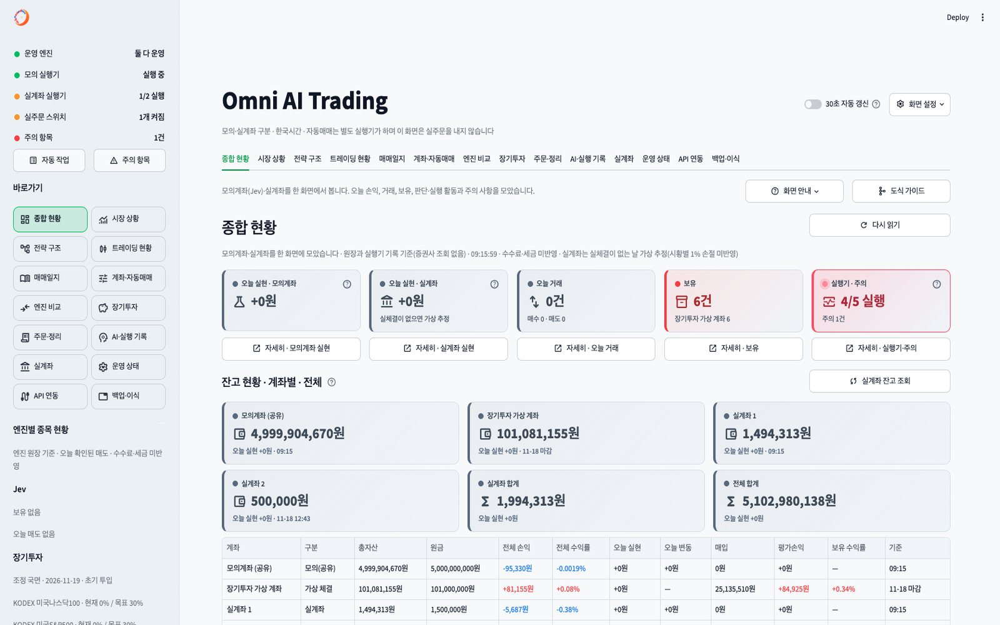

모의계좌·실계좌·장기투자 가상 계좌를 한 화면에 모읍니다. 원장과 실행기 기록만 읽어 빠르게 열립니다(`streamlit_namuh/overview.py`).

- **맨 위 카드**: 오늘 실현(모의계좌 / 실계좌), 오늘 거래, 보유, 실행기·주의.
- **잔고 현황 · 계좌별 · 전체**: 계좌마다 총자산 카드(아래 줄은 오늘 실현손익, 빨강 ▲·파랑 ▼)를 3장씩 놓고, 실계좌 합계·전체 합계를 더합니다. 아래 표에 총자산·원금·전체 손익·전체 수익률·오늘 실현·오늘 변동·매입·평가손익·보유 수익률·기준 시각이 있습니다.
  - 전체 손익 = 총자산 − 원금이라 수수료·세금까지 반영됩니다. 원금은 **원금 설정**(접힘)에서 계좌마다 넣고 `accounts.json` `principal_krw`에 저장됩니다. 원금이 없는 계좌는 전체 손익을 비웁니다. 장기투자 가상 계좌의 원금은 1억 + 적립 누계로 자동 계산합니다.
  - 잔고 자료: 모의계좌는 실행기의 5분 잔고 기록, 실계좌는 미러·장기 실행기의 5분 기록(`live-balance-<키>.jsonl`), 장기투자는 최근 마감 순자산입니다. 기록이 없으면 **실계좌 잔고 조회**(조회 전용)를 누릅니다.
- **오늘 실현손익 · 전체 계좌**: 계좌별 오늘 실현손익과 합계. 체결가 기준이라 비용은 빠집니다.
- **시장 요약**: 코스피·코스닥 국면, 상승·하락 종목 수, 수집 시각.
- **계좌별 요약** 표와 차트: 오늘 누적 실현손익(계좌별 선), 보유 현황(매입금액), 거래 타임라인(▲ 매수 · ▼ 매도), 판단·실행 활동(10분 단위).
- **아래 탭**: 오늘 거래 전체(판단 경로·근거), 최근 판단·계획, 주의 사항(멈춘 실행기, 정리 요청 대기, 실계좌 차단, API 실패·지연, 장기투자 판단 건너뜀·스토리 훼손).

### 시장 상황

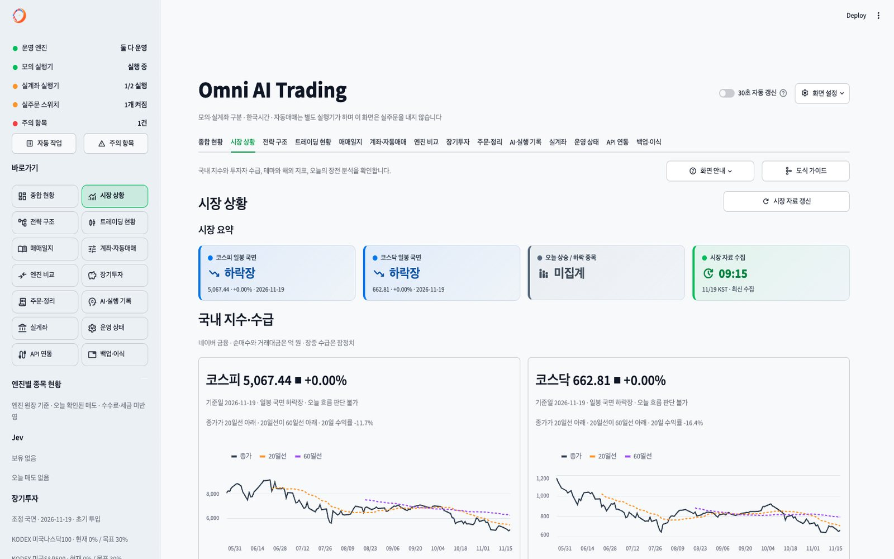

- **시장 요약** 카드와 **시장 자료 갱신** 버튼(네이버·Yahoo를 다시 조회).
- **국내 지수·수급**: 코스피·코스닥 일봉, 20·60일선, 투자자·프로그램 순매수(억 원). 네이버가 실패한 지수는 키움·토스 대체 출처를 지수 아래에 표시합니다.
- **테마 강세·약세**: 테마 등락률 막대와 표(네이버 실패 시 키움 테마그룹).
- **해외 지표**: Yahoo 일봉 종가·등락률·기준일. 키움 외국계 창구·토스 투자자 순위가 있으면 탭으로 붙습니다.
- **미국 장기 지표**: 장기 국면, 나스닥100 낙폭, 200일선 대비, VIX, 거시 배경.
- **오늘의 장전 분석**: 대응 전략, 오늘 주목할 뉴스(별점), 시장·섹터·종목 영향 점검, 장전 상세 분석(`reviews/premarket-YYYY-MM-DD.md`). 상세 분석이 템플릿(`scripts/premarket_template.py`)과 다르면 경고합니다. 야간선물이 '종료 세션 마감값(지연)'이면 현재가가 아닙니다. 자세한 내용은 [장전 분석](premarket.md).

### 전략 구조

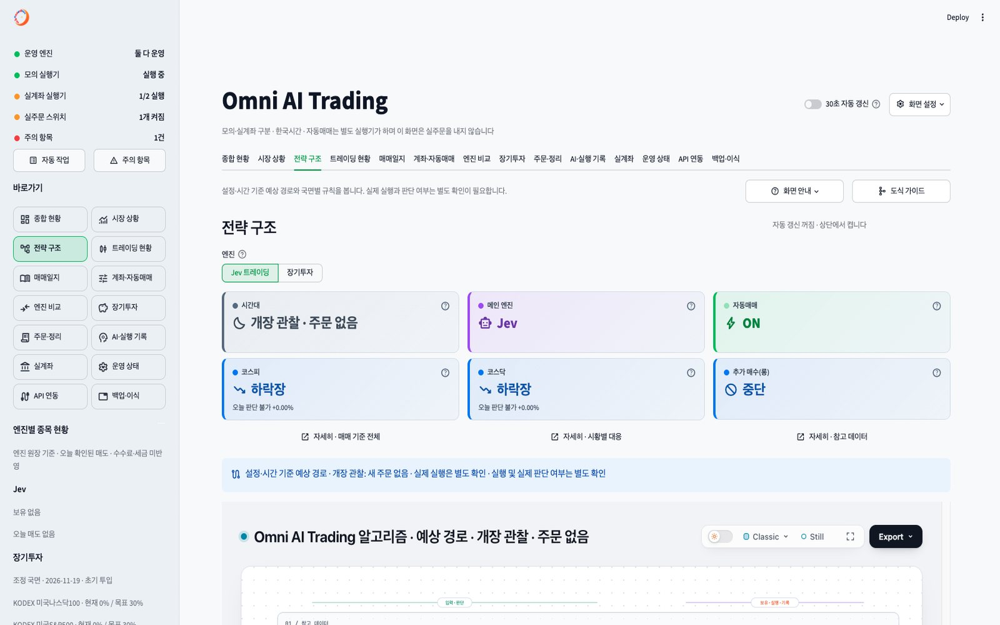

맨 위 **엔진**에서 'Jev 트레이딩'과 '장기투자'를 고릅니다.

**Jev 트레이딩**

- 상태 카드: 시간대(신규 매수·정리·장 종료), 메인 엔진, 자동매매(ON·OFF·중단 요청), 코스피·코스닥 국면과 오늘 흐름, 추가 매수(롱) 허용 여부.
- **자세히** 팝업 3종: 매매 기준 전체, 시황별 대응, 참고 데이터(데이터별 마지막 갱신과 기준).
- **시황별 대응**: 지금 시황 카드와 마지막 확인 시황, 다른 시황의 대응·청산 방식(접힘).
- **엔진별 진입 경로**: 경로별 켜짐 상태와 확인 순서.
- **낙폭과대 알고리즘 · FLOW**: FLOW 도식 / 구성 요소 / 오늘 운영 상태 탭, 오늘 감시 종목, 사례집, 낙주매매 재현 기록([낙폭과대 반등](oversold.md)).
- **다음 날까지 보유하는 조건**: 종가매매 조건과 스윙 조건 체크리스트.
- 참고 데이터, 알고리즘 상세, 청산 규칙 재현 평가(지난 60일 5분봉), 장 마감 개선안·감사 보고서, 장 마감 복기(접힘).

#### 전략 구조 도식

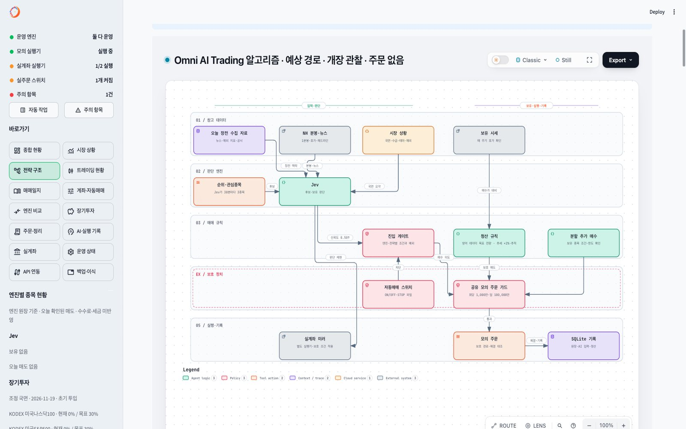

설정과 시각으로 계산한 예상 경로를 Archify로 그립니다. 초록 굵은 경로가 지금 시간대에 적용될 흐름이며 실제 판단·주문을 뜻하지 않습니다. 시장 요약이 20분보다 오래되면 국면별 규칙이 판단되지 않는다는 경고가 뜹니다.

**장기투자**: 상태 카드, 자세히 3종(운용 기준 전체·국면별 대응·참고 데이터), 탭 '아키텍처 · 하루 알고리즘 · 국면 전이 · 거장 모듈 · 구성 요소 · 오늘 운영 상태'(`streamlit_namuh/longterm_flow.py`). 조회 전용입니다.

### 트레이딩 현황

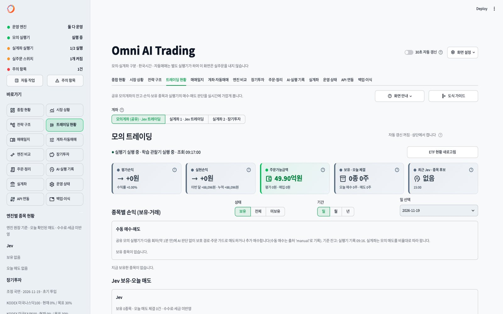

첫 줄의 **계좌** 버튼(사이드바 계좌 선택과 같음)으로 모의계좌와 실계좌를 오갑니다.

**모의계좌 (공유)**

- 상태 줄: 실행기·학습 관찰기 상태와 **ETF 현황 새로고침**. 실행기가 멈춰 있으면 손절 감시도 멈춘다는 경고가 뜹니다.
- 카드: 평가손익(수익률), 주문가능금액, 보유·오늘 체결, 최근 Jev 의견.
- 종목별 손익 표: **상태**(보유·전체·미보유), **기간**(일·월·년)과 손절~익절 사이 위치. 평가손익은 증권사 응답, 실현손익은 실행기가 확인한 체결 기준이며 수수료·세금은 빠집니다.
- **Jev 보유·오늘 매도** 종목 버튼, **매매 기준 (지금 적용 중)**(접힘).
- 분봉 차트(TradingView): Jev 판단 표식과 확인된 체결 ▲▼, 손절·익절 선.
- 아래 탭: 시장·관심종목(순위 후보·관심종목·신규상장) / Jev 판단 근거 / 판단·주문 기록(Jev 신뢰도 추이와 최근 10회) / 증권사 잔고·주문 원본 / 즉시 매도(종목별 수량 매도·추가 매수·전량 매도, 전체 매도, 확인 팝오버) / 전략·AI 설정(매매 기준 설정, Jev·Decision 사용 요청).

**실계좌 (Jev 미러)**: 상태 줄(미러 실주문·관찰, 따라가는 엔진, 마지막 계획), 같은 배치의 카드·차트(주황 원 가상 매수, 자주 원 가상 매도, 화살표 증권사 체결), 탭 '메인 엔진 가상 실행 · 당일 주문·체결 · 즉시 매도 · 실행기 기록 · 계좌 설정'.

**실계좌 (장기투자)**: 장기투자 카드(실행 모드·오늘 엔진 판단·오늘 계좌 주문 계획). 차트 종목은 장기 엔진 대상 ETF만 나옵니다.

### 매매일지

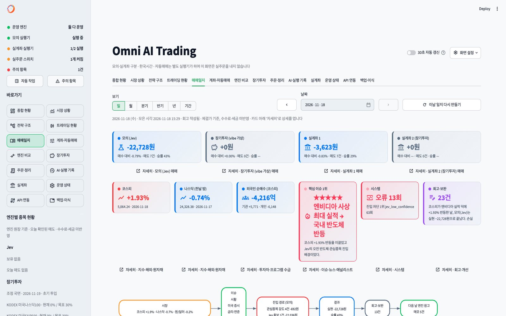

모든 계좌의 매매, 시장·수급·이슈, 시스템 상태, 회고를 일·월·분기·반기·년·기간 단위로 봅니다(`streamlit_namuh/journal_view.py`). 일지는 장 마감 뒤 학습 관찰기가 모으고 평일 16:40 예약 작업이 분석 리포트를 씁니다. 만드는 과정과 템플릿은 [매매일지](journal.md)에 있습니다.

**일 단위**

- 머리줄: 보기(일·월·분기·반기·년·기간), ◀ 이전 일지 · 날짜 · 다음 일지 ▶, **이날 일지 다시 만들기**(주말·미래 날짜는 막힘).
- 계좌별 성과 카드와 시장·수급·이슈·시스템·회고 카드. 카드 아래 **자세히**가 팝업을 엽니다.
- 하루 종합 도식(시장 → 이슈 → 진입 경로 → 결과 → 회고 → 다음 날 엔진 참고).
- 상세 탭: 매매관점 리포트(분석 리포트 / 데이터 리포트, .md 내려받기) · 매매·차트(분봉 위 모든 계좌의 매수 ▲·매도 ▼, VWAP, 전일 종가, KODEX 200 대비) · 시장·수급 · 이슈·뉴스 · 시스템·회고 · 장기투자(거장의 거시 시황, 엔진 결정, 장기투자 계좌 체결, 그날 리포트).

#### 손익 흐름과 핵심 이슈

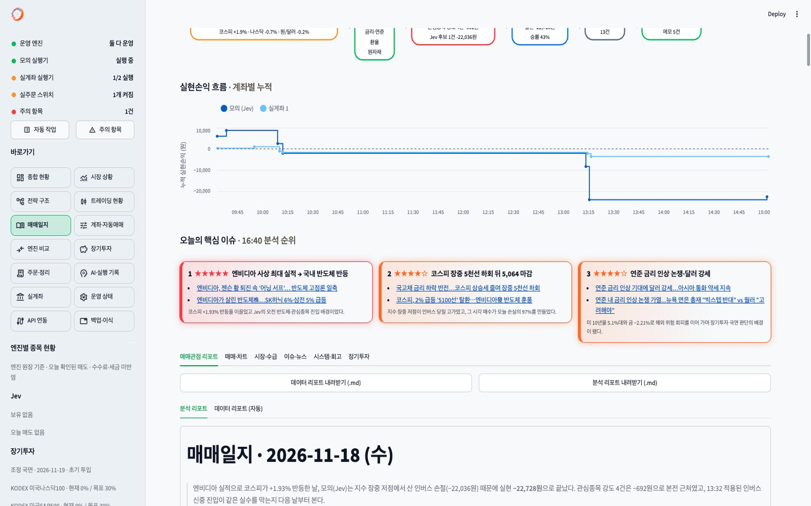

도식 아래에 계좌별 누적 실현손익 흐름(전체 폭)과 **오늘의 핵심 이슈** TOP 3가 있습니다. 16:40 분석 순위가 있으면 그것을, 없으면 데이터 순위를 쓰고 별 4~5개 카드는 테두리로 강조합니다.

**월·분기·반기·년·기간**: 탭 '한눈에 보기 · 기간 매매일지 리포트 · 장기투자'. 계좌 카드, 고른 계좌의 지표 카드(최대 낙폭 차트 팝업, 최고·최저일 **일지 열기**), 일별 손익 막대와 누적선, 경로·종목별 성적, 일별 일지 표(행을 고르면 그날로 이동).

### 계좌·자동매매

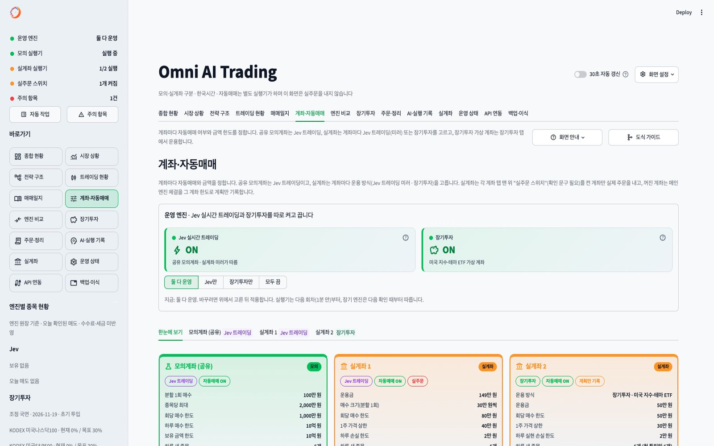

- **운영 엔진**(맨 위): 둘 다 운영 · Jev만 · 장기투자만 · 모두 끔 중 하나를 고르고 적용합니다(`scripts/engine_ops.py`). Jev를 켤 때 실주문 스위치가 켜진 실계좌가 있으면 확인 체크가 필요합니다. 실행기는 1분 안에, 장기 엔진은 다음 확인 때 따릅니다.
- **한눈에 보기** 탭: 모든 계좌 설정 카드, 매매 기준 카드, 장기투자 카드, Jev와 장기투자 차이(접힘), 모의계좌와 실계좌 설정 비교(접힘).
- **계좌마다 탭**(이름 옆 배지: 보라 'Jev 트레이딩', 초록 '장기투자'): 왼쪽 계좌 카드, 오른쪽 한도 도식(매수 한 건이 거치는 한도를 지금 값으로).

| 계좌 | 맨 위 | 하위 탭 |
| --- | --- | --- |
| 모의계좌 (공유) | — | 금액·주문 보호 한도 / 매매 기준 (진입·익절·손절·빠른 선택) / 제한 규칙(끌 수 있는 규칙은 스위치) |
| 실계좌 (Jev 트레이딩) | 실주문 스위치 카드 | 금액·한도·미러 규칙 / 오늘 가상 실행 / 제한 규칙(표시만) |
| 실계좌 (장기투자) | 실주문 스위치 카드 | 금액·포트폴리오·보호 한도(전략·적립식 구역 포함) / 오늘 주문 계획 / 보호 한도 요약 |

- 실주문 스위치 카드: 실주문 스위치, 서비스 상태(실주문 대기 `--execute` / 관찰 전용 / 계획만 등록), HALT, 지금 상태(실주문 중 / 계획만 기록).
- 금액 칸은 슬라이더·+/−·직접 입력이 함께 움직이고, 범위 밖 값은 한글 안내와 함께 경계값으로 맞춥니다. 실계좌 운용금은 그 계좌 잔고(총자산)까지만 정할 수 있습니다.
- 매매 기준에는 **매매 기준 쉽게 보기** 팝업과 빠른 선택 카드(보수적·엄격 = 파랑, 기본 = 초록, 적극적·완화 = 주황, 끄기 = 회색)가 있습니다. 저장하면 실행기가 다음 회차에 다시 읽습니다. 항목과 범위는 [설정 레퍼런스](configuration.md).

### 엔진 비교

맨 위 **보기**에서 고릅니다(`streamlit_namuh/engine_compare.py`).

- **Jev · 장기투자 기간 성과**: 장기투자 시작일 이후 날짜별로 Jev 누적 실현손익과 장기투자 순자산을 나란히 봅니다. 자동 그림자 선, 장부별 최대 낙폭, 날짜별 장기 국면 띠가 있습니다. 기준이 다릅니다. Jev는 원장 실현손익(수수료·세금 전), 장기투자는 가상 계좌 순자산 평가(수수료 포함)입니다.
- **Jev vs vibe 장중 (보관 · ~11-17)**: 범위(종합·모의·실계좌)와 기간(일·월·년·전체)을 고르고, 탭 '거래 결과·판단 근거 · 보유·진행 · 판단 비교 · 판단 정산·이력'을 봅니다. vibe 장중 엔진은 2026-11-17에 멈췄고, Jev 쪽은 지금도 갱신됩니다.

### 장기투자

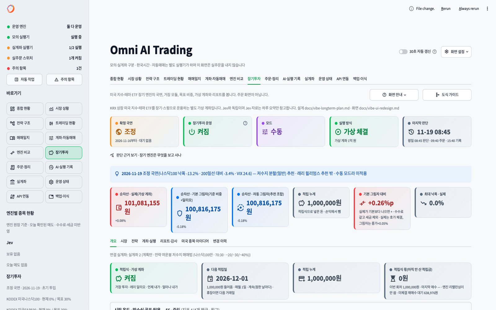

장기 엔진의 화면입니다. 주문 화면이 아닙니다(`streamlit_namuh/vibe_longterm_view.py`). 전략 규칙은 [장기투자](longterm.md)·[적립식](longterm-dca.md)·[여운봉 저수지 매매법](yeo-method.md)에 있습니다.

- 맨 위: 상태 카드(확정 국면과 확정 대기 일수, 운영 스위치, 모드, 실행 방식, 마지막 판단), **판단 근거 보기** 팝업(데이터 흐름·데이터 전체·국면 판정 규칙·기능별 판단·보지 않는 것·오늘 실제 값), 오늘의 판단 문장, 순자산 KPI(실제·기본 그림자·자동 그림자).
- 탭 7개와 하위 보기:

| 탭 | 하위 보기 | 내용 |
| --- | --- | --- |
| 개요 | — | 순자산 곡선, 목표 대비 비중 불릿 차트(밴드·현재·목표), 연결 실계좌, 적립식 카드, 다음 타점 |
| 시장 | 시황·국면 / 테마 스토리 / 차트 | 지표 카드, 확정 대기 진행, 시장 온도(공포·탐욕, 참고), 거시 배경, 국면 이력·기준표, 국면 확정 일수 / 위성 테마 판정 / 일·주봉 차트 |
| 전략 | 거장 모듈·비중 / 적립식 / 레시피 비교 | 설정할 장부 → ① 운용 방식 ② 모듈 선택 방식 ③ 거장 모듈(카드별 수치 조정) ④ 집행 속도 ⑤ 미리보기, **전략 저장** / 장부별 적립식 / 레시피별 1억 가상 장부 비교 |
| 계좌·실행 | 실행 / 포트폴리오·주문 / 기록 | 가상 체결 스위치(확인 문구)·중지 요청 / 보유와 주문, '왜 샀나·팔았나' 근거 / 판단 기록 |
| 리포트·감사 | 전략 리포트 / 감사·개선안 | 그날·주간·월간 전략 리포트와 거장 카드 / 최근 5거래일 자동 점검과 복기·감사 보고서 |
| 미국 종목 아이디어 | — | 거장 추천·텐베거 후보·추천 성적표·거장 13F(참고 정보, 주문 없음) |
| 변경 이력 | — | 장기 엔진 설정 변경 이력 |

#### 장기투자 차트

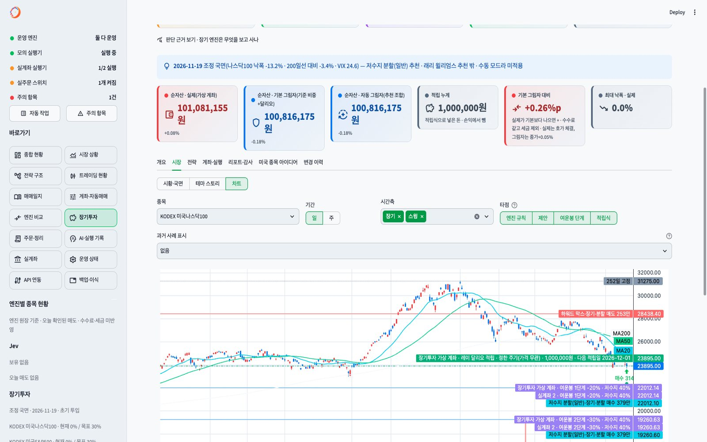

장기투자 → 시장 → 차트. 일·주봉 위에 20/50/200일선과 타점 선을 그립니다. **타점**에서 rule(엔진 규칙)·advice(제안)·yeo(여운봉 매매법 단계, 보라 점선)·dca(적립식 다음 매수, 초록 긴 점선)를 골라 켜고 끕니다. 가상 체결 ▲▼, 적립 체결 ●, 과거 사례도 표시하고, 차트 아래에서 매수·매도 근거를 펼쳐 봅니다.

> [!TIP]
> 예전 탭 이름(예: '운용 설정')으로 들어온 안내는 새 자리를 찾아갑니다. '운용 설정'은 지금 계좌·실행 → 실행입니다.

### 주문·정리

맨 위 **계좌**에서 종합 · 모의계좌 · 실계좌를 고릅니다.

- **종합**: 모든 계좌의 보유 전체, 오늘 체결 전체, 장기투자 오늘 주문 계획(로컬 기록, 증권사 조회 없음)과 정리 요청 대기.
- **모의계좌**: **잔고·주문 조회** 뒤 보유 종목·오늘의 주문 탭, 보유 종목 정리 요청(종목 선택 + 동의 체크). 실행기 전용이 아닌 모의계좌만 지정가 주문 폼이 열립니다.
- **실계좌**: 보유 종목 · 오늘의 주문 · 미러 주문 기록(보호 경로로 낸 주문) · 실체결 기록 탭과 정리 요청. 정리 요청은 미러가 산 수량만 보호 경로로 팝니다.

### AI·실행 기록

맨 위 **기록**에서 종합 · Jev 엔진 · 장기투자 결정 · vibe 장중(~11-17, 보관) · 실계좌 N 실행을 고릅니다.

- **종합**: 날짜 하나를 골라 카드, 판단 강도 추이와 체결, 10분 활동 히트맵, 매수하지 않은 이유, 출처·종류로 거르는 통합 기록 표(장기투자 결정·장기투자 실계좌 계획 포함).
- **Jev 엔진**: 기록 날짜, TradingView 판단·체결 차트(종목 선택), Jev 신뢰도 추이, 실행기 활동(10분 단위), 판단 비교·실험 이벤트·체결 확인 표(접힘), 7 ETF 국면 관찰(연구 전용).
- **장기투자 결정**: 국면·스토리·계획·주문 기록. 전체 화면은 장기투자 탭.
- **실계좌 실행**: 미러 실행기의 계획이 바뀐 시점과 사유, 실행 결과. 판단 근거는 따라가는 엔진의 기록입니다.

사이드바 종목 버튼을 누르면 이 탭에서 그 종목의 확인 체결 내역이 열립니다.

### 실계좌

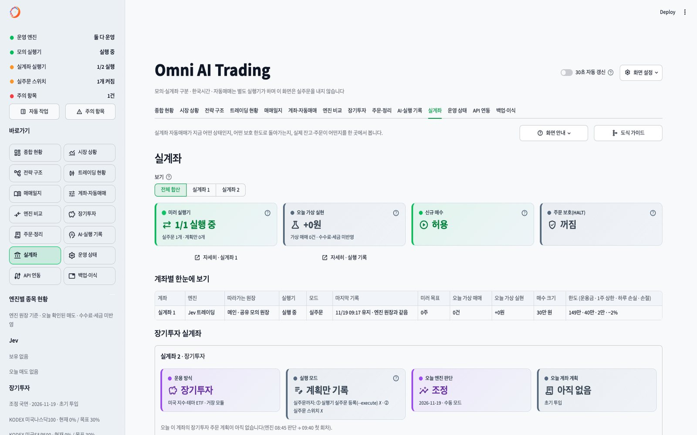

맨 위 **보기**에서 '전체 합산'과 계좌별 화면을 고릅니다.

- **전체 합산**: 미러 실행기 실행 수, 오늘 가상 실현, 신규 매수, HALT 카드, 계좌별 한눈에 보기 표, 장기투자 실계좌 목록.
- **Jev 미러 계좌**: 미러 실행기(평일 08:58 시작·15:20 종료), 따라가는 원장, 운용금·하루 손실 한도·매수 크기·계좌 손절 카드, 오늘 가상 매매(미러 계산).
- **장기투자 계좌**: 상태 카드(장기투자 실행기·계좌 전략·신규 매수·HALT), 돈 카드(운용금·하루 실현 손실 한도·총자산·전체 손익), 오늘 엔진 판단·계좌 계획, 이 계좌 전략의 가상 운용(엔진 가상 계좌와 수익률 비교), 목표 비중 × 운용금 vs 보유, 도식 '이 계좌는 어떻게 움직이나요?', 체결 이력.
- **실계좌 주문은 어떻게 나가나요?**(도식, 접힘), 아래 탭 '잔고·주문 · 자동매매 제어 · 모의 → 실계좌 적용 검토'. 자동매매 제어의 중단은 **신규 매수만** 멈추고, 시작 버튼은 이 화면에서 누를 수 없습니다.

자세한 규칙은 [실계좌](live-accounts.md).

### 운영 상태

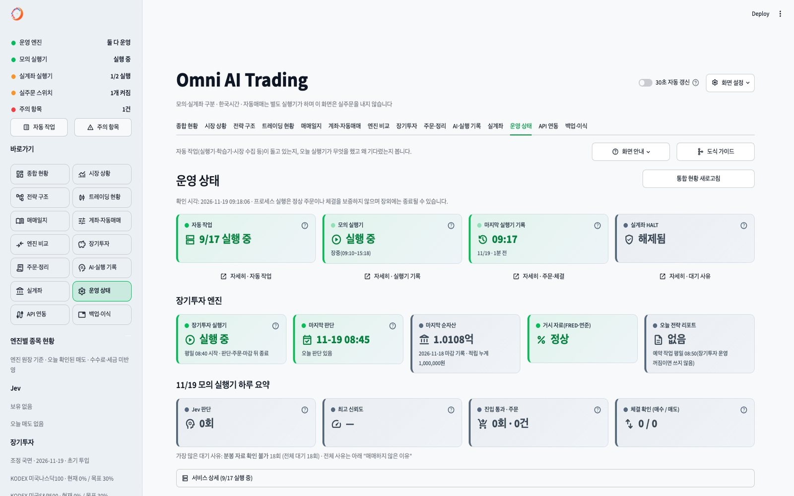

- 카드: 자동 작업 N/M 실행, 모의 실행기, 마지막 실행기 기록, 실계좌 HALT.
- **장기투자 엔진** 카드: 판단·주문·마감 기록의 신선도.
- **모의 실행기 하루 요약**: Jev 판단 횟수, 최고 신뢰도, 진입 통과·주문, 체결, 가장 많은 대기 사유. 서비스 상세(접힘, '미등록'은 `~/Library/LaunchAgents`에 없다는 뜻).
- 모의 실행기 활동(10분 단위), 학습·기록 데이터 적재량, 최근 기록 표(접힘).
- **모의 실행기 중단**: 확인 체크 뒤 **공유 ETF 실행 중단 요청**(STOP 파일).
- **운영 조정값**: 묶음별 입력(장 시간 · 공유 모의 실행기 · 실계좌 미러 · 대시보드). 장중 vibe 값은 '보관된 설정'으로 읽기만 합니다. 대시보드 값은 바로, 실행기 값은 그 실행기를 다시 시작해야 반영됩니다.
- **설정 변경 이력**: `settings-history.sqlite3` 최신 300건. 종류(계좌·자동매매, 매매 기준·제한 규칙, 운영 조정값, 화면 설정, AI 사용 설정, 관심종목 편집)로 거릅니다.

### API 연동

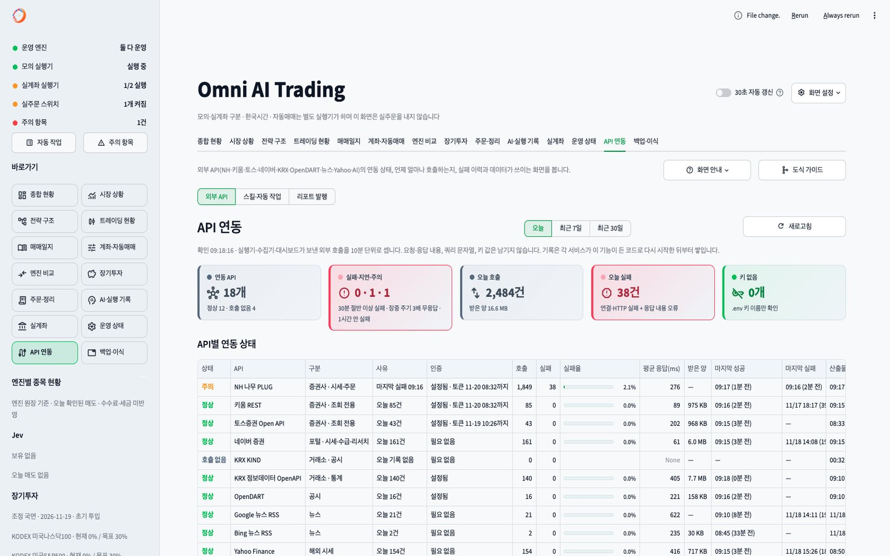

맨 위 **보기**에서 '외부 API · 스킬·자동 작업 · 리포트 발행'을 고릅니다(`streamlit_namuh/api_status_view.py`).

- **외부 API**: 기간(오늘·최근 7일·최근 30일) 선택, 카드(연동 API 수, 실패·지연·주의, 호출·실패 수, 키 없음), API별 연동 상태 표, 호출 흐름 차트, **API 상세**(탭 '데이터·용도 · 엔드포인트별 호출 · 호출한 프로그램 · 실패 이력 · 산출물', FRED·연준은 '최근 데이터' 추가), **화면별 데이터 출처**.
  - 상태는 키 없음 → 실패 → 지연 → 주의 → 정상 → 호출 없음 순으로 판정합니다. **지연**은 장중(평일 09:15~15:00) 카탈로그 예상 주기(`expect_min`)의 3배, 최소 5분 넘게 성공이 없을 때입니다. 오늘 '실패'·'지연'인 API는 종합 현황·사이드바 주의 항목에 올라갑니다.
  - 키움·토스·NH 접근 토큰의 만료 시각을 보여 줍니다(토큰 값은 보여 주지 않음).
- **스킬·자동 작업**: 하루 일정(예약 작업·자동화가 스킬을 부르는 시각), 스킬 한눈에 보기, 스킬 상세(`scripts/skill_catalog.py`). [자동 작업](automation.md) 참고.
- **리포트 발행**: 리포트 목록(HTML 미리보기) · 발송·작업 이력 · 발행 대상·일정. [리포트 발행](report-pages.md) 참고.

기록이 어떻게 쌓이는지는 [동작 구조](architecture.md#외부-api-호출-기록)를 보세요.

### 백업·이식

- 마지막 백업 시각과 보관 개수, **지금 백업**, **선택한 백업 내려받기**.
- **가져오기**: 거래 서비스가 모두 꺼져 있어야 하고, 확인 문구 `백업 가져오기`를 입력해야 합니다. 덮어쓸 파일은 `restore-backup-<시각>` 폴더로 옮겨 둡니다.
- **새 계정·새 기기 점검**: `.env` 키 이름, 폴더, 서비스, 예약 작업 상태.

절차는 [이식](portability.md)에 있습니다.

## 화면 설정

오른쪽 위 **화면 설정** 팝오버에서 바꾸고 `nhplug/dashboard-prefs.json`에 저장합니다. 화면 표시만 바뀌고 매매·한도·주문은 바뀌지 않습니다.

| 항목 | 기본 | 선택지 |
| --- | --- | --- |
| 테마 버튼 | 시스템 | 시스템 → 다크 → 라이트 순환 |
| 화면 글씨 크기 | 100% | 70~120% |
| 상태 깜박임 | 켬 | 켬·끔 |
| 처음 여는 탭 | 종합 현황 | 14개 탭 |
| 자동 갱신 간격(초) | 30 | 15·30·60·120 |
| 자동 갱신 기본 켜기 | 끔 | 켬·끔 |
| 기본 금액 단위 | 만원 | 원·만원·10만원·100만원·1000만원·억원 |

같은 팝오버의 **실행기 상태 · 자동 작업** 버튼이 서비스 목록 팝업을 엽니다.

## 변경 이력

| 날짜 | 바뀐 점 |
| --- | --- |
| 2026-11-13 | 매매일지 탭, 실주문 스위치, 설정 변경 이력 |
| 2026-11-17 | 장기투자 탭, 'Jev vs vibe-trading' → '엔진 비교', API 연동·백업·이식 탭, 운영 엔진, 실계좌별 운용 방식 |
| 2026-11-18 | 잔고 현황·원금, 장기투자 탭 7개로 정리, 가이드 팝업 템플릿 통일, FLOW 도식 Archify 규칙 |

설계 기록: 화면·설정 개편(`docs/vibe-ui-redesign.md`, 비공개), 장기투자 대시보드(`docs/longterm-dashboard-plan.md`, 비공개), 장기투자 설정 재설계(`docs/longterm-strategy-settings-redesign.md`, 비공개).
