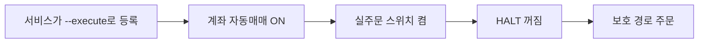

# FAQ·문제 해결

운영 중에 자주 만나는 증상과 원인, 확인할 곳, 고치는 법을 모았습니다. 장중 감사가 같은 문제를 다시 찾으면 `nhplug/audit-incidents.sqlite3`에 `recurred`로 남기므로(`scripts/audit_incidents.py`), 여기 없는 증상은 그 이력과 [운영 가이드](operations.md)를 먼저 봅니다.

**시작 전에**
- [AI 도구 비용이 드나요?](#ai-도구-비용이-드나요)
- [수익을 보장하나요? 손실은 누가 책임지나요?](#수익을-보장하나요-손실은-누가-책임지나요)

**매매**
- [실행기가 매수를 안 합니다](#실행기가-매수를-안-합니다)
- [Jev 판단이 뉴스 때문에 건너뜁니다](#jev-판단이-뉴스-때문에-건너뜁니다)
- [실주문 스위치를 켰는데 주문이 실행되지 않습니다](#실주문-스위치를-켰는데-주문이-실행되지-않습니다)
- [실계좌 매도가 시세 시각 때문에 거절됐습니다](#실계좌-매도가-시세-시각-때문에-거절됐습니다)
- [장기투자 적립식 매수가 미체결로 남았습니다](#장기투자-적립식-매수가-미체결로-남았습니다)
- [NXT(넥스트레이드)에서도 거래하나요?](#nxt넥스트레이드에서도-거래하나요)

**연결·데이터**
- [NH 유량 초과가 납니다](#nh-유량-초과가-납니다)
- [모의 서버에서 시세가 안 나옵니다 (IGW40023)](#모의-서버에서-시세가-안-나옵니다-igw40023)
- [분봉 조회 실패가 자주 보입니다](#분봉-조회-실패가-자주-보입니다)
- [API 연동에 '호출 없음'·'지연'이 뜹니다](#api-연동에-호출-없음지연이-뜹니다)

**실행기·서비스**
- [실행기가 "원장 불일치"로 멈췄습니다](#실행기가-원장-불일치로-멈췄습니다)
- [실행기가 시작하자마자 멈췄습니다](#실행기가-시작하자마자-멈췄습니다)
- [원장 반영이 멈췄다는 경고가 뜹니다](#원장-반영이-멈췄다는-경고가-뜹니다)
- [재부팅 뒤 서비스가 안 올라옵니다](#재부팅-뒤-서비스가-안-올라옵니다)

**대시보드·리포트·자동 작업**
- [대시보드에 ImportError가 뜹니다](#대시보드에-importerror가-뜹니다)
- [종합 현황에 실계좌 잔고가 비어 있습니다](#종합-현황에-실계좌-잔고가-비어-있습니다)
- [금액 칸을 빠르게 누르면 숫자가 한 박자 늦습니다](#금액-칸을-빠르게-누르면-숫자가-한-박자-늦습니다)
- [오늘 장전 상세 분석이 없습니다](#오늘-장전-상세-분석이-없습니다)
- [예약 작업이 승인 대기로 멈춥니다](#예약-작업이-승인-대기로-멈춥니다)
- [리포트가 Discord로 오지 않습니다](#리포트가-discord로-오지-않습니다)
- [장기투자 기록에 '시간 놓침'이 있습니다](#장기투자-기록에-시간-놓침이-있습니다)
- [키는 어디에 두나요?](#키는-어디에-두나요)

---

## AI 도구 비용이 드나요?

네. 이 서비스는 AI 도구와 함께 쓰는 AI 트레이딩 시스템입니다. 설치·운영·리포트 작성에 Claude Code나 Codex 같은 AI 코딩 에이전트가 필요하고, 이를 쓰려면 해당 서비스의 유료 요금제(Claude Pro·Max 또는 ChatGPT Plus·Pro 같은 구독, 또는 API 사용료)가 필요합니다. 매매 판단에 쓰는 Jev·OpenAI API도 각 서비스의 이용 조건과 요금을 따릅니다. 요금과 이용 조건은 각 서비스의 최신 안내를 확인하세요. NH 나무 PLUG 시세·주문 API와 무료 데이터 출처(네이버·Yahoo·KRX 등)는 별도 요금이 없지만 각 이용 조건을 따릅니다.

## 수익을 보장하나요? 손실은 누가 책임지나요?

보장하지 않습니다. 모든 정보는 투자 판단을 위한 참고 자료이며 투자 권유가 아닙니다. 투자의 최종 판단과 손익(원금 손실 포함)의 책임은 투자자 본인에게 있습니다. AI 판단, 모의 성과, 가상 체결, 과거 재현 결과는 미래 수익을 보장하지 않고, 금융투자상품은 원금 손실(0\~100%)이 생길 수 있습니다. 전체 고지는 [README · 투자 유의사항 및 면책 고지](../README.md#투자-유의사항-및-면책-고지)에 있습니다.

## 실행기가 매수를 안 합니다

정상일 수 있습니다. 진입 조건이 모두 맞아야 사기 때문입니다. 대시보드 **운영 → 운영 상태 → 모의 실행기 하루 요약**의 '가장 많은 대기 사유'와 **트레이딩 현황 → 판단·주문 기록**을 봅니다.

| 대기 사유 (화면 표시) | 뜻 | 확인·조정 |
| --- | --- | --- |
| 자동매매 꺼짐 (`auto_off`) | 운영 엔진이 'Jev만'·'둘 다 운영'이 아님 | 계좌·자동매매 → 운영 엔진 |
| 개장 직후 진입 대기 | 당일 완료 분봉과 개장 보완 자료가 부족하거나 진입 조건을 통과하지 못함 | **트레이딩 현황 → 판단·주문 기록**에서 자료·차단 사유 확인. [개장 준비](strategy.md#장전-분석과-개장-준비) |
| Jev 신뢰도가 진입 기준 미만 / Jev 대기 의견 | 후보 신뢰도가 `entry_confidence`(기본 0.5) 미만 | 관심종목 강도·신규주 경로가 대신 확인됨 |
| 거래량 증가 조건 미충족 (`volume_not_rising`) | 최근 5분 거래량이 그 앞 5분의 `entry_volume_ratio`배 미만 | 거래량 프리셋(완화 1.0) |
| 최근 분봉 상승 아님 | `rising_check` 켬 | 제한 규칙 탭 |
| 지수 방향이 맞지 않음 / 시장 요약 없음 | 롱 후보인데 지수 하락, 또는 시황 요약이 20분보다 오래됨 | 시황 판단 유지 권장. 시황 수집기 확인 |
| 인버스 관문 (`inverse_*`) | 지수의 하락 국면·당일 낙폭·최근 30분 흐름, 프로그램 수급과 전날 나스닥100, Jev 신뢰도와 ETF 추격 여부를 확인 | [인버스 관문](strategy.md#인버스-관문)에서 항목별 차단 사유 확인 |
| 보유 종목과 반대 방향 | 레버리지↔인버스 동시 보유 차단 | 제한 규칙 탭 |
| 연속 손실 쉬기 | 오늘 왕복이 3번 연속 손실이면 30분 쉼 | 운영 조정값 |
| 같은 날 재진입 제한 / 신중 재진입 | 그날 사고판 종목을 불리한 국면에 다시 사려면 추격 금지·약세 받기 금지·Jev 재검토(0.6)·크기 50% | 제한 규칙 탭 |
| 매수 시간 종료 | 신규 매수 마감(`entry_cutoff_hhmm`, 기본 14:30) 뒤. 추가 매수는 장 마감 정리 30분 전에 막힘 | 제한 규칙 탭 |
| 공유 계좌 가드 거절 / 회당·하루·보유 한도 | 주문 보호 한도에 걸림, 하루 손실 한도 도달 | 계좌·자동매매 → 금액·주문 보호 한도 |

수치를 바꾸기 전에 [매매 전략](strategy.md)과 [설정 레퍼런스](configuration.md)를 확인하고, 며칠 관찰한 뒤 판단하세요.

## Jev 판단이 뉴스 때문에 건너뜁니다

Jev에게는 장중 **90분 안**의 기사만 보냅니다(`scripts/etf_news.py` `RECENT`). 새 기사가 없는 주제는 빠지고, 하나도 없으면 그 회차는 대기합니다(이벤트 `v2_news_error`). 밤사이·장전 소식은 장전 브리프(`premarket_context`)로 따로 갑니다.

| 증상 | 원인 | 지금 동작 |
| --- | --- | --- |
| HTTP 429가 이어짐(2026-11-17 09:09\~09:23 사례) | 여러 실행기가 매분 같은 RSS를 부름 | 모든 실행기가 3분 공유 캐시 `nhplug/news-cache.json`을 씀 |
| 한 출처가 막힘 | Google 뉴스 제한 | Google·네이버 증권이 번갈아 맡고 Bing은 빈 주제만 채움 |
| 모든 출처 실패 | 네트워크·제한 | 30분 안의 마지막 결과 중 90분 안 기사를 다시 쓰고, 캐시가 없어도 5분간 다시 묻지 않음 |

운영 → API 연동에서 Google 뉴스·Bing 뉴스·네이버의 실패 이력을 봅니다. 연합뉴스 기사는 처음부터 뺍니다.

## 실주문 스위치를 켰는데 주문이 실행되지 않습니다

실계좌 실주문은 네 조건이 모두 맞아야 실행됩니다.

계좌·자동매매 → 실계좌 맨 위 카드에 서비스 상태가 '관찰 전용'·'계획만 등록'으로 보이면 서비스가 `--execute` 없이 등록된 것입니다. 재등록은 별도 승인 사항입니다. 조건이 맞아도 운용금·하루 손실 래치·1주 가격 상한·회당 한도·하루 새 종목 수·미체결 차단에 걸리면 그 주문은 막히고 사유가 `live-follow.jsonl`·`longterm-live.jsonl`에 남습니다.

## 실계좌 매도가 시세 시각 때문에 거절됐습니다

실계좌 가드는 시세 시각이 지금과 너무 다르면 주문을 거절합니다. Mac 시계가 2초 늦어 매도가 거절된 사례(2026-11-17) 뒤부터 매도도 매수처럼 5초까지 허용합니다. 같은 일이 다시 생기면 시스템 설정의 '날짜 및 시간 자동 설정'이 켜져 있는지 확인합니다.

## 장기투자 적립식 매수가 미체결로 남았습니다

가상 계좌의 적립식 매수가 체결되지 않으면 그 금액을 재매수 대기금(`retry`)으로 남기고 다음 확인 때 먼저 다시 삽니다(`longterm_dca.add_unfilled`). 계좌 전략이 더는 사지 않는 종목의 몫은 현금(저수지)으로 돌립니다. 주문 전송 중 오류가 난 날도 정산을 먼저 해서 같은 적립을 두 번 사지 않습니다. 장기투자 → 계좌·실행 → 기록에서 '적립식' 기록을 봅니다.

## NXT(넥스트레이드)에서도 거래하나요?

실제 주문은 하지 않고 **가상 체결**로 강세장 종가매매를 운용하며 학습 데이터를 쌓습니다([NXT 종가매매](nxt.md)). 2026-11-12 확인 결과입니다.

| 확인 항목 | 결과 |
| --- | --- |
| ETF 7종 NXT 시세 | 모두 `NXT 거래불가종목` (NH 응답) |
| 일반 주식 NXT 시세 | 삼성전자·NAVER·SK하이닉스 조회됨, 카카오는 거래불가 |
| 모의계좌 NXT 주문 | 거부: `14280 모의투자에서 대체거래소(NXT)는 제공하지 않습니다.` |
| 이 프로젝트의 주문 경로 | 모의·실계좌 모두 `rmt_mkt_cd=KRX` 고정, 가드가 다른 시장을 차단 |

NH API는 실계좌에서 `SOR`·`KRX`·`NXT`를 지원하지만 모의로 검증할 수 없어, 실주문은 KRX 정규장만 씁니다.

## NH 유량 초과가 납니다

NH 나무 PLUG는 **앱 키당 초당 5회**까지 받습니다. 공유 모의 실행기·실계좌 미러·장기 엔진·순위 수집·대시보드가 같은 키를 나눠 쓰므로 몰리면 HTTP 429(MCP 오류 `rate_limit`)가 납니다.

- **확인**: 운영 → API 연동 → NH 나무 PLUG → 실패 이력. 오류 종류·코드가 남습니다.
- **이미 들어간 완화**: 대시보드의 화면용 조회는 초당 2회로 묶고, 거래일 09:00\~15:30에만 자동 갱신합니다. 장기 엔진의 가상 브로커 시세는 유량 초과일 때만 0.5초·1초 뒤 두 번 더 묻고, 장기투자 실계좌 계획 시세도 두 번 더 묻습니다. 순위 계산은 키움 순위로 후보를 먼저 고른 뒤 그 종목만 NH로 조회합니다. 그 조회도 시작 간격을 0.5초(초당 2회)로 띄우고, 유량 초과로 거절되면 1초 뒤 한 번 더 묻습니다(2026-11-19: 5분마다 60종목을 쉬지 않고 조회해 실행기·실계좌 미러 호출까지 함께 거절되던 문제). 같은 프로그램이 한 시간에 IGW42902를 20번 넘게 받으면 장중 감사가 `nh.app_rate_limit`로 알립니다.
- **할 일**: 장중에 손으로 NH를 부르는 스크립트를 여러 개 돌리지 않습니다. 대시보드 탭을 여러 개 열어 두고 자동 갱신을 켜 두지 않습니다.

> [!NOTE]
> 주문 경로(`nh_guarded_live`, 주문 가드)는 유량 초과에도 자동 재전송하지 않습니다. 주문이 같은 회차에 두 번 나가는 것을 막기 위해서입니다.

## 모의 서버에서 시세가 안 나옵니다 (IGW40023)

NH 모의 서버는 시세 조회 API를 제공하지 않습니다. 시세·분봉은 항상 운영 서버(`nhplug_readonly`)에서 읽고, 모의 서버(`nhplug_paper`)는 잔고·주문에만 씁니다. 설정은 [시작하기](getting-started.md#4-nh-공식-mcp-연결)에서 확인합니다.

## 분봉 조회 실패가 자주 보입니다

NH 시세 조회가 몰리면(특히 08:50 순위 후보 수집과 겹칠 때) 일시적으로 실패합니다. 실행기는 한 번 다시 시도하고, 실패한 종목과 사유를 이벤트(`bar_problem`)로 남깁니다. 같은 회차 안에서는 분봉을 한 번만 읽어 보유 점검과 진입 판단이 나눠 씁니다. 조회 실패가 연속 `read_failure_limit`(기본 5)번이면 실행기가 멈춥니다.

## API 연동에 '호출 없음'·'지연'이 뜹니다

| 표시 | 뜻 |
| --- | --- |
| 호출 없음 | 오늘 그 API를 부른 기록이 없음. 장 시간 밖이거나, 그 API를 쓰는 서비스가 호출 기록 코드로 다시 시작하지 않았을 수 있음 |
| 실패 | 최근 30분 호출의 절반 이상이 실패 |
| 지연 | 장중(평일 09:15\~15:00) 예상 주기(`expect_min`)의 3배, 최소 5분 넘게 성공이 없음 |
| 주의 | 최근 1시간 안에 실패가 있었음 |
| 키 없음 | `.env`에 그 API의 키 이름이 비어 있음 |

오늘 '실패'·'지연'인 API는 종합 현황과 사이드바의 '주의 항목'에 올라갑니다. 그날 아무 API도 호출되지 않았으면(휴장·서비스 정지) 지연을 판단하지 않습니다.

## 실행기가 "원장 불일치"로 멈췄습니다

다른 경로로 공유 모의계좌에 주문했거나, 결과가 불확실한 주문이 남았을 때입니다. 실행기는 매 회차 증권사 잔고·주문을 자기 원장과 맞춰 본 뒤에만 주문하므로, 어긋나면 스스로 멈춥니다.

1. 재전송하지 않습니다. 기록을 지우지 않습니다.
2. 증권사 주문·체결 조회(트레이딩 현황 → 증권사 잔고·주문 원본)로 대조합니다.
3. [운영 가이드](operations.md)의 재시작 절차(`scripts/restart_runner.py`, STOP 파일)를 따릅니다. 재시작 기록이 `restarts.jsonl`에 남지 않은 재시작은 장중 감사가 문제로 잡습니다.

## 실행기가 시작하자마자 멈췄습니다

08:55 `trading-day-start`가 실행기를 띄우고 30초 뒤에도 실행기가 시작되지 않으면 최대 5번 다시 띄웁니다. 2026-11-18 08:12에 NH 계좌 목록 조회가 일시 오류를 내 실행기가 `paper account list unavailable`로 멈춘 사례가 계기입니다. 기록은 `shared-etf-paper/trading-day-start.jsonl`과 `com.vibetrading.shared-etf-paper.log`에 있습니다. 공개 v0.1.3에서 `ModuleNotFoundError`가 나면 [설치 후 확인](getting-started.md#공개-v013-설치-후-확인)을 보세요.

다섯 번 모두 실패하면 계좌·정책 문제일 수 있습니다. `shared account policy unavailable`·`shared account owner unavailable`은 주문 가드 정책(`paper-policy-scopes.json`)이나 계좌 소유 등록(`paper-account-owners.json`)을 읽지 못한 것입니다. 이 파일은 손으로 만들지 말고 백업에서 되살립니다([이식](portability.md)). 장전 사전 점검(08:20·08:53, `scripts/preflight.py`)이 같은 시작 검사를 미리 해 Discord로 알립니다.

## 원장 반영이 멈췄다는 경고가 뜹니다

실행기는 이벤트를 `events.jsonl`에 쓰고 곧바로 조회용 원장(`trading-ledger.sqlite3`)에 적재합니다. 등록되지 않은 이벤트 이름 등으로 적재가 실패하면 실행기는 멈추지 않고 `ledger-ingest-error.json`을 남깁니다(2026-11-17 11:46 실행기 정지 사례 뒤 바뀜). 이 파일이 있는 동안에는 하루 신규주·강도 슬롯 매수 수를 셀 수 없으므로 **한도가 찬 것으로 보고** 그 경로로 새로 사지 않습니다. 장중 감사가 이 상태를 알리면 원인을 고친 뒤 재시작 절차를 따릅니다.

## 기록 DB가 "database disk image is malformed"로 실패합니다

2026-11-19 10:36 공유 모의 원장(`trading-ledger.sqlite3`)의 색인이 이렇게 손상됐습니다. `quick_check`로는 안 보이고 `integrity_check`에서 드러났습니다. 원인은 DB 파일을 SQLite 밖에서 `os.open`·`os.close`한 코드였습니다. 파일 설명자 하나를 닫으면 그 프로세스의 POSIX 잠금이 모두 풀려, 다른 프로세스가 쓰던 WAL이 지워집니다.

- 지금은 DB 파일 준비를 `agent/src/tools/private_db.private_file`(없을 때만 만들고, 있으면 권한만 맞춤) 한 곳에서만 하고, `agent/tests/test_private_db.py`가 같은 패턴이 다시 생기면 실패합니다.
- 장중 감사가 기록 DB 6개에 `integrity_check`를 돌려 `db.corrupt`를 알리고, 학습 관찰기가 매 회차 실패하면 `learning.error`를 알립니다. 학습 관찰기는 DB 오류가 3회 연속이면 스스로 새 프로세스로 바뀝니다.
- 복구는 사용자 승인 뒤에 합니다. 쓰는 서비스를 멈추고, DB를 백업하고, `REINDEX`·`VACUUM`을 한 뒤 `integrity_check`로 확인하고 재시작합니다. 기록을 지우지 않습니다.

## 재부팅 뒤 서비스가 안 올라옵니다

plist가 `~/Library/LaunchAgents`가 아닌 곳에서 등록됐을 가능성이 큽니다. 운영 → 운영 상태 → 서비스 상세에 '미등록'으로 보이면 [운영 가이드](operations.md)대로 그 폴더로 옮긴 뒤 `launchctl bootstrap gui/$(id -u) <plist>`로 다시 등록합니다.

| 로그인할 때 바로 시작 | 정한 시각에만 시작 |
| --- | --- |
| `shared-etf-paper`, `shared-etf-learning`, `shared-etf-regime`, `shared-etf-dashboard`, `discord-notify`, `nxt-virtual` | `market-movers`, `premarket`, `trading-day-start`, `preflight`, `vibe-longterm`, `us-ideas`, `trading-backup`, `state-sync`, `exit-replay`, `live-follow-1`, `longterm-live-2` |

Mac이 꺼져 있던 동안 지난 예약 시각은 다시 돌지 않을 수 있습니다. 예를 들어 08:40 이후에 켜면 그날 `vibe-longterm`이 시작되지 않습니다. 판단 창(08:45\~09:30)이 지나기 전이면 서비스를 한 번 시작합니다(`launchctl kickstart gui/$(id -u)/com.vibetrading.vibe-longterm`). 그 뒤에 시작하면 판단 단계는 '시간 놓침'으로 남고 그날은 계획 없이 지나갑니다. 공유 모의 실행기는 로그인 때 바로 시작하므로 09:00 뒤에 켜도 돌아갑니다. `nxt-virtual`도 같은 이유로 로그인 시 시작하도록 바뀌었습니다.

## 대시보드에 ImportError가 뜹니다

다른 세션이 `scripts/`에 새 함수를 더했는데 대시보드가 옛 모듈을 들고 있을 때 납니다(2026-11-18 `ledger_owned`, `order_times` 두 번). Streamlit은 앱 폴더나 `PYTHONPATH` 안의 모듈만 바뀌면 다시 읽습니다.

- launchd로 띄운 대시보드: `scripts/launchd_services.py`가 만든 plist에 `PYTHONPATH`(agent·scripts)가 들어 있습니다. 옛 plist라면 다시 만들어 대시보드 서비스만 재등록합니다.
- 손으로 띄운 대시보드: `PYTHONPATH=agent:scripts .venv/bin/streamlit run streamlit_namuh/app.py ...`처럼 붙여서 띄웁니다([대시보드 가이드](dashboard.md#열기)).

Discord 알림 서비스가 `engine_compare`를 못 읽던 것도 같은 원인이라 `scripts/discord_notify.py`가 경로를 직접 더합니다.

## 종합 현황에 실계좌 잔고가 비어 있습니다

실계좌 잔고는 미러·장기 실행기가 5분마다 `nhplug/live-balance-<키>.jsonl`에 남깁니다. 실행기가 이 코드 이전에 시작했거나 오늘 아직 돌지 않았으면 기록이 없습니다. 종합 현황 → 잔고 현황의 **실계좌 잔고 조회**를 누르면 증권사 잔고를 한 번 읽어(조회 전용) 같은 기록에 남깁니다. 전체 손익이 비어 있으면 **원금 설정**에 원금이 없는 것입니다.

## 금액 칸을 빠르게 누르면 숫자가 한 박자 늦습니다

계좌·자동매매의 금액 칸(+/−, 직접 입력, 슬라이더)은 저장되는 값은 정확하지만, 아주 빠르게 연속으로 누르면 입력창 표시가 한 박자 늦을 수 있습니다(2026-11-18 수정 뒤에도 남은 표시 지연). 저장 전에 슬라이더와 숫자가 같은지 한 번 봅니다.

## 오늘 장전 상세 분석이 없습니다

장전 상세 분석(`shared-etf-paper/reviews/premarket-YYYY-MM-DD.md`)은 Claude 예약 작업 `premarket-analysis-daily`(평일 08:31)가 `premarket-analysis` 스킬로 씁니다. 08:53 장전 사전 점검이 '장전 상세 분석 작성'(작성·템플릿 검사 통과)을 확인해 빠지면 Discord로 알립니다.

2026-11-18에 빠진 원인은 같은 일을 하던 Codex 자동화('장전 상세 분석 작성', '장중 매매·차단 감사')가 11-17부터 일시 정지였기 때문입니다. 지금은 Claude 예약 작업이 맡습니다. Codex 자동화를 다시 켜면 같은 일이 두 번 도므로 **둘 중 하나만** 씁니다. 손으로 쓸 때는 `.agents/skills/premarket-analysis/SKILL.md` 절차를 따르고 `scripts/premarket_template.py --check`로 검사합니다. 자세한 내용은 [장전 분석](premarket.md)에 있습니다.

## 예약 작업이 승인 대기로 멈춥니다

2026-11-18 08:50 장기 리포트 예약 작업이 셸 명령 승인 대기로 30분 멈춘 뒤, 읽기 전용 예약 작업은 모두 `scripts/ro`를 거치도록 바꿨습니다. `scripts/ro`는 허용 목록의 읽기 스크립트, 읽기 전용 SQL(`SELECT`·`WITH`·`PRAGMA`), 서비스 상태, 테스트만 돌리고 `--execute`·`--live`·`--watch`를 거절합니다. `.claude/settings.local.json`(git 제외)에 `Bash(scripts/ro *)` 같은 허용 규칙이 있어야 사람 없이 돌아갑니다.

새 기기에서 이 파일이 없으면 다시 멈춥니다. 서비스 등록·재시작·코드 수정은 이 실행기 밖이라 여전히 승인이 필요합니다. 예약 작업 목록과 규칙은 [자동 작업](automation.md)에 있습니다.

## 리포트가 Discord로 오지 않습니다

장전 분석·장기 전략 리포트·개선안·매매일지 같은 긴 리포트는 HTML로 만들어 GitHub Pages에 올리고 **링크만** Discord로 보냅니다. Pages 배포가 꺼져 있거나(`REPORT_PAGES_PUSH`가 `on`이 아님) 페이지가 아직 열리지 않으면 리포트는 `pending`으로 기다리고, 본문을 텍스트로 대신 보내지 않습니다(2026-11-18 사용자 결정). 체결·계획·순자산·마감 요약 같은 짧은 알림은 그대로 텍스트로 갑니다. 상태는 운영 → 리포트 발행에서 봅니다([리포트 발행](report-pages.md), [알림](notifications.md)).

## 장기투자 기록에 '시간 놓침'이 있습니다

장기 엔진은 판단(08:45\~09:30)·주문(09:40\~14:30)·마감(15:40\~16:30) 창을 놓치면 `missed`를 기록하고 Discord 장기 채널로 알립니다. 2026-11-18 13:53처럼 실행 중에 엔진을 다시 시작하면 이미 끝낸 단계를 놓침으로 적던 문제가 있었고, 지금은 그날 실제로 하지 않은 단계만 기록합니다(`ran_today`). 그날 기록이 있는 단계의 '시간 놓침'은 감사가 문제로 세지 않습니다.

## 키는 어디에 두나요?

저장소 루트 `.env`(권한 600)입니다. `.gitignore`가 막고 있어 커밋되지 않고, 백업 아카이브에도 넣지 않습니다. LLM 에이전트 설정은 `~/.vibe-trading/.env`에 따로 둡니다. 키 이름 목록은 [설정 레퍼런스](configuration.md#1-env-키)에 있습니다.
