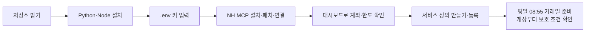

# 시작하기

설치부터 공유 모의계좌 첫 회차와 장기 엔진 dry-run까지의 순서입니다. macOS(Apple Silicon, 한국 시간대)에서 검증했습니다. 다른 OS는 launchd 대신 프로세스를 직접 띄워야 합니다.

- [1. 준비물](#1-준비물)
- [2. 설치](#2-설치)
- [3. 키 설정 (.env)](#3-키-설정-env)
- [4. NH 공식 MCP 연결](#4-nh-공식-mcp-연결)
- [5. 대시보드 열기](#5-대시보드-열기)
- [6. 서비스 정의 만들기](#6-서비스-정의-만들기)
- [7. 첫 모의 회차 확인](#7-첫-모의-회차-확인)
- [8. 장기 엔진 dry-run](#8-장기-엔진-dry-run)
- [9. 테스트](#9-테스트)
- [10. AI에게 설치를 맡길 때](#10-ai에게-설치를-맡길-때)



> [!NOTE]
> 다른 기기·계정에서 이미 돌던 설치를 옮기는 중이라면 이 문서 대신 [이식](portability.md)과 `.claude/skills/ops-bootstrap/SKILL.md`를 먼저 따릅니다. 원장·계좌 등록·설정이 백업에서 함께 옵니다.

## 1. 준비물

> [!IMPORTANT]
> 이 서비스는 AI 도구와 함께 쓰는 AI 트레이딩 시스템이라 **AI 도구 유료 이용이 필요합니다.** Jev·OpenAI API도 각 서비스의 이용 조건과 요금을 따릅니다. 투자 판단과 손익 책임은 투자자 본인에게 있습니다([README · 투자 유의사항 및 면책 고지](../README.md#투자-유의사항-및-면책-고지)).

| 항목 | 용도 | 필수 |
| --- | --- | --- |
| Claude Code 또는 Codex (유료 요금제) | 설치·운영·리포트 작성을 맡는 AI 코딩 에이전트. Claude Pro·Max 또는 ChatGPT Plus·Pro 같은 구독, 또는 API 사용료 필요 | 예 |
| Python 3.11 이상 | 실행기·대시보드(`pyproject.toml` `requires-python >=3.11`) | 예 |
| Node.js 22 이상 | NH 공식 MCP 서버, Archify 도식 | 예 |
| NH투자증권 나무 PLUG 앱 키 | 시세·잔고·주문. 국내주식 모의계좌(계좌 유형 03) 필요 | 예 |
| TypeSafe Jev API 키 | Jev 진입·보유 판단 | Jev 매매에 필요 |
| OpenAI API 키 | Decisions 빠른 판단, 실계좌 AI 관찰 | 권장 |
| 키움 REST·토스증권 Open API | 순위 후보 선별, 시황·신규상장 대체 출처(조회 전용) | 선택 |
| KRX·OpenDART·FRED 키 | 일별 시세, 공시, 장기 엔진 거시 배경 | 선택 |
| Discord·Telegram·Slack | 체결·리포트 알림(하나 이상, [연동 서비스](integrations.md#알림-채널-두-개)) | 선택 |
| LLM 설정(`~/.vibe-trading/.env`) | 장기 엔진의 테마 스토리 점검(원본 vibe-trading 에이전트) | 장기 엔진에 필요 |

## 2. 설치

```bash
git clone https://github.com/roadkwonai/omni-ai-trading.git
cd omni-ai-trading
python3.11 -m venv .venv
.venv/bin/pip install -e . -r requirements-nh.txt
```

`pip install -e .`는 원본 Vibe-Trading의 의존성을, `requirements-nh.txt`는 대시보드(Streamlit)와 웹소켓 모니터 의존성을 설치합니다.

### 공개 v0.1.3 설치 후 확인

공개 v0.1.3과 v0.1.4에는 Jev 모의 실행기가 간접적으로 참조하는 `strategies.kr_swing_v5.signal_engine`이 빠져 있습니다. 공개 소스만 설치하면 Jev 모의 실행과 이를 참조하는 일부 미러·NXT 검증이 `ModuleNotFoundError`에서 중단됩니다. 이 오류가 나면 해당 서비스 등록을 보류하고 NH 시세 연결부터 확인하세요. [NH 공식 MCP 연결](#4-nh-공식-mcp-연결) · [실행기의 시세 함수 참조](../scripts/nh_paper_isolated.py#L30) · [전략 모듈 참조](../scripts/kr_swing_v5_forward.py#L24)

## 3. 키 설정 (.env)

```bash
cp .env.example .env
chmod 600 .env
```

키마다 용도·발급처·읽는 파일이 `.env.example` 주석에 있습니다. 키 이름만 정리하면 다음과 같습니다.

| 묶음 | 키 이름 |
| --- | --- |
| NH (필수) | `APP_KEY`, `APP_SECRET` |
| 실계좌 (실계좌를 쓸 때만) | `ACCOUNT_NUMBER`, `ACCOUNT_NUMBER_2` … |
| AI | `JEV_API_KEY`, `OPENAI_API_KEY` |
| 공공·보조 데이터 | `KRX_API_KEY`, `OPENDART_API_KEY`, `KIWOOM_APP_KEY`, `KIWOOM_APP_SECRET`, `TOSS_CLIENT_ID`, `TOSS_CLIENT_SECRET`, `FRED_API_KEY` |
| 알림·리포트 | `DISCORD_WEBHOOK_REALTIME`, `DISCORD_WEBHOOK_LONGTERM`, `REPORT_PAGES_REPO`, `REPORT_PAGES_URL`, `REPORT_PAGES_BRANCH`, `REPORT_PAGES_PUSH`, `GH_TOKEN` |

> [!IMPORTANT]
> `.env`는 `.gitignore`에 들어 있습니다. 값이나 계좌번호를 화면·로그·이슈에 붙여 넣지 마세요. 스크립트는 `scripts/local_env.py`로 이 파일을 **파싱만** 하고 `os.environ`으로 내보내지 않으므로, 증권사 키가 LLM 에이전트 프로세스에 들어가지 않습니다. 에이전트(LLM 공급자·모델) 설정은 `agent/.env.example`을 참고해 `~/.vibe-trading/.env`에 따로 둡니다.

찾는 순서는 환경변수 `VIBE_TRADING_ENV_FILE` → 저장소 `.env` → 상위 폴더 `.envrc`(예전 방식)입니다. 자세한 설명은 [설정 레퍼런스](configuration.md#1-env-키)에 있습니다.

## 4. NH 공식 MCP 연결

1. [NH 공식 MCP](https://github.com/PLUG-OpenAPI/nhplug-mcp)를 `~/.vibe-trading/integrations/nhplug-mcp`에 받습니다(검증한 공식 커밋 `413a145`).
2. 이 저장소의 호환 패치를 **이 순서대로** 적용하고 빌드합니다. `pagination`이 `no-order-retry`보다 먼저여야 합니다. 이미 적용된 패치는 다시 적용하지 않습니다.

   ```bash
   REPO=$PWD   # 이 저장소 폴더에서 시작
   cd ~/.vibe-trading/integrations/nhplug-mcp
   for p in structured token-cache pagination no-order-retry; do
     git apply --check "$REPO/scripts/nhplug-$p.patch" && git apply "$REPO/scripts/nhplug-$p.patch"
   done
   npm install && npm run build
   ```

3. 공유 모의 실행기의 주문 통로(`--guarded-paper`)는 따로 `~/.vibe-trading/integrations/nhplug-mcp-etf7` 설치본을 씁니다. 위 설치본을 복사하고 `deadline` 패치를 더합니다.

   ```bash
   cp -R ~/.vibe-trading/integrations/nhplug-mcp ~/.vibe-trading/integrations/nhplug-mcp-etf7
   cd ~/.vibe-trading/integrations/nhplug-mcp-etf7
   patch -p1 --forward < "$REPO/scripts/nhplug-deadline.patch" && npm run build
   ```

   | 패치 | 하는 일 | 적용하는 설치본 |
   | --- | --- | --- |
   | `nhplug-structured.patch` | 응답에 표준 MCP `structuredContent`를 더함 | 둘 다 |
   | `nhplug-token-cache.patch` | 접근 토큰을 `nhplug/tokens/`에 캐시해 프로세스마다 재발급하지 않음 | 둘 다 |
   | `nhplug-pagination.patch` | 조회 응답의 연속조회(다음 페이지) 정보 | 둘 다 |
   | `nhplug-no-order-retry.patch` | 토큰 무효 시 조회만 재시도하고 주문은 재전송하지 않음 | 둘 다 |
   | `nhplug-deadline.patch` | 모의 주문 직전 신호 만료 시각과 `shared-etf-paper/STOP`을 확인 | `nhplug-mcp-etf7`만 |

   자세한 차이와 오프라인 검증은 [나무증권 로컬 연동](../guides/nhplug-local.md)을 봅니다.
4. `~/.vibe-trading/agent.json`의 `mcpServers`에 두 서버를 등록합니다. 런처 `scripts/nhplug_mcp.py`가 모드별 주소와 주문 허용 여부를 고정하므로, 환경변수로 운영 주문을 켤 수 없습니다.

   ```json
   {
     "mcpServers": {
       "nhplug_readonly": {
         "type": "stdio",
         "command": "<저장소>/.venv/bin/python",
         "args": ["<저장소>/scripts/nhplug_mcp.py", "--mode", "readonly", "--env-file", "<저장소>/.env", "--account", "<실계좌 번호 또는 빈 값>"],
         "enabledTools": ["list_apis", "describe_api", "call_api", "get_stock_price", "list_accounts"],
         "initTimeout": 30, "toolTimeout": 40
       },
       "nhplug_paper": {
         "type": "stdio",
         "command": "<저장소>/.venv/bin/python",
         "args": ["<저장소>/scripts/nhplug_mcp.py", "--mode", "paper", "--env-file", "<저장소>/.env", "--account", "<모의계좌 번호>"],
         "enabledTools": ["list_apis", "describe_api", "call_api"],
         "initTimeout": 30, "toolTimeout": 40
       }
     }
   }
   ```

   | 서버 | 주소 | 역할 |
   | --- | --- | --- |
   | `nhplug_readonly` | `api.nhplug.com:8443` | 실시간 시세·실계좌 조회, 주문 꺼짐 |
   | `nhplug_paper` | `moapi.nhplug.com:8443` | 모의계좌 조회·주문·취소 (시세 없음) |

5. 연결을 확인합니다. 주문은 보내지 않습니다.

   ```bash
   PYTHONPATH=agent:scripts .venv/bin/python scripts/vibe_market_brief.py
   ```

   ETF 7종의 현재가가 나오면 시세 통로가 열린 것입니다.

> [!NOTE]
> 공유 모의 실행기는 시작할 때 주문 가드 정책(`nhplug/paper-policy-scopes.json`)과 계좌 소유 등록(`nhplug/paper-account-owners.json`)을 확인하고, 없으면 `shared account policy unavailable` 등으로 멈춥니다. 이 두 파일을 만드는 명령은 따로 없으므로 기존 설치의 백업에서 가져오는 것이 안전합니다([이식](portability.md)).

## 5. 대시보드 열기

```bash
PYTHONPATH=agent:scripts .venv/bin/streamlit run streamlit_namuh/app.py \
  --server.address 127.0.0.1 --server.port 8501 --server.headless true
```

http://127.0.0.1:8501 에서 다음을 봅니다.

1. **계좌·자동매매 → 운영 엔진**: 처음에는 'Jev만' 또는 '모두 끔'으로 두고 시작합니다.
2. **계좌·자동매매 → 모의계좌 (공유)**: 분할 1회 매수 금액, 종목당 최대, 주문 보호 한도(회당·하루·보유·새 종목·하루 손실).
3. **운영 → 운영 상태**: 서비스 등록 상태와 운영 조정값.

인증이 없는 개인용 화면이므로 `127.0.0.1` 밖으로 열지 마세요. 화면 읽는 법은 [대시보드 가이드](dashboard.md)에 있습니다.

## 6. 서비스 정의 만들기

```bash
PYTHONPATH=agent:scripts .venv/bin/python scripts/launchd_services.py               # 목록과 일정
PYTHONPATH=agent:scripts .venv/bin/python scripts/launchd_services.py --out ~/vibe-launchd
```

`--out`은 이 저장소 경로와 홈 경로에 맞춘 `com.vibetrading.*.plist`를 만들기만 합니다. 등록·시작은 하지 않습니다. 필요한 것만 골라 등록합니다.

```bash
cp ~/vibe-launchd/com.vibetrading.shared-etf-dashboard.plist ~/Library/LaunchAgents/
launchctl bootstrap gui/$(id -u) ~/Library/LaunchAgents/com.vibetrading.shared-etf-dashboard.plist
```

권장 등록 순서입니다.

| 순서 | 서비스 | 일정 | 하는 일 |
| --- | --- | --- | --- |
| 1 | `shared-etf-dashboard` | 로그인 시 | 대시보드 |
| 2 | `shared-etf-regime`, `market-movers`, `premarket`, `preflight` | 로그인 시 / 평일 08:50 / 평일 07:40\~09:10 / 평일 08:20·08:53 | 국면 관측, 순위 후보, 장전 자료, 장전 사전 점검(모두 읽기 전용) |
| 3 | `shared-etf-learning`, `trading-backup`, `state-sync`, `discord-notify` | 로그인 시 / 평일 15:50 / 평일 16:55 / 로그인 시 | 학습 관찰·일지, 백업, 설정 정리본, 알림 |
| 4 | `shared-etf-paper`, `trading-day-start` | 로그인 시 / 평일 08:55 | 공유 모의 실행기(`--execute` 모의 주문)와 거래일 준비 |
| 5 | `vibe-longterm`, `us-ideas` | 평일 08:40 / 금 10:00·10:30 | 장기 엔진(dry-run), 미국 종목 아이디어 |
| 별도 승인 | `live-follow-1`, `longterm-live-2` | 평일 08:58 / 평일 09:35 | 실계좌 미러, 장기투자 실계좌 |

> [!WARNING]
> `shared-etf-paper`는 `--execute`로 **모의 주문**을 냅니다. 계좌 한도와 [안전장치](safety.md)를 먼저 확인하세요. 이 저장소가 생성하는 `live-follow-1`과 `longterm-live-2` 정의에는 모두 `--execute`가 들어 있습니다. 등록 전 실제 사용할 정의와 계좌 설정을 확인하고, 실계좌 서비스 등록과 실주문 전환에는 사용자 승인이 필요합니다. [실주문이 나가는 조건](live-accounts.md#실주문이-나가는-조건)

서비스 일정 전체와 재시작 절차는 [운영 가이드](operations.md), Claude 예약 작업은 [자동 작업](automation.md)에 있습니다.

## 7. 첫 모의 회차 확인

| 시각 | 하는 일 |
| --- | --- |
| 08:20 | 장전 사전 점검 1차 |
| 08:40 | 장기 엔진 시작 |
| 08:50 | 순위 후보 수집 |
| 08:53 | 장전 사전 점검 2차 |
| 08:55 | 거래일 확인, 실행기와 관찰기 준비 |
| 개장부터(기본 09:00) | 이월 보유와 신규 진입 판단. 자료와 보호 조건을 충족하면 주문 |

1. **장전 사전 점검**을 손으로 돌려 봅니다. 읽기 전용이고, `--no-send`면 Discord로 보내지 않습니다.

   ```bash
   PYTHONPATH=agent:scripts .venv/bin/python scripts/preflight.py --no-send
   ```

2. 평일 08:55에 `trading-day-start`가 휴장·STOP·중복 실행을 확인하고 실행기를 준비합니다. 30초 뒤에도 실행기가 시작되지 않으면 최대 5번 다시 띄웁니다.
3. 대시보드 **운영 → 운영 상태**에 모의 실행기 `실행 중`이 뜨고, **트레이딩 현황**에 Jev 의견과 대기 사유가 쌓이는지 봅니다. 기록은 `~/.vibe-trading/nhplug/shared-etf-paper/events.jsonl`에 남습니다.
4. 개장 첫 8분은 당일 완료 분봉이 부족하면 전 거래일 마감 분봉이나 확인 가능한 당일 NXT 프리마켓 분봉으로 보완합니다. 이때도 자료 신선도와 보호 조건을 통과해야 주문합니다. [장전 분석과 개장 준비](strategy.md#장전-분석과-개장-준비)

처음 며칠은 매수가 없어도 정상일 수 있습니다. 진입 조건이 모두 맞아야 사기 때문입니다. 대기 사유는 **운영 → 운영 상태 → 모의 실행기 하루 요약**과 [FAQ](faq.md#실행기가-매수를-안-합니다)에서 확인합니다.

## 8. 장기 엔진 dry-run

장기 엔진은 기본이 dry-run입니다. 대시보드 **장기투자 → 계좌·실행 → 실행**의 '가상 체결' 스위치(`vibe-longterm/settings.json` `execute`)가 꺼져 있으면 주문 계획만 기록합니다.

```bash
# 오늘 판단만 (국면·거시·뉴스·테마 스토리·계획). 08:45 이후 평일에 돌립니다.
PYTHONPATH=agent:scripts .venv/bin/python scripts/vibe_longterm.py --decide
# 하루 전체(판단 → 주문 → 마감)를 시간 창에 맞춰 한 번씩
PYTHONPATH=agent:scripts .venv/bin/python scripts/vibe_longterm.py --run
```

결과는 대시보드 **장기투자** 맨 위 상태 줄과 '오늘의 판단', **장기투자 → 계좌·실행 → 기록**에 보입니다. 가상 체결을 켜려면 같은 화면에서 확인 문구 `장기투자 가상 체결`을 입력합니다. 1억 원 가상 브로커에 주문하며 증권사 주문이 아닙니다.

> [!CAUTION]
> 이미 `vibe-longterm` 서비스가 도는 설치에서는 손으로 돌리지 마세요. 손으로 돌린 판단도 운영 기록(`longterm.sqlite3`)에 남습니다. `--execute`는 dry-run 확인 뒤 사용자 승인으로만 씁니다.

장기 엔진의 규칙은 [장기투자](longterm.md)에 있습니다.

## 9. 테스트

```bash
PYTHONPATH=agent:scripts:streamlit_namuh .venv/bin/python -m pytest -q scripts streamlit_namuh agent/tests/test_nhplug_*.py
```

테스트는 실제 `tunables.json`과 설정 이력 DB 대신 임시 경로를 씁니다(`scripts/conftest.py`). NH 공식 MCP 설치본이 없는 환경에서는 그 설치본이 필요한 패치 테스트는 건너뜁니다.

## 10. AI에게 설치를 맡길 때

Claude Code나 Codex에게 이 저장소를 열어 두고 설치를 맡길 수 있습니다. 키 입력과 실주문 관련 단계는 사람이 합니다. 설치 프롬프트, 지침 파일 템플릿, 스킬·MCP·권한·예약 작업 등록, 매일 쓰는 프롬프트 예시는 [AI와 함께 쓰기](ai-agents.md)에 모았습니다.

```text
이 저장소는 Omni AI Trading(NH 나무 PLUG 모의·실계좌 자동매매)이다.
docs/getting-started.md와 docs/ai-agents.md를 읽고 그 순서대로 설치를 도와줘.
- .env 값과 계좌번호는 출력하지 말고, 키는 내가 직접 넣게 키 이름만 안내해.
- launchd 서비스는 plist를 만들어 보여 주기만 하고, 등록은 내가 승인한 것만 해.
- shared-etf-paper(모의 주문), 실계좌 서비스, 실주문 스위치, 장기 엔진 --execute는 켜지 마.
```

다른 기기에서 이어서 할 때는 `ops-bootstrap` 스킬이 같은 일을 합니다.

## 다음에 읽을 것

[AI와 함께 쓰기](ai-agents.md) · [동작 구조](architecture.md) · [대시보드 가이드](dashboard.md) · [설정 레퍼런스](configuration.md) · [매매 전략](strategy.md) · [안전장치](safety.md) · [운영 가이드](operations.md) · [FAQ](faq.md)
