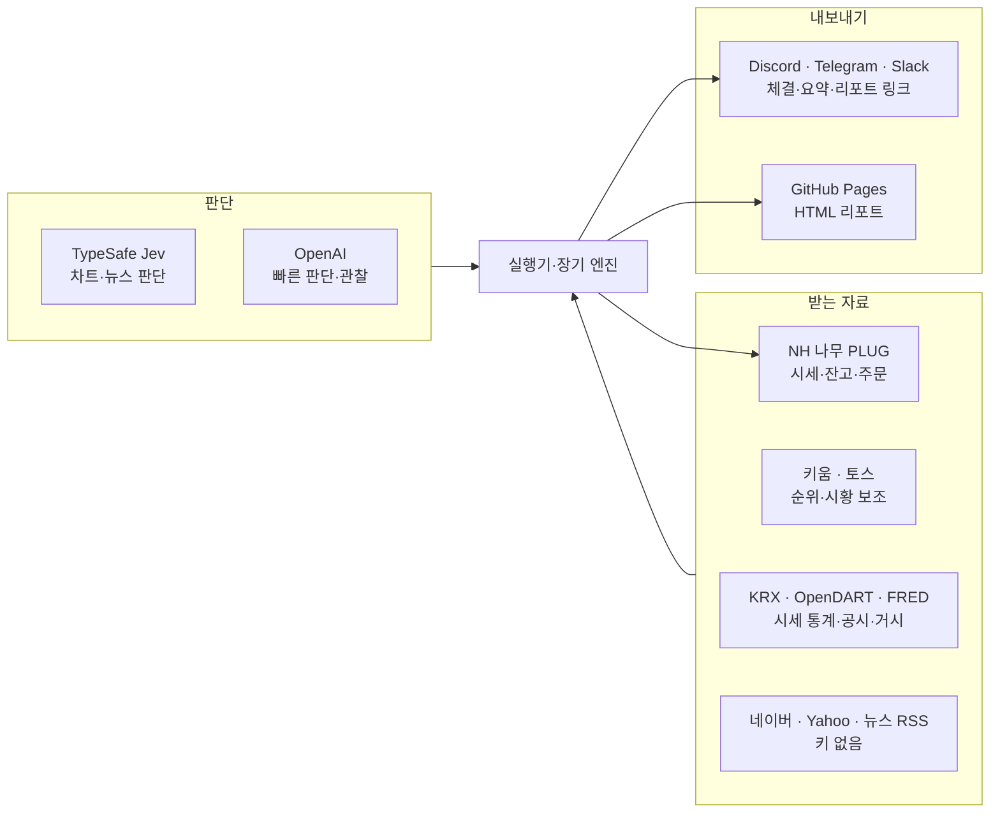
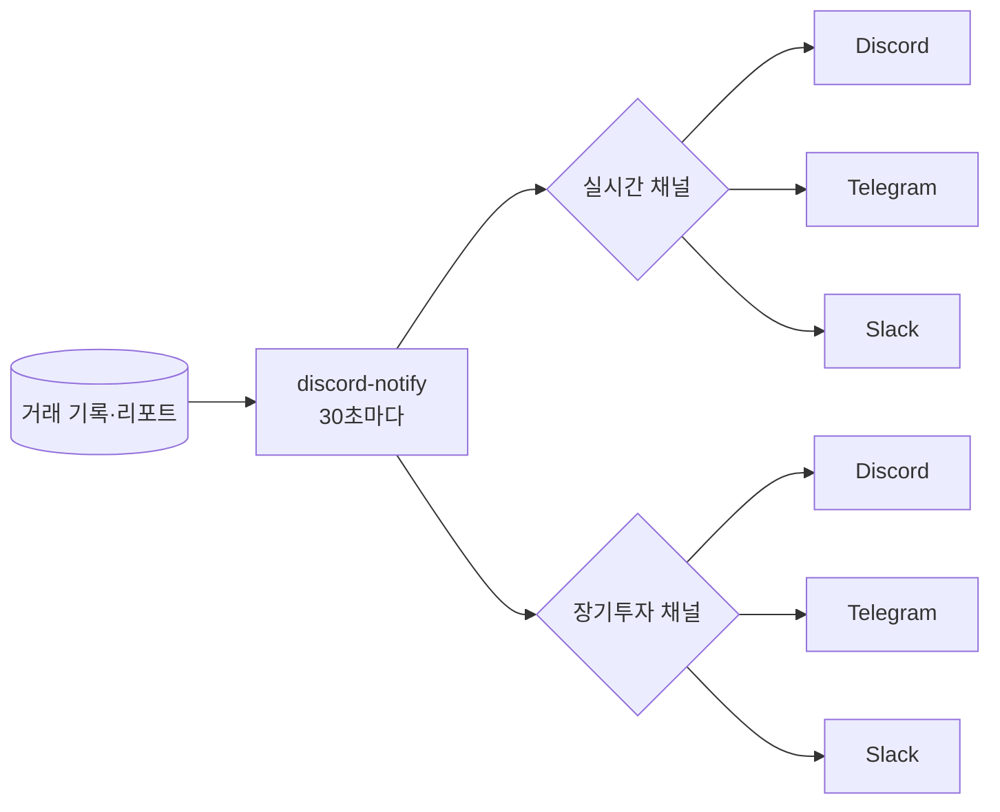

# 연동 서비스

Omni AI Trading이 쓰는 외부 서비스를 한곳에 모았습니다. 서비스마다 무엇에 쓰는지, 꼭 필요한지, 어디서 키를 받는지, `.env`의 어느 키에 넣는지, 제대로 붙었는지 확인하는 법을 적었습니다.

- [한눈에 보기](#한눈에-보기)
- [키를 넣는 곳과 원칙](#키를-넣는-곳과-원칙)
- 증권사: [NH 나무 PLUG](#nh-나무-plug) · [키움 REST](#키움-rest) · [토스증권 Open API](#토스증권-open-api)
- AI 판단: [TypeSafe Jev](#typesafe-jev) · [OpenAI](#openai)
- 공공·시장 데이터: [KRX 정보데이터](#krx-정보데이터) · [OpenDART](#opendart) · [FRED](#fred) · [키 없이 쓰는 출처](#키-없이-쓰는-출처)
- 웹 검색: [Liner](#liner)
- 알림: [알림 채널 두 개](#알림-채널-두-개) · [먼저 정할 것](#먼저-정할-것) · [Discord](#discord) · [Telegram](#telegram) · [Slack](#slack) · [발송 확인과 재시작](#발송-확인과-재시작)
- [리포트 게시: GitHub Pages](#리포트-게시-github-pages)
- [AI에게 맡기기](#ai에게-맡기기)

> [!IMPORTANT]
> 키·토큰·웹훅 주소·계좌번호는 비밀번호와 같습니다. 사용자가 `.env`에 직접 넣고, 화면·채팅·로그·커밋에 붙여 넣지 마세요. 새어 나갔으면 그 서비스 콘솔에서 바로 다시 발급합니다. 각 서비스의 이용 약관과 요금은 그 서비스의 최신 안내를 따릅니다.

## 한눈에 보기



| 서비스 | 쓰는 곳 | 필요 | `.env` 키 | 비용 |
| --- | --- | --- | --- | --- |
| NH 나무 PLUG | 시세, 잔고, 모의·실계좌 주문 | **필수** | `APP_KEY`, `APP_SECRET`, `ACCOUNT_NUMBER`(실계좌만) | NH 안내를 따름 |
| TypeSafe Jev | 진입·보유 판단(차트 이미지·뉴스) | Jev 매매에 필수 | `JEV_API_KEY` | 서비스 요금을 따름 |
| OpenAI | Decisions 빠른 판단, 실계좌 AI 관찰 | 권장 | `OPENAI_API_KEY` | API 사용료 |
| Liner | 종목·이슈 웹 검색과 원문 확인 | 선택 | `LINER_API_KEY` | 요청당 API 사용료 |
| 키움 REST | 순위 후보 선별, 시황 대체, 프로그램매매 | 선택 | `KIWOOM_APP_KEY`, `KIWOOM_APP_SECRET` | 키움 안내를 따름 |
| 토스증권 Open API | 신규상장 목록 대체, 시황 대체, NXT 프리마켓 요약 | 선택 | `TOSS_CLIENT_ID`, `TOSS_CLIENT_SECRET` | 토스 안내를 따름 |
| KRX 정보데이터 | 코스피·코스닥 일별 시세 | 선택 | `KRX_API_KEY` | 무료 신청 |
| OpenDART | 공시, 재무제표, 그림자 후보 공시 | 선택 | `OPENDART_API_KEY` | 무료 신청 |
| FRED | 장기 엔진 거시 배경(금리차·실질금리·하이일드) | 선택 | `FRED_API_KEY` | 무료 |
| Discord | 알림·리포트 링크 | 선택 | `DISCORD_WEBHOOK_REALTIME`, `DISCORD_WEBHOOK_LONGTERM` | 무료 |
| Telegram | 알림·리포트 링크 | 선택 | `TELEGRAM_BOT_TOKEN`, `TELEGRAM_CHAT_REALTIME`, `TELEGRAM_CHAT_LONGTERM` | 무료 |
| Slack | 알림·리포트 링크 | 선택 | `SLACK_WEBHOOK_REALTIME`, `SLACK_WEBHOOK_LONGTERM` | 무료 플랜 가능 |
| GitHub Pages | HTML 리포트 게시 | 선택 | `REPORT_PAGES_REPO`, `REPORT_PAGES_PUSH`, `GH_TOKEN` | 공개 저장소 무료 |

선택 서비스의 키가 비어 있으면 그 기능만 빠지고 나머지는 그대로 동작합니다. 지금 어떤 서비스가 호출되고 실패·지연되는지는 대시보드 **운영 → API 연동**에서 봅니다(호출 기록은 주소의 비밀 부분과 숫자를 가리고 남깁니다).

## 키를 넣는 곳과 원칙

1. 저장소 루트에서 `.env.example`을 `.env`로 복사하고 권한을 600으로 둡니다(`cp .env.example .env && chmod 600 .env`).
2. 필요한 키만 채웁니다. 키 이름과 설명은 `.env.example` 주석에 있습니다.
3. 설정값(한도·매매 기준)은 `.env`가 아니라 대시보드에서 바꿉니다. `.env`에는 비밀값과 경로만 둡니다.
4. 바꾼 키는 그 키를 읽는 서비스가 다음에 시작할 때 적용됩니다. 알림 서비스는 [발송 확인과 재시작](#발송-확인과-재시작)을 따릅니다.

## NH 나무 PLUG

시세·잔고·주문의 중심입니다. 앱 키 하나로 운영 서버(시세·실계좌 조회)와 모의 서버(모의 주문)를 함께 씁니다.

| 항목 | 내용 |
| --- | --- |
| 발급 | [NH 나무 PLUG](https://www.nhplug.com) 개발자 센터 → 앱 등록 → App Key·App Secret. 국내주식 모의투자 계좌(계좌 유형 03)를 함께 신청 |
| `.env` | `APP_KEY`, `APP_SECRET`. 실계좌를 쓸 때만 `ACCOUNT_NUMBER`(추가 실계좌는 `ACCOUNT_NUMBER_2`…) |
| 연결 | 공식 MCP 설치·패치·`agent.json` 등록: [시작하기 4절](getting-started.md#4-nh-공식-mcp-연결) |
| 확인 | `PYTHONPATH=agent:scripts .venv/bin/python scripts/vibe_market_brief.py` (ETF 7종 현재가가 나오면 시세 통로가 열린 것) |
| 유량 | 앱 키당 초당 약 5회. 실행기·대시보드·장기 엔진이 나눠 씀([FAQ](faq.md#nh-유량-초과가-납니다)) |

## 키움 REST

순위 후보를 빠르게 고르고(코스피200·코스닥150 구성종목의 거래대금·거래량·등락 순위), 네이버 시황이 막힐 때 지수·프로그램매매·테마를 대신 받습니다. 조회 TR 허용 목록만 부르며 주문하지 않습니다.

| 항목 | 내용 |
| --- | --- |
| 발급 | [키움 OpenAPI](https://openapi.kiwoom.com) → API 사용 신청 → 앱 키. 호출할 PC의 IP 등록 |
| `.env` | `KIWOOM_APP_KEY`, `KIWOOM_APP_SECRET` |
| 토큰 | 24시간 토큰을 `~/.vibe-trading/kiwoom/token.json`에 공유 캐시(인증 실패 때만 다시 발급) |
| 없으면 | 순위 계산이 NH 전체 스캔으로 돌아가고(느려짐), 시황 대체 출처 하나가 빠짐 |

## 토스증권 Open API

KRX KIND 신규상장 목록이 막힐 때 상장일 목록을, 네이버 시황이 막힐 때 지수 일봉·투자자별 매매를 대신 받고, NXT 프리마켓(08:00\~08:50) 체결 요약을 만듭니다. 조회 경로 허용 목록만 부릅니다.

| 항목 | 내용 |
| --- | --- |
| 발급 | [토스증권 개발자](https://developers.tossinvest.com) 또는 WTS 설정 → Open API. 허용 IP 등록 |
| `.env` | `TOSS_CLIENT_ID`, `TOSS_CLIENT_SECRET` |
| 토큰 | 클라이언트당 1개(다시 발급하면 이전 토큰 폐기)라 모든 프로세스가 `~/.vibe-trading/toss/token.json`을 같이 씀 |
| 참고 | 토스 투자자 값은 미등록 외국인을 포함해 네이버와 기준이 다름. 외부 AI에는 원본 봉이 아닌 요약값만 보냄 |

## TypeSafe Jev

Jev는 차트 이미지와 최근 90분 뉴스, 시황 요약을 받아 매수·대기·매도 의견과 신뢰도를 내는 외부 판단 모델입니다. Jev 트레이딩 엔진의 진입·보유 판단, 낙폭과대·신중 재진입 검토에 쓰입니다.

| 항목 | 내용 |
| --- | --- |
| 발급 | [TypeSafe](https://typesafe.ai)에서 API 키 |
| `.env` | `JEV_API_KEY` |
| 요청 | 이미지 요청에는 `TypeSafe-Danger-Zone-Images: true` 헤더를 붙임(코드가 처리) |
| 없으면 | 그 회차 Jev 의견이 없어 Jev 경로가 대기함(`JEV_API_KEY missing`) |

> [!NOTE]
> Jev의 신뢰도는 수익 확률이 아닙니다. 주문은 승인된 규칙과 주문 한도가 정합니다.

## OpenAI

ETF 모의 실행기의 Decisions(빠른 판단)와 실계좌 AI 관찰기가 씁니다. 장기 엔진의 테마 스토리 점검은 원본 vibe-trading 에이전트의 LLM 설정(`~/.vibe-trading/.env`)을 씁니다.

| 항목 | 내용 |
| --- | --- |
| 발급 | [OpenAI Platform](https://platform.openai.com) → API keys |
| `.env` | `OPENAI_API_KEY` |
| 비용 | API 사용료가 따로 듭니다(채팅용 ChatGPT 구독과 별개) |

## KRX 정보데이터

코스피·코스닥 일별 시세를 받습니다(`krx_daily` 도구).

| 항목 | 내용 |
| --- | --- |
| 발급 | [KRX 정보데이터 OpenAPI](https://openapi.krx.co.kr) → 서비스 이용 신청 |
| `.env` | `KRX_API_KEY` |

신규상장 목록은 키 없이 [KRX KIND](https://kind.krx.co.kr) 웹 페이지에서 읽습니다(막히면 토스로 대신).

## OpenDART

금융감독원 전자공시의 공시·재무제표를 받습니다. 이슈 종목 그림자 후보(경영권·최대주주 변경·공개매수 공시)와 스윙 가치 점검에 쓰입니다.

| 항목 | 내용 |
| --- | --- |
| 발급 | [OpenDART](https://opendart.fss.or.kr) → 인증키 신청 |
| `.env` | `OPENDART_API_KEY` (쿼리 키는 호출 기록에 남기지 않음) |

## FRED

미국 세인트루이스 연준 FRED에서 10년−2년 금리차, 10년물, 실질금리, 하이일드 스프레드와 30일 발표 일정(CPI·고용·GDP·PCE·PPI)을 받아 장기 엔진의 거시 배경과 시장 온도에 씁니다. 참고 입력이라 국면 판정·주문은 이 값을 읽지 않습니다.

| 항목 | 내용 |
| --- | --- |
| 발급 | [FRED](https://fred.stlouisfed.org) → My Account → API Keys (무료) |
| `.env` | `FRED_API_KEY` |
| 함께 쓰는 것 | 연준 FOMC 일정 페이지(키 없음) |

## Liner

1. Liner Platform의 **API Keys**에서 발급한 키를 프로젝트 `.env`의 `LINER_API_KEY`에 넣습니다. [공식 설정 가이드](https://liner.com/ko/developers/docs/quick-start)
2. 대시보드 상단의 **AI 검색**에서 검색어를 입력하거나 중요도 순으로 정렬된 최근 뉴스 제목을 누릅니다. **운영 → API 연동 → API 상세 → Liner → 웹 검색**에서도 사용할 수 있습니다.
3. **투자 AI 채팅**에서 주식이나 ETF를 질문할 수 있습니다. **오늘 주식시장 영향 분석**으로 선택한 이슈의 시장 영향과 출처를 확인하세요. 웹·가이드 채팅과 시장 영향 분석에는 Liner Search Agent API 요금이 적용됩니다. [공식 Search Agent API 문서](https://liner.com/ko/developers/docs/search-agent-api)
4. **추천 질문** 태그를 누르면 채팅에 질문을 보냅니다. **다른 질문**으로 추천을 바꾸거나 **전체**에서 분류별로 고를 수 있습니다. 받은 답과 검색 결과는 **지난 대화**에서 요금 없이 다시 볼 수 있고, **다시 요청하기**는 같은 요청을 새로 보냅니다. 모두 로컬 런타임의 `nhplug/ai-search-history.sqlite3`에 저장합니다.
5. 채팅 오른쪽 위의 **마크다운 복사**를 누르면 가장 최근 답변과 출처를 클립보드에 복사합니다.

대화상자의 **사용 가이드** 탭에서 기능별 안내와 검색·채팅 흐름을 볼 수 있습니다. [AI 검색 사용 가이드](ai-search.md)

서비스 용어와 사용법을 묻는 경우 AI 채팅이 화면 안내와 대시보드·전략·장기투자·연동 가이드의 관련 내용을 찾아 답변에 참고합니다. 답변 아래 **서비스 가이드**에서 사용한 문서와 발췌 내용을 확인할 수 있습니다.

**내부 데이터**에서 실계좌 잔고와 보유 종목을 물으면 대시보드가 NH 나무 PLUG의 읽기 전용 조회를 사용합니다. 결과는 조회 완료 시각과 함께 현재 대화에 표시합니다. [내부 데이터 읽기](ai-search.md#내부-데이터-읽기)

키가 비어 있으면 연동 상태에 **미사용**으로 표시됩니다. 검색 버튼을 누를 때마다 검색어를 Liner에 보내고 웹 검색 API를 한 번 호출합니다. Premium Data는 끕니다. [공식 Search API 문서](https://liner.com/ko/developers/docs/search-api)

## 키 없이 쓰는 출처

| 출처 | 쓰는 곳 |
| --- | --- |
| 네이버 증권 | 지수·수급·테마·종목 정보·애널리스트 리포트, 뉴스 대체 출처 |
| Google 뉴스·Bing 뉴스 RSS | 시장·종목 헤드라인(90분 공유 캐시, 막히면 바로 네이버) |
| Yahoo Finance | 해외 지수·선물·원자재·환율, 국내 일봉 보조, 장기 엔진 지표 |
| TradingView 스캐너 | 코스피200 야간선물 |
| SEC EDGAR | 미국 종목 아이디어(13F·공시) |

키는 없지만 각 사이트의 이용 조건을 따르고, 막히면 대체 출처나 직전 값으로 넘어갑니다.

## 알림 채널 두 개

알림은 채널 두 개로 나뉘고, 채널마다 Discord·Telegram·Slack 중 설정한 곳 **모두**로 같은 내용이 갑니다.

| 채널 | 보내는 것 |
| --- | --- |
| 실시간 (`REALTIME`) | Jev 공유 모의·Jev 실계좌 체결(체결마다 즉시), 15:40 계좌별 마감 요약, 장전 사전 점검 실패, 매매일지·장 마감 개선안·낙폭과대 주간 감사·장전 분석 리포트 링크, 저녁 리포트가 18:00까지 없으면 알림(장기투자 리포트는 장기투자 채널, 주간 감사는 금요일 19:00) |
| 장기투자 (`LONGTERM`) | 장기 엔진의 하루 판단·가상 주문·순자산, 장기투자 실계좌 체결·계획, 장기투자 전략 리포트·복기·감사 링크 |



- 발송처마다 "보낸 목록"을 따로 둡니다. 한 곳이 실패해도 다른 곳에 다시 보내지 않고, 실패한 곳만 다음 회차에 이어서 보냅니다.
- 새 발송처를 켜면 그때부터 생긴 알림만 갑니다(지난 알림을 몰아서 보내지 않음).
- 리포트는 GitHub Pages에 게시되고 페이지가 열린 뒤에만 링크로 갑니다. 본문을 텍스트로 보내지 않습니다([리포트 발행](report-pages.md)).
- 메시지 서식은 발송처에 맞춰 바뀝니다. Discord는 마크다운 그대로, Slack은 mrkdwn(`*굵게*`, `<주소|제목>`)으로, Telegram은 서식 없는 글자로 보냅니다.
- 내용과 표기 규칙(손절·익절·전량 매도 구분 등)은 [알림](notifications.md)에 있습니다.

### 먼저 정할 것

| 질문 | 고르는 법 |
| --- | --- |
| 어디로 받을까 | 셋 중 하나만 써도 되고 여럿을 같이 써도 됩니다. 평소 쓰는 메신저 하나면 충분합니다 |
| 채널을 나눌까 | 실시간(체결이 잦음)과 장기투자(하루 몇 건)를 다른 방으로 나누면 보기 편합니다. 한 방으로 받으려면 두 키에 같은 값을 넣습니다 |
| 누가 보나 | 웹훅·봇이 있는 방의 사람은 모두 체결과 손익을 봅니다. 혼자 쓰는 방이나 비공개 채널을 권합니다 |

## Discord

준비물: 알림을 받을 Discord 서버와, 그 서버에서 **웹후크 관리** 권한(서버 주인이면 이미 있음).

| 단계 | 할 일 |
| --- | --- |
| 1 | 서버에 알림 채널 두 개(예: `#실시간`, `#장기투자`)를 만듭니다. 혼자 보려면 채널 설정 → 권한에서 비공개로 둡니다 |
| 2 | 채널 이름 옆 톱니바퀴(채널 편집) → **연동** → **웹후크** → **새 웹후크**를 누릅니다. 이름(예: `Omni 실시간`)과 프로필 그림은 마음대로 바꿔도 됩니다 |
| 3 | **웹후크 URL 복사**를 누릅니다. 주소는 `https://discord.com/api/webhooks/<숫자>/<문자열>` 모양입니다 |
| 4 | `.env`의 `DISCORD_WEBHOOK_REALTIME`에 붙여 넣고, 장기투자 채널에서 2\~3단계를 반복해 `DISCORD_WEBHOOK_LONGTERM`에 넣습니다 |
| 5 | 아래 [발송 확인과 재시작](#발송-확인과-재시작)대로 테스트 메시지를 보내고 서비스를 다시 시작합니다 |

| 문제 | 확인할 것 |
| --- | --- |
| 연동 메뉴가 없음 | 그 서버에서 웹후크 관리 권한이 없습니다. 서버 주인에게 권한을 받거나 내 서버를 새로 만듭니다 |
| `--test`가 `failed` | 주소를 끝까지 복사했는지, 웹후크를 지우지 않았는지 확인합니다. 지운 웹후크 주소는 다시 살릴 수 없으니 새로 만듭니다 |
| 주소가 새어 나감 | 채널 편집 → 연동 → 웹후크에서 그 웹후크를 **삭제**하고 새로 만들어 `.env`를 바꿉니다 |

## Telegram

준비물: Telegram 앱과, 알림을 받을 그룹·채널(또는 봇과의 1:1 대화).

| 단계 | 할 일 |
| --- | --- |
| 1 | Telegram에서 [@BotFather](https://t.me/BotFather)를 열고 `/newbot`을 보냅니다. 봇 이름(예: `Omni 알림`)과 `bot`으로 끝나는 사용자 이름(예: `my_omni_alert_bot`)을 차례로 정하면 봇 토큰을 줍니다. 토큰은 `123456789:ABC...` 모양입니다 |
| 2 | 받을 곳을 고릅니다. **1:1로 받기**: 내 봇을 검색해 `/start`를 보냅니다. **그룹으로 받기**: 그룹을 만들고 봇을 초대합니다. **채널로 받기**: 채널을 만들고 봇을 관리자로 추가합니다(메시지 게시 권한) |
| 3 | 그곳에 아무 메시지나 하나 보냅니다(그룹이면 `/start@봇사용자이름`, 채널이면 아무 글이나 게시) |
| 4 | 브라우저에서 `https://api.telegram.org/bot<봇 토큰>/getUpdates`를 열고, 결과에서 `"chat":{"id": ...}` 숫자를 찾습니다. 1:1은 양수, 그룹·채널은 보통 `-100`으로 시작합니다. 이 주소에는 토큰이 들어 있으니 공유하지 마세요 |
| 5 | `.env`에 `TELEGRAM_BOT_TOKEN`(1단계 토큰)과 `TELEGRAM_CHAT_REALTIME`·`TELEGRAM_CHAT_LONGTERM`(4단계 채팅 ID)을 넣습니다. 한 곳으로 받으려면 두 채팅 ID를 같게 둡니다. 봇 하나로 두 방에 보낼 수 있습니다 |
| 6 | 아래 [발송 확인과 재시작](#발송-확인과-재시작)대로 확인합니다 |

| 문제 | 확인할 것 |
| --- | --- |
| `getUpdates`가 `"result":[]` | 봇을 초대한 뒤 메시지를 보내지 않았거나, 그룹에서 봇이 일반 메시지를 못 보는 설정(개인정보 보호 모드)입니다. `/start@봇사용자이름`처럼 봇을 부르는 메시지를 보내고 다시 엽니다 |
| `--test`가 `failed` | 토큰과 채팅 ID의 `-` 부호를 확인합니다. 채널이면 봇이 관리자인지, 그룹이면 봇이 아직 그룹에 있는지 확인합니다 |
| 1:1에서 안 옴 | 봇에게 `/start`를 먼저 보내야 봇이 말을 걸 수 있습니다 |
| 토큰이 새어 나감 | BotFather에 `/revoke`를 보내 그 봇의 토큰을 새로 받고 `.env`를 바꿉니다 |

토큰이 없으면 채팅 ID가 있어도 Telegram은 꺼진 것으로 봅니다. 한 메시지는 4,000자에서 나눠 보냅니다.

## Slack

준비물: 알림을 받을 Slack 워크스페이스와, 앱을 설치할 수 있는 권한(워크스페이스 설정에 따라 관리자 승인이 필요할 수 있음).

| 단계 | 할 일 |
| --- | --- |
| 1 | 알림 채널 두 개(예: `#omni-실시간`, `#omni-장기투자`)를 만듭니다. 혼자 보려면 비공개 채널로 만듭니다 |
| 2 | [Slack API](https://api.slack.com/apps) → **Create New App** → **From scratch**에서 앱 이름(예: `Omni 알림`)과 워크스페이스를 고릅니다 |
| 3 | 왼쪽 메뉴 **Incoming Webhooks** → **Activate Incoming Webhooks**를 켭니다 |
| 4 | 아래 **Add New Webhook to Workspace**를 누르고 실시간 채널을 골라 허용합니다. 장기투자 채널도 한 번 더 추가합니다 |
| 5 | 만들어진 Webhook URL(`https://hooks.slack.com/services/T.../B.../...` 모양)을 `.env`의 `SLACK_WEBHOOK_REALTIME`, `SLACK_WEBHOOK_LONGTERM`에 넣습니다 |
| 6 | 아래 [발송 확인과 재시작](#발송-확인과-재시작)대로 확인합니다 |

| 문제 | 확인할 것 |
| --- | --- |
| 앱 설치가 막힘 | 워크스페이스가 앱 설치에 관리자 승인을 요구합니다. 관리자에게 요청하거나 개인 워크스페이스를 씁니다 |
| 비공개 채널이 목록에 없음 | 비공개 채널은 내가 들어가 있어야 고를 수 있습니다 |
| `--test`가 `failed` | 주소를 끝까지 복사했는지, 앱이나 채널을 지우지 않았는지 확인합니다 |
| 주소가 새어 나감 | 앱 설정 → Incoming Webhooks에서 그 웹훅을 **Remove**하고 새로 추가해 `.env`를 바꿉니다 |

## 발송 확인과 재시작

알림 서비스는 시작할 때 `.env`를 읽습니다. 발송처를 더하거나 바꾼 뒤에는 연결을 확인하고 서비스를 다시 시작합니다.

```bash
PYTHONPATH=agent:scripts:streamlit_namuh .venv/bin/python scripts/discord_notify.py --test        # 발송처마다 연결 확인 메시지 1건
PYTHONPATH=agent:scripts:streamlit_namuh .venv/bin/python scripts/report_pages.py --test-send     # 채널마다 최신 리포트로 테스트
launchctl kickstart -k gui/$(id -u)/com.vibetrading.discord-notify                               # 알림 서비스 다시 시작
```

`--test`는 채널·발송처마다 `sent` 또는 `failed`를 보여 줍니다. `failed`면 주소·토큰·채팅 ID와 봇 초대 여부를 확인합니다. 발송 결과와 실패 사유는 대시보드 **운영 → 리포트 발행**과 호출 기록에 남습니다.

## 리포트 게시: GitHub Pages

리포트(장전 분석·매매일지·개선안·장기 전략 등)를 HTML로 만들어 GitHub Pages에 올리고, 알림에는 링크를 보냅니다.

| 항목 | 내용 |
| --- | --- |
| `.env` | `REPORT_PAGES_REPO=<owner>/<repo>`, `REPORT_PAGES_PUSH=on`, `GH_TOKEN`(또는 상위 폴더 `.envrc`) |
| 선택 | `REPORT_PAGES_URL`(사용자 도메인), `REPORT_PAGES_BRANCH`(기본 `gh-pages`) |
| 주의 | 무료 계정의 Pages는 공개 저장소에서만 동작합니다. 리포트는 검색 엔진에 올리지 않지만 주소를 아는 사람은 볼 수 있습니다 |
| 자세히 | [리포트 발행](report-pages.md) |

## AI에게 맡기기

```text
docs/integrations.md를 읽고 지금 .env에서 비어 있는 키를 서비스별로 이름만 표로 보여 줘(값은 출력하지 마).
필수인 것과 선택인 것을 나누고, 빈 선택 서비스가 빠지면 무엇이 안 되는지도 적어 줘.
```

```text
Telegram으로도 알림을 받고 싶어. docs/integrations.md의 Telegram 절차를 단계별로 안내해 주고,
내가 .env에 키를 넣었다고 하면 discord_notify.py --test로 확인한 뒤 discord-notify 재시작이 필요한지 알려 줘.
```

```text
API 연동 화면 기준으로 오늘 실패하거나 지연된 외부 서비스가 있는지 보고, 원인과 확인할 곳을 정리해 줘.
```

## 다음에 읽을 것

[시작하기](getting-started.md) · [알림](notifications.md) · [리포트 발행](report-pages.md) · [설정 레퍼런스](configuration.md) · [AI와 함께 쓰기](ai-agents.md)
