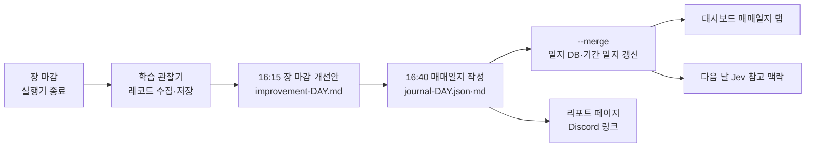
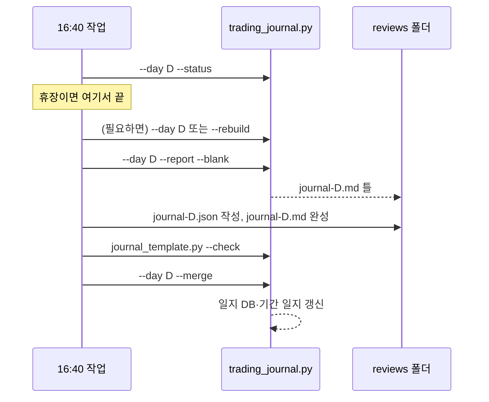

# 매매일지

거래일마다 모든 계좌의 체결·손익과 그날의 시장·수급·이슈·시스템 기록을 한 레코드로 모으고, 16:40에 분석 리포트를 붙여 일·월·분기·반기·연 단위로 쌓는 기능입니다. 같은 템플릿을 쓰므로 날짜·기간끼리 비교할 수 있고, Jev와 장기 엔진이 최근 일지를 참고 맥락으로 읽습니다. 장 마감 개선안(16:15)도 이 문서에서 다룹니다.

- [하루의 흐름](#하루의-흐름)
- [하루 레코드에 들어가는 것](#하루-레코드에-들어가는-것)
- [16:40 분석 리포트](#1640-분석-리포트)
- [기간 매매일지](#기간-매매일지)
- [대시보드 매매일지 탭](#대시보드-매매일지-탭)
- [엔진이 읽는 일지 요약](#엔진이-읽는-일지-요약)
- [장 마감 개선안](#장-마감-개선안)
- [명령 모음](#명령-모음)
- [파일 위치](#파일-위치)

> [!NOTE]
> 매매일지는 기록과 연구용입니다. 주문을 내지 않고 매매 규칙도 바꾸지 않습니다. 손익은 **체결가 기준이며 수수료·세금이 빠진 값**입니다.

## 하루의 흐름



| 시각 (평일) | 누가 | 무엇을 |
| --- | --- | --- |
| 실행기 종료 7분 뒤 (15:10보다 이르지 않음, 보통 15:2x) | launchd `shared-etf-learning`(`scripts/isolated_paper_learning_watch.py`) | `trading_journal.build` → `store`로 그날 레코드를 만들고 `update_periods`로 월·분기·반기·연 일지를 다시 모읍니다. |
| 16:15 | 예약 작업 `trading-daily-improvement` | [장 마감 개선안](#장-마감-개선안)을 씁니다. |
| 16:40 | 예약 작업 `trading-journal` (스킬 `trading-journal-writer`) | 관점 JSON과 매매관점 리포트를 쓰고 템플릿 검사 뒤 `--merge`로 레코드에 붙입니다. |
| 매월 1일 17:10 | 예약 작업 `trading-journal-period` | 지난달, 그리고 끝난 분기·반기·연의 기간 일지를 씁니다. |

학습 관찰기가 레코드를 만들 때는 아직 16:15 개선안이 없습니다. `--merge`가 그날 개선안을 `system.improvement_report`에 다시 넣습니다.

## 하루 레코드에 들어가는 것

수집은 `scripts/trading_journal.py`의 `build(day)`가 합니다. 저장 위치는 `~/.vibe-trading/nhplug/shared-etf-paper/trading-journal.sqlite3`의 `days` 표(날짜당 JSON 한 줄)입니다.

| 키 | 내용 | 출처 |
| --- | --- | --- |
| `books` | 계좌(장부)별 그날 체결과 성적. 모의(Jev), 장기투자 가상 계좌, 실계좌마다 하나씩. 장기투자로 운용하는 실계좌는 `(장기투자)`가 붙습니다. | 모의 원장 `orders.sqlite3`·`events.jsonl`, 장기 엔진 `vibe_longterm.journal_rows`, 실계좌 체결 `live_fills` |
| `books.*.performance` | 실현손익, 매수 대비 수익률, 매도 수, 승률, 평균 이익·손실 %, 손익비, 가장 큰 이익·손실 매매와 종목, 실현손익이 가장 높았던 분 | 이동평균 원가 계산 |
| `market` | 코스피·코스닥·나스닥·S&P500·다우·필라델피아 반도체·VIX·금·WTI·비트코인·이더리움·원/달러·미 국채 10년의 종가와 등락 | Yahoo Finance |
| `market_context` | 그날 만든 경우에만: 시황 스냅숏(지수·테마) | `market-context.json` |
| `flows.market` | 코스피·코스닥 개인·외국인·기관 순매수(날짜별, 최근 5거래일). 그날 만든 경우 마감 프로그램 매매(차익·비차익·전체)와 상승·하락 종목 수 | 네이버 증권 |
| `flows.stocks` | 매매 종목의 외국인·기관·개인 순매수(당일 잠정) | 네이버 증권 |
| `flows.pressure` | 매매 종목의 공매도·신용·대차. 신용은 다음 영업일 새벽에 나오므로 장 마감 레코드에는 전날 값이 들어갑니다. | 토스 Open API(키가 있을 때) |
| `flows.investor_rankings` | 그날 만든 경우에만: 투자자별 순매수·순매도 상위 | 토스 Open API |
| `issues` | 분야 13개의 그날 헤드라인: 시황, 미국 증시, 금리·연준, 환율, 원자재, 코인, 전쟁·분쟁, 정치, 지정학, 기업 실적, 혁신 발표, 반도체, 애널리스트 | Google News (연합뉴스 제외) |
| `engine_news` | Jev가 그날 판단할 때 실제로 받은 헤드라인, 오래 본 순, 본 시간(분)과 링크 | 실행기 이벤트(`market_context`) |
| `analysts` | 매매 종목의 애널리스트 컨센서스와 리포트 링크 | 네이버 리서치 |
| `charts` | 매매 종목과 KODEX 200의 분봉, 전일 종가 | 아래 [차트 자료](#차트-자료) |
| `system` | 실행기 상태, 진입 차단 사유, 주문 가드 사용량, 제한 규칙이 막은 횟수, 오류 수, 경로·청산별 성적, 15:10 복기 교훈, 그날 개선안 | `scripts/daily_improvement.py`, 이벤트 |
| `perspective` | 16:40 작업이 쓴 관점 | `reviews/journal-DAY.json` |

### 차트 자료

`chart_data(day, code)`는 아래 순서로 처음 얻은 것을 씁니다.

1. 실행기가 그날 기록한 NH 1분봉(하루 내내 있을 때: 300개 이상, 14:50 이후까지)
2. 키움 1분봉(ka10080, 약 1년, 키가 있을 때)
3. Yahoo 1분봉(7일) → 5분봉(60일) → 60분봉(2년)

체결 시각과 수량, 실현손익을 차트 위에 표시하고, VWAP·전일 종가·거래량·KODEX 200 대비 등락과 매수·매도 위치 설명을 붙입니다.

### 이슈 별점

`rank_issues(record)`가 헤드라인마다 점수를 매기고 ★1\~5로 바꿉니다. 같은 기사는 한 번만 셉니다.

점수 = 분야 가중치 + 큰 사건 단어(폭락·전쟁·관세·금리 인상 등) + 그 분야 지표의 큰 움직임 + 그날 매매 종목 언급 + 엔진이 판단에 받은 정도 + 비슷한 보도 수

| 점수 | 7 이상 | 5.5 이상 | 4 이상 | 2.5 이상 | 그 밖 |
| --- | --- | --- | --- | --- | --- |
| 별점 | ★5 | ★4 | ★3 | ★2 | ★1 |

<details>
<summary>분야 가중치와 지표 연결</summary>

| 분야 | 가중치 | 연결 지표(+1 / +2가 되는 등락 폭) |
| --- | --- | --- |
| 전쟁·분쟁, 지정학, 금리·연준, 미국 증시 | 3.0 | 미국 증시 = 나스닥 2% / 4%, 금리·연준 = 미 국채 10년 2% / 4% |
| 반도체 | 2.5 | 필라델피아 반도체 3% / 6% |
| 시황, 기업 실적, 환율, 원자재 | 2.0 | 시황 = 코스피 2% / 4%, 환율 = 원/달러 0.8% / 1.5%, 원자재 = WTI 3% / 6% |
| 애널리스트, 정치, 혁신 발표 | 1.5 | — |
| 코인 | 1.0 | 비트코인 5% / 10% |

값은 `scripts/trading_journal.py`의 `CATEGORY_WEIGHT`·`MOVE_LINKS`에 있습니다.

</details>

16:40 분석이 `top_issues`(이슈·별점·이유·링크)를 쓰면 대시보드는 그 순위를 먼저 보여 줍니다. 없으면 위 데이터 순위를 씁니다.

### 다시 모으기

지난 날짜를 다시 모을 때는 `--rebuild`를 씁니다(대시보드 '이날 일지 다시 만들기'와 같음). 그날에만 잡히는 값은 기존 레코드의 값을 지킵니다.

- 지킴: 장 마감 프로그램 매매·등락 종목 수, 시황 스냅숏, 더 촘촘하거나 더 긴 분봉, 그날 만든 지표·헤드라인, 지금은 출처가 더 주지 않는 값
- 새로 받음: 투자자별 수급(네이버 날짜별 값은 다음 날 확정)

> [!WARNING]
> 지난 날짜에 `--day D`(새로 모으기)를 쓰면 그날에만 있던 값이 빠집니다. 지난 날짜는 `--rebuild`만 씁니다.

## 16:40 분석 리포트

평일 16:40 예약 작업 `trading-journal`이 프로젝트 스킬 `.claude/skills/trading-journal-writer`의 절차대로 씁니다. 사람이 "매매일지 써줘"라고 해도 같은 스킬을 씁니다.



만드는 파일은 `~/.vibe-trading/nhplug/shared-etf-paper/reviews/`의 두 개입니다.

- `journal-YYYY-MM-DD.json`: 관점 데이터. 엔진과 대시보드가 읽습니다.
- `journal-YYYY-MM-DD.md`: 매매관점 리포트. 자동 틀(`report_md`) 위에 분석을 채운 글입니다.

### 템플릿

절 제목과 순서는 `scripts/journal_template.py`의 `DAY`가 정합니다. 자동 리포트, 분석 리포트, 검사기가 모두 이 정의를 씁니다.

| 순서 | 절 |
| --- | --- |
| 맨 위 | 제목 `# 매매일지 · YYYY-MM-DD (요일)`, `> ` 한 줄 요약 |
| — | 오늘의 핵심 이슈 |
| 1\~7 | 숫자로 보는 하루 · 매매 관점(무엇을 왜 사고 팔았나) · 종목별 차트로 본 매매 · 시장과 수급 · 이슈와 뉴스 · 애널리스트 · 시스템 |
| 8\~12 | 복기·회고 · 매매 전략 보완 · 시스템 결함·개선 · 다음 날 Jev·vibe 참고 · 다음 날 지켜볼 것 |
| 끝 | 출처 |

검사(`journal_template.py --check`)는 제목, 요약 줄, 절 제목과 순서, 출처 링크, 남은 `_작성 전 — …_` 자리표시를 봅니다. "템플릿과 일치합니다."가 나와야 병합합니다.

<details>
<summary>관점 JSON 키</summary>

| 키 | 내용 |
| --- | --- |
| `summary` | 2\~3문장 하루 요약 |
| `views` | 분야별 관점: `market`, `global`, `issues`, `earnings`, `analysts`, `stocks`, `longterm`(거장 관점 거시 시황과 장기 계좌 한 줄 복기) |
| `retrospective` | 복기·회고. 금요일에는 이번 주 흐름 한 항목을 더합니다(`--week`). |
| `strategy_improvements` | 매매 전략 보완. 근거 수치와 확인 방법을 붙입니다. |
| `system_improvements` | 시스템 결함·보완 |
| `engine_notes` | 다음 날 엔진 참고 맥락. 매매 규칙이나 숫자 지시는 쓰지 않습니다. |
| `watch_next` | 다음 날 지켜볼 일정·이슈 |
| `top_issues` | `{title, stars(1~5), why, links}` |
| `sources` | `{publisher, date, title, url}` |

전체 형식은 `.claude/skills/trading-journal-writer/references/day.md`에 있습니다.

</details>

> [!IMPORTANT]
> 16:40 작업은 읽기 전용입니다. 주문·설정·서비스·코드를 바꾸지 않고, 쓰는 파일은 `journal-<key>.json`·`.md` 두 개뿐입니다. 전략 수치를 바꾸자는 제안은 `strategy_improvements`에 적고, 적용은 사용자가 대화에서 승인할 때만 합니다.

리포트는 HTML 페이지로도 만들어집니다. 템플릿 검사를 통과한 것만 Discord 링크로 발송됩니다. [리포트 발행](report-pages.md)을 보세요.

## 기간 매매일지

저장된 하루 레코드를 묶어 기간 일지를 만듭니다. `trading-journal.sqlite3`의 `periods` 표에 키별로 저장합니다.

| 종류 | 키 예 | 기간 |
| --- | --- | --- |
| 월 | `2026-11` | 11월 |
| 분기 | `2026-Q4` | 10\~12월 |
| 반기 | `2026-H2` | 7\~12월 |
| 연 | `2026` | 1\~12월 |

- **자동 갱신**: 학습 관찰기와 하루 `--merge`가 그날이 속한 월·분기·반기·연 일지를 다시 모읍니다(`update_periods`).
- **분석 리포트**: 매월 1일 17:10 예약 작업 `trading-journal-period`가 `journal_template.py --due`가 알려 준 기간을 월 → 분기 → 반기 → 연 순서로 씁니다. 기간 안에 일지가 없으면 쓰지 않습니다.
- **템플릿**: `journal_template.py`의 `PERIOD` — 숫자로 보는 기간 · 손익 흐름 · 진입 경로별 성적 · 종목별 성적 · 시장 흐름 · 기간의 핵심 이슈 · 시스템 · 기간 복기·회고 · 매매 전략 보완 · 시스템 결함·개선 · 다음 기간 Jev·vibe 참고 · 다음 기간 지켜볼 것 · 출처
- 파일은 하루와 같은 폴더에 `journal-2026-11.md`, `journal-2026-Q4.json`처럼 씁니다.

## 대시보드 매매일지 탭

화면은 `streamlit_namuh/journal_view.py`가 그립니다. 맨 위 '보기'에서 **일 · 월 · 분기 · 반기 · 연 · 기간**을 고릅니다.

### 일 보기

◀/▶로 저장된 일지 사이를 오가고, 날짜를 직접 고를 수도 있습니다. '이날 일지 다시 만들기'는 `--rebuild`와 같습니다(약 15초, 주말·미래 날짜는 막힘).

위에서 아래로 이렇게 놓입니다.

1. **계좌별 성과 카드**: 실현손익, 매수 대비 수익률, 매도 수, 승률
2. **맥락 카드**: 코스피 · 나스닥(전날 밤) · 외국인 순매수(코스피) · 핵심 이슈 1위 · 시스템(오류·진입 차단 1위) · 회고·보완
3. **하루 종합 도식**
4. **실현손익 흐름**: 계좌별 누적
5. **오늘의 핵심 이슈 TOP 3**: 16:40 분석 순위가 있으면 그것, 없으면 데이터 순위
6. **탭 6개** (열린 탭만 그림)

| 탭 | 내용 |
| --- | --- |
| 매매관점 리포트 | 16:40 분석 리포트와 자동 데이터 리포트, `.md` 내려받기 |
| 매매·차트 | 종목 분봉 차트와 매수 ▲·매도 ▼, 계좌별 체결 표 |
| 시장·수급 | 투자자·프로그램 수급, 지수·해외·원자재·코인 |
| 이슈·뉴스 | 분야별 헤드라인과 별점, 엔진이 본 뉴스, 애널리스트 |
| 시스템·회고 | 실행기 상태·차단·오류, 회고와 개선 |
| 장기투자 | 거장의 거시 시황(그날 장기 전략 리포트 2절·거장 카드), 장기투자 매매일지(엔진 결정·가상 계좌와 그림자 순자산·장기투자 계좌 체결), 그날·그 주·그 달 전략 리포트, 16:40 일지의 `views.longterm` |

> [!TIP]
> 카드 아래 '자세히'를 누르면 그 카드의 상세가 팝업으로 열립니다.

### 월·분기·반기·연 보기와 기간 보기

월·분기·반기·연은 탭 3개입니다.

- **한눈에 보기**: 계좌 카드, 선택한 계좌의 매수 대비 수익률·최대 낙폭·가장 큰 이익/손실 매매·최고/최저일 카드(최고/최저일을 누르면 그날 일지로 이동), 일별 실현손익 막대와 누적 선, 진입 경로별 성적(모의·Jev), 종목별 실현손익, 일별 일지 표(행을 고르면 그날로 이동), 기간의 전략 보완·시스템 개선 모음
- **기간 매매일지 리포트**: 저장된 기간 일지(없으면 지금 만든 것)의 분석 리포트와 자동 리포트
- **장기투자**: 순자산 곡선, 국면 변화, 주간·월간 전략 리포트

'기간'을 고르면 날짜 범위를 직접 정하고, '한눈에 보기' 내용만 보여 줍니다.

## 엔진이 읽는 일지 요약

`trading_journal.brief()`가 최근 일지를 짧게 묶어 엔진 입력의 `trading_journal`로 넣습니다.

- **담는 것**: 오늘 전 최근 3거래일의 모의 실현손익·승률·진입 경로별 결과, 요약, 복기(4개까지), `engine_notes`(5개까지), `watch_next`(5개까지), 그리고 이번 달·이번 분기 기간 요약(계좌별 손익·승률·최대 낙폭, 경로별 성적, 기간 교훈)
- **읽는 곳**: Jev 공유 모의 실행기의 진입·보유 판단(`scripts/nh_paper_isolated.py`), 장기 엔진의 테마 스토리 점검(`scripts/vibe_longterm.py`)
- **캐시**: 일지 DB 파일이 바뀔 때만 다시 읽습니다.

> [!NOTE]
> 이 요약은 판단 참고 맥락입니다. 매매 규칙이 아니며, 승인된 진입·손절·한도 규칙이 주문을 정합니다.

## 장 마감 개선안

평일 16:15 예약 작업 `trading-daily-improvement`("장 마감 개선안 연구")가 그날 공유 모의계좌(Jev) 기록을 분석해 개선안을 제안합니다. 데이터는 `scripts/daily_improvement.py`가 모으고, 보고서는 작업이 씁니다.

```bash
scripts/ro daily_improvement.py --day 2026-11-19 --days 10
```

| JSON 키 | 내용 |
| --- | --- |
| `round_trips` | 왕복 거래마다 진입 경로·근거, 보유 시간, 수익률, 보유 중 최고·최저, 매도 뒤 30분 변화 |
| `by_entry_route`, `by_exit` | 진입 경로·청산 사유별 성적 |
| `reentries`, `late_entries_after_1400`, `undersized_buys` | 같은 날 재진입, 14시 이후 진입, 분할 금액보다 작게 산 주문 |
| `entry_gates`, `restriction_blocks`, `guard` | 진입 대기 사유, 제한 규칙이 막은 횟수, 주문 가드 사용량 |
| `health`, `jev_calls_30m` | 실행기 오류·중단, Jev 판단 30분 정산 |
| `signal_calibration` | Jev 진입 후보·보유 HOLD/SELL 신호의 5·15·30분 뒤 적중률을 신뢰도 구간별로 오늘과 최근 10거래일 묶음. 구간당 20건 이상일 때 '높은 구간이 더 맞았는지'(`calibrated`)를 표시 |
| `add_sizing` | 최근 10거래일 모든 추가 매수가 그 포지션을 판 가격까지 몇 % 났는지, 승률, 오늘 막힌 추가 매수(`add_not_better`·`add_count_limit`), 일부 매도 횟수. 10건 이상이면 `add_size_pct` 상향·하향·유지 제안 문구(`hint`) |
| `blocked_outcomes` | 막힌 관심종목 강도 후보와 사지 않은 신규 상장주가 그 뒤 30분·15:00까지 어떻게 움직였는지, 막힌 이유별 평균 |
| `oversold` | 낙폭과대 발동·엔진 판단, 선별 v2 판정·후보·표본, 사후 결과, 최근 20거래일 묶음 |
| `settings`, `history`, `daily_review_lessons` | 지금 설정, 최근 10거래일 성적, 15:10 복기 교훈 |

보고서는 `~/.vibe-trading/nhplug/shared-etf-paper/reviews/improvement-YYYY-MM-DD.md`입니다. 개선안마다 근거 수치, 바꿀 것(설정 키·값 또는 코드 위치), 재현 추정 효과, 위험, 필요한 승인을 적고, 이전 보고서의 제안이 적용됐는지 추적합니다.

- 대시보드: **전략 구조 → (Jev 트레이딩) 장 마감 개선안**
- 매매일지에 들어가는 곳: 레코드 `system.improvement_report`, 16:40 리포트 7절

> [!IMPORTANT]
> 개선안은 제안만 합니다. 설정·스위치·코드는 사용자가 대화에서 승인할 때만 바뀝니다. 안전장치를 끄거나 실계좌 승인 한도를 넘는 제안은 하지 않습니다.

## 명령 모음

예약 작업과 같은 방식으로 저장소 루트에서 읽기 전용 실행기 `scripts/ro`로 실행합니다. 직접 실행하려면 `PYTHONPATH=agent:scripts .venv/bin/python scripts/trading_journal.py …`로 바꿉니다.

```bash
scripts/ro trading_journal.py --day 2026-11-19 --status     # 거래일·수집·작성·병합 여부
scripts/ro trading_journal.py --day 2026-11-19              # 오늘 레코드 수집(지난 날짜는 --rebuild)
scripts/ro trading_journal.py --day 2026-11-18 --rebuild    # 지난 날짜 다시 모으기
scripts/ro trading_journal.py --day 2026-11-19 --report --blank   # 자리표시만 있는 리포트 틀
scripts/ro trading_journal.py --day 2026-11-19 --week       # 이번 주 계좌별 묶음
scripts/ro trading_journal.py --day 2026-11-19 --merge      # 관점 JSON 병합
scripts/ro trading_journal.py --period month --key 2026-11 [--report] [--merge]
scripts/ro journal_template.py --check ~/.vibe-trading/nhplug/shared-etf-paper/reviews/journal-2026-11-19.md
scripts/ro journal_template.py --due 2027-01-01             # 그날 써야 할 기간 목록
```

## 파일 위치

| 경로 (`~/.vibe-trading/nhplug/shared-etf-paper/` 아래) | 내용 |
| --- | --- |
| `trading-journal.sqlite3` | `days`(하루 레코드), `periods`(기간 레코드) |
| `reviews/journal-YYYY-MM-DD.json`·`.md` | 하루 관점과 매매관점 리포트 (권한 600) |
| `reviews/journal-YYYY-MM`·`-Qn`·`-Hn`·`YYYY`.json·`.md` | 기간 관점과 리포트 |
| `reviews/improvement-YYYY-MM-DD.md` | 장 마감 개선안 |

| 코드 | 역할 |
| --- | --- |
| `scripts/trading_journal.py` | 수집·저장·기간 묶음·리포트 틀·brief |
| `scripts/journal_template.py` | 절 정의·기간 키·검사 |
| `scripts/daily_improvement.py` | 장 마감 개선안 데이터 |
| `streamlit_namuh/journal_view.py`, `longterm_journal_view.py` | 대시보드 매매일지 탭 |
| `.claude/skills/trading-journal-writer/` | 분석 리포트 작성 절차(`references/day.md`·`period.md`) |

<details>
<summary>변경 이력</summary>

| 날짜 | 변경 |
| --- | --- |
| 2026-11-13 | 매매일지 도입, 종목 차트, 참고 링크, 투자자별 수급과 이슈 별점, 한눈에 보이는 화면, 템플릿과 기간 일지 |
| 2026-11-17 | 장 마감 개선안에 신호 적중률·추가 매수 감사·막힌 후보 사후 결과, 매매일지 장기투자 탭 |
| 2026-11-18 | 복기에 『실전 시황 트레이딩』 스킬(`danswer-market-trading`) 판단표 사용, 예약 작업은 `scripts/ro`로만 실행 |

전략 쪽 맥락은 [매매 전략](strategy.md), 리포트 발행은 [리포트 발행](report-pages.md), 자동 작업 일정은 [자동 작업](automation.md)을 보세요.

</details>
