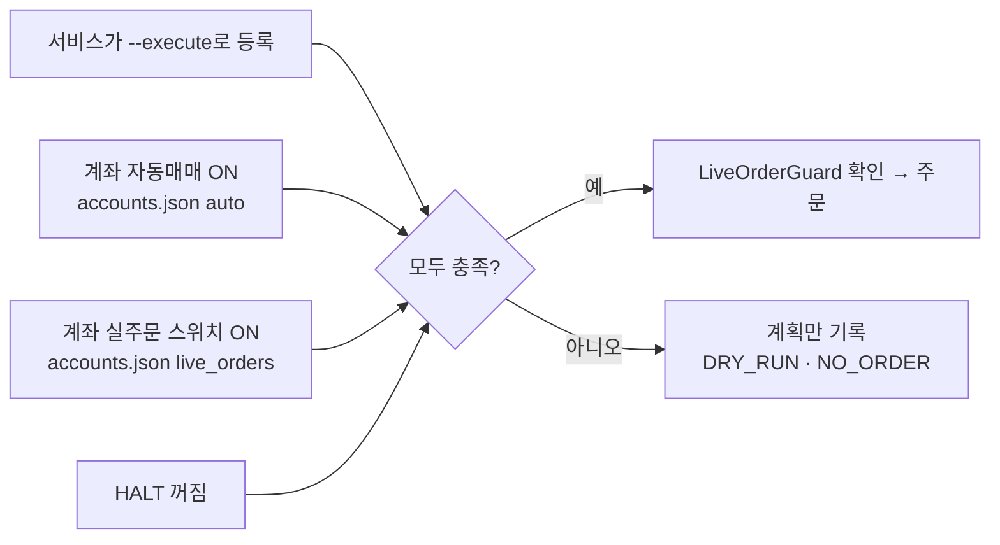
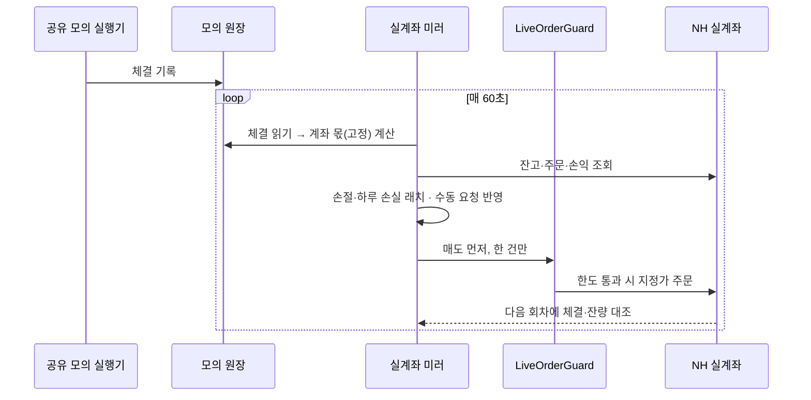
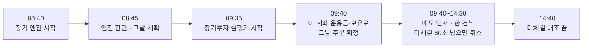

# 실계좌 운용

NH 실계좌는 계좌마다 **Jev 트레이딩**(공유 모의계좌 체결을 따라 사고팜) 또는 **장기투자**(장기 엔진의 그날 계획을 실행) 중 하나로 운용합니다. 두 방식 모두 보호 경로 `scripts/nh_guarded_live.py` → `LiveOrderGuard`(`agent/src/tools/nhplug_live_guard.py`)로만 주문하고, 계좌의 실주문 스위치가 켜졌을 때만 실제 주문이 실행됩니다.

> [!WARNING]
> 이 문서는 동작 방식을 설명합니다. 어느 계좌가 지금 실주문을 내는지는 단정하지 않습니다. 대시보드 **계좌·자동매매**(계좌 탭 맨 위 실주문 스위치)와 **실계좌** 탭, `~/.vibe-trading/nhplug/accounts.json`(`engine`·`auto`·`live_orders`), 서비스 등록 상태(`--execute` 여부)를 직접 확인하세요. 시세 급변·미체결로 손실 한도를 넘을 수 있습니다.

## 목차

- [두 운용 방식](#두-운용-방식)
- [실주문이 나가는 조건](#실주문이-나가는-조건)
- [Jev 트레이딩 계좌 (모의 미러)](#jev-트레이딩-계좌-모의-미러)
  - [무엇을 언제 따라 사나](#무엇을-언제-따라-사나)
  - [매수 크기](#매수-크기)
  - [손절과 하루 손실](#손절과-하루-손실)
  - [모의가 다 팔면 실계좌도 다 판다](#모의가-다-팔면-실계좌도-다-판다)
  - [수동 매수·매도](#수동-매수매도)
- [장기투자 계좌](#장기투자-계좌)
- [보호 한도](#보호-한도)
- [대시보드에서 보는 곳](#대시보드에서-보는-곳)
- [파일과 기록](#파일과-기록)
- [변경 이력](#변경-이력)

## 두 운용 방식

| | Jev 트레이딩 (`engine: jev`) | 장기투자 (`engine: longterm`) |
| --- | --- | --- |
| 실행기 | `scripts/nh_live_follow.py` (launchd `live-follow-<n>`, 평일 08:58 시작, 15:20 종료) | `scripts/longterm_live.py` (launchd `longterm-live-<n>`, 평일 09:35 시작) |
| 따르는 것 | 공유 모의 실행기의 체결 원장(`shared-etf-paper/orders.sqlite3`) | 장기 엔진 `scripts/vibe_longterm.py`의 그날 계획(08:45 판단) |
| 주문 시간 | 매수 09:00\~신규 매수 마감(기본 14:30, 선별 v2만 14:55까지), 매도 15:18 전 | 09:40\~14:30, 미체결 정리 14:40까지 |
| 종목 손절 | 있음(평균가 −2% 상한, 국면·계획에 따라 좁아짐) | 없음 |
| 하루 손실 래치 | 평가손 포함 보수적 추정 | 오늘 실현 손실 + 수수료만 |
| 자세한 전략 | [매매 전략](strategy.md) | [장기투자](longterm.md) · [적립식](longterm-dca.md) · [여운봉 저수지 매매법](yeo-method.md) |

운용 방식은 **계좌·자동매매 → 계좌 탭 → 금액·한도·미러 규칙**(장기투자 계좌는 '금액·포트폴리오·보호 한도')의 '운용 방식'에서 고릅니다. 공유 모의계좌는 Jev 트레이딩으로 고정입니다(`accounts.ENGINES`). 2026-11-17 사용자 결정은 실계좌 1 = Jev 트레이딩, 실계좌 2 = 장기투자이며, 지금 값은 대시보드에서 확인하세요. 실계좌 계좌번호는 `.env`의 `ACCOUNT_NUMBER`, `ACCOUNT_NUMBER_2`…에 있고(같은 앱 키), `accounts.json`에는 해시와 가린 이름만 저장됩니다.

## 실주문이 나가는 조건

- **실주문 스위치**는 계좌 탭 맨 위에 있습니다. 켤 때는 `<계좌 이름> 실주문`을 그대로 입력해야 하고, 끌 때는 버튼 한 번이면 다음 회차(약 1분)부터 계획만 기록합니다. 켜고 끈 기록은 설정 변경 이력 `~/.vibe-trading/nhplug/settings-history.sqlite3`(운영 → 운영 상태)에 남습니다. 기본은 꺼짐입니다.
- **`--execute`**: 저장소에서 생성한 `live-follow-1`과 `longterm-live-2` 정의에는 모두 들어 있습니다. 사용 중인 인자는 서비스 등록 상태에서 확인하세요. 등록과 실주문 전환에는 사용자 승인이 필요합니다. [서비스 정의](../scripts/launchd_services.py#L51)
- 스위치를 꺼도 실행기는 자기가 낸 미체결 주문을 대조·취소할 수 있습니다. 위험을 줄이는 동작이라 막지 않습니다.
- 자동매매를 끄면 Jev 미러는 회차마다 쉽니다(`automation off`). 매 회차 다시 읽으므로 재시작이 필요 없습니다.

> [!CAUTION]
> 자동매매를 끈 Jev 계좌는 미러가 **아무 주문도 하지 않습니다**. 종목 손절과 하루 손실 래치도 돌지 않습니다(코드 기준, `nh_live_follow.main`). 보유가 있는데 새 매수만 막고 싶으면 자동매매를 끄지 말고 실계좌 → 자동매매 제어의 신규 매수 중단을 쓰세요.
- **신규 매수 중단**: 실계좌 → 자동매매 제어의 중단 버튼은 모든 실계좌 실행기의 매수만 멈춥니다(`LIVE_BUY_PAUSED`). 매도·손절은 계속합니다.
- **HALT**: `~/.vibe-trading/live/HALT`(전역) 또는 `~/.vibe-trading/live/nhplug/HALT`(NH)가 있으면 실계좌 주문 경로 전체가 막힙니다.

## Jev 트레이딩 계좌 (모의 미러)

미러는 1분마다 모의 원장으로 계좌별 목표 보유량을 계산하고, 증권사 잔고와 비교해 **한 회차에 한 건**만 주문합니다. 매도를 먼저 검토하며 실계좌에는 가격, 크기, 미러 제외 조건과 주문 가드를 따로 적용합니다.

### 무엇을 언제 따라 사나

- **오늘 모의가 산 것만** 새 보유로 삼습니다. 예전 체결은 실계좌가 이미 들고 넘어온 보유의 크기만 맞춥니다(`opening_units`).
- **테마 동반주 제외**: 그날 테마 동반주로 선정된 뒤 모의계좌가 시작한 포지션은 추가 매수를 포함해 실계좌가 따라 사지 않습니다. [후보 선정](strategy.md#대상-종목)
- **추격 한도**: 실계좌 매도호가가 모의 체결가보다 `chase_pct`(기본 1%, 0.1\~5%) 넘게 오르면 따라 사지 않습니다. '근거 추격'(`evidence_chase`, 기본 켬)이 켜져 있으면, 엔진이 최근 15분 안에 그 종목을 다시 골랐고 현재가가 모의 1차 익절가 아래일 때는 삽니다.
- **매수 창**: 09:00부터 모의 신규 매수 마감까지. 모의 계획이 선별 v2인 종목만 마감 뒤에도 선별 v2 매수 창 끝(기본 14:55)까지 따라 삽니다(`v2_late_buys`).
- **신규상장주도 따라 삽니다(2026-11-19 사용자 결정).** 모의 신규주 체결도 다른 체결과 같은 크기 규칙으로 실계좌 몫을 정합니다. 11-17\~11-19 10:21까지 본 신규주 체결(11-19 471800)은 그때 0으로 고정돼 소급해 사지 않습니다. 손절은 모의 청산 계획의 신규주 손절 %(2%)를 쓰고, 하루 손실 2만 원 래치·운용금·1주 가격 상한·회당 한도·미체결 차단은 그대로입니다.
- **추가 매수 횟수**: 계좌의 '추가 매수 최대 횟수'(`rules.max_adds`, 0\~100, 기본 100 = 엔진 그대로)를 넘는 모의 추가 매수 체결은 실계좌 몫 0입니다. 엔진의 `scale_max_adds`보다 크게 잡아도 엔진 횟수를 넘지 않습니다.
- 모의 매도는 비율대로 따라 팝니다. 모의가 조금이라도 들고 있고 그 포지션에 실계좌 몫이 있으면 실계좌는 최소 1주를 남깁니다.
- 실계좌가 목표보다 5분 넘게 더 들고 있으면 미러 지연으로 표시하고 알립니다.

### 매수 크기

계좌마다 '1주 기준' 또는 '금액 기준'을 고릅니다(`rules.sizing`, 기본 1주 기준).

| 기준 | 모의 매수 체결 1건당 실계좌 몫 |
| --- | --- |
| 1주 기준 `share` | 1주. 한 번의 주문은 '1회 매수 최대 수량'(`max_order_qty`, 1\~1,000주, 기본 100) 이하 |
| 금액 기준 `amount` | 모의 체결 금액에 설정한 비율(1~100%)을 곱합니다. 자동을 고르면 실계좌 운용금 ÷ (모의 분할 1회 금액 × 3분할 × 모의 하루 새 종목 수)로 계산합니다. '체결 1건당 최대 금액'(`tranche_krw`, 1만 원\~운용금)을 적용합니다. |

차이는 **싼 종목**에서만 납니다. 비율 10%(운용금 150만 원, 모의 분할 1회 100만 원 × 3분할 × 하루 5종목)에서 모의가 분할 1회 100만 원어치를 살 때:

| 1주 가격 | 모의가 산 것 | 금액 기준 | 1주 기준 |
|---|---|---|---|
| 1만 원 | 100주 | 10만 원어치 → 10주 | 1주 |
| 5만 원 | 20주 | 10만 원어치 → 2주 | 1주 |
| 20만 원 | 5주 | 10만 원어치 → 0.5주지만 최소 1주 | 1주 |
| 1주 가격 상한보다 비쌈 | — | 안 삼 | 안 삼 |

'체결 1건당 최대 금액'은 금액 기준에서만, '1회 매수 최대 수량'은 1주 기준에서만 씁니다. 대시보드는 쓰지 않는 칸을 잠그고, 라디오 바로 아래 '이 계좌 예시' 표가 그 계좌의 지금 값으로 같은 계산을 보여 줍니다(`nh_live_follow.sizing_example`).

계좌·자동매매 → 모의계좌 (공유)의 ‘실계좌 운용금에 맞춰 모의매매’에서 Jev 실계좌와 동시 보유 종목 수를 고르면 분할 1회·종목당 매수 금액과 연동되는 보호 한도를 계산합니다. 연동을 해제하면 적용 전 설정을 복원합니다. [계좌 설정](../scripts/accounts.py#L241)

금액 기준 예: 운용금 100만 원, 모의 분할 1회 100만 원, 하루 새 종목 5개면 비율은 100만 ÷ 1,500만 ≈ 6.7%입니다. 모의가 계획만큼 다 사면 실계좌는 운용금만큼 삽니다. 모의 보유 한도나 예수금은 상한일 뿐이라 기준으로 쓰지 않습니다. 1주에 못 미치는 몫은 포지션 안에서 쌓이고, 1주 값이 체결 1건당 상한과 1주 가격 상한 이하이면 최소 1주를 삽니다. 금액 기준에서는 '1회 매수 최대 수량'을 쓰지 않고, 가드의 1,000주·회당 매수 한도·운용금이 막습니다.

> [!NOTE]
> **체결별 고정(pins):** 미러가 모의 매수 체결을 처음 볼 때 계산한 실계좌 몫을 계좌별 파일 `~/.vibe-trading/nhplug/live-follow/units-<계좌 해시 앞 16자>.json`(권한 0600)에 고정합니다. 크기 기준·금액·1주 가격 상한·운용금·모의 계획을 바꿔도 **이미 본 체결은 다시 계산하지 않습니다.** 그래서 설정 변경만으로 기존 보유를 사고팔지 않고, 기존 보유는 모의가 팔 때 비율대로 줄어듭니다. 모의 원장이 바뀌면 새로 시작합니다. 대시보드는 이 파일을 읽기만 합니다.

### 손절과 하루 손실

손절은 **NH 잔고의 매입평균가** 기준이며, 걸리면 그날 그 종목을 래치합니다(그날 다시 사지 않음).

| 포지션 | 실계좌 손절 % |
| --- | --- |
| 일반 전략 포지션(모의 일반 경로로 확인됨) | 모의 손절·계좌 손절(`rules.stop_loss_pct`, 0.5\~2%)·승인 상한 2% 중 가장 좁은 값. 지수 국면이 불리하면(롱은 횡보장·하락장, 인버스는 상승장·횡보장) 1% |
| 낙폭과대·선별 v2 포지션 | 모의 청산 계획(`exit-plans.json`)의 손절 %를 그대로. 2% 상한을 적용하지 않음 |
| 계획이 없거나 경로를 확인하지 못한 포지션 | 계좌 손절 %(기본 2%) |

- 모의 선별 v2가 손절 뒤 저점에서 다시 사면, 실계좌도 자기 손절 래치를 풀고 그 종목을 다시 따라 삽니다(`paper_reentries`).
- **하루 손실 래치**: 매 회차 증권사 손익을 직접 조회해 계좌의 하루 손실 한도(`budget.daily_loss_krw`, 계좌별 최대 2만 원)에 닿으면 그날 매수를 막고 보유를 모두 팝니다. 보수적 추정치라 수수료·이월분이 겹쳐 셀 수 있고, 자동 체결을 보장하지 않습니다. 실계좌 2개면 합계 최대 4만 원입니다.
- 계좌 하루 손실과 종목 평균가 손절은 **먼저 닿는 쪽**으로 판단합니다. 두 조건이 동시에 맞을 필요는 없습니다.
- 손절과 하루 손실 래치는 모의 원장이나 상태 파일을 못 읽어도 돌아갑니다.

### 모의가 다 팔면 실계좌도 다 판다

모의가 포지션을 다 팔면 실계좌도 그 종목을 다 팝니다(2026-11-18, 그 전의 '남은 보유를 Jev 판단으로 관리'를 대체). 그래도 모의에 없는 실계좌 보유(지금은 수동 추가 매수분)가 남으면, 주문할 수 있는 회차마다 Jev 보유 판단을 따로 받습니다(`review_remainders`).

- 분봉은 실행기 기록이 30초 안이면 그것을, 아니면 NH에서 직접 읽습니다.
- Jev 메인(공유 모의)이 요청 중이면 최대 10초 기다리고, 별도 잠금·연구 저장소를 써서 Jev 메인에 영향을 주지 않습니다.
- SELL이 공유 전략의 `sell_confidence`(기본 0.7) 이상이면 그 몫을 그 회차에 팝니다.
- 판단을 못 받으면 이유를 회차 기록(`remainder`)에 남기고, 종목별 하루 한 번 Mac 알림을 보냅니다. 손절·하루 손실 래치는 Jev 없이 그대로 작동합니다.

### 수동 매수·매도

**트레이딩 현황**에서 실계좌를 고른 뒤 **즉시 매도** 탭(종목별 수량·매도·추가 매수·전량 매도, 전체 매도, 확인 팝오버)을 씁니다. 요청은 파일로 남고 다음 회차에 미러가 가드를 거쳐 처리합니다.

| 요청 | 동작 |
| --- | --- |
| 전량 매도 | 그날 래치. 모두 팔고 그날 다시 사지 않음 |
| 수량 매도 | 그 종목 목표를 그만큼 낮춤. 그 포지션이 끝날 때까지 되사지 않고, 새 모의 포지션이 열리면 사라짐 |
| 추가 매수 | 그 종목 목표를 그만큼 높임. 그 수량만 사고, 공유 모의의 정리 시각(기본 14:40)에 함께 팖. 매수 창이 끝난 뒤 요청은 거절 |

실주문 스위치가 꺼져 있으면 계획만 기록합니다. 한 요청 수량은 한 번만 반영되고, 보내지 못한 수동 매수는 다음 회차로 되돌립니다.

## 장기투자 계좌

`scripts/longterm_live.py`가 장기 엔진의 당일 계획을 기준으로 이 계좌의 전략·운용금·보유를 반영해 주문을 다시 계산합니다. 당일 계획이 없으면 대기합니다. [장기투자](longterm.md) · [입금형 적립식](longterm-dca.md#입금형-적립식)

- **계좌 전략**: 계좌·자동매매 → 장기투자 계좌 → '전략'에서 '엔진(가상 계좌)과 같음', '이 계좌 전략'(거장 모듈 직접 고르기), '여운봉 저수지 매매법' 중 고릅니다(`vibe-longterm/settings.json`의 `books.<계좌 키>`). 국면·스토리·지표는 엔진 것을 그대로 씁니다. 기준 비중·밴드·월 매도 상한·집행 속도 같은 운용 수치는 모든 계좌가 엔진(가상 계좌) 값을 씁니다(계좌별 수치는 2026-11-19에 없앰).
- **주문**: `nh_guarded_live.execute`로 한 건씩, 매도 먼저, 미체결이 있으면 기다리고 60초 넘은 미체결은 취소합니다(`nh_live_follow.pending_step` 공용).
- **일시적 거절**(HALT, 매수 중단, 미체결, 오래된 시세, 증권사 유량 초과 등)은 14:30까지 다시 시도하고, 그 밖의 거절(한도, 가격 상한, 손실 래치 등)은 그날 확정입니다.
- **장기 전용 보호**(사용자 선택): 종목 손절을 쓰지 않습니다. 하루 손실 래치는 **오늘 실현 손실 + 수수료**만 셉니다(평가손 제외, `accounts.live_loss_realized_only`). 하락장에서도 계획대로 사야 하는 장부이기 때문입니다. 운용금·1주 가격 상한·회당 한도·하루 새 종목·미체결 차단·HALT·하루 손실 상한 2만 원은 Jev 계좌와 같습니다.
- **첫 투입일 예외**: 장기투자 계좌에 이전 날 매수가 없는 첫 투입일에는 하루 새 종목을 6개(엔진 ETF 수)까지 허용합니다(`LONGTERM_FIRST_DAY_NEW_SYMBOLS`). 다른 날과 Jev 계좌는 5개입니다.
- 운용금이 작으면 1주 값이 몫보다 큰 ETF는 그날 건너뜁니다.
- 실주문 조건이 안 맞으면 그날 계획만 `DRY_RUN`으로 기록합니다.

## 보호 한도

모든 실계좌 주문은 `LiveOrderGuard`를 거칩니다. 가드는 주문 의도를 먼저 기록하고, 통과한 주문만 보냅니다. 대시보드에서 정하는 계좌별 값은 승인된 상한보다 넓힐 수 없습니다.

| 항목 | 코드 상한·기본 | 계좌 설정 |
| --- | --- | --- |
| 운용금 | 계좌 잔고(총자산) 안에서 정함. 코드에는 오타 방지 상한 10억 원(`CAPITAL_MAX`)만 | `budget.capital_krw`. 매수 직전 증권사 현금·총자산도 확인. 운용금을 넘기지 않는 예전 인버스 경로(`nh_live_auto.py`)는 100만 원 |
| 하루 손실 | 2만 원(`LIMIT`) | `budget.daily_loss_krw` 1,000\~20,000원 |
| 1주 가격 상한 | 200만 원(`MAX_PRICE`), 설정이 없으면 1만 원 | `budget.order_price_max_krw`. 매수에만 적용 |
| 회당 매수 금액 | 운용금 이하 | `limits.order_max_krw` 1만 원\~운용금(기본 100만 원) |
| 1회 수량 | 1,000주(`ORDER_QTY_MAX`) | 1주 기준이면 `max_order_qty` 1\~1,000주 |
| 하루 새 종목 | 5개, 장기투자 첫 투입일 6개. 그날 이미 산 종목 재매수는 세지 않음 | `limits.daily_new_symbols` 1\~5 |
| 매도 하한 | 같은 종목 현재 매수호가 대비 −3%보다 낮은 지정가 거부(`SELL_FLOOR_PCT`) | 고정 |
| 시간 | 매수 09:00\~15:00, 매도 09:00\~15:18. 시세는 120초 안, 미래 시각 허용 5초 | 고정 |
| 미체결·미확인 | 결과가 확인되지 않은 주문이 있으면 새 주문 없음. 같은 종목·수량·가격 주문은 앞 주문이 체결·취소로 끝났을 때만 새 주문으로 받음 | 고정 |
| 주문 종목 | 이 실행기가 맡은 종목만 | 고정 |

한도·단계 전체와 모의계좌 한도는 [안전장치](safety.md)에 있습니다.

## 대시보드에서 보는 곳

| 위치 | 내용 |
| --- | --- |
| 계좌·자동매매 → 계좌 탭 맨 위 | 실주문 스위치 |
| 계좌·자동매매 → 계좌 탭 → 금액·한도·미러 규칙 / 오늘 가상 실행 / 제한 규칙 | Jev 계좌의 운용금·크기·손절·추격·추가 매수 횟수, 가상 실행, 보호 한도 |
| 계좌·자동매매 → 계좌 탭 → 금액·포트폴리오·보호 한도 / 오늘 주문 계획 / 보호 한도 요약 | 장기투자 계좌의 전략·적립식·보호 한도 |
| 트레이딩 현황 → (실계좌 선택) → 메인 엔진 가상 실행 | 미러와 같은 계산(`nh_live_shadow.ledger_shadow`)으로 본 오늘의 가상 매매. 실제 체결이 아님 |
| 트레이딩 현황 → (실계좌 선택) → 즉시 매도 | 수동 매수·매도 |
| 실계좌 → 잔고·주문 / 자동매매 제어 | 계좌별 상태, 신규 매수 중단, HALT 표시 |
| 종합 현황 | 계좌별 오늘 실현손익, 총자산, 원금(`principal_krw`, '원금 설정') 대비 전체 손익 |

## 파일과 기록

모두 `~/.vibe-trading/nhplug/` 아래입니다. `<키>`는 `accounts.json`의 계좌 키(예: `live-1`)이며 계좌번호가 아닙니다.

| 파일 | 내용 |
| --- | --- |
| `accounts.json` | 계좌별 운용 방식·자동매매·실주문 스위치·운용금·한도·규칙 |
| `live-follow.jsonl` | Jev 미러 회차 기록(계획·주문·사유). 같은 계획이 반복되는 계획만 모드는 2분마다 한 줄로 접음 |
| `live-follow/units-*.json` · `manual-*.json` · `lag-<키>.json` | 체결별 고정 몫, 수동 매매 오프셋, 미러 지연 |
| `live-exit-requests-<키>.json` · `live-manual-buys-<키>.json` | 대시보드 수동 매도·매수 요청 |
| `longterm-live.jsonl` · `longterm-live/state-<키>.json` | 장기투자 계좌 회차 기록과 하루 상태 |
| `live-balance-<키>.jsonl` | 실행기가 5분마다 남기는 잔고 요약(계좌번호 없음) |
| `settings-history.sqlite3` | 실주문 스위치를 포함한 모든 설정 변경 이력 |

## 변경 이력

| 날짜 | 바뀐 것 |
| --- | --- |
| 2026-11-12 | 계좌별 1주 가격 상한(최대 200만 원), 하루 새 종목 5개, 매도 하한 −3%, 1주·금액 기준 크기 |
| 2026-11-13 | 계좌별 보호 한도, 실주문 스위치(확인 문구·이력) |
| 2026-11-17 | 금액 기준 비례 크기와 체결별 고정, 계좌별 추가 매수 횟수, 운용금은 계좌 잔고 안에서, 국면·계획별 손절, 신규주 따라 사지 않음, 수동 매수·매도, 계좌별 운용 방식(장기투자)과 장기 전용 보호 |
| 2026-11-18 | 모의가 다 팔면 실계좌도 다 팜, 남은 보유 Jev 판단, 선별 v2 마감 뒤 따라 사기, 장기투자 첫 투입일 새 종목 6개 |
| 2026-11-19 | 끝난 주문과 같은 지문의 새 주문 허용(미해결 주문은 그대로 차단) |

설계 기록: `docs/longterm-live-account-plan.md`(비공개), 사용자 결정 원문은 운영자 로컬의 `AGENTS.md`(비공개).
