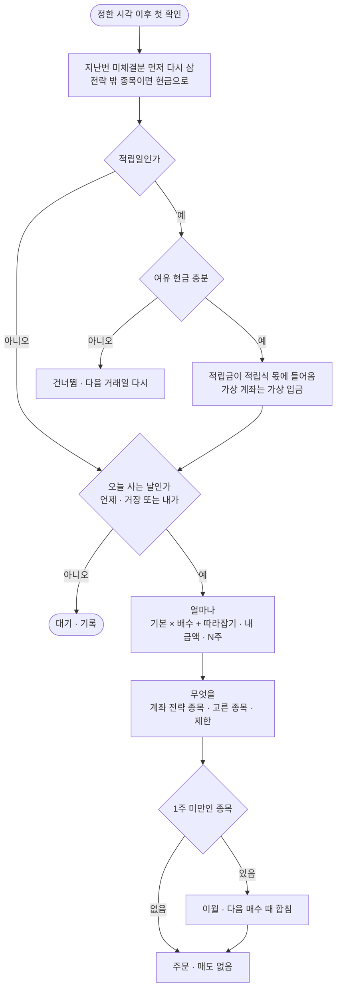

# 적립식 (장기투자 적립식 v3)

장기투자 장부(가상 계좌, 장기투자 실계좌)에 들어오는 적립금을 소액으로 꾸준히 사는 기능입니다. 코드는 `scripts/longterm_dca.py`입니다. **언제·얼마나·무엇을·몇 시**를 항목마다 고른 거장에게 맡기거나(자동) 내가 정합니다(수동). 장부마다 따로 켜며 기본은 꺼짐입니다.

> [!IMPORTANT]
> 적립식은 **사기만** 합니다. 익절·리밸런싱·큰 하락 때 몰아 사기는 계좌 전략(엔진 거장 모듈 또는 [여운봉 저수지 매매법](yeo-method.md))이 맡습니다. 재현 수치는 과거 한 구간의 결과이고 수익을 보장하지 않습니다.

**목차**

- [원칙](#원칙)
- [네 항목 한눈에](#네-항목-한눈에)
- [켜고 설정하는 곳](#켜고-설정하는-곳)
- [투자 방식](#투자-방식)
- [언제](#언제)
- [얼마나](#얼마나)
- [거장 표](#거장-표)
- [무엇을](#무엇을)
- [몇 시](#몇-시)
- [한 번의 확인이 지나는 길](#한-번의-확인이-지나는-길)
- [못 산 몫과 1주 미만 몫](#못-산-몫과-1주-미만-몫)
- [내 조정](#내-조정)
- [적용 설정 요약과 예시](#적용-설정-요약과-예시)
- [차트 타점](#차트-타점)
- [엔진 모듈 묶음 반영](#엔진-모듈-묶음-반영)
- [가상 계좌와 실계좌](#가상-계좌와-실계좌)
- [바뀐 점](#바뀐-점)

관련 가이드: [장기투자 엔진](longterm.md) · [여운봉 저수지 매매법](yeo-method.md) · [실계좌 운용](live-accounts.md)

## 원칙

- 들어오는 돈을 소액으로 꾸준히 모읍니다. 전부·절반 같은 큰 매수는 없습니다.
- 고른 거장은 시황(확정 국면)에 따라 **사는 날과 속도만 조금**(0.5~1.5배) 바꿉니다. 어느 거장도 0이나 '전부'가 되지 않습니다. 예외는 린치가 '훼손'으로 본 테마 하나입니다.
- 계좌 운용금의 매매는 계좌 전략이 하고, 적립식은 적립금(여운봉 계좌는 현금 하한 위 저수지 일부)만 씁니다. 거장 모듈 계좌의 운용금은 엔진이 초기 투입(12주 분할 등)으로 투자하므로 적립식이 손대지 않습니다.

## 네 항목 한눈에

| 항목 | 자동 · 거장 | 수동 · 내가 |
| --- | --- | --- |
| **언제** | 거장이 매 거래일 확인해 살 날을 고름. 매수 빈도(매일·매주·매월)마다 한 번까지 | 매일 · 매주 요일 · 매월 n일. 방식은 계속(정한 날마다) 또는 하락일 우선 |
| **얼마나** | 기본 금액 × 국면 배수(0.5~1.5) + 따라잡기, 한 번에 기본의 1.5배까지 | 1회 금액(원) 또는 종목별 N주 |
| **무엇을** | 계좌 전략이 사는 종목(여운봉 계좌는 70:30 짝, 거장 모듈 계좌는 KOFR을 뺀 목표) | 내가 고른 종목과 수량 제한 |
| **몇 시** | 장중 전일 종가 이하일 때, 늦어도 14:20 | 정한 시각(09:40~14:20) |

섞어 쓸 수 있습니다. 예: 언제 = 거장(매일 확인, 매주 한 번까지), 얼마나 = 내가 2주, 무엇을 = 내가 고른 379810, 몇 시 = 내가 정한 13:00. '모두 거장 자동' 버튼은 네 항목을 거장 자동으로 **채우기만** 하고, 저장은 직접 누릅니다.

## 켜고 설정하는 곳

**장기투자 → 전략 → 적립식**에 장부마다 카드가 하나씩 있습니다(가상 계좌, 장기투자를 고른 실계좌).

1. 카드 오른쪽 '적립식 켜기'를 켭니다.
2. 투자 방식(거장 투자 / 수동 투자)과 적립 크기(금액 기준 / 종목별 수량 기준)를 고릅니다.
3. 거장 투자면 거장, '언제 정하기', '얼마나 정하기'를 고릅니다.
4. 금액·주기·날짜·매수 시각을 정하고, 필요하면 '매수 종목·수량 제한 (선택)'을 엽니다.
5. 카드 위쪽 '자동 · 수동 한눈에'와 '적용 설정 요약'에서 저장 전 값으로 계산한 결과를 확인하고 '저장'을 누릅니다. 다음 확인(평일, 정한 시각 이후)부터 적용됩니다.

- 저장값: vibe-longterm `settings.json`의 `dca.<장부>`(`actual` = 가상 계좌, 실계좌는 계좌 키). 변경 이력이 남습니다.
- 카드 맨 위 안내가 "적립식은 들어오는 적립금만, 운용금 매매는 전략에서 따로 — 지금: …"을 보여 줍니다. 실계좌의 운용금 전략은 **계좌·자동매매 → 그 실계좌 → 금액·포트폴리오·보호 한도**에서 정합니다.
- '적립식 상세 가이드' 버튼: 흐름, 언제·얼마나 정하기, 거장 비교, 설정값 사전, 상황별 추천, 주의를 팝업으로 봅니다. 입력 옆 (?)에는 범위와 기본값이 나옵니다.

## 투자 방식

| 방식 | 뜻 |
| --- | --- |
| 거장 투자 | 거장을 고르고, 언제·얼마나를 각각 거장 자동 또는 내가 정함 |
| 수동 투자 | 언제·얼마나 모두 내가 정함. 거장 배수·현금 하한은 쓰지 않음 |

기본 설정(코드 `DEFAULT`)은 거장 투자 · 레이 달리오 · 언제 내가 · 얼마나 내가 · 매월 1일 · 100만 원 · 10:00 · 계속이고, 적립식은 꺼져 있습니다.

## 언제

### 거장이 정할 때

- 거장이 **매 거래일** 확인하고, 고른 '매수 빈도(최대)'(매일·매주·매월, 기본 매주) 기간마다 **한 번까지** 삽니다.
- 거장마다 사는 날 성향이 있습니다([거장 표](#거장-표)).
  - 정한 주기: 그 기간 첫 확인일에 삽니다(달리오·보글·버핏·린치).
  - 하락일 우선: 아직 사지 않은 기간의 첫 확인일부터 기다리다 하락일에 삽니다. 최대 대기일(막스·윌리엄스 5일, 여운봉 7일)이 지나면 하락일이 아니어도 삽니다.
  - 윌리엄스는 급락일(나스닥100 하루 −3% 이하 + VIX 25 이상)에도 사고, 그날은 1.5배입니다.

### 내가 정할 때

- 주기: 매월 n일(1~28) · 매주 요일(월~금) · 매일(장이 열리는 날마다 한 번).
- 정한 날이 휴장이면 그 기간의 다음 거래일에, 기간 안에 남은 거래일이 없으면(예: 2월 말 주말) 그 기간 마지막 거래일에 적립합니다(`due`).
- 정한 날 방식:

| 방식 | 동작 |
| --- | --- |
| 계속(정한 날마다) | 적립일에 그 적립금을 산다 |
| 하락일 우선 | 적립일 뒤 첫 하락일에 산다. 하락일이 없어도 7일(`MAX_WAIT_DAYS`) 뒤에는 산다. 적립 한 번에 한 번 |

**하락일:** 전날 나스닥100이 내렸거나, 사려는 주식 ETF가 지금 전일 KRX 종가 이하인 날입니다(`down_day`). 자료를 모르면 하락일이 아닙니다.

## 얼마나

### 거장이 정할 때

한 번에 사는 금액 = 기본 금액 × 오늘 국면 배수 + 따라잡기, 상한은 기본의 1.5배입니다.

| 장부 | 기본 금액 | 쓰는 돈 |
| --- | --- | --- |
| 거장 모듈 계좌 | 들어오는 적립금 속도 × 0.7(`PACE`)을 매수 빈도 한 번으로 환산 | 적립식 몫(아직 안 산 적립금) 안에서만 |
| 여운봉 계좌 | 장부 가치 × 주 0.25%(`RATE`)와 '적립금 속도 × 0.7' 중 큰 값 | 현금이 거장의 현금 하한 아래로 내려가지 않는 만큼 |

- **환산:** 매월 1회 = 1, 매주 = 4.35, 매일 = 21회로 봐서 한 달 총액이 같게 나눕니다. 예: 매월 100만 원 적립, 매주 매수면 기본은 100만 × 0.7 ÷ 4.35 ≈ 16만 원이고 한 번에 최대 약 24만 원입니다.
- **0.7인 이유:** 기본을 적립금 속도보다 조금 느리게 두어야 남는 적립금이 쌓이고, 거장이 약세·하락일에 그 몫을 더 삽니다. 적립금 속도와 같게 두면 들어오는 대로 다 사서 거장 차이가 없어집니다(재현 v3 7-1(`docs/longterm-dca-v3-plan.md`, 비공개)). 2026-11-18 사용자가 0.7 유지로 정했습니다. 장부별로는 [내 조정](#내-조정)으로 바꿉니다.
- **따라잡기:** 거장 모듈 계좌는 '오늘 매수와 적립 한 번 몫을 넘는 대기 자금'의 1/8을, 여운봉 계좌는 덜 산 누계의 1/8을 매수마다 더합니다. 오늘 금액이 이미 상한이면 더하지 않습니다.
- **현금 하한:** 여운봉 계좌에서만 씁니다(거장 모듈 계좌의 현금 비중은 엔진 저수지가 지킵니다). 현금 하한에 막힌 날은 사지 않고 따라잡기 누계도 바꾸지 않습니다.

> [!NOTE]
> 여운봉 계좌에서 '얼마나 · 거장'은 저수지 현금 중 하한 위의 몫을 조금씩 씁니다. 그만큼 매매법의 다음 단계 매수에 쓸 저수지가 줄어듭니다. 단계 매수는 그날의 저수지로 금액을 정합니다([여운봉 저수지 매매법](yeo-method.md#적립식과의-관계)).

### 내가 정할 때

| 크기 | 동작 |
| --- | --- |
| 금액 기준 | 1회 적립 금액(1만~10억 원, 기본 100만 원). 언제 = 내가이면 적립 때 쌓인 적립식 몫 전부, 언제 = 거장이면 매수일마다 내 금액까지 |
| 종목별 수량 기준 | 고른 종목을 N주(1~1,000주, 기본 1주)씩. 금액은 매수가 × N × 종목 수(수수료 포함, 원 올림 + 1원) |

- 종목별 수량 기준도 '얼마나 · 거장'을 고를 수 있습니다(2026-11-19). 거장이 금액 기준과 같은 규칙(기본 금액 × 국면 배수 + 따라잡기, 상한 1.5배, 현금 하한)으로 회당 금액을 정하고 고른 종목을 정수 주로 나눠 삽니다. 1주 미만 몫은 다음으로 넘기고, 판단 기록에 '이번 수량(거장)'이 남습니다. 이때 적립 한 번(가상 입금)은 '들어오는 적립금' 칸의 금액이고, 화면은 N주 칸 대신 그 칸을 보입니다.
- 내가 정한 N주는 '얼마나 · 내가'일 때만 씁니다. 언제 = 거장이면 거장이 사는 날마다 N주씩 사고, 가상 입금은 매수 빈도 기간에 한 번입니다. 이 경우는 대기 자금·국면 배수·하락 단계와 섞지 않습니다. 시세가 없거나 돈이 모자라면 다음 거래일에 다시 시도합니다.

## 거장 표

`PROFILES`입니다. 배수는 확정 국면별로 기본 금액에 곱합니다. 재현은 V1(여운봉 계좌, KRX 2021-11 고점 시작, 1억 + 매월 100만 원, 주 0.25%)의 연수익 · 최대 낙폭 · 약세 국면(조정·약세·투매)에 산 몫입니다.

| 거장 | 성향 | 강세 | 회복 | 조정 | 약세 | 투매 | 과열 | 사는 날 | 현금 하한 | V1 재현 |
| --- | --- | --- | --- | --- | --- | --- | --- | --- | --- | --- |
| 레이 달리오 | 균형 · 과열만 조금 덜 | 1.0 | 1.0 | 1.0 | 1.0 | 1.0 | 0.9 | 정한 주기 | 15% | 15.05% · −17.8% · 56% |
| 존 보글 · 워런 버핏 | 시황 보지 않고 꾸준히 | 1.0 | 1.0 | 1.0 | 1.0 | 1.0 | 1.0 | 정한 주기 | 10% | 15.51% · −18.3% · 40% |
| 하워드 막스 | 시계추 · 비쌀 때 덜, 쌀 때 더 | 0.9 | 1.0 | 1.2 | 1.3 | 1.4 | 0.6 | 하락일 우선(최대 5일) | 20% | 14.43% · −17.3% · 52% |
| 여운봉 | 저수지 관점 · 하락할수록 조금 더 | 0.8 | 1.0 | 1.2 | 1.4 | 1.5 | 0.5 | 하락일 우선(최대 7일) | 20% | 13.86% · −16.7% · 65%(현금 하한 30%로 재현) |
| 피터 린치 | 테마 스토리 반영 | 1.0 | 1.0 | 1.0 | 1.0 | 1.0 | 0.9 | 정한 주기 | 15% | 재현 불가(LLM 스토리) |
| 래리 윌리엄스 (비권장) | 급락일 우선 | 1.0 | 1.0 | 1.1 | 1.1 | 1.2 | 0.9 | 하락일 우선(최대 5일), 급락일 1.5배 | 20% | 14.43% · −17.3% · 51% |

- 린치: 테마 스토리가 '주의'면 그 테마 몫을 절반, '훼손'이면 그 테마를 사지 않습니다. 입금·매수 모두 같은 비중을 씁니다(`buy_weights`).
- 거장 선택은 수익률보다 **언제·어떤 국면에 사는지**를 고르는 일입니다. 재현 차이는 연 0.1~1.7%p였고 수익과 낙폭을 맞바꾸는 관계였습니다. 차이를 만드는 것은 대부분 현금 하한입니다.
- 추천 등급(`profile_grade`): 그 국면에 시황 자동이 고르는 거장은 강력 추천, 윌리엄스는 비권장, 파는 쪽 모듈 묶음이 그 국면 추천 조합 안이면 추천, 그 밖은 선택입니다. 추천은 안내이고 고른 거장대로 적립합니다.

**시황 자동**(`AUTO`)은 확정 국면마다 위 거장 하나를 고릅니다. 실제 장부에는 쓰지 않고, 가상 계좌 적립식이 켜져 있고 가상 체결 중일 때 '적립 시황 자동 그림자'(`dca_auto`)로만 기록합니다.

| 국면 | 강세 안정 | 회복 | 조정 | 약세 | 투매 | 과열 |
| --- | --- | --- | --- | --- | --- | --- |
| 거장 | 보글·버핏 | 달리오 | 막스 | 보글·버핏 | 여운봉 | 막스 |

## 무엇을

기본은 **계좌 전략이 사는 종목**입니다(`vibe_longterm.dca_targets`).

| 계좌 전략 | 적립식이 사는 것 |
| --- | --- |
| 거장 모듈(엔진과 같음·이 계좌 전략) | 그날 목표 비중에서 저수지(KOFR)를 뺀 종목, 그 비율대로 |
| 여운봉 저수지 매매법 | 그 짝을 위험 비율대로(기본 379810 70 : 0261H0 30). 매매법이 관리하지 않는 ETF나 KOFR은 사지 않음 |

'매수 종목·수량 제한 (선택)'에서 범위를 좁힐 수 있습니다. 모두 장부별이고 기본은 꺼짐입니다.

| 옵션 | 범위 | 동작 |
| --- | --- | --- |
| 적립 종목 선택 | 엔진 ETF 6종 · 0261H0 · 438080 · 관심목록 | 고른 종목만. 고른 엔진 ETF는 계좌 전략 목표가 0%여도 남고 기준 비중으로 나눔. 관심목록·여운봉 ETF는 고른 주식 ETF의 평균 비중 |
| 종목 수 제한 | 1~26 (기본 3) | 비중이 큰 순서로 그 수만 |
| 종목당 보유 주식 수 제한 | 1~100,000주 (기본 100) | 보유가 그 수를 넘지 않게 적립 매수를 줄임 |
| 전체 보유 주식 수 제한 | 1~1,000,000주 (기본 500) | 모든 보유 합계 기준 |

- 제한은 적립식이 사는 몫에만 걸립니다. 엔진의 리밸런싱 매수·매도는 따로입니다. 못 산 돈은 현금으로 남고 판단 기록에 적힙니다.
- 살 종목이 하나도 없으면 그 적립은 건너뛰고 입금·적립으로 기록하지 않습니다.
- **관심목록:** 적립식 카드 위 '장기투자 관심목록'에서 엔진 6종 밖의 국내 상장 종목을 모읍니다(`scripts/longterm_watchlist.py`). 엔진은 이 종목을 리밸런싱하거나 팔지 않습니다. 목록에서 빼면 새 매수만 멈추고 보유는 그대로입니다.
- **거장 추천종목으로 더하기:** 미국 종목 아이디어의 추천 종목을 그 종목을 담은 엔진 ETF로 연결해 더합니다. 미국 개별주는 주문하지 않습니다([장기투자 엔진](longterm.md#미국-종목-아이디어)).

## 몇 시

| 방식 | 동작 |
| --- | --- |
| 정한 시각 (기본 10:00) | 09:40~14:20 중 10분 단위 |
| 거장 자동(장중 시황) | 09:40부터 5분마다 보고, 사려는 주식 ETF 중 하나라도 전일 KRX 종가 이하가 된 첫 순간에 산다. 그런 때가 없으면 14:20에 산다 |

- 전일 종가는 아침 판단 때 받은 Yahoo `.KS` 종가(`indicators.krx_close`), 지금 가격은 NH 실시간 매도호가입니다. 전일 종가 기록이 없으면 바로 삽니다.
- 매수 시각은 시각만 정합니다. 뉴스·국면은 언제·얼마나와 테마 스토리 단계에서 이미 반영됩니다. 매수 시각 옆 '거장 자동은 어떻게 사나' 팝업이 판단 도식과 예시 차트를 보여 줍니다.
- 실계좌는 기다리는 동안 WAIT 사유를 기록합니다.

## 한 번의 확인이 지나는 길

적립식은 하루 한 번, 정한 시각(거장 자동이면 09:40) 이후 첫 확인에서 판단합니다(`plan`).

**돈의 구분:** 장부 현금 중 적립식에 묶인 돈은 엔진이 쓰지 않습니다(`reserved`).

| 이름 | 뜻 |
| --- | --- |
| 적립식 몫 `waiting_krw` | 들어왔지만 아직 안 산 적립금 |
| 이월 `carry` | 1주가 안 돼 다음 매수 때 합쳐 살 몫 |
| 미체결 재매수 `retry` | 보냈지만 체결되지 않은 적립 매수 금액 |
| 누적 적립 `contributed_krw` | 지금까지 들어온 적립금. 손익 계산에서 뺌 |

## 못 산 몫과 1주 미만 몫

- **미체결:** 체결되지 않은 적립 매수 금액은 `retry`로 남아 다음 확인 때 먼저 다시 삽니다(`add_unfilled`). 계좌 전략이 더는 사지 않는 종목이면 현금(저수지)으로 돌립니다. 보냈지만 정산되지 않은 주문은 체결됐을 수 있어 다시 사지 않습니다.
- **1주 미만:** 종목 몫이 1주 값(수수료 포함)에 못 미치면 `carry`로 넘겨 다음 매수 때 합쳐 삽니다. 적립 대상에서 빠진 종목의 이월은 풀어 현금으로 둡니다.
- **시세 없음:** 시세가 없는 종목 몫은 사지 않고 현금으로 남깁니다.
- 화면 카드 상단 줄에 누적 적립·적립식 몫·마지막 적립·마지막 매수·이월·미체결 재매수 대기가 보입니다.

## 내 조정

거장 투자에서 '거장 값 미세 조정'을 열면 고른 거장 값을 미리 채운 칸이 나옵니다. 바꾼 값만 `tune`으로 저장하고, 항목별·전체를 거장 값으로 되돌릴 수 있습니다. 거장을 바꾸면 이전 조정은 쓰지 않습니다.

| 항목 | 뜻 | 기본 | 범위 |
| --- | --- | --- | --- |
| rate | 여운봉 계좌 기본 금액의 주 비율 | 0.25% | 0.1~1% |
| pace | 거장 모듈 계좌의 적립금 속도 | 0.7 | 0.3~1.0 |
| mult | 국면별 배수 | 거장 표 | 0.5~1.5 |
| wait | 하락일 최대 대기일 | 거장 표 | 1~10일 |
| floor | 현금 하한(여운봉 계좌) | 거장 표 | 5~50% |

조정이 있으면 판단 기록과 주문 근거에 '내 조정: …'이 남습니다. 시황 자동 그림자는 조정을 쓰지 않습니다.

## 적용 설정 요약과 예시

카드 위쪽 상자는 **저장 전 화면 값**으로 엔진과 같은 규칙(`effective`)을 돌려 보여 줍니다.

- '자동 · 수동 한눈에': 언제·얼마나·무엇을·몇 시에를 누가 정하는지와 값.
- '적용 설정 요약': 거장, 언제, 얼마나, 오늘 국면 배수, 무엇을, 몇 시, 현금 하한, 파는 쪽, 종목·수량 제한. 값마다 '거장 기본값'/'내 조정값' 배지가 붙습니다.
- '이번 적립 예시': 오늘이 사는 날이라고 가정하고 `plan()`으로 계산한 종목별 비중·가격·금액·주 수·이월·제한 제외. 금액은 그날 계좌 가치·국면·적립식 몫으로 달라집니다.

적립식 탭 위쪽의 '거장 비교 · 국면 배수와 재현 V1'은 거장마다 국면 배수와 재현 결과를 표로 보여 줍니다.

## 차트 타점

**장기투자 → 시장 → 차트**에 장부별 적립식 다음 매수를 초록 긴 점선으로 그립니다(`buy_levels`).

| 방식 | 선 |
| --- | --- |
| 하락일 우선(거장 또는 내 방식) | 전일 종가 |
| 정한 주기·계속 | 오늘 가격(가격 무관), 라벨에 다음 적립일 |
| 윌리엄스 | 급락일 선(오늘 가격 −3%, 1.5배) |

라벨에 거장, 다음 매수일, 이번 회차 크기가 붙습니다. 적립 체결은 초록 ●입니다.

## 엔진 모듈 묶음 반영

적립식 탭 아래 칸입니다. 적립식 거장 프로필은 **사는 쪽**만 정합니다. 거장마다 짝으로 권하는 **파는 쪽·비중 조절** 엔진 모듈 묶음이 있습니다(예: 달리오 = 기준 비중 · 달리오 월 밴드 · 버핏 저회전). 이 버튼은 그 묶음을 엔진(가상 계좌) 또는 한 실계좌 전략(`books.<키>`)의 모듈 스위치에 복사합니다.

- 꼭 할 필요는 없습니다. 적립식은 이 버튼 없이도 동작합니다.
- 반영 대상을 고르면 지금 → 반영 뒤 모듈 표(규칙, 마지막 변경과 변경자, 오늘 영향)가 나옵니다.
- 사용자가 대화로 승인해 켠 모듈을 끄게 되면 경고가 나오고, 목표 비중이 줄 때도 경고가 나옵니다.
- '바뀌는 모듈과 그 장부의 다음 주문 계획이 바뀌는 것을 확인했습니다'를 체크해야 저장됩니다.
- 자동 모드(실제 적용) 중에는 엔진이 국면 추천 조합을 쓰므로, 가상 계좌 엔진 반영은 수동·추천 모드에서 의미가 있습니다.
- 여운봉 저수지 매매법 장부에는 '적용되지 않음'이 보입니다.

## 가상 계좌와 실계좌

| | 가상 계좌 (`actual`) | 장기투자 실계좌 |
| --- | --- | --- |
| 실행 | `vibe_longterm.dca`, 주문 창 09:40~14:30 안에서 | `longterm_live.dca_orders`가 그날 엔진 주문과 ETF별로 합침 |
| 돈 | 적립일에 가상 입금 뒤 삼(가상 체결 중일 때만, 기간마다 한 번) | 계좌의 여유 현금과 운용금 안에서만 삼. 입금은 사용자가 직접 |
| 계획만 | 가상 체결이 꺼져 있으면 계획만 기록 | 실주문 스위치·`--execute`가 없으면 계획만 기록 |
| 보낸 뒤 미체결 | 다음 확인 때 다시 삼(`retry`) | 보내지 못한 적립은 다음 날 다시 적립. 보낸 뒤 미체결 취소분 재매수는 실주문 전 보완 대상 |
| 근거 | 주문별 근거(`evidence`)와 판단 기록 `dca` | 계획 기록 `nhplug/longterm-live.jsonl` |
| 그림자 | 기본·자동 그림자가 같은 적립금을 같은 규칙으로 씀 | 계좌 가상 운용에는 적립식을 넣지 않음 |

판단 기록 `dca`에는 그때 설정, 적립일 여부, 적립식 몫 전후, 누적 적립, 주문 계획이 남습니다. Discord 장기투자 채널에는 적립식 주문 알림도 발송됩니다([알림](notifications.md)).

## 바뀐 점

2026-11-17 첫 버전부터 v3까지

| 날짜 | 버전 | 내용 |
| --- | --- | --- |
| 2026-11-17 | 첫 버전 | 정기 적립 · 하락할 때만(−5/−10/−20% 단계) · 여운봉식 혼합, 선택 과열 익절 |
| 2026-11-18 | 거장 프로필 | 장부마다 거장 프로필. **과열 익절 삭제**(아래 F1). 하락 단계 −10/−20/−30% |
| 2026-11-18 | 거장 판단 시점 | 정한 날 / 거장 판단, PACE(국면별 집행 비율)와 매주 기준 환산. 재현에서 거장 판단이 정한 날을 꾸준히 이기지 못함 |
| 2026-11-18 | v2 | 바로(적립일 전액) / 꾸준(여운봉 계좌, 주 비율 + 현금 하한). 거장 방식은 '예전 방식(고급)'으로 접음. 무엇을은 계좌 전략을 따름 |
| 2026-11-18 | v3 (지금) | v2가 접은 요청을 되살림: 네 항목 × 자동/수동, 거장별 배수·사는 날·현금 하한, 하락일 우선, 내 조정, 차트 타점, 모두 거장 자동 |

- **F1 · 적립식이 팔지 않는 이유:** 적립식이 과열에서 판 몫을 다음 달 엔진의 월 밴드가 되사 상쇄했습니다(테스트로 확인, 재현 연 −2.9%p). 그래서 적립식은 사기만 하고 익절·리밸런싱은 엔진 모듈이 합니다.
- **예전 설정 옮김**(`clean`): 정한 날 + 전액(달리오·보글·린치, 수동 정기, v2 바로)은 '내가 정한 날·금액'으로, 기다리는 방식(막스·여운봉·윌리엄스, 거장 판단)은 '거장'으로, 수동 '하락할 때만'·'혼합'은 '하락일 우선'으로, v2 꾸준은 여운봉 거장으로 읽습니다.
- 수동 '혼합(절반 정기 + 절반 하락일)'은 '절반 같은 큰 매수 금지' 원칙과 맞지 않아 되살리지 않았습니다. 하락일 대기 일수로 조절합니다.
- 예전 PACE 재현 스크립트(`longterm_dca_replay.py --timing`)는 지웠고 결과는 `docs/longterm-dca-timing-plan.md`에 있습니다. (비공개 설계 기록이라 공개 저장소에는 없습니다)

재현 스크립트: `scripts/longterm_dca_v3_replay.py`(V1), `scripts/longterm_dca_replay.py --pace`(적립금 속도 비교: 10년 거장 70% 연 15.5~16.7%·넣은 돈 대비 최악 −5.5~−6.2%, 100% 15.8~16.9%·−7.1~−8.0%, 바로 17.1%·−18.9%).

설계 기록: `docs/longterm-dca-v3-plan.md` · `docs/longterm-dca-plan.md` · `docs/longterm-dca-steady-plan.md` · `docs/longterm-dca-timing-plan.md` · `docs/longterm-master-dca-ideas-plan.md` · `docs/longterm-account-settings-plan.md` · 검수 `docs/audit/longterm-review3-2026-11-18.md` (비공개 설계 기록이라 공개 저장소에는 없습니다)
