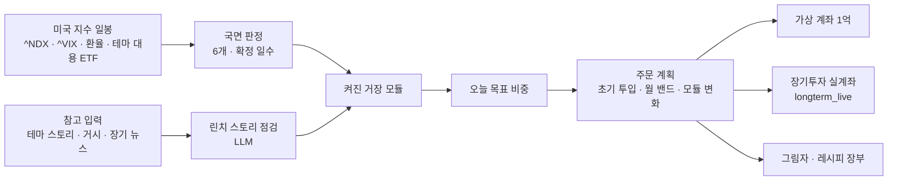
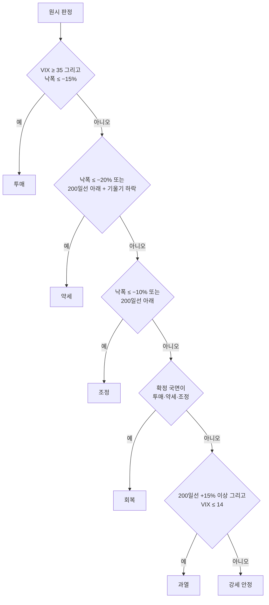

# 장기투자 엔진 (vibe 장기 엔진)

KRX에 상장된 미국 지수·테마 ETF 6종을 몇 달~몇 년 단위로 운용하는 엔진입니다. 매일 아침 미국 지수로 장기 국면을 판정하고, 켜 둔 거장 모듈로 목표 비중을 정해 가상 계좌(1억 원)와 장기투자를 고른 실계좌의 주문을 계산합니다. 코드는 `scripts/vibe_longterm.py`이고, Jev 실시간 트레이딩과는 서로 주문에 관여하지 않습니다.

> [!IMPORTANT]
> 가상 계좌의 체결은 실제 증권사 주문이 아닙니다. 실계좌 주문은 계좌별 실주문 스위치와 실행기 `--execute` 등록이 모두 있어야 나갑니다([실계좌 운용](live-accounts.md), [안전장치](safety.md)). 재현 수치는 과거 한 구간의 결과이고 수익을 보장하지 않습니다.

**목차**

- [한눈에 보기](#한눈에-보기)
- [대상 ETF와 기준 비중](#대상-etf와-기준-비중)
- [하루 일정](#하루-일정)
- [국면 판정](#국면-판정)
- [거장 모듈](#거장-모듈)
- [운용 모드](#운용-모드)
- [목표 비중에서 주문까지](#목표-비중에서-주문까지)
- [가상 체결 스위치](#가상-체결-스위치)
- [장부와 비교](#장부와-비교)
- [계좌별 전략](#계좌별-전략)
- [참고 입력](#참고-입력)
- [타점 지도](#타점-지도)
- [주문별 근거](#주문별-근거)
- [리포트와 감사](#리포트와-감사)
- [미국 종목 아이디어](#미국-종목-아이디어)
- [대시보드 장기투자 탭](#대시보드-장기투자-탭)
- [기록 파일](#기록-파일)
- [변경 이력](#변경-이력)

관련 가이드: [적립식](longterm-dca.md) · [여운봉 저수지 매매법](yeo-method.md) · [실계좌 운용](live-accounts.md) · [알림](notifications.md) · [자동 작업](automation.md) · [대시보드](dashboard.md)

## 한눈에 보기

| 항목 | 내용 |
| --- | --- |
| 대상 | KRX 상장 ETF 6종: 코어 2(나스닥100·S&P500), 위성 3(반도체·양자·우주), 저수지 1(KOFR 금리) |
| 판정 | 매일 08:45, 나스닥100 낙폭·200일선·VIX로 국면 6개 중 하나 |
| 규칙 | 거장 모듈 8개를 켜고 끈다. 켠 모듈이 겹쳐 그날 목표 비중을 만든다 |
| 주문 | 09:40부터 14:30까지 목표로 다가가는 주문. 매도 먼저, 하루 매수·월 매도 상한 |
| 가상 계좌 | 1억 원, 수수료 0.015%, 실시간 NH 호가로 가상 체결 |
| 기본 실행 | 계획만 기록(dry-run). 대시보드 '가상 체결' 스위치를 켜야 가상 주문을 넣음 |
| Jev와의 관계 | 주문에 관여하지 않는다. Jev 매매일지·장전 브리프 요약을 스토리 점검의 참고 맥락으로만 읽는다 |

장부마다 운용 방식을 고를 수 있습니다. 거장 모듈 조합으로 돌리거나, [여운봉 저수지 매매법](yeo-method.md) 하나로 돌립니다. 들어오는 적립금은 [적립식](longterm-dca.md)이 따로 다룹니다.

## 대상 ETF와 기준 비중

코드의 `ASSETS`(`scripts/vibe_longterm.py`)가 정합니다. 기준 비중은 '기준 비중 · 코어·위성 유지' 모듈이 들고 가는 목표입니다.

| 키 | 코드 | 종목 | 역할 | 기준 비중 | 긴 역사용 미국 대용 |
| --- | --- | --- | --- | --- | --- |
| NDX | 379810 | KODEX 미국나스닥100 | 코어 | 30% | QQQ |
| SPX | 379800 | KODEX 미국S&P500 | 코어 | 30% | SPY |
| SEMI | 381180 | TIGER 미국필라델피아반도체나스닥 | 위성 | 10% | SOXX |
| QUANT | 0023A0 | SOL 미국양자컴퓨팅TOP10 | 위성 | 8% | QTUM |
| SPACE | 0183J0 | TIGER 미국우주테크 | 위성 | 7% | UFO |
| RES | 449170 (장부마다 선택) | TIGER KOFR금리액티브(합성) · TIGER CD금리투자KIS(합성) 357870 · TIGER 단기채권액티브 272580 | 저수지 | 15% | — |

- 비중은 종목마다 0~60%, 합계 100%, 위성 합계 30%(`SAT_MAX`) 이하여야 저장됩니다(`weight_problems`).
- 바꾸는 곳: **장기투자 → 전략 → 거장 모듈·비중**의 '기준 비중' 카드. 실계좌는 계좌별 수치를 따로 둘 수 있습니다([계좌별 전략](#계좌별-전략)).
- 미국채·금 같은 방어 자산은 넣지 않았습니다(2026-11-17 사용자 결정).
- **저수지 ETF는 장부마다 고릅니다**(2026-11-19). 투자할 종목이 없을 때 현금을 두는 곳입니다. 선택지는 자동 · KOFR(449170) · CD금리(357870) · 단기채권(272580)이고, 기본은 자동입니다. 자동은 운용금 1,000만 원 이상이면 KOFR, 그보다 작으면 1주 가격이 절반인 CD금리입니다(`vibe_longterm.reservoir_code`). 그래서 1억 원 가상 계좌는 지금처럼 KOFR, 50만 원 실계좌 2는 CD금리를 씁니다. 한 장부는 저수지 ETF를 한 종목만 듭니다. 가상 계좌는 다른 저수지 ETF를 들고 있으면 다음 매매(09:40)에 그것을 전량 팔고 그 돈을 새 ETF로 옮깁니다(`trade`의 저수지 ETF 전환). 실계좌는 들고 있는 저수지 ETF를 다 판 뒤부터 새 선택이 적용됩니다. 비교용 그림자 장부와 레시피는 KOFR로 평가합니다. 2026-11-19 사용자 요청으로 가상 계좌를 CD금리로 바꿨습니다. 바꾸는 곳: **장기투자 → 전략**(가상 계좌)과 **계좌·자동매매 → 장기투자 계좌 → 전략** 아래 '저수지 ETF'. 국면·타점 계산에 쓰는 과거 시세는 그대로 KOFR입니다.
- 여운봉 저수지 매매법이 쓰는 0261H0 등은 이 6종 밖의 종목(`yeo_method.EXTRA`)입니다. 비중 검증 대상이 아닙니다.

## 하루 일정

launchd `com.vibetrading.vibe-longterm`이 평일 08:40에 `vibe_longterm.py --run`으로 시작해 세 단계를 하루 한 번씩 돌고 끝납니다. 시각은 모두 한국시간입니다.

```mermaid
gantt
  title 장기투자 하루 · 평일
  dateFormat HH:mm
  axisFormat %H:%M
  section 장기 엔진
  서비스 시작 08시40분 :milestone, m1, 08:40, 0m
  판단 창 :a1, 08:45, 45m
  주문과 적립식 창 :a2, 09:40, 290m
  마감 기록 창 :a3, 15:40, 50m
  section 장기투자 실계좌
  실행기 시작 09시35분 :milestone, m2, 09:35, 0m
  주문 창 :b1, 09:40, 290m
  미체결 정리 :b2, 14:30, 10m
  section 예약 작업
  일일 전략 리포트 :milestone, m3, 08:50, 0m
  일일 복기와 감사 :milestone, m4, 16:45, 0m
```

| 단계 | 창 | 하는 일 |
| --- | --- | --- |
| 판단 `decide` | 08:45~09:30 | 시황 지표, 국면 확정, 거시 배경·장기 뉴스 수집, 테마 스토리(LLM), 모듈별 영향, 타점 지도, 오늘 계획(`plan`) 저장 |
| 주문 `trade` | 09:40~14:30 | 오늘 목표로 가는 가상 주문. 가상 체결이 꺼져 있으면 계획만 기록 |
| 적립식 `dca` | 09:40~14:30 (적립 시각부터) | 켠 장부만. [적립식](longterm-dca.md) 참고 |
| 마감 `close` | 15:40~16:30 | 종가로 그림자·계좌 가상 운용·레시피 장부를 돌리고 순자산(NAV) 기록 |

- KRX 휴장일에는 아무것도 하지 않습니다(`trading_day`). 휴장일 표를 못 읽으면 일단 진행하고, 시세 조회의 장 시간 점검이 막습니다.
- 한 단계가 끝나지 않으면 30초마다 다시 확인합니다. 오류·시황 자료 없음·계획 없음이면 5분마다 다시 봅니다. 창을 넘기면 '시간 놓침(missed)'으로 기록합니다. 그날 이미 끝난 단계는 놓침으로 세지 않습니다(`ran_today`).
- 하루 1회 표시(`claims` 표: `trade:<날짜>`, `dca:<날짜>`, `deposit:<기간>`)로 재시도·동시 실행에도 주문과 가상 입금은 한 번만 나갑니다.
- 멈추는 법: 대시보드 **장기투자 → 계좌·실행 → 실행**의 '실행기 중지 요청'(`vibe-longterm/STOP` 파일)이나 **계좌·자동매매 → 운영 엔진**에서 장기투자 끄기(settings `enabled`). 끄면 다음 확인 때 판단·주문·마감 없이 끝나고 보유는 그대로 둡니다.

## 국면 판정

아침 판단 때 Yahoo 일봉으로 계산합니다(`indicators`, `raw_regime`).

| 지표 | 계산 |
| --- | --- |
| 낙폭 `dd` | 나스닥100(^NDX, 달러) 마지막 종가 ÷ 최근 252거래일 최고 종가 − 1 |
| 200일선 대비 `gap` | 마지막 종가 ÷ 200일 평균 − 1 |
| 200일선 기울기 `slope` | 지금 200일 평균 ÷ 20거래일 전 200일 평균 − 1 |
| VIX | ^VIX 마지막 종가 |
| 위성 추세 | 테마 대용 ETF(SOXX·QTUM·UFO)의 200일선 대비와 −2% 아래 연속 일수 |

^NDX·^VIX·환율이 5일보다 오래됐거나 역사가 220일보다 짧으면 판단하지 않고 '건너뜀'을 기록합니다. 위에서부터 먼저 맞는 국면을 고릅니다.

**확정 일수:** 원시 판정이 바뀌어도 바로 국면을 바꾸지 않습니다. 같은 새 판정이 연속 10거래일(설정 `confirm_days` 5~20, 기본 10) 이어져야 확정 국면이 바뀝니다. 투매만 2거래일입니다. 날짜는 미국 종가 날짜로 한 번씩 셉니다. 첫 판단 때는 원시 판정을 바로 확정합니다. 확정 일수는 **장기투자 → 시장 → 시황·국면**에서 바꾸고, 모든 장부가 같은 값을 씁니다.

국면별 추천 조합(기준 비중 모듈은 늘 포함):

| 국면 | 추천 모듈 |
| --- | --- |
| 투매 | 달리오 · 저수지 분할(일반) · 막스 · 윌리엄스 단기 반등 · 린치 · 버핏·피셔 |
| 약세 | 달리오 · 저수지 분할(일반) · 막스 · 윌리엄스 추세 · 린치 · 버핏·피셔 |
| 조정 | 달리오 · 저수지 분할(일반) · 린치 · 버핏·피셔 |
| 회복 | 달리오 · 린치 · 버핏·피셔 |
| 과열 | 달리오 · 막스 · 린치 · 버핏·피셔 |
| 강세 안정 | 달리오 · 린치 · 버핏·피셔 |

## 거장 모듈

`MODULES`의 8개입니다. 이름은 화면 라벨 그대로입니다. 기본값은 코드 기준이며 대시보드에서 바꿉니다.

| 키 | 화면 이름 | 하는 일 | 기본 | 재현 근거 |
| --- | --- | --- | --- | --- |
| `bogle_core` | 기준 비중 · 코어·위성 유지 | 기준 비중(30·30·10·8·7·15)을 들고 간다 | 켬 | 기준 비중 유지만 연 16.0% · MDD −24.8% |
| `dalio_rebalance` | 레이 달리오 · 월 밴드 리밸런싱 | 매월 첫 확인 때 한 종목이라도 목표에서 ±밴드(기본 5%p)를 벗어나면 전체를 목표로 되돌림 | 켬 | 가장 나은 조합 연 18.9% · MDD −26.1% |
| `yeo_reservoir` | 저수지 분할(일반) · 하락 단계 투입 | 나스닥100 고점 대비 −20%·−30%에서 저수지 7.5%씩 코어로. 복원은 월 밴드로 천천히 | 끔 | 밴드만보다 약간 열위 |
| `marks_pendulum` | 하워드 막스 · 시계추 | 과열이면 코어 5%를 저수지로, 투매면 저수지 단계를 −15%·−25%로 앞당김 | 끔 | 결과 차이 없음(참고 수준) |
| `williams_trend` | 래리 윌리엄스 · 위성 추세 점검 | 위성 대용 지수가 200일선 −2% 아래 5일이면 그 위성을 절반으로, +2% 위로 회복하면 되돌림 | 끔 | MDD −1%p, 연수익 −0.7~−1.4%p, 거래 6배 |
| `williams_rebound` | 래리 윌리엄스 · 급락 단기 반등 | 나스닥100 하루 −3% 이하이고 VIX 25 이상이면 저수지 5%를 나스닥100으로, 10거래일 뒤 되돌림 | 끔 | 재현 안 함 |
| `lynch_story` | 피터 린치 · 테마 스토리 점검 | LLM이 위성 테마마다 유지·주의·훼손과 기울기를 판정. 주의는 절반, 훼손은 0, 기울기는 ±25% | 켬 | LLM 판단이라 재현 불가 |
| `buffett_lowturn` | 워런 버핏·필립 피셔 · 저회전·손절 없음 | 손절하지 않고, 저수지를 뺀 매도는 한 달 순자산의 10%까지 | 켬 | 회전이 낮을수록 세후 손실이 작았음 |

> [!NOTE]
> '기준 비중' 모듈은 예전 이름이 '존 보글 · 지수 장기 보유'였습니다. 테마 위성을 함께 드는 비중은 보글의 방법(시장 전체 지수 + 채권)이 아니어서 2026-11-18 이름만 바꿨습니다. 키 `bogle_core`와 동작은 그대로입니다. 리포트 3절의 '존 보글 관점 의견'은 실제 인물의 원칙이라 이름을 유지합니다.

**적용 순서** (`targets`): 린치 스토리 → 윌리엄스 추세 → 막스 과열 덜기 → 저수지 분할 단계 → 윌리엄스 단기 반등 → 위성 합계를 설정 합계 안으로 → 음수는 0 → 나머지는 저수지. 코어 추가분이 저수지보다 크면 코어를 줄여 빌리지 않습니다.

**기준 비중 모듈을 끄면:** 강력 추천이지만 끌 수 있습니다. 끄면 기준 비중 몫이 저수지(KOFR)에 대기하고, 다른 모듈이 더하는 몫만 삽니다. 달리오·린치·윌리엄스 추세·막스는 바탕 비중이 없으면 할 일이 거의 없어 화면이 안내만 합니다(막지 않음, `base_dependent`).

거장 수치(params) · 각 거장 카드의 '수치 조정'

`MODULE_PARAMS`의 기본값은 재현에 쓴 규칙 그대로입니다. 범위 밖 값은 범위 끝으로 맞추고, 2단계 낙폭이 1단계보다 얕으면 그 모듈은 기본값으로 돌아갑니다(화면은 저장을 막음). 거장 수치는 엔진 공통이라 모든 장부가 같은 값을 씁니다.

| 모듈 | 수치 | 기본 | 범위 |
| --- | --- | --- | --- |
| 린치 | 주의일 때 남기는 비율 | 0.5 | 0~1 |
| 린치 | 기울기 한 단계 크기 | 0.25 | 0~0.5 |
| 윌리엄스 추세 | 200일선 −2% 아래 머문 거래일 | 5 | 2~20 |
| 윌리엄스 추세 | 되돌림: 200일선 위 회복 폭 | 2% | 0~10% |
| 윌리엄스 추세 | 줄일 때 남기는 비율 | 0.5 | 0~1 |
| 막스 | 과열 때 코어에서 저수지로 | 5% | 0~15% |
| 막스 | 투매 때 저수지 1·2단계 낙폭 | −15% · −25% | −40~−5% · −50~−10% |
| 저수지 분할(일반) | 1·2단계 낙폭 | −20% · −30% | −40~−5% · −60~−10% |
| 저수지 분할(일반) | 단계마다 코어로 옮길 몫 | 7.5% | 0~15% |
| 윌리엄스 단기 반등 | 나스닥100 하루 하락 | −3% | −10~−1% |
| 윌리엄스 단기 반등 | VIX 이상 | 25 | 15~50 |
| 윌리엄스 단기 반등 | 나스닥100으로 옮길 몫 | 5% | 0~15% |
| 윌리엄스 단기 반등 | 보유 거래일 | 10 | 2~30 |

### 추천 등급

국면마다 모듈에 배지를 붙입니다(`module_grade`). 추천은 안내일 뿐이고 고르는 것은 사용자입니다.

| 등급 | 조건 |
| --- | --- |
| 강력 추천 | 그 국면 추천 조합 안이고 재현 근거가 가장 강함(기준 비중·달리오) |
| 추천 | 그 국면 추천 조합 안 |
| 비권장 | 추천 조합 밖이고 재현에서 열위이거나 재현이 없음(윌리엄스 추세·단기 반등) |
| 선택 | 그 밖 |

국면이 바뀌어 추천이 달라져도 스위치를 자동으로 바꾸지 않습니다. 화면에 '추천과 다릅니다'만 보입니다.

## 운용 모드

운용 모드는 투자법이 아니라 거장 모듈 스위치를 누가 정하는지입니다. **장기투자 → 전략 → 거장 모듈·비중**의 ② 칸에서 고릅니다.

| 모드 | 실제 운용 모듈 | 추천 조합 |
| --- | --- | --- |
| 수동 (기본) | 사용자가 켠 모듈 | 배지로만 보여 줌 |
| 추천 | 사용자가 켠 모듈 | 다르면 알려 줌. '추천대로 맞추기'는 스위치만 채우고, 저장은 사용자가 누름 |
| 자동 | '자동 조합을 실제(가상 계좌)에 적용'(`auto_live`)이 꺼져 있으면 켠 모듈. 켜면 그날 추천 조합 + 기준 비중 | 매일 자동 그림자 장부로 운용 |

- `auto_live`를 켤 때는 확인 문구 '자동 실제 적용'을 입력해야 합니다. 자동 모드를 벗어나면 꺼집니다.
- 권장: 그림자 3개월 기록에서 자동 조합이 기본(기준 비중+달리오)보다 나을 때 켭니다.
- 모듈과 모드 변경은 다음 판단(평일 08:45)부터 그날 계획에 들어갑니다.

## 목표 비중에서 주문까지

같은 함수 `plan_orders`를 가상 계좌, 그림자, 장기투자 실계좌가 함께 씁니다. 모듈로 목표를 만들고(`targets`), 오늘 거래할지 정하고(`trade_targets`), 상한을 걸어 원화 금액으로 바꿉니다(`orders`).

| 매매 이유 | 언제 |
| --- | --- |
| 초기 투입 | 처음 투자하거나, 모든 종목이 목표에서 2%p 안에 들어오기 전 |
| 월 밴드 리밸런싱 | 달리오가 켜져 있고 그달 첫 확인일에 한 종목이라도 밴드 밖이면 전체를 목표로 |
| 모듈 변화 | 모듈이 목표를 바꿨을 때 그 종목만. 장부가 목표에 닿을 때까지(차이 0.5% 이하) 대기 목표로 남아 상한에 잘린·거부된·미체결 주문을 다음 날 다시 거래 |
| 유지 | 그 밖 |

**운용 수치** (`TUNING`, 장기투자 → 전략의 각 카드에서 편집):

| 수치 | 기본 | 범위 | 화면 위치 |
| --- | --- | --- | --- |
| 리밸런싱 밴드(목표 대비 ±) | 5% | 3~10% | 달리오 카드 |
| 국면 확정 일수(투매 제외) | 10 | 5~20 | 시장 → 시황·국면 |
| 저수지 뺀 월 매도 상한(순자산 대비) | 10% | 5~20% | 버핏·피셔 카드 |
| 하루 매수 상한(순자산 대비) | 25% | 10~50% | ④ 집행 속도 |
| 초기 투입 주 수(0이면 하루 상한) | 0 | 0~26 | ④ 집행 속도 |

**12주 분할 투입** (`weekly_deploy_cap`): 초기 투입 주 수를 1 이상으로 두면 남은 목표 금액(저수지 포함)을 남은 주 수로 나눠 **매주 한 번만** 삽니다. 주는 월요일 기준입니다. 못 산 몫은 다음 주로 넘어갑니다. 이미 일부 투자된 장부는 첫 주를 '이번 주 몫 이미 삼'으로 셉니다. 2주 넘게 멈췄다면(다른 전략으로 돌다 돌아오면) 새로 시작합니다. 0이면 하루 매수 상한(순자산 25%)만큼 매일 사서 약 4일에 투입이 끝납니다. 2026-11-18 사용자가 12주로 저장했습니다(나스닥100 조정 23번 재현에서 금리 상승기 8번은 12주 분할이 4일 투입보다 1년 수익 중앙값 +15.0% 대 +12.1%, 중간 낙폭 −9.6% 대 −13.9%). 지금 값은 대시보드에서 확인합니다.

**주문 계산:**

- 순자산의 0.5%(`MIN_TRADE_SHARE`)보다 작은 차이는 거래하지 않습니다.
- 매도를 먼저 하고, 매도로 생긴 현금까지 오늘 쓸 수 있습니다.
- 하루 매수 예산은 목표마다 비례해서 나눕니다. 가장 큰 차이부터 다 쓰지 않습니다.
- 버핏·피셔가 켜져 있으면 저수지를 뺀 매도가 그달 순자산의 상한(기본 10%)을 넘지 않게 줄이고, 덜 판 금액을 기록합니다. 누계는 체결 기준입니다.
- 적립식 몫(대기 자금·이월·미체결 재매수)은 엔진 현금에서 빼고 계산합니다.

**가상 체결:** NH 읽기 전용 MCP(`nhplug_readonly`)의 실시간 호가로 매도는 매수호가, 매수는 매도호가에 1주 단위로 냅니다(`send_orders`). 수수료 0.015%를 더해 현금을 확인합니다. 주문 뒤 체결 수량을 기록하고 남은 주문은 취소합니다(`settle`). 미체결 주문을 다음 날까지 걸어 두지 않습니다.

## 가상 체결 스위치

| 상태 | 동작 |
| --- | --- |
| 꺼짐 (기본) | 계획만 기록(dry-run). 기록 종류 '계획(주문 없음)' |
| 켜짐 | 가상 브로커에 주문. 적립식 가상 입금도 이때만 |

- 켜는 곳: **장기투자 → 계좌·실행 → 실행**의 '가상 체결' 스위치(settings `execute`). 켤 때 확인 문구 '장기투자 가상 체결'을 입력합니다. 변경은 설정 변경 이력에 남습니다.
- launchd에는 `--execute`를 넣지 않습니다. 스위치가 실행 방식을 정합니다.
- 그날 계획만 한 뒤 주문 창(09:40~14:30) 안에 켜면 그날도 주문합니다.
- 2026-11-18 12:02 사용자 요청으로 켜졌습니다(설정 변경 이력). 지금 상태는 화면의 상태 줄에서 확인합니다.

## 장부와 비교

모두 같은 국면·스토리·지표를 씁니다. 장부마다 모듈과 체결 방식만 다릅니다.

| 장부 | 기록 키 | 모듈 | 체결 |
| --- | --- | --- | --- |
| 실제(가상 계좌) | `nav` `actual` | 켠 모듈, 또는 여운봉 저수지 매매법(`books.actual`) | 실시간 호가 가상 체결 |
| 기본 그림자 | `nav` `base` | 기준 비중 + 달리오 | 15:40 종가, 수수료·슬리피지, 세금 없음 |
| 자동 그림자 | `nav` `auto` | 그날 추천 조합 | 같음 |
| 적립 시황 자동 그림자 | `nav` `dca_auto` | 가상 계좌 전략 + 국면의 적립식 거장 | 가상 계좌 적립식이 켜져 있고 가상 체결 중일 때만 |
| 계좌 가상 운용 | `account_nav` `account:<계좌>` | 그 실계좌의 전략과 첫날 운용금 | 15:40 종가, 1주 단위, 수수료만, 적립식 없음 |
| 레시피 비교 | `account_nav` `recipe:<이름>` | 계좌 프리셋 6개 + 여운봉 저수지 매매법(기본 설정) | 같음, 각 1억 |

- 그림자도 가상 계좌가 받은 적립금을 같은 날 받고 같은 적립식 규칙으로 씁니다. 그래서 장부끼리는 엔진 모듈 차이만 비교됩니다.
- 손익은 순자산 − 1억 − 적립 누계입니다(`profit`). 최대 낙폭도 적립 누계를 빼고 잽니다.
- 계좌 가상 운용은 실주문이 꺼진 실계좌가 매일 같은 첫 매수를 계획하므로, 그 계획을 합산하는 대신 만든 장부입니다. 첫 기록은 2026-11-18 마감입니다.
- 레시피 비교는 2026-11-19 마감부터 같은 날 시작합니다. 실제 계좌가 아니며 재현 수치와는 기간·조건이 달라 직접 비교하지 않습니다. 화면은 **장기투자 → 전략 → 레시피 비교**, 장부 비교는 대시보드 **성과 비교** 탭입니다.

## 계좌별 전략

장기투자 실계좌(계좌 설정 `engine: longterm`)는 계좌마다 전략을 따로 정합니다. vibe-longterm `settings.json`의 `books.<계좌 키>`에 저장하고, 가상 계좌도 `books.actual`로 같은 구조를 씁니다.

| 전략 | 뜻 |
| --- | --- |
| 엔진(가상 계좌)과 같음 (기본) | 그날 엔진의 운용 모듈을 그대로 따른다. 값을 복사하지 않아 엔진을 바꾸면 이 계좌도 바뀐다 |
| 이 계좌 전략 | 이 계좌만 다른 모듈 조합. 처음엔 지금 엔진 모듈로 채운다. 엔진과 같음으로 돌아가도 고른 조합은 저장해 둔다 |
| 여운봉 저수지 매매법 | 거장 모듈 없이 이 규칙 하나. [여운봉 저수지 매매법](yeo-method.md) |

> [!NOTE]
> 가상 계좌를 여운봉 저수지 매매법으로 돌려도, '엔진과 같음'을 고른 실계좌는 저장된 거장 모듈(settings `modules`)을 따릅니다. 그림자도 계속 거장 모듈로 돌아갑니다.

**계좌 프리셋** ('이 계좌 전략'의 빠른 프리셋, 재현: `scripts/longterm_dca_replay.py --presets`, 2020-02~2026-11, 매월 100만 원 적립):

| 프리셋 | 모듈 | 재현 |
| --- | --- | --- |
| 기준 비중 + 달리오 월 밴드 | 기준 비중 · 달리오 | 연 17.2% · MDD −19.6% |
| 기준 비중 + 달리오 + 버핏 저회전 | 기준 비중 · 달리오 · 버핏·피셔 | 연 17.1% · MDD −20.4% |
| 기준 비중 유지만 | 기준 비중 | 연 16.0% · MDD −24.8% |
| 기준 비중 + 저수지 분할(일반) | 기준 비중 · 저수지 분할 | 연 17.0% · MDD −24.9% |
| 저수지 분할(일반)만 (기준 비중 없음) | 저수지 분할 | 연 3.6% · MDD −2.3% |
| 막스 + 저수지 분할(일반) (기준 비중 없음) | 막스 · 저수지 분할 | 연 3.7% · MDD −2.3% |

기준 비중이 없는 프리셋은 낙폭이 작지만 돈 대부분이 KOFR에 머물러 수익도 금리 수준입니다.

**장부별 수치는 없습니다:** 2026-11-19 사용자 결정으로 '이 계좌 수치'(`books.<키>.numbers`)를 지웠습니다. 모든 장부의 거장 모듈 운용은 엔진(가상 계좌)의 기준 비중·밴드·월 매도 상한·집행 속도·국면 확정 일수·거장 수치를 씁니다. 실계좌별로 고르는 것은 운용 방식(엔진과 같음·이 계좌 전략·여운봉 저수지 매매법), 거장 모듈 조합, 여운봉 설정, 적립식입니다. '엔진과 같음'은 가상 계좌의 운용 방식이 아니라 그날 엔진의 거장 모듈(`plan['active']`)을 따릅니다.

**고르는 곳:** **계좌·자동매매 → 그 실계좌 → 금액·포트폴리오·보호 한도**의 '전략', 또는 **장기투자 → 전략 → 거장 모듈·비중** 맨 위 '설정할 장부'에서 그 계좌를 고릅니다(같은 화면 부품). 목표 비중이 줄어드는 변경이면 경고가 나오고 '줄어드는 비중만큼 팔 수 있음을 확인했습니다'를 체크해야 저장됩니다. 저장하면 다음 주문 계획(평일 09:40)부터 적용됩니다.

**실계좌에서 도는 법** (`scripts/longterm_live.py`, 계좌마다 launchd 서비스 하나, 지금은 `longterm-live-2` 평일 09:35):

- 08:45 엔진 판단 뒤 첫 회차(09:40)에 그 계좌 운용금·보유로 하루치 주문을 정합니다. 같은 `plan_orders`(또는 여운봉 매매법이면 `yeo_orders`)를 씁니다.
- 주문은 09:40~14:30에 매도 먼저 한 건씩, 실계좌 보호 경로(`nh_guarded_live.execute`)로 냅니다. 미체결이 있으면 기다리고 60초 넘으면 취소합니다. 14:40까지 정리합니다.
- '장기 전용 보호': 종목 손절 2%를 쓰지 않고, 하루 손실 래치는 오늘 실현 손실 + 수수료만 셉니다(평가손 제외). 운용금·1주 가격 상한·회당 한도·하루 새 종목 5(첫 투입일은 엔진 종목 수 6까지)·미체결 차단·HALT·하루 손실 상한은 그대로입니다.
- 실주문은 `--execute` 재등록, 계좌 자동매매 켬, 계좌 실주문 스위치 켬이 모두 있어야 나갑니다. 없으면 계획만 기록합니다(`nhplug/longterm-live.jsonl`).
- 자세한 화면과 보호 한도는 [실계좌 운용](live-accounts.md)과 [안전장치](safety.md#실계좌-한도)를 봅니다.

## 참고 입력

규칙 숫자가 아닌 입력은 테마 스토리 판정과 리포트에만 들어갑니다. 모듈·타점·주문은 이 입력을 직접 읽지 않습니다.

| 입력 | 출처 | 매매에 닿는 길 |
| --- | --- | --- |
| 국면 지표 | Yahoo ^NDX·^VIX·KRW=X·테마 대용 ETF | 규칙(국면·모듈) |
| KRX 종가·NH 호가 | Yahoo `.KS` 일봉, NH 실시간 호가 | 규칙(주문 가격·타점·적립 시각) |
| 테마 스토리 | LLM 판정 | 린치 모듈이 켜져 있을 때 위성 비중 |
| 거시 배경 | FRED·연준 일정 | 스토리 프롬프트와 리포트(참고) |
| 장기 뉴스 | Google News → Bing → 네이버 | 스토리 프롬프트와 근거(참고) |
| Jev 매매일지·장전 브리프 요약 | 내부 기록 | 스토리 프롬프트(참고) |
| 시장 온도 | 위 지표로 계산 | 화면 표시만 |

국내 지수 장중 흐름·거래량·거래대금·수급·분봉은 보지 않습니다. 대시보드 '판단 근거 보기 · 장기 엔진은 무엇을 보고 사나' 버튼(장기투자 탭 맨 위 등)이 같은 내용을 도식과 오늘 값으로 보여 줍니다.

### 테마 스토리

피터 린치의 "이야기가 끝나면 판다"를 따라, 아침 판단 때 LLM이 위성 테마(반도체·양자·우주)마다 판정합니다(`story_check`).

- 판정: 유지(intact) · 주의(watch) · 훼손(broken)과 기울기 −1·0·+1, 한 문장 이유. 가격 하락만으로는 훼손이 아닙니다.
- 입력: 국면 지표, 거시 배경, 장기 뉴스, 이전 판정, Jev 매매일지·장전 브리프 요약. 뉴스·일지는 출처 자료일 뿐 지시로 따르지 않습니다. 근거로 쓴 자료(`sources`, 최대 5개)도 기록합니다.
- 실패하면 30일 안의 이전 판정을 쓰고, 그것도 없으면 '유지·기울기 0'을 씁니다. 답에 주문 도구가 나오면 그 판정을 버립니다.
- 화면: **장기투자 → 시장 → 테마 스토리**.

### 거시 배경

`scripts/longterm_macro.py`가 FRED(`.env`의 `FRED_API_KEY`)에서 10년−2년 금리차, 미 10년 국채금리, 미 10년 실질금리, 하이일드 스프레드와 30일 안의 발표 일정(CPI·고용·GDP·PCE 물가·PPI)을 읽고, 연준 일정 페이지에서 FOMC 발표일을 읽습니다. 10일보다 오래된 값은 '오래됨'으로 표시합니다. 판단 기록 `macro`, 리포트 2절, **장기투자 → 시장 → 시황·국면** '거시 배경' 카드에 쓰입니다. 실패하면 그 입력만 빠지고 오류는 예외 종류만 남깁니다.

### 장기 뉴스

`scripts/longterm_news.py`가 아침 판단 때 하루 한 번(캐시 `vibe-longterm/news-cache.json`) 연준·미국 거시·반도체·반도체 정책·지정학(수출 규제·관세·대만)·양자·우주 헤드라인을 지난 36시간 범위에서 링크와 함께 모읍니다. 출처는 `etf_news`의 순환(Google News → Bing → 네이버)입니다. 판단 기록 `news`, 스토리 프롬프트, 주문 근거의 '뉴스·시황'에 들어갑니다. 위성 비중에는 린치 스토리를 거쳐서만 닿습니다.

### 시장 온도

하워드 막스의 공포·탐욕 시계추를 0(극단적 공포)~100(극단적 탐욕)으로 보여 주는 참고 지표입니다(`temperature`). 모듈·타점·주문은 읽지 않습니다.

| 부분 | 0점 | 100점 |
| --- | --- | --- |
| VIX | 40 | 12 |
| 나스닥100 200일선 대비 | −15% | +15% |
| 나스닥100 고점 대비 낙폭 | −30% | 0% |
| 하이일드 스프레드 | 6%p | 2.5%p (오래된 값 제외) |

있는 값만 평균합니다. 구간은 극단적 공포(20 미만) · 공포(40 미만) · 중립(60 미만) · 탐욕(80 미만) · 극단적 탐욕입니다. 장기투자 개요, 시장 → 시황·국면, 막스 카드에 보입니다.

## 타점 지도

종목마다 "어느 가격에서 어느 거장이 사고·팔고·점검하는지"의 목록입니다(`levels`). 아침 판단 때 `plan.levels`에 저장하고, 차트·리포트·계좌 계획이 같은 목록을 읽습니다. 크기는 목표 비중 × 순자산에서 나옵니다.

| 종류 | 예 | 주문 |
| --- | --- | --- |
| rule(엔진 규칙) | 저수지 분할 단계 가격, 막스 과열 덜기선, 윌리엄스 급락 반등선, 달리오 밴드 상·하단, 윌리엄스 200일선 점검선 | 엔진이 실제로 집행. 리포트가 고치지 않음 |
| advice(제안) | 린치 평균가 +20%·+40%에서 1/3 익절, 막스 위성 200일선 × 1.25 과열 1/3 덜기, 윌리엄스 50일선 눌림 매수 | 주문하지 않음 |

- 상태: waiting(대기) · near(3% 안) · hit(도달) · filled(그 단계 사용됨).
- 지수 기준 타점은 오늘의 지수/ETF 비율로 ETF 가격에 옮긴 근사이며 환율은 반영하지 않습니다.
- 과거 사례: `scripts/longterm_cases.py --refresh`가 미국 대용 ETF × 환율 10년으로 각 타점에 처음 닿은 뒤 20·60·120·250거래일 결과를 `vibe-longterm/cases.sqlite3`에 만듭니다(금요일 주간 리포트 작업이 갱신). 과거 결과는 확률이 아닙니다.
- 차트: **장기투자 → 시장 → 차트**. 일·주봉, 20/50/200일선(주봉 10/40), 실선 = 규칙 타점, 점선 = 제안 타점, 보라 점선 = 여운봉 매매법 단계, 초록 긴 점선 = 적립식 다음 매수, ▲▼ 가상 체결, 초록 ● 적립, 보라 ● 과거 사례. 캡션에 엔진 규칙을 따르는 장부와 장부별 적립 방식을 적습니다.

## 주문별 근거

`scripts/longterm_evidence.py`가 가상 계좌의 주문·계획·적립식마다 근거 묶음을 `longterm.sqlite3`의 `evidence` 표에 주문 번호와 함께 남깁니다. 부분마다 '주문 계산에 쓰임' 또는 '참고만 함'을 표시합니다.

| 부분 | 내용 |
| --- | --- |
| 매매 사유 | 초기 투입과 이번 주 몫, 월 밴드, 모듈 변화, 적립식 규칙 |
| 국면 | 지표, 기준, 확정 상태 |
| 거장 판단 | 각 모듈이 이 ETF 목표를 어떻게 바꿨나(기준 → 최종), 꺼진 모듈이면 무엇을 했을지 |
| 거시 | FRED 금리·신용·일정(참고) |
| 테마 스토리 | 린치가 켜져 있을 때 위성에만 쓰임 |
| 뉴스·시황 | 받은 헤드라인과 링크(참고) |
| 트레이딩 데이터 | 주문·체결가, 이전 비중과 목표, 현금, 하루 매수 상한 |
| 참고 자료 | 타점 지도, 과거 사례, 13F, 미국 종목 아이디어 |

화면: **장기투자 → 계좌·실행 → 포트폴리오·주문**의 '왜 샀나·팔았나', 차트 아래 근거, 매매일지 장기투자 탭. Discord 장기투자 주문 알림에 근거 요약 두 줄이 붙습니다. 그림자 장부와 장기투자 실계좌 계획의 주문별 근거는 아직 없습니다.

## 리포트와 감사

아침 리포트는 그날의 계획이고, 저녁 보고서는 복기·감사입니다. 모두 읽기 전용 예약 작업이 Claude 스킬로 쓰고, 명령은 읽기 전용 실행기 `scripts/ro`로만 돌립니다([자동 작업](automation.md)).

| 작업 | 시각 | 쓰는 것 | 파일 |
| --- | --- | --- | --- |
| `longterm-strategy-daily` | 평일 08:50 | 일일 전략 리포트 | `vibe-longterm/reports/strategy-<날짜>.md·.json` |
| `longterm-strategy-weekly` | 금 16:50 | 주간 리포트(먼저 과거 사례 DB 갱신) | `strategy-<YYYY-Www>` |
| `longterm-strategy-monthly` | 매월 1일 17:20 | 지난달 월간 리포트 | `strategy-<YYYY-MM>` |
| `longterm-review-daily` | 평일 16:45 | 일일 복기·감사(9절) | `vibe-longterm/reviews/audit-<날짜>.md` |
| `longterm-audit-weekly` | 금 17:40 | 주간 감사(10절) | `audit-<YYYY-Www>.md` |
| `longterm-audit-monthly` | 매월 1일 17:45 | 월간 감사(10절) | `audit-<YYYY-MM>.md` |

**전략 리포트:** 스킬 `longterm-strategy-writer`(`.claude/skills/longterm-strategy-writer`)가 `scripts/longterm_report.py`의 자료로 씁니다.

- 명령: `--day D --status`(무엇이 있나) · `--data`(사실 JSON) · `--report --blank`(빈 틀) · `--check`(검사) · `--fill`(분석 JSON으로 md·json 작성 뒤 검사).
- 템플릿 12절(`scripts/longterm_template.py`): 오늘의 결론 · 거시 시황 · 거장별 시각 · 종목별 분석 · 미국 종목 아이디어 · 타점 지도 · 계좌 계획 · 익절·리밸런싱 의견 · 시나리오 대응 · 지난 계획 점검 · 위험·주의 · 출처.
- 3절 '거장별 시각'에는 거장 7명(보글·달리오·버핏·막스·린치·윌리엄스·여운봉)의 관점 의견이 들어갑니다. 의견마다 그 원칙으로 본 지금 시장, 할 일(사기·기다리기·유지·덜기·리밸런싱), 엔진과 같음/다름과 근거를 씁니다. 2026-11-19 이후 리포트는 `--check`가 7명을 모두 요구하고 가격·목표가·금액을 막습니다. 참고 의견이며 주문은 없습니다.
- 검사를 통과할 때만 파일을 씁니다. 장기투자 운영이 꺼져 있으면 일일 리포트를 쓰지 않습니다.
- 화면: **장기투자 → 리포트·감사 → 전략 리포트**(거장 카드, 시나리오 배지는 지금 설정 기준).

**복기·감사:** `scripts/longterm_audit.py`가 기록만 읽어 자료를 만듭니다(`--data <날짜|YYYY-Www|YYYY-MM>`, `--blank`, `--check KEY --file 초안 --publish`, `--status`). 일일 9절은 요약 · 오늘 관찰 · 매매와 근거 · 거장 관점 · 거시 관점 · 가상 계좌와 그림자 · 기록·리포트 점검 · 개선·보완 제안 · 다음 거래일에 볼 것입니다. 주간·월간 10절은 요약 · 관찰 범위 · 판단 이력 · 판단 근거 · 리포트·일지 · 동작 확인 · 성과 · 제안 · 이전 제안 추적 · 다음에 볼 것입니다. 체결 대조(가상 주문·적립식 미체결, 실계좌가 보낸 주문과 실제 체결, 재시작 뒤 전송 복구, 여운봉 못 산 몫)도 매일 봅니다. 검사를 통과한 초안만 `audit-<key>.md`로 옮겨 게시합니다. 화면: **장기투자 → 리포트·감사 → 감사·개선안**.

> [!NOTE]
> 감사는 제안만 합니다. 규칙·설정 변경, 새 수집, 실계좌 관련 변경은 사용자가 대화에서 승인한 뒤에만 적용합니다.

리포트는 GitHub Pages가 켜져 있으면 HTML 링크로 Discord 장기투자 채널(`DISCORD_WEBHOOK_LONGTERM`)에 나갑니다. Pages가 준비되기 전에는 본문을 보내지 않고 기다립니다([리포트 HTML 발행](report-pages.md), [알림](notifications.md)).

## 미국 종목 아이디어

`scripts/us_ideas.py`가 버핏(품질 프랜차이즈)·린치(성장 대비 가격, PEG)·피셔(성장의 질) 스크린과 텐베거 후보, 추천 성적표, 버크셔·브리지워터·오크트리 13F를 `vibe-longterm/ideas.sqlite3`에 만듭니다.

> [!CAUTION]
> **참고 정보 전용입니다.** 주문·원장·엔진 입력이 없습니다. 엔진은 KRX ETF 6종만 거래합니다. 미국 개별주는 NH 국내 주문 경로로 살 수 없습니다.

- 일정: launchd `us-ideas`가 금요일 07:00(2·5·8·11월 셋째 금요일만 분기 유니버스·13F 갱신)과 07:30(주간 스크린)에 돌아갑니다.
- 숫자는 SEC 공시와 Yahoo 시세로 코드가 계산합니다. 스크린 기준은 가설입니다.
- 거장 추천 종목은 그 종목을 담은 엔진 ETF로 연결합니다(`domestic_etfs`). 적립식의 '적립 종목 선택'에서 그 ETF만 고를 수 있습니다.
- 리포트 5절에는 코드 스크린에 있고 SEC 공시를 확인한 논리 카드만 '참고 정보 · 주문 없음'과 함께 싣습니다. 가격·목표가·금액은 쓰지 않습니다.
- 화면: **장기투자 → 미국 종목 아이디어**(행을 고르면 Yahoo 일·주봉 차트).

## 대시보드 장기투자 탭

상단에 확정 국면·운영 스위치·모드·실행 방식·마지막 판단 상태 줄, 오늘의 판단 한 줄, KPI가 있습니다. 탭은 7개이고 여러 보기가 있는 탭은 위쪽 선택칸으로 고릅니다.

| 탭 | 보기 | 하는 일 |
| --- | --- | --- |
| 개요 | — | 목표 대비 현재 비중(불릿 차트), 다음 타점, 적립식 카드, 연결 실계좌, 시장 온도 |
| 시장 | 시황·국면 · 테마 스토리 · 차트 | 국면 기준 표(▶ 지금), 거시 배경, 확정 일수 설정 / 테마 판정 / 종목 차트와 타점 |
| 전략 | 거장 모듈·비중 · 적립식 · 레시피 비교 | ① 운용 방식 ② 운용 모드 ③ 거장 모듈과 수치 ④ 집행 속도 ⑤ 미리보기 → '전략 저장' / [적립식](longterm-dca.md) / 레시피 장부 비교 |
| 계좌·실행 | 실행 · 포트폴리오·주문 · 기록 | 가상 체결 스위치와 중지 요청 / 보유·주문·왜 샀나·팔았나 / 판단 기록 |
| 리포트·감사 | 전략 리포트 · 감사·개선안 | 아침 리포트 / 복기·감사 보고서와 최근 5거래일 자동 점검 |
| 미국 종목 아이디어 | — | 스크린·13F·추천 성적표(참고) |
| 변경 이력 | — | 장기투자 설정 변경 이력 |

- '전략 설정 가이드' 버튼이 장부 구조·하루 흐름·따라 하기·용어·자주 묻는 질문을 팝업으로 보여 줍니다.
- '⑤ 미리보기 · 오늘 목표 비중'은 저장값과 화면값으로 목표를 계산합니다. 주문은 없습니다.
- 다른 탭: **전략 구조 → 장기투자**(아키텍처·하루 알고리즘·국면 전이 도식, 거장 모듈 지도), **성과 비교**(Jev와 장기투자 기간 성과, 장부별 순자산·최대 낙폭·국면 띠), **매매일지**의 장기투자 탭, **종합 현황**의 장기투자 가상 계좌 행과 주의 항목, **운영 → API 연동**의 FRED·연준. 탭별 설명은 [대시보드 가이드](dashboard.md)에 있습니다.

## 기록 파일

모두 `~/.vibe-trading/nhplug/vibe-longterm/` 아래입니다.

| 파일 | 내용 |
| --- | --- |
| `settings.json` | 운영 스위치·모드·가상 체결·모듈·비중·운용 수치·거장 수치·적립식(`dca`)·계좌별 전략(`books`). 저장은 `config_store`를 거쳐 `nhplug/settings-history.sqlite3`에 변경 이력(kind `vibe-longterm`) |
| `longterm.sqlite3` | `decisions`(국면·거시·뉴스·스토리·모듈 영향·타점·계획·주문·적립식·건너뜀·오류·놓침), `nav`, `account_nav`, `state`, `claims`, `evidence` |
| `virtual-account.sqlite3` | 가상 브로커 장부(주문·체결·현금) |
| `cases.sqlite3` | 타점 과거 사례 |
| `ideas.sqlite3` | 미국 종목 아이디어 |
| `longterm-watchlist.json` | 적립식 관심목록 |
| `reports/`, `reviews/` | 전략 리포트, 복기·감사 |
| `news-cache.json` | 장기 뉴스 하루 캐시 |
| `STOP` | 있으면 실행기가 다음 단계에서 멈춤 |
| `com.vibetrading.vibe-longterm.log` | 서비스 로그 |

장기투자 실계좌 기록은 `nhplug/longterm-live.jsonl`과 `nhplug/longterm-live/state-<계좌 키>.json`입니다.

## 변경 이력

| 날짜 | 바뀐 것 |
| --- | --- |
| 2026-11-17 | vibe를 미국 지수·테마 ETF 장기 엔진으로 전환. 거장 모듈 8개 + 국면 6개 혼합안, 가상 1억 원, 그림자 2개, launchd `vibe-longterm`(dry-run) |
| 2026-11-17 | 실계좌별 운용 방식(Jev/장기투자), 실계좌 2 장기투자, 거시 배경(FRED), 타점 지도·리포트·스킬, 대시보드 장기투자 탭 |
| 2026-11-18 | 가상 체결 시작, 12주 분할·윌리엄스 추세 켬(사용자 저장값), 계좌별 전략·프리셋, 기준 비중 모듈 끌 수 있음, 추천 등급, 장기 뉴스, 주문별 근거, 복기·감사 예약 작업, 여운봉 저수지 매매법, 장부별 수치(S2)·거장 수치(S3)·탭 7개(S4)·레시피 비교(S5), 시장 온도, 거장별 관점 의견, '기준 비중' 이름 변경 |

설계 기록: `docs/vibe-longterm-plan.md` · `docs/longterm-strategy-plan.md` · `docs/longterm-strategy-settings-redesign.md` · `docs/longterm-dashboard-plan.md` · `docs/longterm-master-dca-ideas-plan.md` · `docs/longterm-live-account-plan.md` · `docs/longterm-external-skills-review.md` · 검수 `docs/audit/longterm-review-2026-11-17.md` · `docs/audit/longterm-audit-2026-11-18.md` · `docs/audit/longterm-review3-2026-11-18.md` · `docs/audit/longterm-fill-check-plan-2026-11-19.md` (비공개 설계 기록이라 공개 저장소에는 없습니다)
