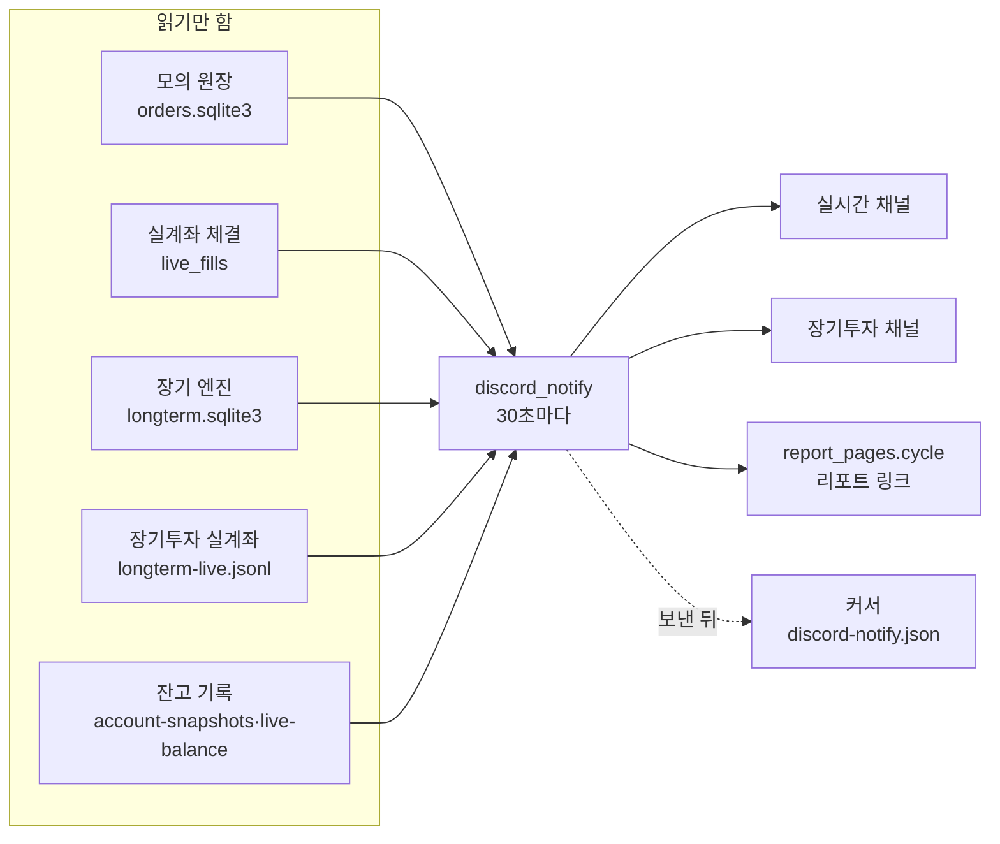

# 알림 (Discord)

체결·마감 요약·장기투자 판단 같은 짧은 알림은 Discord 채널 두 곳에 텍스트로 보내고, 리포트는 GitHub Pages 페이지의 링크로만 보냅니다. 알림 서비스는 엔진 기록을 읽기만 하는 별도 감시 프로그램이라, 알림이 실패해도 매매에는 영향이 없습니다.

- [채널과 키](#채널과-키)
- [무엇을 보내나](#무엇을-보내나)
- [메시지 형식](#메시지-형식)
- [중복 방지와 커서](#중복-방지와-커서)
- [실패했을 때](#실패했을-때)
- [리포트는 링크로만](#리포트는-링크로만)
- [그 밖의 알림](#그-밖의-알림)
- [명령](#명령)

## 채널과 키

| 채널 | `.env` 키 | 받는 것 |
| --- | --- | --- |
| 실시간 (Jev) | `DISCORD_WEBHOOK_REALTIME` | 공유 모의 체결, Jev 미러 실계좌 체결, 15:40 마감 요약, 장전 사전 점검 실패, Jev 쪽 리포트 링크 |
| 장기투자 | `DISCORD_WEBHOOK_LONGTERM` | 장기 엔진 판단·가상 주문·적립식·순자산, 장기투자 실계좌 체결·계획, 장기 리포트 링크 |

> [!CAUTION]
> 웹훅 주소 자체가 비밀입니다. `.env`에만 두고, 로그·기록·화면 어디에도 쓰지 않습니다. 키가 비어 있으면 그 채널은 보내지 않고 기다립니다.

## 무엇을 보내나

서비스는 launchd `discord-notify`(`scripts/discord_notify.py --watch`, 로그인 시 시작)이고 30초마다 한 번 돕니다.



| 알림 | 채널 | 언제 |
| --- | --- | --- |
| 공유 모의 체결 (매수·매도) | 실시간 | 체결마다 |
| 실계좌 체결 (Jev 미러 계좌) | 실시간 | 체결마다 |
| 실계좌 체결 (장기투자 계좌) | 장기투자 | 체결마다 |
| 마감 요약 | 실시간 | KRX 거래일 15:40 이후 한 번 |
| 장기 엔진 판단 (`regime`) | 장기투자 | 아침 판단 기록이 생길 때 |
| 장기 가상 주문·계획·적립식 (`order`·`plan`·`dca`) | 장기투자 | 기록이 생길 때 |
| 장기 단계 오류·시간 놓침 (`error`·`missed`) | 장기투자 | 기록이 생길 때 |
| 장기 가상 순자산 | 장기투자 | 15:40 이후 그날 한 번 |
| 장기투자 실계좌 주문 계획·적립식 주문 | 장기투자 | 계좌·종류·실행 모드별 하루 한 번 |

## 메시지 형식

### 체결

```text
🟢 매수 · KODEX 인버스(114800) 100주 × 4,515원 · 모의 · Jev 판단 · 10:12
🛑 손절 · KODEX 인버스(114800) 100주 × 4,470원 · 모의 · 실현손익 **-4,500원 (-1.00%)** · 11:05
　오늘 실현 -4,500원 (-1.00%) · 총자산 1,995,500원 (오늘 -4,500원 -0.23%, 11:05 기준)
```

(숫자는 예시입니다.)

- **머리**: 매수는 `🟢 매수`. 매도는 이렇게 고릅니다(2026-11-19 사용자 결정, `discord_notify.sell_head`).
  - `🛑 손절`: 손절 경로(손절·추적 손절·본전 손절·신규주 시간 손절)이면서 실제로 손실일 때만. 손실이 아니면 사유를 '추적 청산'·'본전 청산'처럼 '청산'으로 씁니다. 실현손익을 모르면 손절이라 하지 않습니다.
  - `전량 매도`: 포지션을 다 판 매도. 수익이면 💰, 아니면 🔴입니다.
  - `💰 익절`: 일부 익절. 그 밖은 `🔴 매도`입니다.
- **경로 이름**: Jev 판단, 관심종목 강도 경로, 가격 단계 추가, 수동, 신규주, 장 마감 정리, 국면 절반 매도, 방향 전환 매도 등.
- **매도 손익**: 이동평균 원가 기준 실현손익 금액과 %입니다(수수료·세금 전). 기록 전에 산 주식을 판 것이면 '실현손익 확인 불가'라고 씁니다.
- **매도 둘째 줄**: 그 계좌의 오늘 실현손익과 총자산, 오늘 변동, 잔고 기준 시각
- **실계좌 매도 이름**: Jev 미러 계좌의 매도는 20분 안에 같은 종목을 판 모의 매도의 경로를 따릅니다. 모의 매도 없이 실계좌가 스스로 낸 손절·대시보드 매도 요청은 주문 번호로 찾아 '실계좌 손절'(손실이면 🛑)로 씁니다(`live_exit_route`). 장기투자 계좌의 매도는 '리밸런싱 매도'입니다.

### 15:40 마감 요약

```text
🏁 2026-11-19 마감 요약
**모의(Jev)** · 청산 6건 · 승 4/패 2
　오늘 실현 +12,000원 (+0.40%) · 총자산 … (오늘 …, 15:30 기준)
**실계좌 1** · …
**실계좌 2** · …
**실계좌 합계**
　오늘 실현 … · 총자산 …
```

- 계좌마다 청산 수·승패, 오늘 실현손익(판 주식 원가 대비 %), 총자산과 오늘 변동을 씁니다.
- 실계좌가 둘 이상이면 실계좌 합계를 더합니다. 모의계좌의 가상 금액은 합계에 넣지 않습니다.
- 잔고는 로컬 기록에서 읽습니다. 모의는 `shared-etf-paper/account-snapshots.jsonl`, 실계좌는 미러·장기 실행기가 5분마다 남기는 `live-balance-<계좌 키>.jsonl`(계좌번호 없음)입니다. 기록이 없으면 '총자산 기록 없음'으로 씁니다.

### 장기투자

- `🧭 장기투자 판단 · 국면 · 모드`와 활성 거장 모듈, 판단 이유
- `🧾 가상 주문`·`📝 주문 계획`·`💰 적립식 가상 주문/계획`: 종목·수량·가격과 근거 요약 두 줄. 전체 근거는 대시보드 **장기투자 → 계좌·실행 → 포트폴리오·주문 → 왜 샀나·팔았나**에 있다고 덧붙입니다.
- `⚠️ 장기투자 오류/시간 놓침`
- `📈 장기투자 가상 NAV`: 장부별 순자산과 적립 누계
- `📝 실계좌 주문 계획`·`💰 실계좌 적립식 주문`: 계좌·날짜·실행 모드(계획만/실행)

## 중복 방지와 커서

알림 서비스가 쓰는 파일은 커서 `~/.vibe-trading/nhplug/discord-notify.json` 하나입니다.

- **처음 실행**: 지금 있는 기록을 모두 '보낸 것'으로 표시하고 끝냅니다. 지난 기록을 한꺼번에 보내지 않습니다.
- **보낸 목록**: 항목마다 고유 키(모의 주문 번호, 실계좌 키·날짜·주문 번호, 장기 기록 행 번호, `summary:날짜` 등)를 남깁니다. 최근 3,000개만 보관합니다.
- **최근 3일**: 3일보다 오래된 체결은 보내지 않습니다.
- **한 건씩 확정**: 한 건을 보낼 때마다 커서를 저장합니다. 도중에 멈춰도 이미 보낸 것을 다시 보내지 않습니다.
- **장기 기록 커서**: 아직 못 보낸 장기 기록이 있으면 커서를 그 앞까지 되돌려 다음 회차에 다시 모읍니다.
- **멘션 차단**: `@everyone` 같은 멘션은 막아서 보냅니다(`allowed_mentions` 비움).
- **긴 메시지**: Discord 한도(2,000자) 안에서 1,900자씩 줄 단위로 나눕니다.

## 실패했을 때

| 상황 | 동작 |
| --- | --- |
| 429 (속도 제한) | Discord가 알려 준 시간(최대 30초)만큼 기다렸다가 3번까지 다시 보냅니다. |
| 연결 실패·일시 오류 | 그 건을 보내지 않은 채로 두고 다음 회차(30초 뒤)에 다시 보냅니다. |
| 4xx 거절 (429 제외) | 3번 연속 거절되면 그 건을 건너뜁니다(영원히 막히지 않게). |
| 웹훅 키 없음 | 그 채널은 보내지 않고 기다립니다. |
| 한 채널의 건이 실패 | 그 채널의 뒤 건은 순서를 지키려고 다음 회차로 미룹니다. 다른 채널은 계속 보냅니다. |
| 기록 읽기 오류 | 그 부분(손익·잔고 줄)만 빼고 보냅니다. 회차 전체가 실패해도 서비스는 멈추지 않습니다. |

실패 사유는 서비스 로그(`~/.vibe-trading/nhplug/shared-etf-paper/com.vibetrading.discord-notify.log`)에 예외 종류만 남습니다.

## 리포트는 링크로만

매매일지·장 마감 개선안·장전 상세 분석·낙폭과대 주간 감사·기간 매매일지·장기 전략 리포트·장기 복기·감사는 HTML 페이지로 만들어 **링크만** 보냅니다. 같은 서비스가 매 회차 끝에 `report_pages.cycle`을 부릅니다.

> [!IMPORTANT]
> 리포트 본문을 텍스트로 대신 보내지 않습니다(사용자 결정 2026-11-18). Pages가 배포되기 전에는 리포트가 '대기'로 남고, 배포되어 페이지가 열리면 그때 링크로 나갑니다. 템플릿 검사를 통과하지 못한 초안도 보내지 않습니다.

생성·게시·재시도는 [리포트 발행](report-pages.md)에 있습니다. 리포트 처리에서 오류가 나도 체결 알림은 계속 나갑니다.

## 그 밖의 알림

| 알림 | 어디로 | 보내는 곳 |
| --- | --- | --- |
| 장전 사전 점검 실패 (08:20·08:53) | 실시간 채널 | `scripts/preflight.py`. 실패 항목만 보냅니다. |
| 실계좌 미러 지연 | Mac 알림 | `scripts/nh_live_follow.py`. 실행 모드의 실계좌가 모의보다 많이 든 채 5분 넘게 매도를 못 따라갈 때 |
| 실계좌 남은 보유 Jev 판단 실패 | Mac 알림 | `scripts/nh_live_follow.py`. 종목별 하루 한 번. 손절·하루 손실 보호는 그대로 작동 |
| 장중 감사 발견·재발 | 대화 | 예약 작업 `intraday-audit-hourly` ([자동 작업](automation.md#장중-감사)) |

## 명령

```bash
PYTHONPATH=agent:scripts:streamlit_namuh .venv/bin/python scripts/discord_notify.py --once --dry-run   # 보낼 메시지 미리보기(발송·커서 저장 없음)
PYTHONPATH=agent:scripts:streamlit_namuh .venv/bin/python scripts/discord_notify.py --test            # 두 채널에 연결 확인 메시지 한 번
```

대시보드 **API 연동**의 Discord 웹훅 항목에서 호출 기록을, **API 연동 → 리포트 발행**에서 리포트 발송 상태를 봅니다.

> [!TIP]
> 서비스를 다시 시작하려면 `launchctl kickstart -k gui/$(id -u)/com.vibetrading.discord-notify`를 씁니다. 커서가 남아 있으므로 보낸 알림을 다시 보내지 않습니다.
