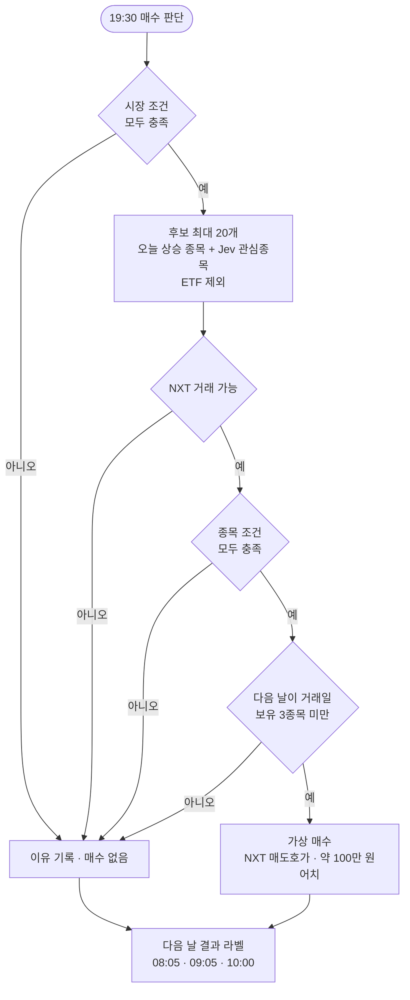

# NXT 종가매매 (가상 실행)

NXT(넥스트레이드) 애프터마켓에서 **강세장일 때만** 종가매매로 사고, 다음 날 1\~2% 수익을 노려 파는 전략입니다. 스윙으로 들고 간 종목을 NXT 장에서 정리하는 판단도 함께 기록합니다. 코드는 `scripts/nxt_virtual.py`, 서비스는 `com.vibetrading.nxt-virtual`입니다.

> [!IMPORTANT]
> 지금은 **가상 체결만** 합니다. NH 모의투자가 NXT 주문을 받지 않아(2026-11-12 확인, `14280`), 실시간 NXT·KRX 호가로 가상 체결하고 모든 판단과 결과를 학습 데이터로 쌓습니다. 실제 주문은 어디로도 실행되지 않습니다. 실계좌 NXT 주문은 데이터를 검토한 뒤 별도 승인을 받은 뒤에만 시작합니다.

## 원칙

- NXT는 **종가매매 전략으로만** 접근합니다. 장중 단타나 추격 매수는 하지 않습니다.
- 강세장(지수 상승장 + 오늘 강세)이 아니면 사지 않습니다.
- 코스피 야간선물, 나스닥·S&P500 선물, 원유·금 선물, 시황, 투자자별 매매, 거래량·거래대금을 함께 봅니다.
- 다음 날 아침에 정리합니다. 목표는 +1% 절반, +2% 전량입니다.
- ETF는 NXT 거래 불가라 대상이 아닙니다. NXT에서 거래되는 일반 주식만 봅니다.

## 하루 흐름

```mermaid
gantt
  dateFormat HH:mm
  axisFormat %H:%M
  section 다음 날 아침
  NXT 프리마켓 청산·결과 기록    :08:00, 50m
  KRX 정규장 청산               :09:00, 60m
  남은 수량 전부 정리            :milestone, 10:00, 0m
  section 당일 저녁
  시장·선물 스냅숏 10분 간격     :15:40, 258m
  야간선물 개장                 :milestone, 18:00, 0m
  매수 판단 1회                 :crit, 19:30, 20m
  세션 종료                     :milestone, 19:58, 0m
```



저녁 15:40\~19:58 스냅숏 · 18:00 야간선물 개장 · 19:30\~19:50 매수 판단(하루 1회) · 다음 날 08:00\~08:50 NXT 프리마켓, 09:00\~10:00 KRX에서 청산 · 10:00 남은 수량 정리

## 매수 판단



수량은 100만 원 ÷ NXT 매도호가(내림)이고, 1주가 100만 원보다 비싸면 200만 원 이하일 때만 1주를 삽니다(그보다 비싸면 `price_too_high`). 가상 계좌 현금은 1,000만 원입니다.

시장 조건이 맞지 않아도 모든 후보의 지표와 실패 이유를 기록합니다. 다음 날 같은 종목의 가격을 따라가 "샀다면 어땠을지"를 라벨로 남기기 때문에, 사지 않은 날도 학습 데이터가 됩니다.

### 시장 조건 (모두 충족)

| 코드 | 조건 | 출처 |
| --- | --- | --- |
| `regime_not_rising` | 종목이 속한 지수(코스피/코스닥)가 상승장 | 네이버 금융 지수, 20·60일선 규칙 |
| `today_not_strong` | 그 지수가 오늘 강세 | 상승·하락 종목 수와 등락 |
| `flows_not_supporting` | 외국인 + 기관 순매수 합계가 플러스 | 네이버 투자자별 매매 |
| `us_futures_down` / `us_futures_unavailable` | 나스닥·S&P500 선물이 모두 전일 정산가 이상 | Yahoo `NQ=F`, `ES=F` (약 15분 지연) |
| `night_futures_down` | 코스피200 야간선물이 그날 주간 종가 대비 0% 이상 (야간 시세가 있을 때만) | TradingView 코스피200 선물 최근월물 `KRX:K2I1!` (20분 지연) |
| `oil_spike` | WTI 선물 상승률 +3% 이하 | Yahoo `CL=F` |
| `gold_spike` | 금 선물 상승률 +1.5% 이하 (위험 회피 급증 제외) | Yahoo `GC=F` |

### 종목 조건 (모두 충족)

| 코드 | 조건 |
| --- | --- |
| `change_out_of_range` | 오늘 KRX 종가 등락률 +2% \~ +15% (상한가 추격 제외) |
| `weak_close` | 종가가 오늘 고가-저가 범위의 상위 30% 안 |
| `volume_not_high` | 거래량이 전일의 150% 이상 |
| `value_too_small` | 오늘 거래대금 300억 원 이상 |
| `below_5d_high` | 종가가 5일 고가의 3% 이내 |
| `nxt_below_close` | NXT 현재가가 KRX 종가 이상 (애프터마켓에서 강세 유지) |
| `spread_too_wide` | NXT 호가 스프레드 0.5% 이하 |

### 그 밖의 거부 사유

| 코드 | 뜻 |
| --- | --- |
| `not_nxt_eligible` / `quote_unavailable` | NXT 시세가 없음(거래 불가 종목) / KRX 시세 조회 실패 |
| `market_closed_next_day` | 다음 날이 KRX 거래일이 아님 |
| `already_held` | 이미 가상 보유 중 |
| `position_limit` | 가상 보유가 이미 3종목 |
| `price_too_high` | 1주 값이 200만 원 초과 |

## 다음 날 청산

| 조건 | 매도 |
| --- | --- |
| 평균가 +1% | 절반 (2주 이상일 때) |
| 평균가 +2% | 남은 수량 전량 |
| 평균가 −2% | 전량 손절 |
| 10:00 | 남은 수량 전량 |

08:00\~08:50은 NXT 호가로, 09:00 이후는 KRX 호가로 가상 체결합니다. 08:50\~09:00은 NXT가 쉬고 KRX가 동시호가라 판단하지 않습니다. 금요일이나 휴장 전날은 사지 않습니다(다음 날이 거래일이어야 함).

## 스윙 종목의 NXT 정리 신호

공유 모의 실행기가 이월·스윙으로 들고 있는 종목(ETF 제외) 중 NXT에서 거래되는 종목은 19:30에 확인합니다. 나스닥·S&P500 선물이나 야간선물 중 가장 나쁜 값이 −0.7% 이하이면 "NXT에서 팔았어야 함" 신호(`nxt_swing_signal`)를 남깁니다. 모의계좌는 NXT 주문이 안 되므로 실제 보유는 바꾸지 않고 신호만 기록해, 다음 날 KRX에서 판 결과와 비교합니다.

## 장전 브리프의 NXT 프리마켓 요약

2026-11-19부터 장전 수집(`premarket.py`, 08:00\~08:55 매 5분)이 보유·관심 개별주의 NXT 프리마켓 실제 체결을 요약해 장전 브리프 `nxt_premarket` 절로 남기고, Jev 진입·보유 판단 입력(`premarket_context`)에 넣습니다. 이 가상 종가매매와는 별개의 참고 자료이며 주문으로 이어지지 않습니다. 자세한 내용은 [장전 분석](premarket.md#모으는-자료)을 봅니다.

## 쌓이는 데이터

`~/.vibe-trading/nhplug/nxt-virtual/`

| 파일 | 내용 |
| --- | --- |
| `events.jsonl` | 모든 기록을 시간순으로 남기는 감사 기록(덧붙이기만 함) |
| `nxt.sqlite3` | 같은 기록을 조회용 표(`events`: 시각·날짜·종류·종목·JSON)로 저장 |
| `virtual-account.sqlite3` | 가상 계좌(현금 1,000만 원)의 주문·체결 |

| 이벤트 | 언제 | 주요 필드 |
| --- | --- | --- |
| `nxt_snapshot` | 저녁 10분마다 | 선물 4종 등락, 야간선물, 지수 국면·강도·투자자·프로그램 매매·등락 종목 수 |
| `nxt_decision` | 19:30 판단 때 후보마다 | 통과 여부, 실패 코드, 지표(등락률·종가 위치·거래량 비율·거래대금·NXT 가격·스프레드), 판단 가격 |
| `nxt_order` / `nxt_exit` | 가상 매수 / 청산 | 수량, 가격, 체결 여부, 청산 사유, 손익 % |
| `nxt_outcome` | 다음 날 08:05·09:05·10:00 | 판단한 모든 후보의 그 시각 가격과 판단 가격 대비 수익률 (재시작 등으로 2분 이상 늦게 찍히면 `late_min`에 늦은 분) |
| `nxt_swing_signal` | 19:30 | 스윙 종목의 NXT 정리 신호 |
| `nxt_error` | 실패 회차 | 오류 종류 (10회 연속이면 그 세션 종료) |

조회 예:

```bash
sqlite3 ~/.vibe-trading/nhplug/nxt-virtual/nxt.sqlite3 \
  "SELECT symbol, json_extract(data,'$.at'), json_extract(data,'$.ret_pct'), json_extract(data,'$.passed')
   FROM events WHERE event='nxt_outcome' ORDER BY id DESC LIMIT 20"
```

## 감사

```bash
PYTHONPATH=agent:scripts .venv/bin/python scripts/nxt_virtual.py --audit
```

| 확인 | 문제로 보는 경우 |
| --- | --- |
| 기록 일치 | `events.jsonl`과 `nxt.sqlite3`의 건수가 다름 |
| 판단 근거 | 매수 판단이 있는 날에 시장 스냅숏이 없음 |
| 세션 종료 | 시작과 종료 기록 수가 다름 (지금 돌고 있는 세션은 `session.json`의 프로세스로 확인해 `running`으로만 표시) |
| 가상 주문 | 체결도 취소도 안 된 주문이 남음 (가상 주문은 즉시 체결 아니면 바로 취소) |
| 주문 대조 | 가상 계좌의 주문 수와 기록된 주문 수가 다름 |
| 보유 이월 | 아침 정리 뒤에도 보유가 남음 |

감사는 문제를 보고만 하고 고치지 않습니다. 원장 수정은 하지 않습니다.

## 운영

- 서비스: 평일 07:55(아침 세션)와 15:35(저녁 세션)에 시작해 세션이 끝나면 스스로 종료합니다. 로그인·재부팅 때도 한 번 시작해, 그 시각이 아침 창(07:50\~10:05)이나 저녁 창(15:30\~19:58) 안이면 그 세션을 돌고 밖이면 바로 끝납니다(2026-11-17, 재부팅으로 아침 세션을 놓친 사례 뒤). `scripts/launchd_services.py`가 정의를 만듭니다.
- 아침 세션은 10:00 청산 뒤 결과 라벨이 다 찍히면 끝나고, 늦은 라벨은 10:05까지 다시 시도합니다.
- 중단: `touch ~/.vibe-trading/nhplug/nxt-virtual/STOP` (다음 회차에 종료, 다시 쓰려면 파일 삭제)
- 로그: `~/.vibe-trading/nhplug/nxt-virtual/com.vibetrading.nxt-virtual.log`
- 대시보드 **운영 → 운영 상태**의 자동 작업 목록에 `NXT 가상 실행기`로 표시됩니다.

## 알려진 한계

- 코스피200 **야간선물**은 TradingView 스캐너 시세(20분 지연)를 씁니다. 네이버 선물 시세는 15:35 주간 종가에서 멈춰 야간에 쓸 수 없습니다. 18:00에 열린 야간 세션 시세가 최근 40분 안에 갱신됐을 때만 씁니다. 야간 시세가 없으면 그 조건은 건너뛰고(`night.available=false`로 기록) 미국 선물 조건은 그대로 적용합니다.
- 해외 선물은 약 15분, 국내 선물은 약 20분 늦습니다. 등락률은 전일 정산가 기준입니다.
- 지수 국면·투자자 매매는 장중 마지막 수집(대개 15시대) 값입니다.
- 가상 체결은 호가에 바로 전량 체결된다고 가정합니다. 대기열, 부분 체결, 수수료·세금은 없습니다. 실제 체결 검증이 아닙니다.
- 수치(조건·목표·손절)는 처음 정한 가상 운용 값이며 수익 검증을 거치지 않았습니다. 쌓인 결과 라벨을 보고 조정합니다.

## 실계좌로 옮기려면

다음이 모두 갖춰진 뒤 사용자가 따로 승인해야 합니다. 자동으로 넘어가지 않습니다.

1. 충분한 가상 결과(매수 판단과 다음 날 라벨)와 감사 통과 기록
2. 실계좌 가드에 NXT 시장 코드·시간대(15:30\~20:00, 08:00\~08:50) 허용 추가
3. 장외 시간 손절 감시와 실계좌 하루 손실 한도 적용 확인
4. 첫 실주문 시험 방법(1주·즉시 취소 등) 합의
