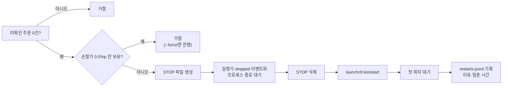

# 운영 가이드

서비스를 등록하고 확인하는 법, 장중에 실행기를 안전하게 다시 시작하는 법, 멈추기·정리 요청, 매일 볼 것, 로그와 백업을 다룹니다. 무엇이 언제 도는지(시간표·예약 작업·감사)는 [자동 작업](automation.md)에 있습니다.

- [서비스 한눈에](#서비스-한눈에)
- [등록과 확인](#등록과-확인)
- [실행기 재시작](#실행기-재시작)
- [멈추기와 켜기](#멈추기와-켜기)
- [정리 요청과 수동 매매](#정리-요청과-수동-매매)
- [매일 확인할 것](#매일-확인할-것)
- [로그와 기록](#로그와-기록)
- [백업](#백업)
- [자주 쓰는 명령](#자주-쓰는-명령)

> [!NOTE]
> 시각은 한국시간입니다. launchd는 Mac 시계를 따르므로 Mac이 KST여야 합니다.

## 서비스 한눈에

정의는 `scripts/launchd_services.py`의 `SERVICES` 한 곳이고 라벨은 `com.vibetrading.<이름>`입니다. 일정과 로그 폴더 전체는 [자동 작업 → launchd 서비스](automation.md#launchd-서비스)를 보세요.

| 묶음 | 서비스 | 역할 |
| --- | --- | --- |
| Jev 트레이딩 | `shared-etf-paper` | 공유 모의 실행기(`--execute`, 모의 주문). 09:00(개장)부터 매매 |
| | `trading-day-start` | 08:55 거래일 확인 뒤 실행기·관찰기 준비 |
| | `shared-etf-learning`, `shared-etf-regime` | 사후 관측·학습·장 마감 복기, 시황 국면 관측 |
| | `market-movers`, `premarket`, `preflight` | 순위·관심종목, 장전 자료, 장전 사전 점검 |
| 실계좌 | `live-follow-1` | 실계좌 1 미러(`--execute` 등록, 실주문은 계좌 스위치가 켜졌을 때만) |
| | `longterm-live-2` | 실계좌 2 장기투자 실행기(저장소 정의에 `--execute` 포함, 계좌별 실주문 조건 확인) |
| 장기투자 | `vibe-longterm`, `us-ideas` | 장기 엔진(가상 계좌), 미국 종목 아이디어(참고) |
| 기타 | `nxt-virtual` | [NXT 종가매매](nxt.md) 가상 실행 |
| | `discord-notify` | [알림](notifications.md)과 [리포트 발행](report-pages.md) |
| | `trading-backup`, `state-sync`, `exit-replay` | 일일 사본, 설정·전체 백업, 청산 규칙 재현 |
| | `shared-etf-dashboard` | 대시보드 `http://127.0.0.1:8501` |

**퇴역** (2026-11-17): `vibe-advisor`, `vibe-paper`, `vibe-fast-exit-observer`, `vibe-event-advisor`, `vibe-event-replay`, `live-follow-2`, `jev-virtual`. plist는 `~/.vibe-trading/nhplug/retired-launchd-2026-11-17/`에 있습니다.

## 등록과 확인

```bash
PYTHONPATH=agent:scripts .venv/bin/python scripts/launchd_services.py            # 목록과 일정
PYTHONPATH=agent:scripts .venv/bin/python scripts/launchd_services.py --out DIR  # plist 파일 생성(등록은 하지 않음)
launchctl list | grep vibetrading                                                 # 상태(PID, 마지막 종료 코드)
```

새로 등록할 때:

```bash
cp DIR/com.vibetrading.<이름>.plist ~/Library/LaunchAgents/
launchctl bootstrap gui/$(id -u) ~/Library/LaunchAgents/com.vibetrading.<이름>.plist
```

> [!WARNING]
> - plist는 반드시 `~/Library/LaunchAgents`에 두고 등록합니다. 다른 폴더에서 등록한 서비스는 재부팅 뒤 올라오지 않습니다.
> - 저장소의 `shared-etf-paper`, `live-follow-1`, `longterm-live-2` 정의에는 `--execute`가 들어 있습니다. 모의·실계좌 주문이 가능한 서비스를 등록하기 전에 사용할 인자와 계좌·보호 설정을 확인하고 사용자 승인을 받습니다.

대시보드 **운영 → 운영 상태**에서 서비스별 실행 여부와 오류를 한국어 이름으로 봅니다.

## 실행기 재시작

코드 변경을 공유 모의 실행기에 반영할 때만 장중 재시작을 합니다. 재시작하는 동안 손절 감시가 멈춥니다.

```bash
.venv/bin/python scripts/restart_runner.py --runner shared --reason "무엇을 반영하는지"
```

`scripts/restart_runner.py`가 정해진 순서를 한 번에 합니다.



- 손절가 근처 기준은 `--stop-margin`(기본 0.5%p)입니다.
- 모든 시도는 `shared-etf-paper/restarts.jsonl`에 이유·멈춘 시간과 함께 남아 하루 재시작 수를 셀 수 있습니다.
- 주문을 내거나 취소하지 않습니다.

<details>
<summary>손으로 할 때 (스크립트를 쓸 수 없을 때)</summary>

```bash
touch ~/.vibe-trading/nhplug/shared-etf-paper/STOP
# events.jsonl에서 stopped 이벤트와 프로세스 종료를 확인한 뒤
rm ~/.vibe-trading/nhplug/shared-etf-paper/STOP
launchctl kickstart gui/$(id -u)/com.vibetrading.shared-etf-paper
# 첫 회차 로그 확인
```

</details>

> [!CAUTION]
> 오류나 결과가 불확실한 주문이 있으면 재전송하지 말고 증권사 조회로 먼저 대조합니다. 미확인 주문이나 남은 보유를 대조하지 않고 재시작하거나 기록을 지우지 않습니다.

주문과 무관한 서비스는 `kickstart -k`로 바로 다시 띄웁니다.

```bash
launchctl kickstart -k gui/$(id -u)/com.vibetrading.discord-notify
launchctl kickstart -k gui/$(id -u)/com.vibetrading.shared-etf-dashboard   # 브라우저 새 탭은 열리지 않음
```

## 멈추기와 켜기

| 무엇을 | 방법 | 효과 |
| --- | --- | --- |
| 공유 모의 실행기 | `~/.vibe-trading/nhplug/shared-etf-paper/STOP` 파일 | 미확인 주문을 대조한 뒤 실행기를 종료. 08:55 거래일 준비 때도 파일이 있으면 띄우지 않음 |
| 장기 엔진 | `~/.vibe-trading/nhplug/vibe-longterm/STOP` 파일 | 그날 실행을 끝냄 |
| 실주문 전체 | `~/.vibe-trading/live/HALT`(전체) 또는 `live/<브로커>/HALT` | 모든 실주문 직전에 확인하는 차단 스위치 |
| Jev·장기투자 운영 | 대시보드 **계좌·자동매매 → 운영 엔진** (둘 다·Jev만·장기투자만·끔) | Jev를 끄면 새 진입·추가 매수만 멈추고 보유 손절·익절·정리는 계속. 장기투자를 끄면 다음 확인 때 판단·주문 없이 끝남 |
| 실계좌 실주문 | 대시보드 계좌별 실주문 스위치(기본 꺼짐, 켤 때 확인 문구) | 꺼져 있으면 미러는 계획만 기록. 자기가 낸 미체결 주문은 취소할 수 있음 |

STOP·HALT가 켜져 있으면 장전 사전 점검이 알립니다. 사람이 일부러 켠 것일 수 있으므로 자동 작업은 지우지 않습니다. 스위치와 한도는 [안전장치](safety.md)를 보세요.

## 정리 요청과 수동 매매

AI 판단 없이 바로 팔거나 사려면 대시보드에서 요청합니다. 실행기가 다음 회차(약 1분 안)에 보호 경로·주문 가드를 거쳐 처리합니다.

- 대시보드: **실계좌 → 주문·정리 종합** 보기(계좌별로는 계좌 화면의 '주문·정리' 탭), 또는 **트레이딩 현황 → (모의계좌·실계좌) 즉시 매도** 탭의 '수동 매수·매도'(종목별 수량 매도·추가 매수·전량 매도, 전체 매도, 확인 팝오버)

| 계좌 | 매도 요청 파일 | 매수 요청 파일 |
| --- | --- | --- |
| 공유 모의 | `shared-etf-paper/exit-requests.json` | `shared-etf-paper/manual-buys.json` |
| 실계좌 (계좌 키별) | `live-exit-requests-<계좌 키>.json` | `live-manual-buys-<계좌 키>.json` |

(경로는 `~/.vibe-trading/nhplug/` 아래입니다.)

- **매도 형식**: 목록 `["114800"]`은 전량, 객체 `{"114800": 100}`은 그 수량만 팝니다. 보유가 0이 되면 요청이 지워집니다. 문자열이 아닌 항목이 있으면 그 파일을 무시합니다.
- **매수 형식**: `{"114800": 10}`. 모의는 한 회차에 한 건씩 사고 출처 `manual`로 기록합니다. 장 마감 정리 시각(설정 `flatten_hhmm`, 기본 14:40) 뒤의 수동 매수는 거절합니다.
- **실계좌**: 미러가 요청 파일을 `.claim`으로 옮겨 받은 뒤 계좌별 수동 오프셋으로 목표를 바꾸고 실계좌 가드를 거쳐 주문합니다. 일부 매도분은 그 포지션이 끝날 때까지 되사지 않고, 추가 매수분은 정리 시각에 함께 팝니다. 실주문 스위치가 꺼져 있으면 계획만 기록합니다.

손으로 파일을 쓸 때는 권한을 600으로 둡니다.

```bash
echo '["114800"]' > ~/.vibe-trading/nhplug/shared-etf-paper/exit-requests.json
chmod 600 ~/.vibe-trading/nhplug/shared-etf-paper/exit-requests.json
```

## 매일 확인할 것

| 언제 | 어디서 | 무엇을 |
| --- | --- | --- |
| 08:20\~09:00 | Discord 실시간 채널, `preflight/<날짜>.jsonl` | 장전 사전 점검 실패가 없는지([자동 작업](automation.md#장전-사전-점검)) |
| 장중 | **운영 → 운영 상태** | 실행 중 서비스 수, 오류 기록, 가장 많은 대기 사유 |
| 장중 | **트레이딩 현황** | 증권사 보유와 실행기 원장이 같은지, 미확인 주문이 0인지 |
| 장중 | `reviews/operations-audit-<날짜>.md` | 매시 장중 감사 발견과 재발 |
| 장 마감 뒤 | **트레이딩 현황**, Discord 마감 요약 | 장 마감 정리 결과, 이월 종목과 그 이유 |
| 16:15 이후 | **전략 구조 → 장 마감 개선안**, **매매일지** | 개선안과 매매일지([매매일지](journal.md)) |

## 로그와 기록

| 파일 (`~/.vibe-trading/nhplug/` 아래) | 내용 |
| --- | --- |
| `<폴더>/com.vibetrading.<이름>.log` | 서비스 표준 출력·오류 (대시보드는 `shared-etf-paper/streamlit.log`) |
| `shared-etf-paper/events.jsonl` | 판단·주문·체결·대기 사유 이벤트 |
| `shared-etf-paper/orders.sqlite3` | 공유 모의 주문·체결 원장 |
| `shared-etf-paper/trading-ledger.sqlite3` | 조회용 이벤트 원장 |
| `shared-etf-paper/trading-day-start.jsonl` | 평일 08:55 거래일 준비 기록 |
| `shared-etf-paper/restarts.jsonl` | 실행기 재시작 이력 |
| `live-follow.jsonl`, `longterm-live.jsonl` | 실계좌 미러·장기투자 실계좌 회차 기록 |
| `live-balance-<계좌 키>.jsonl` | 실계좌 잔고 기록(5분마다, 계좌번호 없음) |
| `preflight/<날짜>.jsonl` | 장전 사전 점검 결과 |
| `audit-incidents.sqlite3` | 장중 감사 문제 이력 |
| `settings-history.sqlite3` | 모든 설정 변경 이력 |

## 백업

| 작업 | 언제 | 결과 |
| --- | --- | --- |
| `trading-backup` (`scripts/backup_trading_data.py`) | 평일 15:50 | `~/.vibe-trading/backups/YYYY-MM-DD/`에 원장 SQLite(온라인 백업 API)와 이벤트·설정 사본. 14일 보관 |
| `state-sync` (`scripts/state_sync.py export`) | 평일 16:55 | 설정 정리본 `state/settings/`(git, 계좌번호·해시 제거)과 전체 아카이브 `state/backups/`(git 제외, 최근 14개) |

전체 백업·복원·다른 기기로 옮기기는 [이식](portability.md)을 보세요. 대시보드 **운영 → 백업·이식**에서도 합니다.

## 자주 쓰는 명령

```bash
PYTHONPATH=agent:scripts .venv/bin/python scripts/vibe_market_brief.py                   # 시세·서비스·오늘 체결 요약
PYTHONPATH=agent:scripts .venv/bin/python scripts/nh_live_shadow.py --day 2026-11-19     # 실계좌 가상 실행 결과
scripts/ro intraday_audit.py --since 09:00                                               # 장중 감사 수집(읽기 전용)
scripts/ro preflight.py --no-send                                                        # 사전 점검을 지금 한 번(Discord 없이)
scripts/ro services                                                                      # vibetrading 서비스 상태
```
