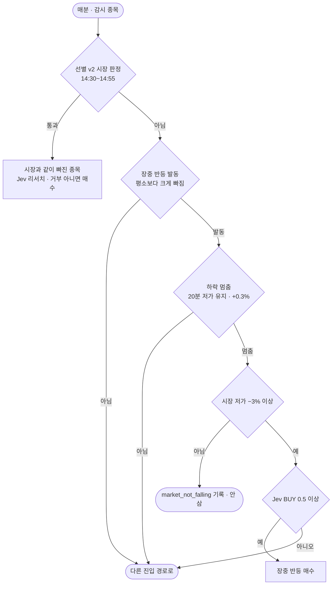
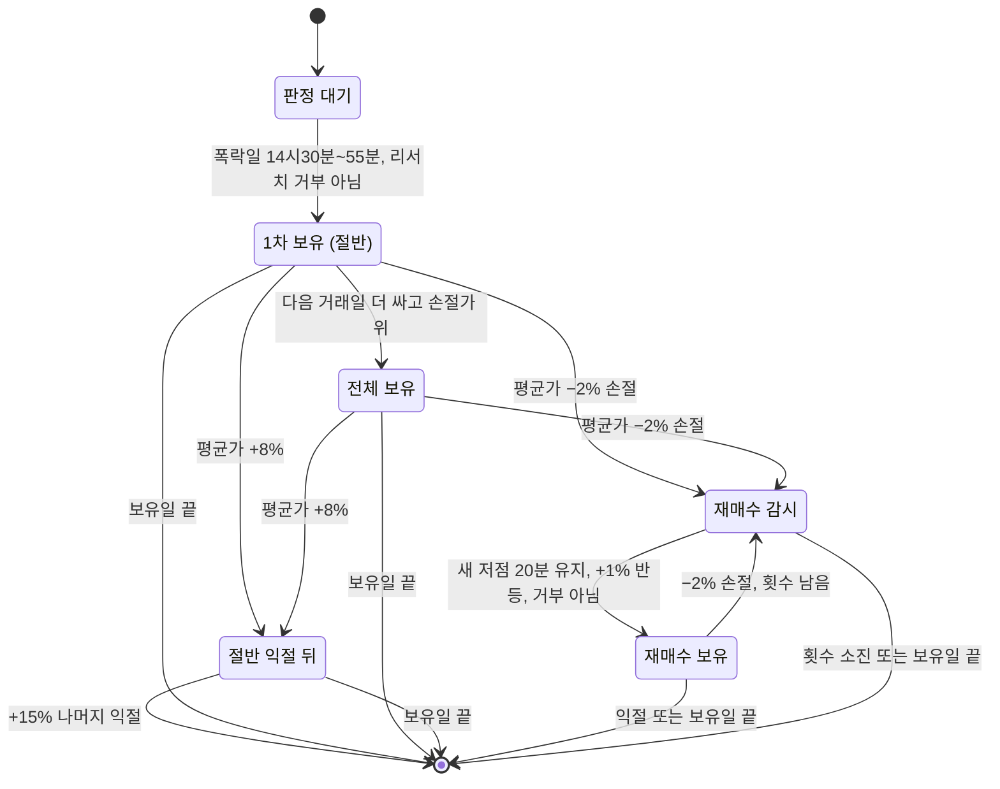

# 낙폭과대 반등

탄탄한 대형주·지수 ETF가 시장 충격으로 평소보다 훨씬 크게 빠진 날을 노리는 매매입니다. 공유 모의계좌 실행기(`scripts/nh_paper_isolated.py`)가 다른 진입 경로보다 먼저 보며, **장중 반등**과 **선별 v2 낙주매매** 두 경로가 있습니다. 계산은 `scripts/oversold.py`, 저점 재매수는 `scripts/v2_reentry.py`가 맡습니다.

> [!IMPORTANT]
> 모의매매로 데이터를 모으는 단계입니다. 기준값은 과거 재현으로 정했고 실제 체결로 검증되지 않았습니다. 재현 수치는 비용을 넣은 하루 단위 평균이지 수익 보장이 아닙니다. 수치는 코드 기본값이며 대시보드에서 바꿀 수 있으니 지금 값은 대시보드나 `strategy-settings.json`에서 확인하세요.

## 목차

- [두 경로 한눈에](#두-경로-한눈에)
- [감시 종목](#감시-종목)
- [장중 반등 경로](#장중-반등-경로)
- [선별 v2 낙주매매](#선별-v2-낙주매매)
  - [손절 뒤 저점 재매수](#손절-뒤-저점-재매수)
  - [다른 규칙과의 관계](#다른-규칙과의-관계)
- [실계좌는 어떻게 따라가나](#실계좌는-어떻게-따라가나)
- [사례집과 재현 기록](#사례집과-재현-기록)
- [사후 결과와 감사](#사후-결과와-감사)
- [대시보드에서 보기](#대시보드에서-보기)
- [남는 기록](#남는-기록)
- [설정 값](#설정-값)
- [알려진 한계](#알려진-한계)
- [설계 기록](#설계-기록)

## 두 경로 한눈에

과거 사례 연구의 결론은 하나로 모입니다. **크게 빠졌다고 해서 반등하지는 않았고, 시장 전체가 같이 빠진 날에만 반등 우위가 있었습니다.** 종목 혼자 급락한 날에는 우위가 없었습니다(사례 연구 결론 2번, `docs/oversold-case-study.md`, 비공개). 그래서 두 경로 모두 시장이 같이 빠진 날에만 삽니다.

| | 장중 반등 | 선별 v2 낙주매매 |
| --- | --- | --- |
| 노리는 것 | 하락이 멈춘 직후 짧은 되돌림 | 폭락일 장 막판에 사서 며칠 반등 |
| 시장 조건 | 그 종목 시장의 저가가 전일 대비 −3% 이상 | 지수 저가 −8% 이상, 또는 직전 5일 −5% 뒤 −5% 이상. 전날 나스닥이 오르지 않았어야 함 |
| 언제 사나 | 장중 아무 때나(신규 매수 마감 전) | 14:30\~14:55, 신규 매수 마감 뒤에도 |
| 엔진 역할 | Jev가 BUY 0.5 이상이어야 삼 | 기본은 삼. Jev가 WAIT 0.7 이상이면 거부 |
| 크기 | 분할 1회의 100% | 1차 절반 + 다음 거래일 2차 절반 |
| 익절 | +1.5% 또는 낙폭 회복 중 낮은 값에서 전량 | 평균가 +8% 절반, +15% 나머지 |
| 손절 | 당일 저가 −0.5% | 평균 매입가 −2%, 그 뒤 저점 재매수 |
| 보유 | 최대 1거래일 | 최대 3거래일 |
| 출처 이름 | `oversold` | `oversold_v2` · `oversold_v2_add` · `oversold_v2_reentry` |



## 감시 종목

두 경로 모두 `~/.vibe-trading/nhplug/shared-etf-paper/oversold-universe.json`의 종목만 봅니다. 파일이 없거나 깨지면 기본 6종목을 씁니다(`oversold.DEFAULT_UNIVERSE`).

| 기본 감시 종목 | 종류 |
| --- | --- |
| KODEX 200 (069500) | 1배 ETF |
| KODEX 레버리지 (122630) | 2배 ETF (기본 제외) |
| KODEX 반도체레버리지 (494310) | 2배 ETF (기본 제외) |
| 삼성전자 (005930) | 개별주 |
| SK하이닉스 (000660) | 개별주 |
| 알테오젠 (196170) | 개별주 |

실적·애널리스트 평가가 탄탄해 크게 빠지면 되돌아올 가능성이 큰 종목·지수 ETF만 넣으세요. 2배 ETF는 어떤 설정에서도 이익이 없어서 '2배 ETF 포함'(`oversold_lev_on`)을 켜야만 봅니다. 인버스는 선별 v2 후보에서 늘 빠집니다. 편집은 **계좌·자동매매 → 모의계좌 → 매매 기준 → 낙폭과대 감시 종목**에서 하고, 다음 회차부터 적용됩니다.

## 장중 반등 경로

Jev 모드가 켜져 있고 신규 매수 마감 전이면 `nh_paper_isolated.oversold_entry`가 매분 확인합니다.

1. **발동:** 오늘 저가가 전일 종가보다 개별주 6%(`oversold_stock_drop_pct`), 1배 ETF 6%(`oversold_etf_drop_pct`), 2배 ETF 8%(`oversold_lev_drop_pct`) 이상 빠졌고, 동시에 최근 20일 평균 변동폭(ATR)의 1.5배(`oversold_atr_mult`) 이상일 때.
2. **하락 멈춤:** 최근 20분(`oversold_calm_min`) 동안 저가를 새로 쓰지 않았고, 현재가가 저가보다 0.3%(`oversold_rebound_pct`) 이상 올라와 있을 때.
3. **시장 폭락일:** 그 종목 시장(코스피는 KODEX 200, 코스닥은 KODEX 코스닥150)의 오늘 저가가 전일 종가보다 3%(`oversold_market_drop_pct`) 이상 빠졌을 때. 시장을 모르면 사지 않고, 조건이 안 맞으면 엔진에 묻지 않고 `oversold_signal`(`reason=market_not_falling`)을 하루 한 번 남깁니다. 0으로 두면 이 조건을 끕니다.
4. **Jev 확인:** 차트, 시황, 뉴스, 투자자 수급, 네이버 애널리스트 평균 의견·평균 목표주가·최근 리포트 제목, 비슷한 과거 사례(`past_similar_falls`)를 받고 BUY를 0.5(`oversold_jev_min`) 이상으로 골라야 삽니다(`jev_oversold7`). WAIT였으면 5분 뒤, 또는 1% 더 빠지면 바로 다시 묻습니다.
5. **매수:** 분할 1회 금액의 100%(`oversold_size_pct`). 회당·하루 매수 한도는 그대로입니다.
6. **청산:** +1.5%(`oversold_tp_pct`)와 낙폭의 100% 회복(`oversold_recover_pct`) 중 낮은 가격에서 전량. 손절은 당일 저가보다 0.5%(`oversold_stop_pct`) 아래. 추가 매수와 본전 손절은 없습니다. 목표에 못 닿으면 최대 1거래일(`oversold_hold_days`) 장 마감 정리에서 빠지고, 휴장일 앞에서는 넘기지 않습니다.

시장 폭락일 조건은 2026-11-17에 더했습니다. 최근 6개월 재현에서 이 규칙은 모든 낙폭에서 하루 평균 −0.34%(오른 날 40%), 1배 ETF −0.96%였고, 시장 폭락일만 +0.53%(62%)였습니다.

## 선별 v2 낙주매매

"빠르게 판단하고, 분할 진입하고, 폭등하면 분할 익절과 전량 매도로 큰 수익을 노린다"는 사용자 결정(2026-11-13)으로 만든 경로입니다. 숫자는 과거 폭락일 재현으로 정했습니다(사례 연구 2-2절, `docs/oversold-case-study.md`, 비공개).

| 단계 | 하는 일 | 설정 |
| --- | --- | --- |
| ① 시장 판정 | 매분 KODEX 200·KODEX 코스닥150 저가로 판정. 저가 −8% 이상, 또는 −5% 이상이면서 직전 5거래일 지수 −5% 이상. 통과한 날만 전날 밤 나스닥을 읽고, 나스닥이 올랐거나 모르면 불통과. 5분 뒤 다시 읽음 | `oversold_v2_index_drop_pct` 8 · `oversold_v2_capit_drop_pct` 5 · `oversold_v2_prior5_pct` 5 |
| ② 후보 | 통과한 시장의 감시 종목 중 자기 저가가 개별주 −5%·1배 ETF −3%·2배 ETF −6% 이상 빠졌고, 시장보다 4%p 넘게 더 빠지지 않은 종목(종목 고유 악재 제외). 거래소를 모르는 종목은 시장을 추정하지 않음. 가장 깊게 빠진 순 | `oversold_v2_rel_max_pct` 4 |
| ③ 리서치 | 후보마다 하루 한 번 Jev가 차트·뉴스·투자자 수급·시황과 해외 테마·애널리스트 의견과 리포트·비슷한 과거 사례를 보고 판단. WAIT 0.7 이상이면 거부, BUY 0.8 이상이면 크기를 키울 수 있음(기본 100%라 키우지 않음). 리서치가 실패하면 규칙대로 기본 크기로 사고 다음 분에 다시 물음 | `oversold_v2_veto_conf` 0.7 · `oversold_v2_boost_pct` 100 |
| ④ 1차 매수 | 14:30\~14:55. 신규 매수 마감 뒤에도 이 경로만 삼. 크기는 1·2차 합계(분할 1회의 100%)의 절반. 하루 3종목까지. 최근 분봉 상승·반대 방향 보유 차단은 보지 않음 | `oversold_v2_from_hhmm` 1430 · `oversold_v2_until_hhmm` 1455 · `oversold_v2_size_pct` 100 · `oversold_v2_max_new` 3 |
| ⑤ 2차 매수 | 다음 거래일 같은 창에서 1차 매수가보다 싸고 손절가보다 위면 나머지 절반. 이미 일부를 팔았으면 사지 않음. 2차를 산 뒤 손절은 새 평균가 기준 | `oversold_v2_add_on` 1 |
| ⑥ 분할 익절 | 평균가 +8%에서 절반, +15%에서 나머지. 매분 확인해 닿으면 바로 팜. 절반 판 뒤 본전 손절은 걸지 않음 | `oversold_v2_half_tp_pct` 8 · `oversold_v2_tp_pct` 15 |
| ⑦ 손절 | 평균 매입가 −2%에서 전량. 손절된 포지션은 저점 재매수 감시로 넘어감 | `oversold_v2_stop_pct` 2 |
| ⑧ 보유일 | 매수일을 0으로 세어 3번째 거래일의 장 마감 정리에서 남은 물량을 팜. 주말·휴장일은 세지 않음 | `oversold_v2_hold_days` 3 |



**재현 성적**(선별 통과일, 하루 단위 평균, 비용 반영, 2026-11-13 기준):

| 구분 | 최근 6개월 | 그 전 10년 |
| --- | --- | --- |
| 대형주 | +1.98% (오른 날 67%, 최악 −5.6%) | +2.48% (69%, −6.5%) |
| 1배 ETF | +2.40% (73%) | +2.93% (75%) |

이 표는 손절을 −2%로 바꾸기 전(첫날 저가 −12% 손절) 설정의 재현입니다. 사용자는 재현에서 넓은 손절의 평균이 더 높았다는 보고를 받은 뒤 −2% 손절과 저점 재매수를 골랐습니다(2026-11-17). 지금 재현 기록(`oversold_replay.run_v2`)은 −2% 손절을 반영하지만, 손절 뒤 재매수는 장중 봉이 필요해 재현하지 않습니다.

### 손절 뒤 저점 재매수

"−2%에 손절하고 저점에서 다시 판단해 매수"(사용자 결정 2026-11-17, `scripts/v2_reentry.py`):

1. 손절된 선별 v2 포지션은 감시 목록 `v2-reentry.json`에 오릅니다(판 수량, 원래 보유 거래일, 재매수 횟수).
2. 매분 손절 뒤 가장 낮은 1분봉 저가를 따라갑니다.
3. 그 저점이 20분(`oversold_v2_reentry_hold_min`) 깨지지 않고 현재가가 저점보다 1%(`oversold_v2_reentry_bounce_pct`) 이상 오르면 Jev에게 다시 묻고(같은 선별 v2 리서치), 거부가 아니면 **판 수량만큼** 다시 삽니다. 새 손절은 새 매수가 −2%입니다.
4. 포지션당 최대 2번(`oversold_v2_reentry_max`, 0이면 끔). 원래 보유 거래일 안에서만, 09:00부터 선별 v2 매수 창 끝(14:55)까지 삽니다. 감시 목록 기준으로 매수일 0부터 `hold_days − 1`번째 거래일까지 사며, 그 마지막 날은 14:00 전까지입니다(코드 기준).
5. 거부되면 다음 새 저점에서 다시 묻습니다.

재현에서는 이 방식의 평균이 넓은 손절보다 낮았습니다. 다음 판단은 모의 결과로 정합니다.

### 다른 규칙과의 관계

- Jev 보유 SELL로는 팔지 않고 기록만 합니다. 손절·상한 익절·보유일로만 청산합니다.
- 국면 손절 축소, Jev 일부 매도, 시황 역전 절반 매도, 일반 추가 매수는 적용하지 않습니다.
- 반대 방향 보유 차단을 적용하지 않습니다. 며칠 들고 가는 매매라 당일 인버스와는 다른 거래로 봅니다.
- 주문 가드·하루 손실 정지·미확인 주문 차단은 그대로입니다.
- 주문 전 확인에 막히면 다음 분에 다시 시도합니다. 주문을 보냈거나 가드가 거절한 종목, 리서치가 거부한 종목은 그날 다시 사지 않습니다. 실행기를 다시 시작해도 그날 보낸 주문과 거부는 이벤트 기록에서 다시 읽습니다.
- v2 매수는 그 분의 일반 Jev 응답이 최신이어야 실행됩니다. 실패하면 다음 분에 다시 시도합니다.

## 실계좌는 어떻게 따라가나

실계좌 미러(`scripts/nh_live_follow.py`)는 공유 모의 체결을 따릅니다. 낙폭과대 매수도 실계좌 설정 크기로 따라가며, 신규 매수 마감 뒤의 선별 v2 매수(14:30\~14:55)도 그날 따라 삽니다. 손절은 모의 청산 계획의 손절 %를 그대로 쓰고 실계좌 손절 2% 상한을 적용하지 않습니다. 모의가 선별 v2를 저점에서 다시 사면 실계좌도 자기 손절 뒤 그 종목을 다시 따라 삽니다. 계좌 하루 손실 한도·운용금·회당 한도는 그대로입니다. 실제 주문은 계좌의 실주문 스위치가 켜졌을 때만 실행됩니다. 자세한 규칙은 [실계좌 운용](live-accounts.md)에 있습니다.

> [!CAUTION]
> 실계좌 실주문 스위치는 모의 체결 20건 이상과 별도 승인 전에는 낙폭과대 때문에 켜지 않기로 했습니다(2026-11-13 결정).

## 사례집과 재현 기록

**사례집**(`scripts/oversold_cases.py`, `shared-etf-paper/oversold-cases.sqlite3`): 연구 전용이며 주문하지 않습니다.

- 대형주·ETF 약 85종목의 Yahoo 일봉 10년, 60분봉 2년, 5분봉 60일과 네이버 투자자 수급·리포트로 저가 낙폭 사례(개별주 −5%, 1배 ETF −3%, 2배 ETF −6%)를 모읍니다. 해외 지수·원유·코인·국내 상장 해외 ETF도 같이 쌓습니다.
- 사례마다 그날 알 수 있던 사실(낙폭, ATR 배수, 시장 낙폭, 전날 나스닥, 직전 추세, 거래량)과 그 뒤 결과(1·3·5·10·20일 수익, 5일 안 최고·최저)를 남깁니다.
- 학습 관찰기가 장 마감 뒤 최근 40일을 갱신하고, 순위 서비스가 08:50에 일봉을 다시 받습니다.
- `similar()`가 비슷한 과거 사례의 기준율을 엔진 입력(`past_similar_falls`, `past_falls_reference`)과 대시보드에 줍니다. 참고 정보이며 매매 규칙이 아닙니다.

```bash
# 비슷한 과거 사례 조회 (읽기만 함)
PYTHONPATH=agent:scripts .venv/bin/python scripts/oversold_cases.py --similar 005930 -7
# 저장된 시세로 모든 재현을 다시 계산 (사례집 DB를 다시 씀)
PYTHONPATH=agent:scripts .venv/bin/python scripts/oversold_cases.py --rereplay
```

전체 수집(`--collect`, 기본 10년)은 네트워크 요청이 많아 오래 걸립니다. 평소에는 학습 관찰기의 최근 40일 갱신으로 충분합니다.

**재현 기록**(`scripts/oversold_replay.py`): 모든 사례를 지금 장중 규칙, 종가 매수 → 1·3·5일, ATR·저가 −5% 손절, +8% 익절, 전일 종가 회복, 다음 날 시가 → 5일 같은 매수 방식, 그리고 선별 v2 계획(`v2_plan`)으로 재현해 비교합니다. 최근 6개월은 기계적 낙주매매가 대부분 손실이었고, 선별 v2 판정을 통과한 폭락일만 이익이었습니다.

**선별 v2 표본:** 매매와 별도로 사례집이 2026-11-14부터 매일 선별 v2 판정 통과일을 쌓습니다(`oversold_replay.v2_samples`). 재현 판정은 실시간과 같게 종목별 자기 시장을 쓰고, 나스닥을 모르면 불통과로 칩니다.

## 사후 결과와 감사

| 언제 | 무엇 | 결과물 |
| --- | --- | --- |
| 매 장 마감 뒤 | 학습 관찰기가 감시 종목마다 낙폭, 발동·근접 여부, 지금 규칙으로 다시 계산한 결과, 엔진 판단과 체결을 연구 DB에 쌓음(`scripts/oversold_outcomes.py`, Yahoo 5분봉 재현) | `market-research.sqlite3` `oversold_outcome` |
| 평일 16:15 | 장 마감 개선안에 '낙폭과대 반등' 절 | `reviews/improvement-YYYY-MM-DD.md` |
| 금요일 16:45 | 주간 감사 `oversold-weekly-audit`: 수집 데이터·사후 결과·실제 매매를 보고 설정·기능·화면 보완안 제안. 선별 v2 통과일이 쌓이면 통과일과 나머지 성적을 비교 | `reviews/oversold-weekly-YYYY-MM-DD.md` |

감사는 읽기 전용이며 제안만 합니다. 설정 변경 제안은 종류별 표본이 10건 이상일 때만 냅니다. 적용은 사용자 승인으로만 합니다. 사후 결과는 Yahoo 5분봉 규칙 재현이지 체결 검증이 아닙니다.

## 대시보드에서 보기

| 위치 | 내용 |
| --- | --- |
| 전략 구조 → 낙폭과대 알고리즘 · FLOW → FLOW 도식 | 선별 v2·장중 반등·데이터 학습 순환을 지금 설정값으로 그린 도식 |
| 전략 구조 → 낙폭과대 알고리즘 · FLOW → 구성 요소 | 감지·판단·진입·관리·청산·기록 9단계 각각의 하는 일·데이터·설정 키·코드 |
| 전략 구조 → 낙폭과대 알고리즘 · FLOW → 오늘 운영 상태 | 시장 판정, 후보와 리서치 결과, 보유 중인 v2 포지션의 단계와 남은 거래일 |
| 전략 구조 → 낙폭과대 감시 | 오늘 발동한 종목과 엔진 판단, 최근 60거래일 사후 결과, 사례집, 낙주매매 재현 기록, 선별 v2 표본 |
| 계좌·자동매매 → 모의계좌 → 매매 기준 | '낙폭과대 반등' 빠른 선택(보수적·기본·적극적·끄기)과 세부 값, 감시 종목, 2배 ETF 포함, '낙폭과대 선별 v2' 값 |

도식 구성은 `streamlit_namuh/oversold_flow.py` 한 곳에서 정의하고, 가이드 센터의 '낙폭과대 반등' 주제도 같은 정의를 씁니다.

## 남는 기록

실행기 이벤트(`shared-etf-paper/events.jsonl`, 원장 `trading-ledger.sqlite3`):

| 이벤트 | 뜻 |
| --- | --- |
| `oversold_scan` | 장중 반등 발동, 하락 멈춤 상태가 바뀔 때마다 |
| `oversold_signal` | 장중 반등 엔진 판단, 또는 `market_not_falling`. 선별 v2 저점 재매수 판단도 이 이름(`reentry` 필드) |
| `oversold_v2_gate` | 선별 v2 시장 판정. 매수 창 안에서 상태가 바뀔 때마다(통과하지 않은 날도) |
| `oversold_v2_gate_error` | 판정 조회 실패, 하루 한 번 |
| `oversold_v2_signal` | 후보와 리서치 결과(`research` = veto · boost · normal) |
| `oversold_v2_research_failure` | 리서치 실패(규칙대로 기본 크기로 삼) |
| `submitted` `source` | `oversold` · `oversold_v2`(1차) · `oversold_v2_add`(2차) · `oversold_v2_reentry`(재매수) |
| `exit_plan` | 진입 때 고정한 청산 계획(`profile=oversold`, 선별 v2는 `target_basis.variant=v2`) |

## 설정 값

<details>
<summary><strong>장중 반등 (<code>oversold_*</code>)</strong></summary>

| 키 | 기본 | 범위 | 뜻 |
| --- | --- | --- | --- |
| `oversold_on` | 1 | 0·1 | 장중 반등 경로 |
| `oversold_stock_drop_pct` | 6.0 | 1\~30 | 개별주 낙폭 % |
| `oversold_etf_drop_pct` | 6.0 | 0.5\~15 | 1배 ETF 낙폭 % |
| `oversold_lev_on` | 0 | 0·1 | 2배 ETF 포함 |
| `oversold_lev_drop_pct` | 8.0 | 1\~30 | 2배 ETF 낙폭 % |
| `oversold_atr_mult` | 1.5 | 0\~5 | ATR 배수 |
| `oversold_calm_min` | 20 | 1\~25 | 저가 갱신 없는 분 |
| `oversold_rebound_pct` | 0.3 | 0\~5 | 저가 대비 반등 % |
| `oversold_market_drop_pct` | 3.0 | 0\~15 | 시장 저가 하락 % 이상일 때만(0=조건 없음) |
| `oversold_size_pct` | 100 | 50\~1000 | 분할 1회 대비 매수 크기 % |
| `oversold_tp_pct` | 1.5 | 0.3\~15 | 익절 % |
| `oversold_recover_pct` | 100 | 20\~100 | 낙폭 회복 % 익절(둘 중 낮은 값) |
| `oversold_stop_pct` | 0.5 | 0.1\~5 | 당일 저가 아래 손절 % |
| `oversold_hold_days` | 1 | 0\~3 | 최대 보유 거래일(0=당일) |
| `oversold_jev_min` | 0.5 | 0\~0.95 | Jev 매수 신뢰도 |

</details>

<details>
<summary><strong>선별 v2 (<code>oversold_v2_*</code>)</strong></summary>

| 키 | 기본 | 범위 | 뜻 |
| --- | --- | --- | --- |
| `oversold_v2_on` | 1 | 0·1 | 선별 v2 경로 |
| `oversold_v2_from_hhmm` · `oversold_v2_until_hhmm` | 1430 · 1455 | 900\~1510 · 930\~1515 | 매수 창 |
| `oversold_v2_index_drop_pct` | 8.0 | 3\~20 | 지수 폭락 %(저가) |
| `oversold_v2_capit_drop_pct` | 5.0 | 2\~15 | 투매일 지수 낙폭 % |
| `oversold_v2_prior5_pct` | 5.0 | 0\~20 | 투매 직전 5일 지수 하락 % |
| `oversold_v2_rel_max_pct` | 4.0 | 0.5\~15 | 시장보다 더 빠진 한도 %p |
| `oversold_v2_add_on` | 1 | 0·1 | 다음 날 2차 매수 |
| `oversold_v2_half_tp_pct` | 8.0 | 2\~30 | 절반 익절 % |
| `oversold_v2_tp_pct` | 15.0 | 3\~45 | 나머지 익절 % |
| `oversold_v2_stop_pct` | 2.0 | 1\~25 | 평균 매입가 대비 손절 % |
| `oversold_v2_hold_days` | 3 | 1\~10 | 보유 거래일 |
| `oversold_v2_size_pct` | 100 | 10\~1000 | 1·2차 합계 크기(분할 1회 대비 %) |
| `oversold_v2_veto_conf` | 0.7 | 0.5\~1.0 | 리서치 거부(Jev WAIT 신뢰도, 1.0이면 거부 안 함) |
| `oversold_v2_boost_pct` | 100 | 100\~200 | 강한 동의(BUY 0.8 이상) 때 크기 % |
| `oversold_v2_max_new` | 3 | 1\~6 | 하루 매수 종목 수 |
| `oversold_v2_reentry_max` | 2 | 0\~3 | 손절 뒤 재매수 횟수(0=끔) |
| `oversold_v2_reentry_hold_min` | 20 | 5\~60 | 재매수 전 저점 유지 분 |
| `oversold_v2_reentry_bounce_pct` | 1.0 | 0.2\~3 | 재매수 저점 반등 % |

</details>

`oversold_vibe_min`·`oversold_v2_vibe_veto`는 퇴역한 vibe 장중 엔진의 값이라 화면에서 숨겼고, 지금 읽는 실행기가 없습니다.

## 알려진 한계

- 표본이 작습니다. 장중 반등의 기준값은 2년 일봉·60일 5분봉 연구(`scripts/oversold_research.py`)에서 약 10건으로 정했고, 선별 v2는 28개 판정 통과일로 정했습니다.
- 사례집과 사후 결과는 Yahoo 시세 재현입니다. 대기열·부분 체결·호가 공백은 없습니다.
- 나스닥 전날 값은 Yahoo 일봉이며, 읽지 못하면 선별 v2는 사지 않습니다.
- 직전 5일 지수 변화는 사례집 일봉을 씁니다. 사례집이 직전 거래일까지 갱신되지 않았으면 그 조건은 쓰지 않습니다.
- 사례 연구에서 지금 장중 반등의 +1.5% 익절·저가 −0.5% 손절·1일 보유는 가장 약한 조합이었습니다. 시장 폭락일 조건을 더한 뒤의 결과는 아직 모으는 중입니다.

## 설계 기록

- 낙폭과대 시험 운영·감사·보완 계획(`docs/oversold-plan.md`, 비공개): 운영 방식, 판단 기준, 로드맵(O-1\~O-15), 화면 설계
- 낙폭과대 과거 사례 연구(`docs/oversold-case-study.md`, 비공개): 데이터, 결론, 6개월 재현(2-1절), 낙주매매 설계 검증(2-2절)
- 사용자 결정 원문: 운영자 로컬 `AGENTS.md`(비공개)의 2026-11-13·11-17 낙폭과대 항목
