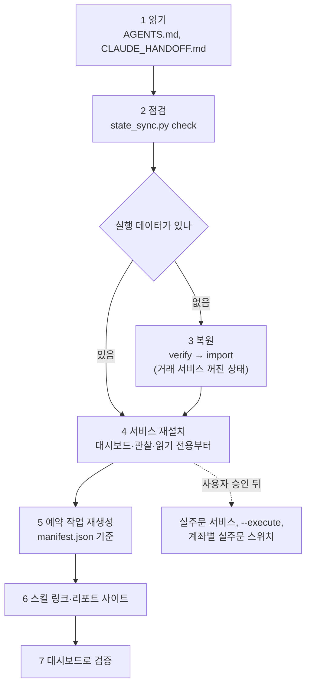

# 이식: 다른 계정·기기에서 이어서 진행하기

코드·문서·스킬·예약 작업 정의·설정 정리본은 git으로, 원장·이벤트·리포트는 백업 아카이브로 옮깁니다. 새 Claude 계정이나 새 세션은 먼저 `ops-bootstrap` 스킬과 이 문서를 따릅니다.

- [어디에 무엇이 있나](#어디에-무엇이-있나)
- [새 계정·새 기기 순서](#새-계정새-기기-순서)
- [백업 만들기](#백업-만들기)
- [복원](#복원)
- [예약 작업 옮기기](#예약-작업-옮기기)
- [스킬과 리포트 사이트 다시 잇기](#스킬과-리포트-사이트-다시-잇기)
- [대시보드 백업·이식 화면](#대시보드-백업이식-화면)

## 어디에 무엇이 있나

| 위치 | 내용 | git |
| --- | --- | --- |
| 저장소 | 코드, 공개 가이드 문서, `.claude/skills/`(프로젝트 스킬) | 예 |
| `AGENTS.md`, `docs/`의 설계·감사 기록 | 운영자 결정 원문과 내부 설계 문서(비공개) | 아니오(`.gitignore`). 백업 아카이브에도 들어가지 않으므로 새 컴퓨터에는 직접 옮깁니다 |
| `state/settings/` | 대시보드 설정 JSON의 정리본(계좌번호·해시·마스킹 번호 제거) | 예 |
| `ops/scheduled-tasks/` | Claude 예약 작업 정의(`<taskId>/SKILL.md`)와 일정 목록 `manifest.json` | 예 |
| `state/backups/` | 전체 백업 아카이브 `vibe-trading-state-<날짜>-<시각>.tar.gz`, 최근 14개 | 아니오 |
| `~/.vibe-trading` (`VIBE_TRADING_HOME`) | 실제 운영 데이터: 원장 SQLite, 이벤트 jsonl, 리포트, 설정 원본, HALT 스위치 | 아니오 |
| `.env` | 비밀값(NH·OpenAI·Jev·KRX·OpenDART·키움·토스·FRED·Discord 등) | 아니오, 백업에도 넣지 않음 |
| `~/.claude/scheduled-tasks/` | 예약 작업의 실제 위치(일정은 scheduled-tasks MCP에 저장) | `tasks-export`로 복사 |
| `.agents/`, `CLAUDE_HANDOFF.md` | 개인 작업 폴더(일부 스킬 원본)·개인 작업 기록 | 아니오 |

운영 데이터는 제자리(`~/.vibe-trading`)에 두고, 프로젝트 쪽으로 설정 정리본과 아카이브를 동기화합니다.

> [!CAUTION]
> 아카이브에는 계좌 해시와 원장이 들어 있습니다. git이나 공개 저장소에 올리지 않습니다. `.env` 값과 계좌번호는 어디에도 출력하지 않습니다.

## 새 계정·새 기기 순서



1. **준비**: 저장소 clone, `.venv` 준비 뒤 `.env.example`을 보고 `.env`를 직접 채웁니다(키를 대신 입력하지 않습니다).
2. **점검**: `PYTHONPATH=agent:scripts .venv/bin/python scripts/state_sync.py check` — `.env` 키 이름(값 없음), 실행 데이터 폴더, launchd 서비스(`loaded`/`plist`/`missing`), 빠진 예약 작업, 일정 없는 예약 작업, 마지막 백업 나이를 JSON으로 냅니다.
3. **복원**: 실행 데이터가 없거나 비었을 때만 [복원](#복원)합니다.
4. **서비스**: `scripts/launchd_services.py --out DIR`로 plist를 만들어 `~/Library/LaunchAgents`에 복사하고 `launchctl bootstrap`합니다. 대시보드·관찰·읽기 전용 서비스부터 올립니다([운영 가이드](operations.md#등록과-확인)).
5. **예약 작업**: [예약 작업 옮기기](#예약-작업-옮기기)
6. **스킬·리포트 사이트**: [다시 잇기](#스킬과-리포트-사이트-다시-잇기)
7. **검증**: 대시보드에서 종합 현황 탭과 운영 탭의 운영 상태·API 연동·백업·이식 화면을 봅니다. 테스트는 `PYTHONPATH=agent:scripts:streamlit_namuh .venv/bin/python -m pytest -q -p no:cacheprovider scripts/test_state_sync.py`

> [!IMPORTANT]
> 실주문과 관련된 서비스(`live-follow-*`, `longterm-live-*`, `--execute` 인자)와 계좌별 실주문 스위치는 사용자의 명시 승인 뒤에만 켭니다. 공유 모의 실행기 `shared-etf-paper`의 `--execute`도 계좌·보호 설정을 확인하고 승인받습니다.

전체 절차는 `.claude/skills/ops-bootstrap/SKILL.md`에 있습니다. 이 스킬은 주문·실주문 스위치를 건드리지 않고, 서비스가 도는 중에 복원하지 않으며, 커밋하지 않습니다.

## 백업 만들기

```bash
PYTHONPATH=agent:scripts .venv/bin/python scripts/state_sync.py export
```

- **설정 정리본** → `state/settings/`: `nhplug/` 아래의 `accounts.json`, `strategy-settings.json`, `tunables.json`, `dashboard-prefs.json`, `ai-modes.json`, `watchlist-manual.json`, `settings.json`, `longterm-watchlist.json`에서 계좌 해시·마스킹 번호·계좌번호 형식을 지운 사본(폴더 구조 유지)
- **전체 아카이브** → `state/backups/`: 실행 데이터의 `nhplug/`와 `live/`(활성화 기록과 모든 HALT 스위치)
  - SQLite는 backup API로 일관된 사본을 만듭니다(서비스가 열고 있어도 됨).
  - 넣지 않는 것: 토큰·비밀·인증 파일, `.env*`, `*.lock`, `*.plist`, `*.tmp`, `-wal`·`-shm`·`-journal`, 심볼릭 링크
  - 안에 `manifest.json`(파일 목록·크기·sha256·시각·git 커밋)이 들어 있습니다.
  - 최근 14개만 남깁니다.

평일 16:55 launchd `state-sync`가 자동으로 합니다. 이와 별도로 평일 15:50 `trading-backup`이 `~/.vibe-trading/backups/YYYY-MM-DD/`에 원장 사본을 14일 남깁니다.

## 복원

```bash
PYTHONPATH=agent:scripts .venv/bin/python scripts/state_sync.py verify <아카이브>
PYTHONPATH=agent:scripts .venv/bin/python scripts/state_sync.py import <아카이브>
```

- `verify`는 manifest와 파일 해시, 안전한 경로인지를 확인합니다.
- `import`는 거래 서비스(`com.vibetrading.*` 중 PID가 있는 것, 대시보드 제외)가 돌고 있으면 거부합니다.
- 덮어쓸 기존 파일은 지우지 않고 `~/.vibe-trading/restore-backup-<시각>/`로 옮깁니다. 복원하는 SQLite 옆의 오래된 `-wal`·`-shm`도 함께 옮깁니다(DB 손상 방지).
- `--force-offline`은 launchctl에 보이는 서비스가 이 체크아웃의 거래 서비스가 아님을 알 때(예: 새 기기)만 씁니다. 대시보드는 이 옵션을 제공하지 않습니다.

> [!NOTE]
> `state/settings/`는 계좌번호를 지운 참고용입니다. `accounts.json`의 계좌 해시는 백업 아카이브에서만 옵니다.

## 예약 작업 옮기기

- **내보내기**: `state_sync.py tasks-export`(평일 16:55 `state-sync`가 매일 함께 실행)가 Claude 앱의 예약 작업 저장소에서 작업마다 지시문·제목·cron·한 번 실행 시각(KST)·켜짐·권한 모드를 읽어 `ops/scheduled-tasks/`(`<taskId>/SKILL.md` + `manifest.json`)에 씁니다. 앱에서 지운 작업은 백업에서도 뺍니다. 다만 앱 저장소가 이 저장소의 작업을 하나라도 보여 줄 때만 정리하고, 새 Mac·새 계정에서 복원 전이거나 형식을 모르는 저장소면 백업을 그대로 둡니다(`ops/scheduled-tasks`는 git에 없어 지우면 되돌릴 수 없음). 비밀값처럼 보이는 문자열이 있으면 경고합니다.
- **새 계정에서 만들기**: manifest의 항목(`taskId`, `description`, `cron`/`schedule`)과 `<taskId>/SKILL.md` 본문으로 scheduled-tasks MCP의 `create_scheduled_task`를 호출합니다. 이미 있는 taskId는 먼저 목록으로 확인해 중복으로 만들지 않습니다. 한 번 실행하는 작업은 날짜가 지났으면 만들지 않고, 날짜가 고정된 cron(일·월 칸이 숫자)도 그 날짜가 지났으면 만들지 않습니다. 꺼진 작업은 만든 뒤 끄고, 권한 모드는 사용자에게 맞추게 알립니다. cron은 Mac 시간대로 돌므로 Asia/Seoul인지 먼저 확인합니다. 대시보드 운영 → 자동 작업이 이 manifest의 모든 작업을 날짜별 시각 순으로 보여 줍니다.
- `state_sync.py check`의 `tasks_without_schedule`·`tasks_not_in_manifest`가 manifest 빈틈을 알려 줍니다.

예약 작업 목록과 일정은 [자동 작업](automation.md#claude-예약-작업)에 있습니다. Codex 자동화를 쓰는 기기라면 같은 일을 하는 Claude 예약 작업과 둘 중 하나만 켭니다.

## 스킬과 리포트 사이트 다시 잇기

| 대상 | 새 기기에서 할 일 |
| --- | --- |
| `.claude/skills/*`(git에 있음) | 그대로 씁니다. `ls .claude/skills`로 `premarket-analysis`, `trading-journal-writer`, `longterm-strategy-writer`, `intraday-audit`, `ops-bootstrap` 등이 있는지 봅니다. |
| `.agents/skills/`를 가리키는 링크(`ui-ux-pro-max`, `danswer-market-trading`, 애니메이션·랜딩 스킬 등) | 링크 대상 폴더가 git에 없으므로 원본을 다시 설치하고 `ln -s`로 잇습니다. `premarket-analysis`·`intraday-audit`의 공통 원본도 `.agents/skills/`에 있습니다. |
| `developing-with-streamlit` | `.venv` 안 streamlit 패키지의 스킬로 다시 링크합니다. |
| `design-taste-frontend` | 용량 때문에 git 제외. `ops-bootstrap` 스킬에 적힌 대로 taste-skill v2.5.1을 다시 설치합니다(Node 22+·Chrome 필요). |
| 리포트 HTML 사이트 `~/.vibe-trading/report-pages/site` | 원본 리포트에서 다시 만들 수 있습니다(`report_pages.py --scan`). Pages 푸시(`REPORT_PAGES_PUSH=on`)는 사용자 승인 뒤([리포트 발행](report-pages.md)). |
| 예약 작업 권한 규칙 `.claude/settings.local.json` | git 제외. `Bash(scripts/ro *)`·`Edit(.scratch/**)`·`Edit(~/.vibe-trading/nhplug/shared-etf-paper/reviews/**)`·`Read(~/.vibe-trading/**)`를 다시 넣어야 예약 작업이 승인 대기로 멈추지 않습니다([자동 작업](automation.md#읽기-전용-실행기-scriptsro)). |

## 대시보드 백업·이식 화면

대시보드 **운영 → 백업·이식** 화면의 구성입니다.

| 구역 | 하는 일 |
| --- | --- |
| 마지막 백업 · 지금 백업 | 설정 정리본과 아카이브를 바로 만듭니다(수 분 걸릴 수 있음). |
| 백업 파일 | 보관 중인 아카이브 목록(크기·시각)과 내려받기 |
| 가져오기 | 아카이브 업로드 → 자동 검증 → 확인 문구 `백업 가져오기` 입력 → 가져오기. 거래 서비스가 돌고 있으면 버튼이 막힙니다. |
| 새 계정·새 기기 점검 | `state_sync.py check` 결과: 실행 데이터 폴더, `.env` 키 수(이름만), launchd 서비스 상태, 빠진 예약 작업, 마지막 백업 |
