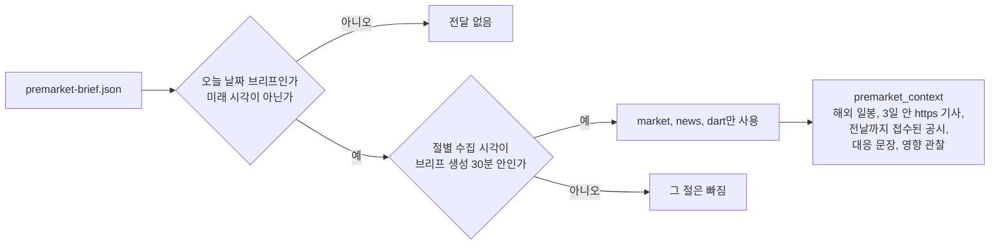

# 장전 분석

개장 전에 밤사이 시장·뉴스·공시·NXT 장전 호가를 읽기 전용으로 모아 장전 브리프를 만들고, 그중 시각이 확인된 일부를 Jev 판단 입력(`premarket_context`)으로 넘깁니다. 사람이 읽는 상세 분석 리포트는 브리프를 바탕으로 예약 작업이 따로 씁니다.

- [하루의 흐름](#하루의-흐름)
- [모으는 자료](#모으는-자료)
- [엔진에 넘기는 것](#엔진에-넘기는-것)
- [상세 분석 리포트](#상세-분석-리포트)
- [사전 점검과의 관계](#사전-점검과의-관계)
- [시각과 지연 주의](#시각과-지연-주의)
- [대시보드에서 보기](#대시보드에서-보기)
- [명령과 파일](#명령과-파일)

> [!IMPORTANT]
> 장전 자료는 참고 정보입니다. 주문 신호가 아니고, 승인된 진입·보호 조건이 그대로 적용됩니다. 뉴스 제목·공시 문장은 신뢰할 수 없는 외부 자료이며 지시로 따르지 않습니다.

## 하루의 흐름

```mermaid
gantt
  title 장전 일정 (평일, KST)
  dateFormat HH:mm
  axisFormat %H:%M
  section 수집
  장전 브리프 수집 (10분 간격) :a1, 07:40, 90m
  section 점검
  사전 점검 1차 :milestone, p1, 08:20, 0m
  점검 결과 보완 (예약 작업) :p2, 08:25, 5m
  사전 점검 2차 :milestone, p3, 08:53, 0m
  section 분석
  장전 상세 분석 작성 (예약 작업) :r1, 08:31, 14m
  section 개장
  주문 시작 · 이월 개장 판단 :o1, 09:00, 8m
```



| 시각 | 누가 | 무엇을 |
| --- | --- | --- |
| 07:40, 08:00~08:55 매 5분, 09:00, 09:10 | launchd `premarket` (`scripts/premarket.py --once`) | 장전 브리프를 새로 모아 `premarket-brief.json`에 덮어씁니다. 연구 DB에도 한 줄 남깁니다. |
| 08:20, 08:53 | launchd `preflight` | [사전 점검](#사전-점검과의-관계). 실패만 Discord로 보냅니다. |
| 08:25 | 예약 작업 `trading-preflight` | 점검 실패를 원인부터 고치고 다시 점검합니다. |
| 08:31 | 예약 작업 `premarket-analysis-daily` | 상세 분석 리포트를 쓰고 템플릿 검사를 통과시킵니다. |
| 09:00~09:07 | 실행기 | 주문 시작. 전날부터 든 포지션은 개장 판단(오늘 분봉 + 전날 마지막 분봉, NXT 프리마켓 요약 포함)을 받습니다. |
| 09:08~ | 실행기 | 장전 맥락은 그날 마지막 브리프 기준으로 계속 판단 입력에 들어갑니다. |

## 모으는 자료

브리프는 절(`sections`)마다 출처, 수집 시각(`observed_at`), 상태를 가집니다.

| 절 | 내용 | 출처 | 상태 예 |
| --- | --- | --- | --- |
| `market` | 국내 지수·일봉 국면·수급·테마, 해외 일봉(나스닥100·S&P500·필라델피아 반도체 등), 직전 세션 | 네이버 금융·Yahoo Finance | 국내 수급·테마는 전 거래일 값일 수 있음 |
| `futures` | 해외 지수 선물 | Yahoo Finance | 늘 `unknown`(거래 시각·지연 미확인) |
| `night_futures` | 코스피200 야간선물 | TradingView | `ok` = 진행 중 세션(약 20분 지연), `closed` = 끝난 세션의 마감값 |
| `news` | '미국 증시 나스닥'·'한국 증시 코스피'·'금리 환율 유가 반도체' 3일 안 기사 24개까지(연합뉴스 제외) | Google News RSS | 일부 주제 실패면 `partial`, `failed_topics`에 표시 |
| `nxt_quotes` | 관심 종목 NXT 장전 호가(08:00~08:50만) | NH NXT 조회 | `unknown`(호가 날짜·진행 여부 미검증) |
| `nxt_premarket` | 보유·관심 개별주(ETF 제외)의 오늘 NXT 프리마켓(08:01~08:50) 실제 체결 요약: 첫·마지막·고가·저가, KRX 전일 종가 대비 %, 첫 체결 대비 %, 거래량·거래대금, 마지막 체결 분. 아직 끝나지 않은 1분봉은 뺌 | 토스증권 1분봉(KRX+NXT 통합), 실패하면 네이버 NXT 시세 | 08:00~08:59 수집, 그 뒤에는 마지막 관측 유지 |
| `nxt_gap` | KRX 전일 종가 대비 NXT 가격 괴리율 상위·하위 | 키움 ka11370 | 08:50 뒤에는 그날 마지막 장전 관찰을 유지 |
| `krx` | 전 거래일 종목·지수 통계 | KRX Open API | `empty` = 기준일 통계 미공개(보통 08시 이후 공개, 실패 아님) |
| `dart` | 관심 종목 공시 목록 | Open DART | 접수일만 있고 접수 시각은 없음 |
| `listings` | 오늘 이후 상장 예정 보통주 | 토스증권 Open API | 거래소 확정값 아님, 엔진에 보내지 않음 |

관심 종목(`premarket.watch`)은 공유 모의계좌 보유 종목 → Jev가 매매하는 ETF 7종 → 수동 추가·스캐너 선정·대형주 순서로 정합니다(합쳐 8개까지).

브리프에는 이 밖에 `summary`(국면·뉴스·공시 건수·미국 마감·상장 예정·주요 뉴스 한 줄)와 `strategy`(상승·하락·혼조 출발별 기본 대응 문장), `report_template`(상세 분석 틀의 절별 자료 상태)이 들어갑니다.

## 엔진에 넘기는 것

> [!NOTE]
> `nxt_premarket`(2026-11-19 추가)은 `engine_brief()["nxt_premarket"]`로 Jev 진입·보유 판단과 이월 포지션의 개장 판단에도 들어갑니다. 원본 봉이 아닌 요약값만 보내며 참고 자료이고 매매 규칙은 그대로입니다. 프리마켓에서 실제로 매매하지는 않습니다(NH 모의투자는 NXT 주문 거부, 가드는 KRX 주문만 받음).

`premarket.engine_brief()`가 브리프에서 일부만 골라 Jev 진입·보유 판단 입력의 `premarket_context`로 넘깁니다(`scripts/nh_paper_isolated.py`의 `premarket_view`). 장기 엔진의 테마 스토리 점검(`vibe_longterm.story_context`)과 장기투자 전략 리포트 자료에도 같은 결과가 참고로 들어갑니다.



- **넘기는 것**: 해외 일봉(직전 10일 안), 3일 안 `https` 링크 기사, 오늘 전에 접수된 공시, 대응 문장(`strategy`), 시장·섹터 영향 관찰(`impact_context`), 출처별 상태
- **넘기지 않는 것**: 선물·야간선물·NXT 호가·NXT 괴리율·KRX 통계·상장 예정, 그리고 상세 분석 리포트 본문
- 결과에는 `historical: true`와 "현재 시세·주문 신호가 아님" 메모가 붙습니다.

> [!NOTE]
> 두 가지 시간 조건을 섞지 마세요.
> - **절별 30분 조건**: 각 절의 수집 시각이 브리프 생성 시각보다 30분 넘게 앞서면 그 절은 빠집니다.
> - **브리프 전체 유효성**: 브리프는 오늘 날짜이고 미래 시각이 아니면 그날 내내 씁니다. 수집이 09:10에 끝나므로 장중에는 09:10 브리프가 들어갑니다. `--status`의 `stale`(지금 기준 30분 넘음)은 작성 작업이 새로 모을지 정하는 표시일 뿐 전달 조건이 아닙니다.

실제로 모델 입력에 들어갔는지는 `market-research.sqlite3`의 `model_inputs` 기록으로 확인합니다(대시보드 '장전 자료 수집·엔진 전달 범위'). 들어간 사실과 모델이 그것을 반영한 효과는 다른 문제입니다.

## 상세 분석 리포트

평일 08:31 예약 작업 `premarket-analysis-daily`가 스킬 `premarket-analysis`의 절차로 `~/.vibe-trading/nhplug/shared-etf-paper/reviews/premarket-YYYY-MM-DD.md`를 씁니다. 절차 원본은 `.agents/skills/premarket-analysis/SKILL.md`(Claude 진입점 `.claude/skills/premarket-analysis/SKILL.md`가 이것을 따름)입니다.

1. `scripts/ro premarket.py --status` — 휴장이면 쓰지 않습니다. 브리프가 없거나 30분 넘었고 수집 시간 안이면 `--once`로 한 번 모읍니다.
2. `scripts/ro --out .scratch/premarket-draft.md premarket.py --report` — 표·링크가 채워진 틀을 받습니다.
3. 브리프 원자료와 웹 검색으로 교차 확인합니다. 4·5절은 『실전 시황 트레이딩』 스킬(`danswer-market-trading`)의 판단표로 점검합니다.
4. `_작성 전 — …_` 자리표시와 맨 위 `> ` 한 줄 요약을 채웁니다.
5. `scripts/ro premarket_template.py --check .scratch/premarket-draft.md` — "템플릿과 일치합니다."가 나올 때까지 고칩니다.
6. 리포트 파일로 저장합니다. 같은 날 파일을 덮을 때는 이전 판을 `premarket-YYYY-MM-DD.prev-HHMM.md`로 남깁니다.

### 템플릿

절 구성의 원본은 `scripts/premarket_template.py`의 `SECTIONS`입니다. 자동 틀, 브리프의 `report_template`, 검사기, 대시보드 경고가 모두 이것을 씁니다.

| 절 | 담는 것 | 쓰는 자료 |
| --- | --- | --- |
| 제목·요약·작성 줄 | `# 장전 분석 · YYYY-MM-DD (요일)`, `> ` 한 줄 요약, `작성: MM/DD HH:MM KST (개장 전 \| 개장 후 사후 작성)` | — |
| 1. 수집 상태 | 거래일, 작성·수집 시각, 자료별 상태, 직전 세션 | 전체 |
| 2. 밤사이 시장 | 미국 종가, 선물·야간선물의 기준 시각과 지연, 환율·원자재, 국내 전 거래일 | market, futures, night_futures |
| 3. 핵심 이슈 | 규칙 기반 별점(`premarket.rank_news`)과 이유, 기사 제목·매체·발행 시각·링크 | news |
| 4. 시장·섹터·종목 영향 | 근거, 가능한 영향과 반대 시나리오, 개장 후 확인할 가격·수급 | market, news, dart, krx, nxt_quotes |
| 5. 오늘의 대응과 전략 | 상승·하락·혼조/자료 부족별 대응, 기존 승인 규칙과 실제 설정 | market, news, night_futures |
| 6. 출처와 한계 | 링크, 시각과 지연, 빠진 자료 | 전체 |

검사기는 제목 날짜, 요약 줄, 작성 줄(09:00 이후면 '사후 작성' 필수), 절 순서, 6절의 링크, 남은 자리표시를 봅니다.

> [!WARNING]
> 상세 분석 리포트는 사람이 읽는 글입니다. 엔진 입력에는 들어가지 않습니다. 엔진은 위 `premarket_context`만 받습니다.

리포트는 HTML 페이지로도 만들어져 Discord 실시간 채널에 링크로 발송됩니다. [리포트 발행](report-pages.md)을 보세요.

## 사전 점검과의 관계

`scripts/preflight.py`(launchd `preflight`, 평일 08:20·08:53)는 장전 브리프와 상세 분석도 점검합니다.

| 점검 | 통과 조건 | 언제부터 |
| --- | --- | --- |
| 장전 자료 수집 | 브리프가 30분 안에 수집됐고 `unavailable`·`error`인 절이 없음. 09:00 뒤에는 야간선물·NXT 장전 호가를 빼고 봅니다. | 08:20 |
| 장전 상세 분석 작성 | `reviews/premarket-DAY.md`가 있고 템플릿 검사를 통과 | 08:52 |

실패하면 Discord 실시간 채널에 실패 항목만 보내고, 08:25 예약 작업이 원인을 찾아 고친 뒤 다시 점검합니다. 점검 전체는 [자동 작업](automation.md#장전-사전-점검)에 있습니다.

## 시각과 지연 주의

- **모든 시각은 KST**입니다. 발행·거래·수집 시각을 구별합니다.
- **해외 선물**(`futures`)은 거래 시각과 지연을 확인하지 못해 방향 판단에 쓰지 않습니다.
- **야간선물** `closed`는 끝난 야간 세션의 지연 마감값입니다. "야간선물 마감 −1.76%(06:20 KST 마지막 체결, 지연)"처럼 쓰고 현재가라고 하지 않습니다.
- **NXT 장전 호가**는 호가 날짜·진행 여부를 검증하지 않은 참고값입니다. 08:00~08:50에만 모읍니다.
- **공시**는 접수일만 있어 장후·장전 공시라고 단정하지 않습니다.
- **나스닥**: 브리프 표는 나스닥100(`^NDX`) 기준입니다. 기사가 나스닥 종합 수치를 쓰면 이름을 붙여 따로 적습니다.

## 대시보드에서 보기

**시장 상황** 탭 아래쪽 '오늘의 장전 분석'에 있습니다.

- 장전 기록 시각, '장전 자료 수집·엔진 전달 범위'(절별 상태와 실제 기록된 모델 입력)
- '오늘의 장전 상세 분석'(템플릿과 다르면 경고)
- 장전 시황 요약, 영향 카드, 오늘의 트레이딩 전략, 오늘 주목할 뉴스(별점)
- 자료 상태와 '장전 근거 자료' 선택(뉴스·공시·선물·야간선물·NXT 호가·KRX 통계·괴리율·상장 예정)

이전 날짜의 브리프는 오늘 자료로 보여 주지 않습니다.

## 명령과 파일

```bash
scripts/ro premarket.py --status     # 오늘 브리프의 시각·나이·절별 상태, 상세 분석 작성·검사 여부
scripts/ro premarket.py --once       # 지금 한 번 수집(읽기 전용 출처)
scripts/ro premarket.py --report     # 오늘 상세 분석 틀(Markdown)
scripts/ro premarket_template.py --check ~/.vibe-trading/nhplug/shared-etf-paper/reviews/premarket-2026-11-19.md
```

| 경로 (`~/.vibe-trading/nhplug/shared-etf-paper/` 아래) | 내용 |
| --- | --- |
| `premarket-brief.json` | 오늘 장전 브리프(매 수집마다 덮어씀) |
| `reviews/premarket-YYYY-MM-DD.md` | 상세 분석 리포트 |
| `market-research.sqlite3` | 수집 이력(`premarket`)과 엔진 입력 기록(`model_inputs`) |
| `../preflight/YYYY-MM-DD.jsonl` | 사전 점검 기록 |

사용하는 키는 `.env`의 `KRX_API_KEY`, `OPENDART_API_KEY`와 키움·토스 키입니다(없으면 그 절만 `unavailable`). 설계 배경은 `docs/premarket-research-design.md`, 변경 기록은 `docs/premarket-strategy-change-history.md`에 있습니다(비공개 설계 기록이라 공개 저장소에는 없습니다).
