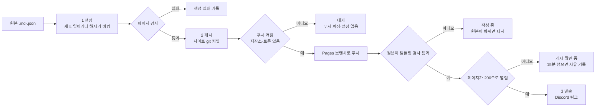

# 리포트 발행 (GitHub Pages + Discord 링크)

매매일지·장전 분석·장 마감 개선안·장기투자 리포트 같은 글은 같은 틀의 HTML 페이지로 만들어 GitHub Pages에 올리고, Discord에는 제목·요약·링크만 보냅니다. 체결·마감 요약 같은 짧은 알림은 [알림](notifications.md)에서 다룹니다.

- [지금 상태](#지금-상태)
- [대상과 일정](#대상과-일정)
- [처리 흐름](#처리-흐름)
- [상태 값](#상태-값)
- [재시도와 실패](#재시도와-실패)
- [가리기와 페이지 검사](#가리기와-페이지-검사)
- [디자인](#디자인)
- [대시보드 화면](#대시보드-화면)
- [배포를 켤 때](#배포를-켤-때)
- [명령](#명령)

## 지금 상태

> [!IMPORTANT]
> **배포는 아직 꺼져 있습니다.** HTML은 로컬(`~/.vibe-trading/report-pages/site`)에서 늘 만들어지지만 GitHub에 올리지 않고, 리포트는 Discord로 보내지 않고 '대기'로 쌓입니다. 리포트 본문을 텍스트로 대신 보내지 않습니다(사용자 결정 2026-11-18).

| 항목 | 지금 | 비고 |
| --- | --- | --- |
| Pages 저장소 | `roadkwonai/omni-ai-trading` (사용자 결정 2026-11-19) | 비공개·빈 저장소로 만들어 둠. 무료 계정이라 Pages를 켜려면 공개로 바꿔야 함 |
| Pages 주소 | `https://roadkwonai.github.io/omni-ai-trading/` | 공개 전환·Pages 켜기 뒤 |
| `.env` `REPORT_PAGES_REPO` | 이 저장소로 바꿀 예정 | 예전 값 `freelife1191/omni-ai-trading`은 만들어진 적 없음 |
| `.env` `REPORT_PAGES_PUSH` | `off` | `on`일 때만 푸시 |
| 사이트 구조 | **예정**: 루트 `/` = 랜딩페이지, 리포트 목록 = `/reports/` | 아래 참고 |

> [!NOTE]
> **예정된 사이트 구조** (사용자 결정 2026-11-19)
> - Pages 루트(`/`)는 Omni AI Trading 랜딩페이지가 됩니다. 랜딩은 별도 작업으로 만듭니다.
> - 리포트 목록 페이지는 루트에서 `/reports/`로 옮깁니다. 개별 리포트 주소 `reports/<종류>/<키>.html`은 그대로입니다.
> - 목록 위치를 옮기는 코드 변경은 다른 작업에서 진행 중이며, 실행 중인 `discord-notify`가 다음에 시작할 때부터 적용됩니다.
> - 공개 전환, 첫 푸시, Pages 켜기는 사용자가 확인한 뒤에 합니다.

## 대상과 일정

`scripts/report_pages.py`의 `REPORTS`가 정합니다.

| 리포트 | 종류 키 | 채널 | 원본 (`~/.vibe-trading/` 아래) | 만드는 작업 |
| --- | --- | --- | --- | --- |
| 장전 상세 분석 | `premarket` | 실시간 | `nhplug/shared-etf-paper/reviews/premarket-YYYY-MM-DD.md` | 평일 08:31 `premarket-analysis-daily` |
| 장기투자 전략 리포트 | `longterm-strategy` | 장기투자 | `nhplug/vibe-longterm/reports/strategy-<키>.md`(+`.json`) | 평일 08:50 · 금 16:50 · 매월 1일 17:20 |
| 장 마감 개선안 | `improvement` | 실시간 | `reviews/improvement-YYYY-MM-DD.md` | 평일 16:15 `trading-daily-improvement` |
| 매매일지 | `journal` | 실시간 | `reviews/journal-YYYY-MM-DD.md`(+`.json`) | 평일 16:40 `trading-journal` |
| 낙폭과대 주간 감사 | `oversold-weekly` | 실시간 | `reviews/oversold-weekly-YYYY-MM-DD.md` | 금 16:45 `oversold-weekly-audit` |
| 기간 매매일지 | `journal-period` | 실시간 | `reviews/journal-YYYY-MM`·`-Qn`·`-Hn`·`YYYY`.md | 매월 1일 17:10 `trading-journal-period` |
| 장기투자 복기·감사 | `longterm-audit` | 장기투자 | `nhplug/vibe-longterm/reviews/audit-<날짜·YYYY-Www·YYYY-MM>.md` | 평일 16:45 · 금 17:40 · 매월 1일 17:45 |

`reviews/`는 `nhplug/shared-etf-paper/reviews/`입니다.

> [!NOTE]
> 코드의 장전 분석 일정 표기는 아직 '평일 08:42 Codex 자동화'로 남아 있습니다. 지금 리포트를 쓰는 것은 08:31 Claude 예약 작업입니다([자동 작업](automation.md#codex-자동화와의-중복)).

HTML로 만들지 않는 것:

| 대상 | 처리 | 이유 |
| --- | --- | --- |
| 체결·주문 계획·장기 NAV·15:40 마감 요약 | `discord_notify`가 텍스트로 바로 발송 | 짧은 매매 알림이라 본문이 빠름 |
| 장중 매매·차단 감사 기록 | 파일만(`reviews/operations-audit-*.md`) | 매시 갱신되는 내부 점검 기록 |
| 장중 진행 보고 · 장 마감 후 보고 | 예약 작업 대화 보고 | 파일로 남지 않음 |

## 처리 흐름

알림 서비스 `discord-notify`가 30초마다 `report_pages.cycle`을 부릅니다. 바뀐 것이 없으면 아무것도 쓰지 않습니다.



1. **생성**: 원본이 새로 생기거나 해시가 바뀌면 `~/.vibe-trading/report-pages/site/reports/<종류>/<키>.html`을 만듭니다. 목록 페이지와 `reports.json`도 갱신합니다(검색어·종류·연·월·날짜로 찾음).
2. **게시**: 사이트 폴더 git에 커밋하고, 푸시가 켜져 있고 저장소·토큰이 있으면 Pages 브랜치(기본 `gh-pages`)로 푸시합니다. 첫 푸시 때 저장소가 없으면 공개 저장소로 만들고 Pages를 켭니다(`ensure_repository`·`ensure_pages`).
3. **발송**: 원본이 템플릿 검사(매매일지 `journal_template`, 장전 분석 `premarket_template` 등)를 통과하고 페이지가 200으로 열릴 때만 링크를 보냅니다.
4. **기록**: `~/.vibe-trading/nhplug/report-pages.sqlite3`
   - `reports`: 리포트별 현재 상태(생성·게시·발송)와 실패 사유
   - `events`: 생성·게시·발송·테스트 이력

토큰은 `GIT_CONFIG_*` 환경변수로만 git에 넘깁니다. 명령줄·기록에는 남지 않습니다. 발송 메시지는 아이콘·리포트 이름·기간, 제목, 요약(280자까지), 링크 네 줄입니다.

## 상태 값

| 값 | 화면 표기 | 뜻 |
| --- | --- | --- |
| `pending` | 대기 | 다음 회차에 처리 |
| `off` | 푸시 꺼짐 | `REPORT_PAGES_PUSH`가 `on`이 아니라 로컬 커밋까지만 |
| `not_configured` | 설정 없음 | 저장소나 토큰이 없음 |
| `backoff` | 잠시 뒤 재시도 | 게시 실패 뒤 10분 대기 중 |
| `draft` | 작성 중 | 원본이 템플릿 검사 전이거나 실패 |
| `waiting_live` | 게시 확인 중 | 푸시했지만 페이지가 아직 열리지 않음 |
| `ok` / `sent` | 완료 / 발송됨 | |
| `failed` | 실패 | 사유는 화면과 `events`에 |
| `skipped`, `sent_text` | 건너뜀, 텍스트로 발송됨 | 도입 시점 기록(아래) |

도입 시점에 이미 텍스트로 보낸 리포트는 `sent_text`, 한 번도 보내지 않은 2026-11 기간 일지는 `skipped`로 표시했습니다.

## 재시도와 실패

| 단계 | 동작 |
| --- | --- |
| 생성 | 원본이 바뀌거나 강제로 다시 만들 때만 다시 시도합니다(30초마다 반복하지 않음). 링크 주소가 바뀌면 다시 만듭니다. |
| 게시 | 실패하면 10분 간격으로 다시 시도합니다. 푸시가 꺼진 동안 대기 중인 페이지는 git을 건드리지 않습니다. |
| 발송: 연결 실패·429 | 10분 뒤 자동으로 다시 보냅니다(최대 5회). |
| 발송: 웹훅 없음 | 웹훅이 생기면 다시 보냅니다. |
| 발송: 4xx 거절 | 웹훅을 고친 뒤 화면에서 수동으로 다시 보냅니다. |
| 발송: 페이지가 15분 넘게 안 열림 | 사유를 남기고 계속 기다립니다. 열리면 링크를 보냅니다. |
| 수동 재발송 실패 | 이미 보낸 리포트는 '발송됨'을 유지합니다. |

보낼 때마다 바로 기록을 확정해 같은 메시지를 두 번 보내지 않습니다. Discord 멘션(@everyone 등)은 막습니다. 리포트 처리에서 오류가 나도 체결 알림은 계속 나갑니다.

## 가리기와 페이지 검사

제목·목차·본문과 JSON 필드(핵심 이슈·시나리오·지켜볼 것)에서 다음 값을 `••••`로 가립니다.

- 10자리 이상 숫자(한글이 바로 붙어 있어도)
- 하이픈이 든 계좌번호 형식(숫자 10자리 이상)
- 16자 이상 16진수 해시

생성한 페이지는 검사(`check`)를 통과해야 합니다: `lang`·viewport·description·`noindex`·`<h1>` 하나·본문 랜드마크·건너뛰기 링크가 있고, 인라인 스크립트·토큰·웹훅 주소가 없어야 합니다. JSON 값이나 표 칸에 잘못된 값이 있어도 페이지 전체가 실패하지 않습니다.

> [!CAUTION]
> Pages 주소는 공개입니다. 검색 노출은 막지만(`noindex`, `robots.txt`) 링크를 아는 사람은 볼 수 있습니다.

## 디자인

- 틀: `scripts/report_templates/`의 `_base`·`report`·`journal`·`longterm-strategy`·`index` 템플릿, `report.css`, `index.js`, `theme.js`, 로고·마스코트·파비콘
- 색: 루트 `DESIGN.md`의 역할 토큰. 다크 모드에서는 팔레트를 뒤집습니다. 이익·상승은 빨강, 손실·하락은 파랑이며 표 셀의 부호 숫자에 자동으로 색을 입힙니다.
- 레이아웃: 넓은 화면 1240px, 1024px 이상에서는 목차를 옆에 붙입니다. 테마 버튼(시스템 → 라이트 → 다크)
- 글꼴: Pretendard 공식 동적 서브셋(jsDelivr). 쓸 수 없으면 시스템 글꼴로 대체합니다(자체 호스팅 사본은 성능 점검 뒤 뺌).
- 글 문법: 콜아웃 `> [!SUMMARY]` 등, `==형광펜==`, 자동 등락 막대, `chart` 코드 블록, `archify-<종류>` 흐름도. 규칙은 `.claude/skills/report-html-publisher/references/report-syntax.md`, 검수 기준은 `references/design.md`
- 데이터 리포트에 맞는 규칙만 taste-skill에서 가져왔습니다(한 체계, 평이한 문구, 가장자리 정렬, 접근성, 조용한 움직임). 회사 사이트용 장치(히어로 사진, 셰이더)는 뺐습니다.

## 대시보드 화면

**API 연동 → 리포트 발행**

- 요약 카드
- 리포트 목록: 검색, 종류, 연·월·날짜, 열기 링크
- 행을 고르면: 세 단계 상태와 실패 사유, 다시 생성·게시·발송, HTML 미리보기
- 발송·작업 이력: 발송만 / 실패만 / 전체
- 발행 대상·일정

> [!NOTE]
> '다시 발송'은 Pages가 꺼져 있으면 보내지 않고 "Pages 배포 전이라 보내지 않음"을 돌려줍니다. 버튼 도움말의 '꺼져 있으면 본문을 보냄' 문구는 옛 표기입니다.

API 연동 목록에는 Discord 웹훅과 GitHub Pages 리포트 항목이 있습니다.

## 배포를 켤 때

사용자 확인이 필요한 단계입니다.

1. `roadkwonai/omni-ai-trading`을 공개로 바꿉니다(무료 계정에서 Pages를 쓰려면 필요).
2. `.env`를 고칩니다.
   - `REPORT_PAGES_REPO=roadkwonai/omni-ai-trading`
   - `REPORT_PAGES_URL`은 비워 두면 `https://roadkwonai.github.io/omni-ai-trading/`을 씁니다(사용자 도메인이면 적음).
   - `REPORT_PAGES_BRANCH`는 기본 `gh-pages`
3. 푸시 토큰을 확인합니다. `.env`의 `GH_TOKEN`(없으면 저장소 상위 폴더 `.envrc`의 `GH_TOKEN` 또는 `GITHUB_TOKEN`)에 그 저장소 Contents 쓰기 권한이 있어야 하고, Pages를 코드로 켜려면 Pages 권한도 필요합니다. 권한이 없으면 게시 실패 사유에 HTTP 코드가 남습니다.
4. `.env`의 `REPORT_PAGES_PUSH=off`를 `on`으로 바꿉니다.
5. 알림 서비스를 다시 시작합니다.

   ```bash
   launchctl kickstart -k gui/$(id -u)/com.vibetrading.discord-notify
   ```

   다음 회차에 쌓인 페이지를 푸시하고, 페이지가 열린 리포트부터 링크를 보냅니다. 대기 중이던 리포트는 자동으로 나갑니다. 오래된 리포트를 따로 보내려면 화면에서 '다시 발송'을 씁니다.

## 명령

```bash
PYTHONPATH=agent:scripts .venv/bin/python scripts/report_pages.py --list                 # 기록
PYTHONPATH=agent:scripts .venv/bin/python scripts/report_pages.py --scan                 # 새·바뀐 리포트 생성
PYTHONPATH=agent:scripts .venv/bin/python scripts/report_pages.py --build journal 2026-11-19 [--force]
PYTHONPATH=agent:scripts .venv/bin/python scripts/report_pages.py --publish              # 사이트 푸시
PYTHONPATH=agent:scripts .venv/bin/python scripts/report_pages.py --send journal:2026-11-19 [--no-live-check]
PYTHONPATH=agent:scripts .venv/bin/python scripts/report_pages.py --cycle                # 생성·게시·발송 한 번
PYTHONPATH=agent:scripts .venv/bin/python scripts/report_pages.py --check FILE           # 만든 페이지 검사
PYTHONPATH=agent:scripts .venv/bin/python scripts/report_pages.py --test-send            # 채널마다 최신 리포트로 테스트 발송
PYTHONPATH=agent:scripts .venv/bin/python scripts/report_pages.py --preview longterm-strategy sample.md [--out DIR]
```

> [!WARNING]
> `--preview`는 기록·게시·발송 없이 그 폴더에만 그립니다. 샘플을 실제 원본 폴더에 두면 진짜 리포트로 발송되므로 샘플은 임시 폴더에 둡니다.

<details>
<summary>변경 이력</summary>

| 날짜 | 변경 |
| --- | --- |
| 2026-11-17 | HTML 발행 준비(생성·게시·발송 파이프라인, 대시보드 화면). 배포는 끔 |
| 2026-11-17 | 디자인 개선: 넓은 화면, 테마 버튼, 콜아웃·형광펜·자동 막대·chart·archify |
| 2026-11-18 | 리포트 본문 텍스트 발송 제거. Pages 배포 전에는 대기 |
| 2026-11-18 | 장기투자 복기·감사(`longterm-audit`) 추가 |
| 2026-11-19 | Pages 저장소를 `roadkwonai/omni-ai-trading`으로 결정, 루트 랜딩·`/reports/` 목록 예정 |

랜딩페이지 기획은 `docs/omni-landing-plan.md`에 있습니다. (비공개 설계 기록이라 공개 저장소에는 없습니다)

</details>
