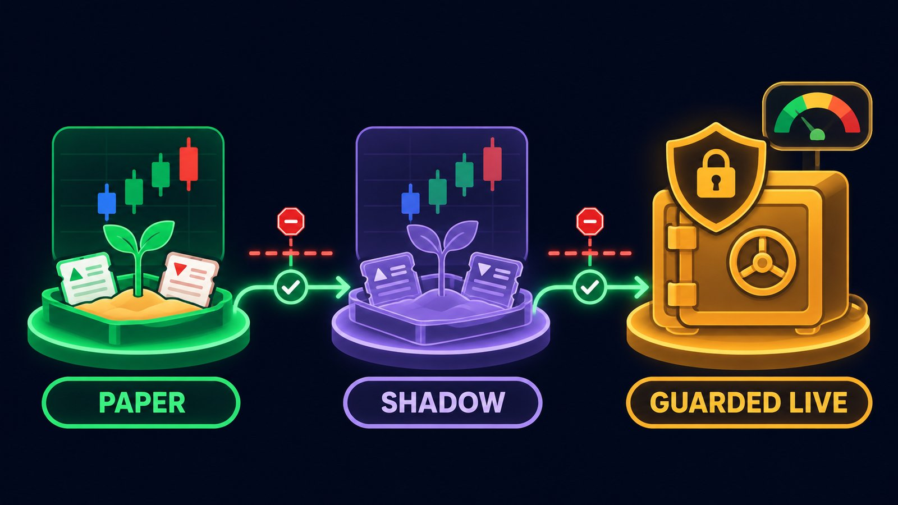
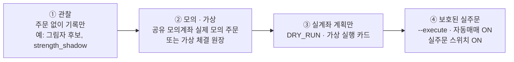
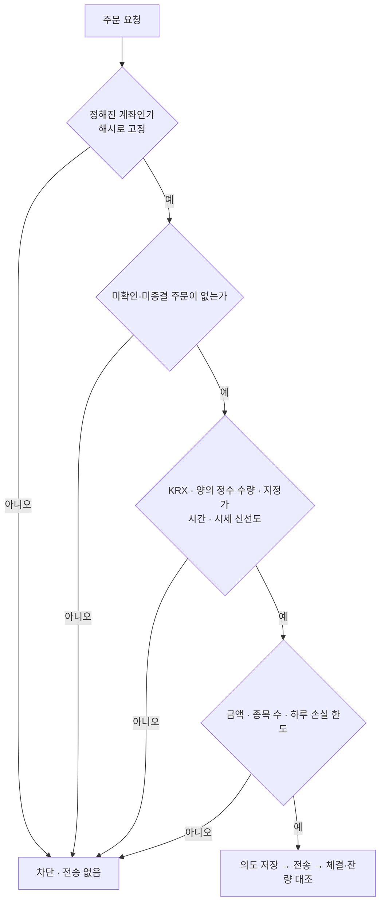

# 안전 장치

주문이 어떤 장치를 거쳐 나가는지, 무엇이 막는지 정리합니다. 이 프로젝트는 **모의계좌가 기본**이고, 실계좌는 단계를 밟아 계좌마다 따로 엽니다. 실계좌 운용 방식은 [실계좌 운용](live-accounts.md)에 있습니다.

## 목차

- [단계: 관찰 → 가상 → 보호 실주문](#단계-관찰--가상--보호-실주문)
- [주문 가드](#주문-가드)
- [모의계좌 한도](#모의계좌-한도)
- [실계좌 한도](#실계좌-한도)
- [미확인 주문과 원장 대조](#미확인-주문과-원장-대조)
- [멈추는 방법: STOP · HALT · 매수 중단](#멈추는-방법-stop--halt--매수-중단)
- [지켜야 할 원칙](#지켜야-할-원칙)

## 단계: 관찰 → 가상 → 보호 실주문

새 전략이나 새 경로는 주문 없는 관찰에서 시작해 한 단계씩 넘어갑니다. 다음 단계로 가는 것은 늘 사용자 승인이며, 자동으로 넘어가지 않습니다.

| 단계 | 주문 | 예 |
| --- | --- | --- |
| 관찰 | 없음, 기록만 | 그림자 후보(`issue_candidates`), 관심종목 강도 그림자(`strength_shadow`), 낙폭과대 사후 결과 |
| 모의·가상 | 모의 서버에 실제 모의 주문, 또는 실시간 호가로 가상 체결 | 공유 모의계좌 실행기(`shared-etf-paper`), 장기투자 가상 계좌, NXT 가상 실행 |
| 실계좌 계획만 | 없음. 실계좌 한도로 무엇을 낼지 계산해 기록 | 실주문 스위치가 꺼진 미러, `--execute` 없는 장기투자 실행기, 대시보드 가상 실행 카드 |
| 보호된 실주문 | 실계좌 지정가 주문 | `--execute` + 계좌 자동매매 ON + 실주문 스위치 ON + HALT 꺼짐 |

모의 성과와 가상 체결은 실제 체결이나 수익성 검증이 아닙니다. 가상 체결은 호가에 바로 전량 체결된다고 가정하고 대기열·부분 체결을 넣지 않습니다.

## 주문 가드

모든 주문은 가드를 거칩니다. 가드는 **주문 의도를 먼저 저장하고** 통과한 주문만 보냅니다. 프로세스가 전송 중에 죽어도 의도가 남아 다음 시작 때 대조합니다.

| 경로 | 가드 | 파일 |
| --- | --- | --- |
| 공유 모의계좌 | `NHOrderGuard` | `agent/src/tools/nhplug_order_guard.py`, 손실 정지 `agent/src/tools/nhplug_loss.py` |
| 실계좌 | `LiveOrderGuard` (`scripts/nh_guarded_live.py`로만 호출) | `agent/src/tools/nhplug_live_guard.py` |

- 같은 내용의 주문을 다시 보내려 하면 거부합니다(`Duplicate NH order intent; do not resubmit`). 실계좌는 같은 날 같은 종목·수량·가격 주문이라도 앞 주문이 체결 완료나 취소 완료로 끝났으면 새 주문으로 받고, 미해결이면 그대로 막습니다.
- 모의 매수는 지정가만, 평일 09:00~15:00에만 받습니다. 실계좌는 매수 09:00~15:00, 매도 09:00~15:18이고 직접 조회한 정규장 호가가 120초 안이어야 합니다.
- 주문은 개장(09:00)부터입니다(2026-11-19 사용자 결정, 예전에는 09:00~09:09 관찰).

## 모의계좌 한도

공유 모의계좌의 주문 보호 한도는 대시보드 **계좌·자동매매 → 모의계좌 → 금액·주문 보호 한도**에서 바꾸고 `accounts.json`의 `paper-shared.limits`·`budget`에 저장됩니다. 주문 가드·손실 정지·실행기 주문 크기가 같은 값을 매 주문 다시 읽습니다. 범위 밖이거나 잘못된 값은 기본값으로 돌아갑니다(`scripts/accounts.py` `PAPER_LIMITS`). 지금 값은 대시보드나 설정 파일로 확인하세요.

| 항목 | 키 | 기본값 | 허용 범위 |
| --- | --- | --- | --- |
| 회당 매수 | `limits.order_max_krw` | 300만 원 | 10만 원~1억 원 |
| 하루 매수 | `limits.daily_buy_krw` | 600만 원 | 100만 원~10억 원 |
| 보유 금액 (보유 매입금액 + 미체결 매수 + 새 매수) | `limits.held_max_krw` | 2,100만 원 | 100만 원~50억 원 |
| 하루 새 종목 (그날 이미 산 종목 재매수는 세지 않음) | `limits.daily_new_symbols` | 5개 | 1~50개 |
| 하루 손실 | `limits.daily_loss_krw` | 30만 원 | 1만 원~1억 원 |
| 분할 1회 매수 금액 | `budget.first_buy_krw` | 100만 원 | 10만 원~1억 원, 회당 매수 이하 |
| 종목당 최대 | `budget.per_symbol_krw` | 300만 원 | 10만 원~50억 원, 보유 금액 이하 |

실행기 쪽 수량 상한은 **운영 상태 → 운영 조정값**에 있습니다: 1회 주문 최대 100주(`paper_max_order_qty`), 총 보유 최대 1,000주(`paper_max_total_qty`), 0이면 제한 없음(금액 한도는 유지). 하루 주문 998건(증권사 모의계좌 제한)에 닿으면 새로 사지 않습니다. 종목당 추가 매수 횟수(`scale_max_adds`) 같은 전략 제한은 [매매 전략 → 제한 규칙](strategy.md#제한-규칙)에 있습니다.

하루 손실 정지는 보수적 추정치입니다. 이전 날 평가손이 섞이거나 비용이 두 번 셀 수 있습니다.

## 실계좌 한도

실계좌는 계좌마다 대시보드에서 값을 정하되, 코드의 승인 상한보다 넓힐 수 없습니다.

| 항목 | 상한·규칙 |
| --- | --- |
| 운용금 | 계좌별. 실계좌 잔고(총자산) 안에서만 정할 수 있고 코드에는 오타 방지 상한 10억 원만 있음. 매수 직전 증권사 현금·총자산도 확인 |
| 하루 손실 | 계좌별 최대 2만 원. 닿으면 그날 매수를 막고 정리(장기투자 계좌는 실현 손실 + 수수료만 셈) |
| 1주 가격 상한 | 계좌별, 최대 200만 원(설정이 없으면 1만 원), 매수에만 |
| 회당 매수 금액 | 1만 원~운용금 |
| 1회 수량 | 최대 1,000주 |
| 하루 새 종목 | 최대 5개(장기투자 계좌의 첫 투입일만 6개) |
| 매도 하한 | 같은 종목 현재 매수호가 대비 −3% 아래 지정가 거부 |
| 종목 손절 | Jev 계좌: 평균가 −2% 상한(국면·계획에 따라 좁아짐). 장기투자 계좌: 없음 |
| 미체결·미확인 | 하나라도 있으면 새 주문 없음 |

계좌 하루 손실과 종목 평균가 손절은 먼저 닿는 쪽으로 판단합니다. 실주문 직전 손익을 직접 조회해 래치를 적용하지만, 시세 급변·미체결로 한도를 넘는 손실이 날 수 있습니다. 별도 점검 도구 `nh_live_loss_preflight.py`의 결과와 실주문 가드 원장은 다른 것입니다. 표 전체와 설정 위치는 [실계좌 운용 → 보호 한도](live-accounts.md#보호-한도)를 보세요.

## 미확인 주문과 원장 대조

- 실행기는 접수 뒤 체결·잔량을 증권사 조회로 따로 대조합니다. 결과를 확인하지 못한 주문이 있으면 새 주문을 내지 않습니다.
- 공유 모의 실행기는 매 회차 증권사 잔고와 자기 원장(`shared-etf-paper/orders.sqlite3`)을 비교해 다르면 멈춥니다. 시세·분봉·잔고 조회가 5번 연속 실패해도 멈춥니다(운영 조정값 `read_failure_limit`).
- 멈출 때는 미확인 주문을 5초 간격으로 최대 6번 대조하고, 끝내 확인하지 못하면 `stopped` 이벤트에 `reconciliation_required`를 남깁니다. 미확인 주문이 둘 이상이면 대조하지 않고 그대로 남깁니다.
- 실계좌 미러는 증권사에 자기 것이 아닌 미체결 주문이 있거나, 원장이 잔고보다 많으면 막습니다(`BLOCK`). 미체결 수량을 모르면 미체결로 봅니다.

> [!WARNING]
> 미확인 주문이 있으면 **재전송하지 마세요.** 증권사 조회로 먼저 대조합니다. 절차는 [`guides/nhplug-order-safety.md`](../guides/nhplug-order-safety.md)에 있습니다. 오류·불확실 주문이나 남은 보유를 대조하지 않고 실행기를 재시작하거나 원장·이벤트 기록을 지우지 마세요.

## 멈추는 방법: STOP · HALT · 매수 중단

| 장치 | 파일 | 효과 |
| --- | --- | --- |
| 실행기 STOP | `~/.vibe-trading/nhplug/shared-etf-paper/STOP` (NXT는 `nxt-virtual/STOP`) | 실행기가 미확인 주문을 대조한 뒤 스스로 끝남. 다시 쓰려면 파일 삭제 |
| 모의 매수 정지 | `~/.vibe-trading/nhplug/PAPER_HALT` | 공유 모의계좌 매수를 가드가 거부 |
| 실계좌 HALT | `~/.vibe-trading/live/HALT`(전역) · `~/.vibe-trading/live/nhplug/HALT`(NH) | 실계좌 주문 경로 전체 차단. 파일 내용과 상관없이 있으면 켜짐 |
| 실계좌 신규 매수 중단 | `~/.vibe-trading/nhplug/LIVE_BUY_PAUSED` (실계좌 → 자동매매 제어) | 모든 실계좌 실행기의 매수만 멈춤. 매도·손절 계속 |
| 실주문 스위치 | `accounts.json` 계좌의 `live_orders` | 끄면 그 계좌는 다음 회차부터 계획만 기록 |
| 공유 모의 자동매매 | `accounts.json` `paper-shared.auto` (계좌·자동매매 → 운영 엔진) | 새 진입·추가 매수만 멈춤. 보유 손절·익절·정리는 계속 |

장중에 공유 모의 실행기를 다시 시작해야 하면 `scripts/restart_runner.py`를 씁니다. 미확인 주문이 없음을 확인 → STOP → 실행기의 `stopped` 기록과 종료 대기 → STOP 삭제 → 재시작 → 첫 회차 확인 순서를 한 번에 하고, 보유가 손절에 가까우면 거부합니다(재시작 중에는 손절 감시가 멈춤). 주문은 하지 않습니다. 절차는 [운영 가이드](operations.md)에 있습니다.

## 지켜야 할 원칙

- 공유 모의계좌에는 실행기 외의 경로(대시보드 직접 주문·직접 API·다른 앱)로 주문하지 않습니다. 수동 매매는 대시보드 요청 파일을 거쳐 실행기가 냅니다.
- 직접 호출로 보호를 우회하지 않습니다. 일반 NH MCP는 조회 전용이고, 실계좌 주문은 `scripts/nh_guarded_live.py` 보호 경로로만 나갑니다.
- 원장·이벤트 파일을 지우거나 고치지 않습니다.
- 계좌번호·키를 화면·로그·이슈·PR에 붙여 넣지 않습니다. `.env`에는 비밀값과 경로만 둡니다.
- 전략 수치나 실계좌 한도는 관찰 결과를 보고 사람이 정합니다. 감사·개선안 작업은 제안만 하고 설정을 바꾸지 않습니다.

> [!CAUTION]
> 이 소프트웨어는 투자 조언이 아니며 수익을 보장하지 않습니다. 실계좌 사용에 따른 손실 책임은 사용자에게 있습니다.
