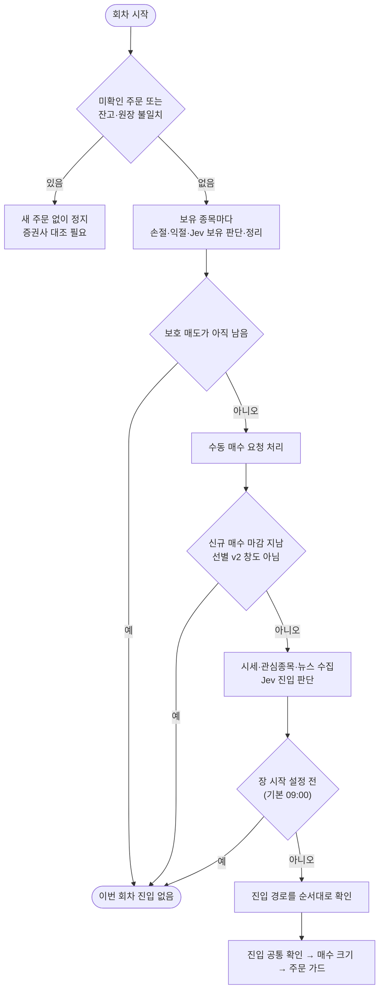
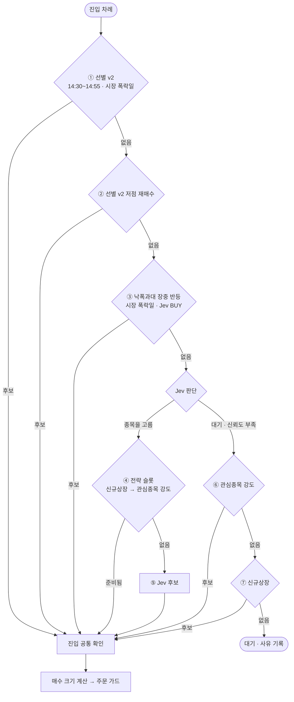
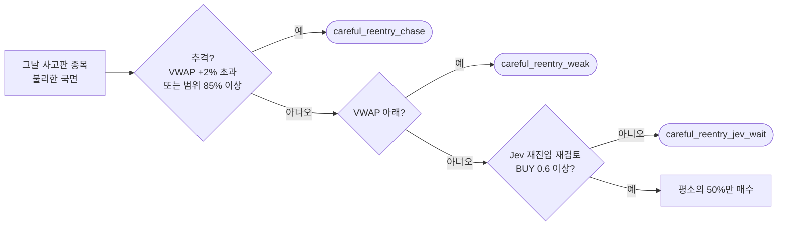
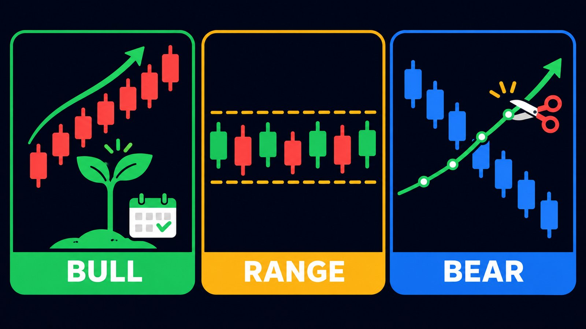

# 매매 전략 (Jev 실시간 트레이딩)

공유 모의계좌 실행기 `scripts/nh_paper_isolated.py`가 매분 무엇을 보고 언제 사고파는지 정리합니다. 수치는 코드의 **기본값**이며, 대부분 대시보드에서 바꿀 수 있으니 지금 값은 대시보드나 `~/.vibe-trading/nhplug/shared-etf-paper/strategy-settings.json`·`~/.vibe-trading/nhplug/accounts.json`에서 확인하세요. 어떤 수치도 수익을 보장하지 않고, Jev 신뢰도는 수익 확률이 아닙니다.

> [!NOTE]
> 실계좌는 이 실행기의 체결 원장을 따라 사고팝니다. 따라가는 방식은 [실계좌 운용](live-accounts.md), 주문을 막는 장치는 [안전장치](safety.md), 낙폭과대 반등은 [낙폭과대 반등](oversold.md)에 따로 있습니다. vibe-trading은 장중 매매를 그만두고 미국 ETF 장기투자 엔진으로 바뀌었습니다([장기투자](longterm.md)).

## 목차

- [한 회차의 흐름](#한-회차의-흐름)
- [하루 일정](#하루-일정)
- [장전 분석과 개장 준비](#장전-분석과-개장-준비)
- [Jev가 받는 자료](#jev가-받는-자료)
- [진입 경로](#진입-경로)
  - [전략 슬롯](#전략-슬롯)
  - [진입 공통 확인](#진입-공통-확인)
  - [인버스 관문](#인버스-관문)
  - [같은 날 재진입과 신중 재진입](#같은-날-재진입과-신중-재진입)
- [낙폭과대 반등 (0번 경로)](#낙폭과대-반등-0번-경로)
- [분할 매수](#분할-매수)
- [청산 프로필](#청산-프로필)
- [보유 중 판단](#보유-중-판단)
- [시황별 대응](#시황별-대응)
- [장 마감과 이월·스윙](#장-마감과-이월스윙)
- [제한 규칙](#제한-규칙)
- [관찰 기록과 그림자 후보](#관찰-기록과-그림자-후보)
- [대상 종목](#대상-종목)
- [변경 이력](#변경-이력)

## 한 회차의 흐름

실행기는 약 60초마다 한 회차씩 돌아갑니다. 보유 종목을 먼저 지키고, 그 뒤에 새로 살지 봅니다.



- 보유 종목이 여럿이면 손절·익절에 걸린 종목부터 처리합니다. 한 종목의 Jev 판단이 느려도 다른 종목의 손절이 밀리지 않게 하려는 순서입니다.
- 공유 모의계좌 자동매매 스위치(`accounts.json` `paper-shared.auto`)가 꺼져 있으면 새 진입과 추가 매수만 멈춥니다. 보유 종목의 손절·익절·정리는 계속합니다. 대시보드 **계좌·자동매매** 맨 위 '운영 엔진'에서 바꿉니다.
- 오늘 왕복 거래가 3번 연속 손실이면 마지막 청산 뒤 30분 동안 새로 사지 않습니다(연속 손실 쉬기, 횟수·분은 운영 조정값).

## 하루 일정

모든 시각은 한국시간입니다. 아래는 기본값이고 대시보드 설정에 따라 움직입니다(`scripts/session_times.py`).

```mermaid
gantt
  dateFormat HH:mm
  axisFormat %H:%M
  section 준비
  장전 자료 수집 매 10분        :07:40, 90m
  관심종목·순위 갱신 매 30분     :08:50, 380m
  section 매매
  주문 가능(개장부터)            :09:00, 330m
  신규상장 보기 시작             :milestone, 09:20, 0m
  보유 종목 추가 매수 마감        :milestone, 14:10, 0m
  신규 매수 마감                 :milestone, 14:30, 0m
  선별 v2 매수 창               :14:30, 25m
  장 마감 정리                   :milestone, 14:40, 0m
  실행기 종료                    :milestone, 15:00, 0m
```



| 시각 | 하는 일 | 바꾸는 곳 |
| --- | --- | --- |
| 07:40, 08:00\~08:55 매 5분, 09:00, 09:10 | 장전 자료 수집(읽기 전용, `scripts/premarket.py`) | 고정 일정 |
| 08:20 · 08:53 | 장전 사전 점검(`scripts/preflight.py`) | 고정 일정 |
| 08:50\~ | 순위·관심종목 갱신 시작(`scripts/market_movers.py`, 관심종목은 30분마다) | 고정 일정 |
| 08:55 | 거래일 확인, 실행기와 관찰기 준비(`trading-day-start`) | 고정 일정 |
| 개장 첫 8분(기본 09:00\~09:07) | 이월 보유와 신규 진입 판단. 당일 완료 분봉이 부족하면 ETF는 전 거래일 마감 분봉을, 개별주는 확인 가능한 당일 NXT 프리마켓 분봉을 우선 보완 자료로 사용 | 고정 규칙(`OPENING_REVIEW_MIN` 8분) |
| 09:00 | 주문 시작(2026-11-19 사용자 결정, 예전 09:10). 운영 조정값 '실행기 장 시작'이 더 늦으면 그 시각, 수능일 등 장 시간이 바뀌는 날은 `nhplug_calendar.SHIFTED_DAYS`만큼 늦춤. 2026-11-19부터는 시작뿐 아니라 신규 매수 마감·정리·종료, 선별 v2 매수 창, 신규주 시작, 순위 계산기·학습 관찰기 종료, 실계좌 미러 종료와 모의·실계좌 주문 가드 시각도 함께 늦춤 | 운영 → 운영 상태 → 운영 조정값 |
| 09:20 | 신규상장 경로 시작 | 운영 조정값 `ipo_start` |
| 정리 30분 전 | 보유 종목 추가 매수 마감(기본 정리 14:40이면 14:10) | 정리 시각을 따라 움직임 |
| 14:30 | 신규 매수 마감 | 제한 규칙 `entry_cutoff_hhmm`(10:00\~15:00) |
| 14:30\~14:55 | 선별 v2 매수 창. 신규 매수 마감 뒤에도 이 경로만 삼 | 매매 기준 → 낙폭과대 선별 v2 |
| 14:40 | 장 마감 정리. 이월 조건을 통과한 포지션만 남김 | 제한 규칙 `flatten_hhmm`(14:00\~15:05) |
| 15:00 | 실행기 종료. 정리 시각 + 20분, 최소 15:00, 최대 15:18 | 운영 조정값 |

정리 주문은 건당 약 2분이 걸려 실행기가 정리 뒤 20분 더 돌아갑니다. 15:20부터는 종가 단일가라 체결을 알 수 없어서, 실행기는 15:18 전에 끝납니다. 시각이 됐다고 판단이 꼭 성공하는 것은 아닙니다. 휴장·자료 누락·미확인 주문이 있으면 대기합니다.

## 장전 분석과 개장 준비

`scripts/premarket.py`가 미국 시장 종가, 국내 시황, 뉴스·공시, 선물·NXT 등 장전 자료를 출처·상태와 함께 모으고, `premarket.engine_brief()`가 그날 유효한 자료만 `premarket_context`로 Jev 진입·보유 판단에 넣습니다. 자료마다 브리프 생성 시각 기준 30분 안에 관찰된 것만 들어가고, 기준 시각을 확인하지 못한 선물·NXT 호가는 현재 시세로 쓰지 않습니다. 장전 문구는 참고 맥락이지 주문 명령이 아닙니다.

사람이 읽는 상세 분석문, 템플릿, 예약 작업은 [장전 분석](premarket.md)에 있습니다.

## Jev가 받는 자료

Jev는 외부 이미지·선택형 모델입니다. 실행기가 매분 차트와 숫자를 묶어 보내고, Jev는 종목 하나(또는 대기)와 신뢰도를 고릅니다.

| 자료 | 내용 | 코드 |
| --- | --- | --- |
| 1분봉 차트 | ETF 7종과 관심종목의 최근 60분 차트 | `scripts/jev_context.py` |
| 당일 요약 `intraday_summary` | 시가·고가·저가, 범위 안 위치(0=저가, 100=고가), VWAP, 30·60분 변화 | `jev_context.summary` |
| 시장 뉴스 | **최근 90분 안** 헤드라인만. 새 기사가 없는 주제는 빼고, 하나도 없으면 대기. Google News·네이버가 번갈아 맡고 Bing은 빈 주제만 채움, 3분 공유 캐시 | `scripts/etf_news.py` `headlines7`, `RECENT` |
| 관심종목 정보 | 오늘 Jev가 고른 관심종목 3개의 재무·수급·최근 90분 종목 뉴스(몇 분 전 기사인지 포함) | `scripts/watchlist.py`, `recent_stock_headlines` |
| 시황 `market_regime_themes_global` | 코스피·코스닥 국면(20·60일선 규칙), 오늘 흐름, 투자자·프로그램 순매수, 상승·하락 종목 수, 테마, 테마 대장 `theme_leaders`, 해외 일봉, 장중 해외 선물·원자재 `global_intraday`(나스닥100·S&P500 선물, 금, WTI, 달러인덱스, 원/달러, 30분 한도) | `scripts/market_context.py` |
| 투자자 수급 | ETF별 투자자 일별 순매수 | `investor_flows` |
| 장전 브리프 | `premarket_context` | `scripts/premarket.py` |
| 자기 성적·매매일지 | 최근 성적 `own_track_record`, 최근 3거래일 일지 요약 `trading_journal` | `track_record`, `trading_journal.brief` |
| 과거 낙폭 사례 | 오늘 크게 빠진 종목의 비슷한 과거 사례 기준율 `past_falls_reference`(인버스 제외) | `scripts/oversold_cases.py` |
| 시황 점검 질문 `market_playbook` | 『실전 시황 트레이딩』의 점검 질문을 자체 문장으로 줄인 것. 진입용·보유용이 따로 있음 | `scripts/market_playbook.py` |

> [!IMPORTANT]
> 시황 점검 질문, 장전 브리프, 매매일지, 과거 사례는 **참고 맥락**입니다. 주문은 아래의 승인된 진입·손절·한도 규칙이 정합니다.

**판단 근거 기록:** Jev는 선택형 질문만 받기 때문에, 같은 요청에 근거를 묻는 선택형 질문 7개(`jev_context.EVIDENCE`: 결정 요인, 차트·뉴스·시황·수급 방향, 자기 성적, 자료 충분성)를 함께 보냅니다. 답은 `market-research.sqlite3`의 `model_evidence` 표와 실행기 이벤트에 남고 매매 답에는 쓰지 않습니다. Jev가 스스로 밝힌 이유일 뿐 측정한 인과가 아닙니다. 점검은 `scripts/jev_explain.py`로 합니다.

**AI 모드:** 트레이딩 현황 → 전략·AI 설정에서 Jev와 Decision(OpenAI)을 각각 켜고 끕니다(`ai-modes.json`, `scripts/paper_ai_modes.py`). Decision을 함께 켜면 두 모델이 다른 종목을 고른 회차는 사지 않고(`model_disagreement`), Decision만 켜면 신뢰도 0.8 이상일 때만 삽니다. 둘 다 끄면 AI 주문을 보류하고 보유 감시만 합니다.

## 진입 경로

매 회차 아래 순서로 보고, 처음 후보가 나온 경로가 그 회차를 씁니다. 주문은 한 회차에 한 건입니다.



| 경로 | 조건 (기본값) | 출처 이름 |
| --- | --- | --- |
| ①② 선별 v2·저점 재매수 | 시장 전체가 폭락한 날 장 막판에 삼. [낙폭과대 반등](oversold.md#선별-v2-낙주매매) | `oversold_v2` · `oversold_v2_add` · `oversold_v2_reentry` |
| ③ 장중 반등 | 감시 종목이 평소보다 크게 빠졌다가 하락이 멈췄고, 그 시장도 저가 −3% 이상 빠진 날. [낙폭과대 반등](oversold.md#장중-반등-경로) | `oversold` |
| ④ 전략 슬롯 | 아래 [전략 슬롯](#전략-슬롯) | `new_listing` · `watchlist_strength` |
| ⑤ Jev 후보 | Jev가 고른 종목의 신뢰도 0.5 이상(`entry_confidence`) | `jev` |
| ⑥ 관심종목 강도 | Jev가 대기했거나 신뢰도가 모자란 회차에만. Jev 관심종목 확률 상위 3위 안(`strength_top_n`)이면서 확률 0.15 이상, 지금 전일 대비 +2\~+25%, 최근 분봉 상승 | `watchlist_strength` |
| ⑦ 신규상장 | 상장 2거래일 안(`ipo_days`, 상장일 포함), NH 시세의 상장일이 KRX KIND 목록과 같음(KIND가 막히면 토스 종목 마스터), 기준가(상장일은 공모가, 그 뒤는 전일 종가)와 시가 위, 당일 고가 3% 안, 최근 분봉·거래량 상승, 09:20부터, 하루 2회(`ipo_daily_max`), 동시 1종목(`ipo_max_positions`) | `new_listing` |

Jev 확률은 종목끼리 나눠 갖는 값이라 관심종목 하나가 0.5를 넘기 어렵습니다. 그래서 관심종목 강도 경로는 0.15를 씁니다. 관심종목 강도 경로가 고를 수 있는 종목은 [대상 종목](#대상-종목)의 관심종목뿐입니다.

### 전략 슬롯

Jev가 종목을 고른 회차에도 켜진 슬롯을 먼저 봅니다(`nh_paper_isolated.slot_entry`). 하락장에서 Jev가 매분 인버스만 골라 신규상장주를 한 번도 못 보던 일(11/17)을 막으려는 구조입니다. 준비된 슬롯이 그 회차를 쓰고, Jev 선택은 다음 회차로 넘어갑니다. 슬롯이 한도를 채우면 다시 Jev만 남습니다.

| 슬롯 | 스위치(기본) | 한도 | 특징 |
| --- | --- | --- | --- |
| 신규상장 | `ipo_slot_on`(켬) | 하루 `ipo_daily_max`(2) · 동시 `ipo_max_positions`(1) | 지수 베팅이 아니라서 인버스를 들고 있어도 반대 방향 차단에서 빠짐 |
| 관심종목 강도 | `strength_slot_on`(**코드 기본 꺼짐**, 대시보드에서 켤 수 있음) | 하루 `strength_slot_daily`(3) · 동시 `strength_slot_max`(2) | 롱 종목이라 인버스를 들고 있으면(반대 방향 차단 켬) Jev 차례를 빼앗지 않고 기다림 |

슬롯은 [진입 공통 확인](#진입-공통-확인)의 재진입·인버스·신중 재진입 검사를 통과할 때만 준비된 것으로 칩니다. 막힐 후보가 Jev 차례만 빼앗는 일이 없게 하려는 것입니다. 하루 새 종목 수·하루 손실·보유 금액 한도는 슬롯과 상관없이 계좌 전체에 걸립니다.

후보가 회차를 계속 붙잡지 않게 두 가지를 더 막습니다(2026-11-19 사용자 결정, 11-19 13:44\~14:46 009150이 매분 `single_order_limit`으로 막히며 Jev 차례를 차지한 사례).

- **1주도 못 사는 강도 후보는 고르지 않습니다.** 주문 단계와 같은 계산(`strength_shares`: 분할 1회·회당 한도·보유/시황 배율·신중 재진입 50%)으로 0주가 되는 종목은 건너뛰고(`one_share_over_buy`) 다음 강도 후보나 Jev 판단에 차례를 넘깁니다.
- **주문 단계에서 사지 못한 후보는 잠시 쉽니다.** 관심종목 강도·신규주 후보가 어떤 이유로든 매수로 끝나지 않으면 그 종목은 처음 `SLOT_COOLDOWN_MIN`(3분) 동안 후보에서 빠지고, 다시 거절될 때마다 두 배로 늘어 최대 `SLOT_COOLDOWN_MAX`(30분)까지 빠집니다. 사면 기록이 지워집니다(이벤트 `pick_cooldown`, 후보 사유 `pick_cooldown`). 장중 감사는 같은 종목·같은 거절 사유가 3분 연속이면 `entry.repeat_block`으로 잡습니다.

### 진입 공통 확인

후보가 정해지면 아래를 차례로 거칩니다. 하나라도 막히면 그 회차는 대기하고 **다른 종목으로 넘어가지 않습니다**. 그래서 하루 새 종목 5개는 채우는 목표가 아니라 상한입니다. 막힌 이유는 `v2_entry_gate`·`v2_execution_gate` 이벤트의 `reason`에 남습니다.

1. Jev 응답과 분봉이 최신인가(`stale_model_signal`, `stale_market_bars`)
2. 최근 분봉 상승: 현재가가 5분 전보다 높은가(`rising_check`, 선별 v2는 제외)
3. 이미 보유한 종목이면 추가 매수 조건을 통과하는가([분할 매수](#분할-매수))
4. 반대 방향 보유: 롱을 들고 인버스를, 인버스를 들고 롱을 사지 않음(`opposite_guard`). 선별 v2와 신규주 슬롯은 제외. 이때 [방향 전환](#방향-전환)이 일어날 수 있음
5. 같은 날 재진입 허용, [인버스 관문](#인버스-관문), [신중 재진입](#같은-날-재진입과-신중-재진입)
6. 지수 방향(`direction_confirm`): Jev 경로의 롱은 그 지수가 오늘 강세이거나, 상승장·횡보장에서 오늘 0% 이상. 인버스는 반대. 시황 요약이 없으면 사지 않음. 관심종목 강도(재진입이 아닐 때)와 신규상장은 종목 자체 강도를 이미 봤으므로 거래량만 확인
7. 거래량 증가: 최근 5개 1분봉 거래량 합이 그 앞 5개의 1.2배 이상(`entry_volume_ratio`, 프리셋 엄격 1.5·기본 1.2·완화 1.0·끄기 0)
8. 하루 주문 998건·총 보유 수량 상한, 현금, 손절 폭이 호가 차이의 2배보다 좁지 않은가(`stop_inside_spread`)
9. 매수 크기 계산 → 주문 가드([안전장치](safety.md))

### 인버스 관문

인버스(114800, 251340)는 대응 지수의 하락이 이어지는지, 인버스 ETF 가격을 추격하는지 확인한 뒤 새로 사거나 더 삽니다(`inverse_gate`, `inverse_tape`).

| 확인 | 막힌 사유 |
| --- | --- |
| 일봉 국면이 하락장 | `inverse_regime_not_falling` |
| 오늘 −0.5% 이하 | `inverse_index_not_falling` |
| 최근 30분 −0.3% 이하. 당일 등락률이 −3%보다 낮으면 최근 30분 −0.5% 이하 | `inverse_index_rebounding`, `inverse_index_not_falling_now`, `inverse_too_late` |
| 프로그램 순매도 | `inverse_flows_not_selling` |
| 전날 나스닥100 하락 | `inverse_us_not_falling` |
| Jev 후보 신뢰도 0.6 이상. 당일 등락률이 −3%보다 낮으면 0.8 이상 | `inverse_low_confidence` |
| 인버스 ETF 가격이 VWAP 대비 +1% 이내이고 당일 가격 범위의 80% 미만. 당일 등락률이 −3%보다 낮으면 VWAP 이하 | `inverse_chase` |
| 자료 누락 또는 갱신 지연 | `inverse_market_unknown` |

분할 1회 매수 금액의 50%를 쓰며, 당일 등락률이 −3%보다 낮은 예외 진입은 25%를 씁니다. 관문에서 막힌 Jev 인버스 후보는 강도·신규상장 경로에 차례를 넘깁니다.

진입 시 지수 등락률이 −1.5% 이하면 +1%, 그보다 높으면 +0.3%에서 전량 익절하는 계획을 씁니다. 손절 폭은 최대 1%입니다. 지수가 최근 30분 +0.3% 이상 반등하거나 인버스가 매수 평균가 대비 +0.5% 이상 오른 뒤 평균가 이하로 돌아오면 청산 조건에 해당합니다. [청산 프로필](#청산-프로필)

### 같은 날 재진입과 신중 재진입

**같은 날 재진입 허용** `reentry_allow`(기본 켬): 켜 두면 그날 사고판 종목도 진입 조건을 처음부터 다시 통과하면 다시 삽니다. 관심종목 강도 경로의 재진입은 종목 강도에 더해 지수 방향(시황)도 통과해야 합니다(`reentry_market_unconfirmed`). 끄면 그날 거래를 마친 종목은 그날 일반 경로로 다시 사지 않습니다(`reentry_disabled`). 낙폭과대 경로는 자기 규칙을 따릅니다.

**직전 매도가 위에서만** `reentry_guard`(코드 기본 켬): 관심종목 강도 경로가 그날 판 종목을 다시 살 때 마지막 매도가보다 비쌀 때만 삽니다(`reentry_below_last_exit`). 청산 방식(익절·손절·추적 손절)과 관계없이 적용합니다.

**신중 재진입** `careful_reentry_on`(기본 켬): 그날 사고판 롱 종목을 국면이 그 포지션에 불리할 때(횡보장·하락장, 국면을 모를 때 포함) Jev 경로나 관심종목 강도 경로로 다시 사면 네 가지를 모두 거칩니다. 인버스는 인버스 관문이 따로 막으므로 여기서 빠집니다.



- 당일 시가·고저·VWAP는 NH 현재가의 당일 값(가중평균가)으로 계산합니다. 당일 봉이 10개 미만이면 사지 않습니다(`careful_reentry_no_session`).
- Jev 재검토(`jev_reentry7`)에는 그날 이 종목의 왕복 매매(진입·청산 시각과 가격, 수익률, 청산 방식), 당일 흐름·뉴스·수급·시황·매매일지를 보냅니다. 종목당 5분에 한 번 묻고, 그 사이 왕복 수가 바뀌면 다시 묻습니다. 호출이 실패하면 사지 않습니다. 기록은 `careful_reentry_review` 이벤트입니다.
- 기준값 4개(`careful_reentry_vwap_pct` 2 · `careful_reentry_range_pct` 85 · `careful_reentry_conf` 0.6 · `careful_reentry_size_pct` 50)는 제한 규칙 탭에서 바꿉니다. 표본이 5건이라 잠정 값입니다.

## 낙폭과대 반등 (0번 경로)

탄탄한 종목·지수 ETF가 시장 충격으로 크게 빠진 날을 노리는 경로입니다. 다른 진입보다 먼저 보며, **장중 반등**과 **선별 v2 낙주매매** 두 가지가 있습니다. 판정·매수·익절·손절·재매수·사례집·감사는 [낙폭과대 반등](oversold.md)에 모았습니다.

## 분할 매수

### 매수 크기

한 번에 사는 금액은 다음과 같이 정해집니다.

```text
분할 1회 금액(계좌 설정, 기본 100만 원)
  × 경로 배율        신규상장 50%(ipo_size_pct) · 장중 반등 100% · 선별 v2 1·2차 각 절반
  × 보유·시황 배율    Jev 후보·관심종목 강도·가격 단계 추가 매수만 (아래)
  × 추가 매수 크기    보유 종목에 더 살 때 50%(add_size_pct)
  × 신중 재진입      50%
→ 회당 매수 한도, 1회 최대 수량(100주), 현금, 종목당 최대(기본 300만 원)로 자름
```

분할 1회 금액·종목당 최대·회당 한도는 **계좌·자동매매 → 모의계좌 → 금액·주문 보호 한도**에서, 1회·총 보유 수량은 **운영 → 운영 상태 → 운영 조정값**(0이면 제한 없음)에서 바꿉니다.

**보유·시황 배율**(`scripts/position_sizing.py`): 쏠림을 줄이려는 장치입니다. 재현(실제 포지션 12개)에서 손익을 뚜렷이 늘리지는 못했습니다.

| 배율 | 값 | 스위치 |
| --- | --- | --- |
| 보유 | 그 종목 보유 원가가 종목당 최대의 절반 미만이면 1.0, 넘으면 1 − 보유 비율 | `size_holding_on` |
| 시황 | 지수 국면이 매수 방향과 같으면 1.0, 횡보장 0.75, 반대(롱은 하락장, 인버스는 상승장) 0.5, 모르면 1.0 | `size_market_on` |

두 배율을 곱해 25\~100%로 묶습니다. 매수 기록 `submitted`의 `sizing`에 배율이 남습니다.

### 추가 매수

같은 종목에 더 사는 길은 두 가지입니다.

| 방법 | 언제 | 스위치 |
| --- | --- | --- |
| 새 판단 추가 | Jev가 보유 중인 종목을 다시 고름. 직전 매수보다 신뢰도가 0.02 이상 높거나(`confidence_up`), 평균가보다 한 단계 싸거나(`cheaper_step`), 한 단계 수익 중(`profit_step`)일 때만 | `scale_signal_add_on`, '직전보다 나은 조건' `add_conf_sizing_on` |
| 가격 단계 추가 | 마지막 체결가에서 한 단계(`add_step_pct` 0.7%) 내려왔거나, 추세형 포지션이 한 단계 올랐고, 직전 분봉이 반등했고, 마지막 체결 뒤 5분(`scale_interval_min`)이 지났으며, 그 회차 Jev가 같은 종목을 고름 | `scale_step_add_on` |

두 방법 모두 분할 1회의 `add_size_pct`(기본 50%)를 삽니다. 첫 매수를 빼고 한 종목에 `scale_max_adds`(기본 2회, 0\~100) 번까지만 더 삽니다. 횟수는 상한일 뿐이고 실제로 몇 번 사는지는 엔진 판단이 정합니다.

추가 매수를 막는 규칙:

- 장 마감 정리 30분 전부터 보유 종목에 더 사지 않음(`add_cutoff`, 고정)
- 약세 시장에서 아래 단계 추가 금지(`averaging_down_guard`: 롱은 하락장이면서 오늘 강세가 아님, 인버스는 반대)
- 인버스 추가는 [인버스 관문](#인버스-관문)을 다시 통과해야 함
- 익절 외의 이유(Jev 일부 매도·시황 역전 절반 매도·수동 수량 매도)로 판 포지션은 끝날 때까지 추가 없음. 익절 뒤 재매수는 `scale_profit_rebuy_on`이 켜져 있을 때만
- 신규주(`ipo_add_guard`)·낙폭과대·선별 v2 포지션은 일반 추가 없음(선별 v2는 자기 2차 매수)
- 같은 Jev 응답으로 두 번 사지 않고, 새 평균가로 바로 청산 조건에 걸리면 사지 않음(`projected_exit`)
- 종목당 최대 금액(`per_symbol_krw`)

장 마감 개선안의 `add_sizing` 절이 최근 10거래일 추가 매수의 성적을 모아 `add_size_pct` 조정 제안을 냅니다. 설정은 사용자가 승인할 때만 바뀝니다.

## 청산 프로필

포지션마다 진입할 때 청산 계획을 정해 `exit-plans.json`에 고정합니다. 그 뒤 설정을 바꿔도 이미 연 포지션의 수준은 움직이지 않습니다(추세형 전환·약세 상한은 예외).

| 프로필 | 언제 | 익절 | 손절 | 그 밖 |
| --- | --- | --- | --- | --- |
| 방어형 | 기본 | 데이터 목표가 있으면 그 값에서 **전량**. 없으면 +1% 절반·+2% 전량 | −2% | 약세 시장이면 늦어도 +1% 절반·+2% 전량으로 당김 |
| 추세형 | 지수가 포지션 방향으로 강할 때. 관심종목 강도 경로는 개별 종목 수익률이 +1%에 닿으면 지수 국면과 관계없이 전환 | +2% 절반 뒤 고점 대비 −1.5% 추적 매도 | −2% | 이월 대상. 2배 ETF(122630·233740·494310)는 익절·추적 폭 ×1.5 |
| 신규주형 | 신규상장 경로 | +3% 절반(`ipo_half_pct`) 뒤 고점 대비 −2% 추적 | `ipo_stop_pct`(코드 기본 3%) | 산 뒤 60분이면 시간 손절(`ipo_time_stop_min`), 추가 매수·이월 없음 |
| 인버스 빠른 익절 `inverse_quick` | 진입 시 지수 등락률이 −1.5%보다 높음 | +0.3% 전량 | 최대 1% | 전용 반등·본전 보호 적용 |
| 인버스 폭락일 청산 `inverse_crash` | 진입 시 지수 등락률이 −1.5% 이하 | +1% 전량 | 최대 1% | 전용 반등·본전 보호 적용 |
| 낙폭과대 `oversold` | 장중 반등·선별 v2 | [낙폭과대 반등](oversold.md) | 자기 손절 | 국면 손절 축소·본전 손절 없음 |

**데이터 목표:** 최근 20거래일 동안 시가에서 고가까지 오른 폭의 중앙값 × 국면 계수(하락장 0.4, 횡보장 0.5, 그 밖 0.6)를 0.8\~3%로 묶은 값입니다. 떨어지는 장에서는 더 일찍 이익을 챙기게 됩니다.

**청산 판단 순서:** 최종 익절 → 손절 → 본전 손절 → 추적 손절. 신규주 시간 손절, Jev 보유 SELL, 장 마감 정리가 따로 붙습니다. 손절은 종목 평균가 기준이며, 계좌 하루 손실 한도는 주문 가드가 따로 막습니다(두 기준 중 먼저 닿는 쪽).

<details>
<summary><strong>국면 손절 축소 (방향 반영)</strong></summary>

일반 전략 포지션은 지수 국면이 그 포지션에 불리하면 손절을 −1%로 좁힙니다(`regime_stop_levels`, `tightening_regimes`). 불리한 국면은 롱이면 횡보장·하락장, 인버스면 상승장·횡보장입니다. 신규주·낙폭과대 포지션은 자기 손절을 씁니다. 실계좌 미러와 대시보드 손절 표시도 같은 함수를 씁니다(`scripts/engine_exits.py`). 근거는 11/17 하락장에서 인버스가 −1.01%에 손절된 뒤 바로 회복한 사례입니다.

</details>

<details>
<summary><strong>1차 익절 수량: 남은 수량의 절반</strong></summary>

1차 익절은 그 포지션에서 산 수량에서, 첫 익절 전에 다른 이유(Jev 일부 매도·시황 역전 절반 매도·수동 수량 매도)로 판 몫을 뺀 수량의 절반(올림)을 팝니다(`take_profit_base`). 예를 들어 100주에서 시황 역전으로 50주를 판 뒤라면 첫 익절은 25주입니다. 익절 뒤 다시 사면 그 수량을 더해 목표를 다시 계산하고, 첫 익절 뒤의 매도는 목표를 바꾸지 않습니다. 판 이유를 모르는 매도가 섞여 있으면 익절 단계와 첫 이월 판단을 건너뛰고, 손절·장 마감 정리는 그대로 합니다.

</details>

<details>
<summary><strong>본전 손절: 익절 매도 뒤에만</strong></summary>

익절로 일부를 판 뒤에는 남은 수량이 평균가 아래로 내려가면 전량 팝니다(`breakeven_stop`). 이 보호는 **마지막 체결이 매도이고, 마지막 매수 뒤에 익절 매도가 있을 때만** 걸립니다(`breakeven_protected` + `sold_for_profit`). 판 뒤에 다시 사면 새 평균가의 일반 손절·익절로 돌아가고, 다시 익절하면 보호가 다시 걸립니다. Jev 일부 매도·시황 역전 절반 매도·수동 수량 매도 뒤의 나머지는 평소 손절을 씁니다. 낙폭과대 계획은 본전 손절을 쓰지 않습니다(`breakeven_after_half=False`).

</details>

## 보유 중 판단

### Jev 보유 판단과 일부 매도

보유 종목마다 매 회차 Jev에게 HOLD/SELL을 묻습니다(`jev_holding7`). 포지션의 수익률, 청산 프로필, 손절·익절 수준, 고점, 절반을 이미 팔았는지, 마감 전 판단인지를 함께 보냅니다.

| Jev 답 | 행동 |
| --- | --- |
| SELL 신뢰도 0.7 이상(`sell_confidence`) | 전량 매도 |
| SELL 0.55(`partial_sell_conf`) 이상 0.7 미만 | 포지션의 33%(`partial_sell_pct`)만 매도. 마지막 체결이 매수일 때 포지션당 한 번. 판 뒤에는 그 포지션에 추가 매수 없음. Decision 모드가 꺼져 있을 때만 |
| 그 밖 | 보유 |

선별 v2 포지션은 Jev SELL로 팔지 않고 기록만 합니다(손절·상한 익절·보유일로만 청산).

### 시황 역전 절반 매도

산 뒤 지수 국면이 보유 방향과 반대로 바뀌면(롱은 하락장, 인버스는 상승장) 포지션당 한 번 절반을 팝니다(`position_sizing.regime_trim`, 스위치 `regime_trim_on`). 처음 본 국면을 진입 국면으로 기억해 `regime-trims.json`에 둡니다. 국면을 모르면 팔지 않습니다. 신규주·낙폭과대·선별 v2는 제외입니다.

### 방향 전환

Jev가 반대 방향(예: 롱 보유 중 인버스)을 골랐는데 반대 방향 보유 차단에 걸리면, **평균가 아래이면서 시장이 불리한** 반대 방향 보유분만 다음 회차에 보호 경로로 팝니다(`direction_switch`, 기본 켬). 이익 중인 포지션은 그대로 두고, 새 진입은 그 회차 대기합니다. 인버스 관문이 거부할 인버스를 고른 경우에는 롱을 팔지 않습니다. 기록은 `direction_switch` 이벤트입니다.

### 수동 매도·매수

트레이딩 현황 → 즉시 매도에서 종목별 수량 매도·추가 매수·전량 매도를 요청하면 다음 회차에 실행기가 보호 시세·주문 가드 경로로 처리합니다(`exit-requests.json`, `manual-buys.json`, 출처 `manual`). 수동 매수는 정리 시각 뒤에는 거절합니다. 공유 모의계좌에 직접 주문하지 마세요.

## 시황별 대응



국면은 `scripts/market_context.py`가 20·60일 이동평균 규칙으로 정하는 상승장·횡보장·하락장이고, 오늘 흐름(강세·약세·혼조)은 따로 봅니다. 예측이 아니라 규칙 판정입니다.

| 국면 | 진입 | 청산 | 장 마감 |
| --- | --- | --- | --- |
| 상승장 | 롱 위주. 인버스는 관문에서 막힘 | 추세형으로 올려 더 길게 보유. 인버스는 손절 1%로 좁힘 | 조건을 모두 통과하면 이월·스윙 |
| 횡보장 | 시황 배율 0.75. 같은 날 재진입은 신중 재진입 | 롱·인버스 모두 손절 1%로 좁힘 | 대부분 정리 |
| 하락장 | 인버스는 [전용 관문](#인버스-관문) 확인, 롱은 시황 배율 0.5. 신규상장 슬롯이 따로 돌아감 | 롱은 손절 1%·약세 상한(+1%/+2%)·물타기 금지, 산 뒤 하락장으로 바뀐 롱은 절반 매도 | 롱은 정리, 인버스는 조건 통과 시 이월 |

## 장 마감과 이월·스윙

정리 시각(기본 14:40)에 보유 종목을 점검합니다. 대부분은 그날 팝니다. 아래 11개 조건을 **모두** 통과한 추세형 포지션만 다음 날로 넘기고(이월), 이미 넘긴 포지션은 6개 스윙 조건을 매일 다시 확인해 최대 `swing_max_days`(기본 5) 거래일까지 들고 갑니다. 이월 금액 합계는 장 마감 보유 한도(`overnight_max_manwon`, 기본 300만 원, 0이면 늘 정리) 안이어야 합니다. 낙폭과대 포지션은 자기 보유일만큼 정리에서 빠집니다.

<details>
<summary><strong>이월 조건 11개</strong> (<code>OVERNIGHT_RULES</code>)</summary>

| 코드 | 조건 |
| --- | --- |
| `not_trend_profile` | 추세형 포지션 |
| `regime_not_rising` | 지수 상승장 + 오늘 강세 (인버스는 하락장 + 약세) |
| `breadth_not_broad` | 상승 종목이 하락 종목의 2배 이상 (인버스는 반대) |
| `flows_not_supporting` | 지수 외국인·기관·프로그램 모두 순매수 (인버스는 모두 순매도) |
| `not_first_target` | 1차 목표에 닿았고, 1차 익절 수량을 익절로 체결 확인 |
| `volume_not_high` | 종목 거래량이 20일 평균의 1.5배 이상 (정리 시각 누적) |
| `weak_close` | 시가 위, 오늘 고가-저가 범위의 상위 20% 안 |
| `not_uptrend` | 현재가 > 5일 평균 > 20일 평균 |
| `jev_not_supportive` | Jev 최근 30분 보유 의견이 HOLD, 신뢰도 0.60 이상 |
| `overnight_limit` | 이월 금액 합계가 장 마감 보유 한도 이내 |
| `market_closed_next_day` | 다음 날이 KRX 거래일 (휴장표 확인 실패 시 정리) |

</details>

<details>
<summary><strong>스윙 유지 조건 6개</strong> (<code>SWING_RULES</code>)</summary>

| 코드 | 조건 |
| --- | --- |
| `swing_days_exceeded` | 스윙 최대 보유일 이내 (휴장일은 세지 않음) |
| `regime_not_rising` | 상승장이고 오늘 약세 아님 (인버스는 하락장이고 강세 아님) |
| `not_uptrend` | 현재가 > 5일 평균 > 20일 평균 |
| `jev_selling` | Jev 최근 30분 보유 의견이 SELL(0.60 이상)이 아님 |
| `overnight_limit` | 이월 금액 합계가 장 마감 보유 한도 이내 |
| `market_closed_next_day` | 다음 날이 거래일 |

</details>

판단 결과는 `overnight_hold` 이벤트(`permitted`, `reason`)에 남고, 실계좌 미러가 이 기록을 읽습니다. 대시보드 전략 구조의 종가매매·스윙 탭에서 조건 목록을 봅니다.

## 제한 규칙

실행기가 매수를 막거나 줄이는 규칙 전체는 `scripts/restrictions.py` 한 곳에 있고, 대시보드 **계좌·자동매매 → 모의계좌 → 제한 규칙**에서 상태와 오늘 막은 횟수를 봅니다. 스위치는 `strategy-settings.json`에 저장되고 실행기가 매 회차 다시 읽습니다.

| 구분 | 규칙 |
| --- | --- |
| 끄기 가능 (코드 기본 켬) | 같은 날 재진입 허용 `reentry_allow` · 신중 재진입 `careful_reentry_on` · 직전 매도가 위에서만 재진입 `reentry_guard` · 연속 손실 쉬기 `losing_streak_guard` · 약세장 물타기 금지 `averaging_down_guard` · 반대 방향 동시 보유 차단 `opposite_guard` · 지수 방향 확인 `direction_confirm` · 최근 분봉 상승 확인 `rising_check` · 신규주 추가 매수 금지 `ipo_add_guard` |
| 이 탭에서 설정 | 신규 매수 마감 `entry_cutoff_hhmm`(10:00\~15:00) · 장 마감 정리 `flatten_hhmm`(14:00\~15:05) · 신규주 동시 보유 수 `ipo_max_positions`(1\~3) · 신중 재진입 기준값 4개 |
| 다른 설정으로 조절 | 거래량 증가 확인(0=끔) · 종목당 추가 매수 횟수 `scale_max_adds` · 직전보다 나은 조건 `add_conf_sizing_on` · 신규주 하루 매수 `ipo_daily_max` · 1회·총 보유 수량 · 주문 보호 한도 · 분할 1회·종목당 금액 · 장 마감 보유 한도 |
| 항상 적용 | 같은 종목 중복 진입 차단 · [인버스 전용 진입·청산](#인버스-관문) · 정리 30분 전 추가 매수 마감 · 호가 차이보다 좁은 손절 거부 · 미확인 주문·잔고 불일치 정지 · 조회 실패 5번 연속 정지 · 하루 주문 998건 |

> [!TIP]
> 매매 기준(진입·익절·손절·빠른 선택 프리셋)은 **계좌·자동매매 → 모의계좌 → 매매 기준**에서 바꿉니다. 값마다 허용 범위가 있고, 범위 밖이거나 서로 모순되는 값(예: 1차 익절 ≥ 2차 익절)은 저장되지 않습니다. 파일이 깨지면 실행기는 승인된 기본값으로 돌아가고 추가 매수를 끕니다(`strategy_settings.problems`).

## 관찰 기록과 그림자 후보

주문 없이 기록만 남겨 규칙을 바꿀지 데이터로 정하려는 장치입니다.

| 기록 | 내용 | 다시 보는 때 |
| --- | --- | --- |
| `strength_shadow` 이벤트 | Jev 자기 선택이 데이터 확인에 막힌 회차에 관심종목 강도 경로라면 무엇을 골랐을지 | 예약 작업 `strength-shadow-10day-review`(2026-11-30, 10거래일 성적) |
| 그림자 후보 (`scripts/issue_candidates.py`) | 실행기 대상(코스피200·코스닥150 구성종목) 밖의 이슈·테마·인기 종목: 키움 전체 시장 거래대금·상승률 상위, OpenDART 경영권·최대주주 변경·공개매수 등 공시, 테마 대장. 처음 본 시각·가격과 '샀을지'(`would_buy`)를 남기고 장 마감 뒤 30분·종가·최고·최저 결과를 채움. `market-research.sqlite3` `shadow_candidates` | 5\~10거래일 표본 뒤 사유별 성적으로 매수 허용(2단계)을 따로 제안. 2단계는 별도 승인 |
| 막힌 후보 사후 결과 (`scripts/blocked_outcomes.py`) | 사지 않은 관심종목 강도 후보와 미매수 신규상장주의 30분 뒤·종가까지 결과 | 장 마감 개선안 |
| 신규주 그림자 기록 (`scripts/ipo_shadow.py`) | 신규주 창(`ipo_days`) 안의 상장 종목마다 그날 1분봉(Yahoo)으로 세 규칙을 재현: 지금 규칙, A. 기준가를 공모가·전일 종가 대신 VWAP으로, C. A + 익절 뒤 VWAP 위 눌림 재매수(하루 4번까지). 지금 규칙의 기준가는 실행기가 읽은 값(이벤트 `ipo_seen`: 종목별 판정·현재가·기준가, 판정이 바뀔 때마다, 2026-11-20부터)을 쓰고, 없으면 '지금 규칙' 행은 비움(실행기가 비교하는 KRX 종가를 다른 출처가 주지 않음). 종목마다 따로 재현하므로 실행기의 하루 신규주 수·동시 보유 한도는 적용하지 않음. 다시 돌리면 다시 재현한 종목만 바꿈. `market-research.sqlite3` `ipo_shadow`. 학습 관찰기가 장 마감 뒤 갱신. 근거는 11/18 에이엘로봇(공모가 17,600원 아래에서 저가 대비 35% 오름) | 장 마감 개선안 `ipo_shadow`. 상장일 10회 이상 쌓인 뒤 규칙 변경을 따로 제안 |
| 신호 적중률 `signal_calibration` | Jev 진입 후보·보유 판단의 5·15·30분 뒤 결과를 신뢰도 구간별로 | 장 마감 개선안 |

평일 16:15 예약 작업 '장 마감 개선안 연구'(`scripts/daily_improvement.py`)가 그날의 왕복 거래·경로별 성적·제한 규칙이 막은 횟수·위 관찰 기록을 모아 개선안을 씁니다(`reviews/improvement-YYYY-MM-DD.md`, 대시보드 전략 구조 → 장 마감 개선안). 읽기 전용이며, 적용은 사용자가 대화에서 승인할 때만 합니다. 예약 작업 전체는 [자동 작업](automation.md)에 있습니다.

## 대상 종목

**ETF 7종**(`scripts/etf_universe.py`): KODEX 200(069500), KODEX 레버리지(122630), KODEX 인버스(114800), KODEX 코스닥150(229200), KODEX 코스닥150레버리지(233740), KODEX 코스닥150선물인버스(251340), KODEX 반도체레버리지(494310). 인버스는 114800과 251340이고, 인버스 2X(252670)와 혼동하지 마세요.

**관심종목:** `scripts/market_movers.py`가 코스피200·코스닥150 구성종목을 거래대금·거래량·상승률·하락률로 순위 매겨 후보를 만들고(키움 순위로 먼저 고른 뒤 NH 현재가로 계산, 키움이 없으면 NH 전체 스캔), 후보는 순위마다 3종목, 모두 10종목입니다. 여기에 **주도 테마 동반주** 칸을 최대 2개 더합니다(2026-11-19 승인). 시황의 테마 묶음 상위 3개 중 오르고 있으면서 아직 후보가 없는 묶음마다, 구성종목 가운데 +2~25% 오른 종목에서 거래대금이 가장 큰 종목을 고릅니다. 구성종목 목록은 하루 한 번(토스 섹터 ∪ 네이버 테마), 장중 등락·거래대금은 키움 여러 종목 시세(ka10095) 한 번으로 보고(키움 실패 시 네이버), 고른 종목은 NH 현재가로 다시 조회합니다. 이 출처는 키가 있는 API들을 같은 질문으로 실측해 점수(필드·범위·속도·호출 수·안정성·공식 계약·한도·조건)로 고른 결과입니다(`scripts/api_bench.py`). 사유는 `주도 테마 동반주 (묶음)`이고 `movers.json` `theme_picks`와 `theme-picks.json`(날짜별 첫 시각)에 남습니다. 실계좌 미러는 그날 동반주가 된 뒤 모의가 연 포지션의 체결(추가 매수 포함)을 실계좌 몫 0으로 고정합니다(모의 체결 20건 뒤 따로 정함). `scripts/watchlist.py`가 30분마다 Jev에게 물어 오늘의 관심종목 3개를 고릅니다. 45분 넘게 갱신되지 않으면 실행기는 ETF만 봅니다.

**신규상장:** `scripts/new_listings.py`의 최근 상장 목록(KRX KIND, 실패 시 토스 종목 마스터).

**낙폭과대 감시 종목:** `oversold-universe.json`(대시보드에서 편집). [낙폭과대 반등](oversold.md#감시-종목) 참고.

## 변경 이력

| 날짜 | 바뀐 것 |
| --- | --- |
| 2026-11-12 | 관심종목 강도·신규상장 경로, 이월·스윙 |
| 2026-11-13 | 제한 규칙 목록화, 신규 매수 마감·정리 시각 설정, 낙폭과대 반등·선별 v2 |
| 2026-11-17 | 전략 슬롯, 추가 매수 크기·횟수·'직전보다 나은 조건', 보유·시황 비중, 국면 손절 방향 반영, 정리 30분 전 추가 매수 마감, 본전 보호 조건, 같은 날 재진입 스위치. vibe 장중 엔진 퇴역 |
| 2026-11-18 | 인버스 관문·빠른 익절, 신중 재진입, 남은 수량 절반 익절, 90분 뉴스, 판단 근거 기록·60분 차트·당일 요약, 시황 점검 질문, 장중 해외 선물·테마 대장, 그림자 후보 |
| 2026-11-19 | 개장(09:00)부터 주문, 이월 포지션 개장 판단, NXT 프리마켓 요약 입력, 1주 미만 강도 후보 건너뛰기, 사지 못한 후보 3분부터 쉬기(최대 30분) |

사용자 결정의 전체 목록(`AGENTS.md`)과 검수 기록(`docs/audit/`)은 운영자 로컬에만 있는 비공개 문서입니다.
