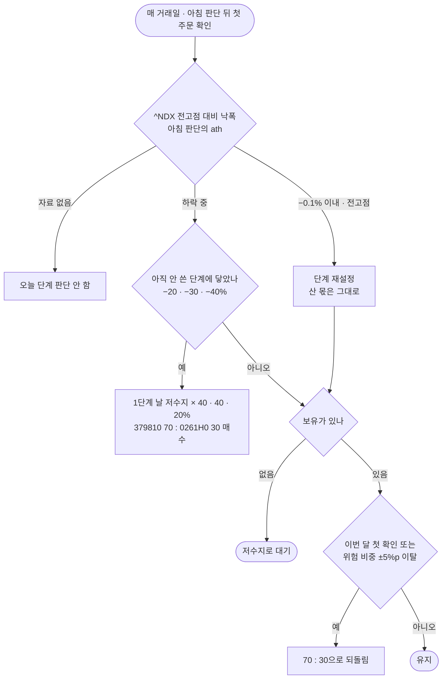

# 여운봉 저수지 매매법

현금(저수지)으로 기다리다 나스닥100이 전고점 대비 −20%·−30%·−40% 빠질 때 단계별로 사고, 보유가 생긴 뒤에는 위험 : 안전 = 70 : 30을 지키는 계좌 전략입니다. 규칙은 `scripts/yeo_method.py`(순수 함수 `plan`), 엔진 연결은 `vibe_longterm.yeo_orders`입니다. 가상 계좌와 장기투자 실계좌의 계좌 전략으로 고를 수 있습니다.

> [!IMPORTANT]
> 나스닥100이 −20%까지 빠지지 않으면 운용금은 계속 저수지(현금이나 저수지 ETF)에 남습니다. 상승이 이어지는 기간에는 수익이 지수 보유보다 낮을 수 있고, 사용자가 이를 받아들인 규칙입니다(2026-11-18). 재현 수치는 대용·근사 자료의 과거 결과이며 수익을 보장하지 않습니다.

**목차**

- [규칙 한눈에](#규칙-한눈에)
- [사는 종목](#사는-종목)
- [단계 매수](#단계-매수)
- [리밸런싱](#리밸런싱)
- [조정할 수 있는 수치](#조정할-수-있는-수치)
- [고르는 법](#고르는-법)
- [화면](#화면)
- [엔진에서 동작하는 방식](#엔진에서-동작하는-방식)
- [못 산 몫](#못-산-몫)
- [적립식과의 관계](#적립식과의-관계)
- [저수지 분할(일반) 모듈과 다른 점](#저수지-분할일반-모듈과-다른-점)
- [재현 결과](#재현-결과)
- [변경 이력](#변경-이력)

관련 가이드: [장기투자 엔진](longterm.md) · [적립식](longterm-dca.md) · [실계좌 운용](live-accounts.md)

## 규칙 한눈에

| 항목 | 규칙 (기본값) |
| --- | --- |
| 시작 | 보유 0, 운용금 전부 저수지(현금, KOFR 449170을 들고 있으면 그것도 저수지) |
| 단계 | ^NDX 전고점 대비 −20% → 저수지의 40%, −30% → 40%, −40% → 20% |
| 단계 금액 기준 | 그 하락 주기에서 1단계가 온 날의 저수지 금액 |
| 매수 비율 | 각 단계 금액을 KODEX 미국나스닥100(379810) 70 : KODEX 미국나스닥100미국채혼합50(0261H0) 30 |
| 전고점 회복 | 단계를 다시 쓸 수 있게 재설정. 산 몫은 팔지 않고 남은 저수지가 다음 하락의 기준 |
| 리밸런싱 | 보유가 생긴 뒤에만. 매월 첫 확인일(분기 초 포함)과 위험 비중이 5%p 이상 벗어난 날 70 : 30으로 되돌림 |
| 하지 않는 것 | 팔아서 저수지 다시 채우기, 거장 모듈, 12주 분할, 버핏 월 매도 상한 |

## 사는 종목

지금 쓰는 짝은 나스닥100 하나입니다(사용자 확정). S&P500·코스피는 선택지로 코드에 있지만 꺼져 있습니다.

| 지수 | 위험 ETF | 안전 ETF | 단계 기준 | 상태 |
| --- | --- | --- | --- | --- |
| 나스닥100 | 379810 KODEX 미국나스닥100 | 0261H0 KODEX 미국나스닥100미국채혼합50 | ^NDX 전고점 | 사용 |
| S&P500 | 379800 KODEX 미국S&P500 | 438080 ACE 미국S&P500미국채혼합50액티브 | ^GSPC 전고점 | 선택지(꺼짐) |
| 코스피 | 069500 KODEX 200 | 183700 RISE 200채권혼합50 | ^KS11 전고점 | 선택지(꺼짐) |
| 대기 | 저수지 ETF: 449170 KOFR · 357870 CD금리 · 272580 단기채권 중 장부 설정(자동: 운용금 1,000만 원 미만이면 CD금리) | — | — | 저수지 |

- 0261H0은 나스닥100 50% + 미국 단기국채 50%를 매일 맞추는 ETF입니다(2026-11-10 상장). 70 : 30이면 실제 나스닥100 비중은 약 85%, 미국채 약 15%입니다.
- 엔진 6종 밖의 종목이라 `yeo_method.EXTRA`(키 NDXMIX·SPXMIX·K200·K200MIX)로 다룹니다.

## 단계 매수

- **전고점:** 아침 판단(08:45)이 Yahoo 10년 일봉의 최고 종가로 계산해 `indicators.ath`에 남깁니다. 지금 세 지수에서는 전체 기간 최고가와 같습니다. 국면 판정이 쓰는 252일 고점과 다릅니다. 이렇게 다르게 두는 것은 1년이 지나 고점이 창 밖으로 빠져도 −40% 단계가 사라지지 않게 하려는 것입니다. ^GSPC·^KS11 조회가 실패하면 그 지수만 빠집니다.
- **금액:** 1단계가 온 날 저수지 × 지수 몫(나스닥100만이면 100%)을 기준 금액으로 고정하고, 2·3단계도 그 기준의 40%·20%를 씁니다. 저수지에 남은 돈보다 많이 쓰지 않습니다.
- **한 번에 여러 단계:** 하루에 두 단계 이상을 지나면 그날 함께 삽니다.
- **현금 부족:** 현금이 모자라면 저수지 ETF(KOFR·CD금리·단기채권 중 그 장부가 든 것)를 팔아 채웁니다.
- **전고점 회복:** 낙폭이 −0.1% 이내면 쓴 단계와 기준 금액을 지웁니다. 산 몫은 팔지 않습니다.
- 단계를 산 날에는 리밸런싱하지 않습니다(그 매수가 이미 목표 비율).

## 리밸런싱

보유가 생긴 뒤에만 합니다.

| 종류 | 언제 |
| --- | --- |
| 정기 | 매월 첫 확인일. 분기 초(1·4·7·10월)도 그 달 첫 확인일이라 함께 |
| 즉시 | 위험 비중이 목표(70%)에서 밴드(기본 5%p) 이상 벗어난 날 |

- 비중이 커진 쪽을 팔아 작은 쪽을 삽니다. 보유의 0.5% 미만 차이는 넘깁니다.
- 버핏 저회전의 월 매도 상한을 걸지 않습니다. 리밸런싱 매도가 이 방법의 핵심이기 때문입니다.

> [!NOTE]
> 설계 문서 0절은 "정기는 분기 기본, 매월 선택"이었지만, 2026-11-19 사용자 정정으로 선택칸을 없애고 매월·분기 첫 확인일 모두 맞춥니다(코드 기준, `yeo_method.period`).

## 조정할 수 있는 수치

`yeo_method.clean`이 범위를 지키고, 범위 밖 값은 가까운 끝으로 맞춥니다.

| 설정 | 기본 | 범위 | 화면에서 바꿈 |
| --- | --- | --- | --- |
| 시장 | 미국 지수만 | 미국 지수만 · 코스피만 · 혼합 | 예 |
| 미국 지수 | 나스닥100만 | 나스닥100만 · S&P500만 · 둘 다 | 예 |
| 위험 비중 | 70% | 50\~90% | 예 |
| 즉시 리밸런싱 밴드 | 5%p | 2\~10%p | 예 |
| 단계(미국) | −20% 40% · −30% 40% · −40% 20% | 최대 3단계, 낙폭 −5\~−60%, 사용 0\~100% | 예(표 편집) |
| 단계(코스피) | −30% 30% · −45% 40% · −55% 30% | 같음 | 아니오(코드 기본값) |
| 혼합일 때 미국 : 코스피 | 70 : 30 | 0\~100% | 아니오(코드 기본값) |
| 둘 다일 때 나스닥100 : S&P500 | 50 : 50 | 0\~100% | 아니오(코드 기본값) |

> [!NOTE]
> 사용자 결정 기록(`AGENTS.md`, 비공개)에는 "모든 수치는 화면에서 조정한다"고 되어 있지만, 코드 기준으로 설정 화면(`longterm_account_view.yeo_panel`)은 시장·미국 지수·위험 비중·밴드·미국 단계 표만 편집합니다. 코스피 단계와 혼합 비율은 저장 구조에만 있고 지금은 기본값을 씁니다.

## 고르는 법

| 장부 | 위치 | 저장 |
| --- | --- | --- |
| 가상 계좌 | **장기투자 → 전략 → 거장 모듈·비중**, '설정할 장부' = 가상 계좌(엔진), ① 운용 방식에서 '여운봉 저수지 매매법 (단독 규칙)' | '운용 방식 저장' → `books.actual` |
| 장기투자 실계좌 | **계좌·자동매매 → 그 실계좌 → 금액·포트폴리오·보호 한도**의 '전략', 또는 장기투자 → 전략에서 '설정할 장부' = 그 계좌. '이 계좌가 따를 거장 모듈'에서 '여운봉 저수지 매매법' | '전략 저장' → `books.<계좌 키>` |

- 저장값은 vibe-longterm `settings.json`의 `books.<키>.strategy = 'yeo_method'`와 `books.<키>.yeo`입니다. 다른 전략으로 바꿔도 이 설정은 보관됩니다.
- 가상 계좌를 이 전략으로 운용하면 ②\~④(운용 모드·거장 모듈·집행 속도)는 그 장부에 쓰지 않습니다. 그 설정은 그림자 장부와 '엔진과 같음'을 고른 실계좌가 계속 씁니다.
- 2026-11-18 실계좌 2와 가상 계좌가 이 전략으로 저장됐습니다(설정 변경 이력). 실계좌 2는 실주문 스위치와 `--execute`가 없어 계획만 냅니다. 지금 상태는 화면에서 확인합니다.

> [!WARNING]
> 가상 계좌가 거장 모듈로 이미 산 S&P500·반도체·양자·우주 ETF는 이 규칙이 관리하지도 팔지도 않고 그대로 둡니다. 나스닥100(379810)만 70 : 30 리밸런싱 대상이 되어, 밴드 밖이면 다음 판단에서 바로 맞춥니다.

## 화면

전략을 '여운봉 저수지 매매법'으로 고르면 설정 칸 아래에 다음이 나옵니다.

| 칸 | 내용 |
| --- | --- |
| 설정 | 시장, 미국 지수, 위험 비중 슬라이더, 즉시 리밸런싱 밴드 슬라이더, 정기 리밸런싱 안내, 저수지 단계 표 |
| 이 설정으로 사는 종목 | 역할(위험·안전·저수지), 종목명, 코드, 비율, 기준 지수와 단계, 저수지 몫(`yeo_instruments`) |
| 지금 적용 | ^NDX 전고점(날짜) 대비 낙폭, 다음 단계까지 거리, 쓴 단계 |
| 단계별 금액 | 단계마다 저수지 사용 %, 금액, 위험·안전 ETF별 금액과 1주 단위 주 수(수수료 포함) |
| 안내 | 저수지 기준 금액, 운용금, 다음 정기 리밸런싱, 가격 출처, 적립식이 켜져 있으면 그 금액 |

- 가상 계좌의 저수지 기준 금액은 실제 규칙과 같게 '현금 − 적립식 몫 + KOFR 평가액'으로 계산합니다. 실계좌는 운용금 − 투자된 금액입니다.
- 단계별 금액은 **지금 저수지로 계산한 예시**입니다. 실제 금액은 그 하락 주기 1단계가 오는 날의 저수지로 정해지고, 그 전에 적립금이 들어오거나 잔고가 바뀌면 달라집니다.
- 가격은 기록된 계획 가격을 먼저 쓰고, 없으면 NH 시세를 한 번 읽습니다(주문 없음).
- 계좌 전략 칸에 재현 근거(`yeo_method.RESEARCH`)가 함께 보입니다.
- 차트: **장기투자 → 시장 → 차트**에 장부별 단계 매수선이 보라 점선으로 그려집니다. 아침 판단 전에는 ^NDX 2년 고점을 기준으로 그립니다.

## 엔진에서 동작하는 방식

| 경로 | 동작 |
| --- | --- |
| 가상 계좌 `trade()` | `books.actual`이 이 전략이면 `yeo_orders`로 계획. 0261H0도 시세를 읽고 순자산에 넣음. 근거의 '거장 판단' 칸에 이 규칙과 낙폭을 적고 국면은 '참고만 함' |
| 장기투자 실계좌 `longterm_live` | 그 계좌가 이 전략이면 0261H0을 시세 조회(재시도 포함)와 가드 허용 종목에 넣고 같은 `yeo_orders`로 하루 계획. 실계좌 보호 경로로 한 건씩 |
| 계좌 가상 운용 (15:40) | 실계좌 전략이 이 방법이면 그 규칙으로 1주 단위 종가 가상 체결(`account_shadow`) |
| 레시피 비교 (15:40) | '여운봉 저수지 매매법'(기본 설정)이 1억 장부로 함께 운용됨 |
| 그림자 | 기본·자동 그림자는 계속 거장 모듈. 적립 시황 자동 그림자는 가상 계좌 전략을 따름 |

- 0261H0 보유는 관심목록 몫(운용금 밖)으로 세지 않습니다.
- 기록 문구: '여운봉 단계 n: ^NDX 전고점 대비 −x%, 저수지 y% 사용(…원), 70:30', '리밸런싱: 즉시(5%p 이상 이탈)/정기(분기·매월), 위험 a% → 70%', '다음 단계 −20%까지 x%p 남음'.
- 매매 이유 라벨: 여운봉 저수지 단계 매수 · 여운봉 70:30 리밸런싱 · 여운봉 대기(단계 전·유지).

## 못 산 몫

단계 매수가 거절·축소·미체결 취소로 다 사지 못하면, 그 단계는 쓴 것으로 두고 못 산 금액을 다음 날 먼저 삽니다(`yeo_owed`, `yeo_method.unbought`).

- 가상 계좌: 그날 정산 뒤 체결되지 않은 매수 금액을 장부 상태 `yeo_owed`로 남깁니다.
- 실계좌: 다음 날 계획 때 전날 계획 매수를 체결 기록(`live_fills`)과 대조해 못 산 몫을 구합니다.
- 다음 날 `plan`이 저수지에서 그 몫을 먼저 사고 보유로 셉니다.
- 넘기는 것은 그날 단계 매수분(`yeo_method.step_buys`, 상태 `step_buy`)까지만입니다. 리밸런싱 매수는 짝 매도로 사는 것이라 체결되지 않아도 저수지 돈으로 다시 사지 않습니다(2026-11-19 검수).

실계좌 전략을 여운봉 매매법으로 바꿀 때는 '보유한 위험·혼합 ETF를 70 : 30으로 맞추려 팔 수 있음' 경고가 나오고, 확인을 체크해야 저장됩니다(`yeo_method.switch_note`).

## 적립식과의 관계

- 이 전략 계좌의 [적립식](longterm-dca.md)은 **무엇을** 항목이 그 짝으로 정해집니다. 적립금을 379810 70 : 0261H0 30으로 삽니다. 매매법이 관리하지 않는 ETF나 KOFR은 적립식이 사지 않습니다.
- 적립식 '얼마나 · 거장'은 이 계좌에서 기본 금액을 '장부 가치 × 주 0.25%'와 '적립금 속도 × 0.7' 중 큰 값으로 잡고, 거장의 현금 하한(10\~20%)까지만 씁니다. 저수지 현금 일부를 조금씩 쓰므로, 다음 단계 매수에 쓸 저수지도 그만큼 줄어듭니다.
- 적립식 몫(아직 안 산 적립금·이월·미체결 재매수)은 저수지에 넣지 않습니다.
- 적립식은 사기만 합니다. 산 짝은 보유가 되어 이 방법의 70 : 30 리밸런싱 대상이 됩니다.
- 큰 하락에 몰아 사기는 이 방법의 단계가 맡고, 적립식은 소액으로 꾸준히 삽니다.

## 저수지 분할(일반) 모듈과 다른 점

엔진 거장 모듈 `yeo_reservoir`는 2026-11-18 이름을 '저수지 분할(일반)'로 바꿨습니다(키 그대로). 이름이 비슷하지만 다른 규칙입니다.

| | 여운봉 저수지 매매법 | 저수지 분할(일반) 모듈 |
| --- | --- | --- |
| 종류 | 계좌 전략 하나(단독 규칙) | 다른 거장 모듈과 겹치는 모듈 하나 |
| 시작 | 보유 0, 전부 저수지 | 기준 비중(코어 60 · 위성 25 · 저수지 15)을 들고 시작 |
| 기준 | ^NDX 10년 전고점 | ^NDX 252일 고점 |
| 단계 | −20/−30/−40%, 1단계 날 저수지의 40/40/20% | −20/−30%, 순자산의 7.5%씩 저수지에서 코어(나스닥100·S&P500 반씩)로 |
| 사는 것 | 379810 70 : 0261H0 30 | 379810 · 379800 |
| 복원 | 팔아서 채우지 않음 | 신고가 뒤 달리오 월 밴드로 천천히 |
| 리밸런싱 | 매월·분기 첫 확인일과 5%p 이탈 | 달리오 모듈이 켜져 있을 때 월 밴드 |
| 12주 분할·월 매도 상한 | 걸지 않음 | 엔진 설정대로 |

적립식 거장 '여운봉'(저수지 관점 · 하락할수록 조금 더)도 별개입니다. 적립금을 사는 속도만 정합니다.

## 재현 결과

`scripts/yeo_method_replay.py`가 실제 규칙 코드(`yeo_method.plan`)를 매일 실행한 결과입니다(2026-11-18). 1억 원 보유 0에서 시작, 종가 체결에 수수료 0.015%·슬리피지 0.05%, 세금 없음, 저수지 연 2.5%입니다. KRX 구간은 379810 실제 종가와 0261H0 근사(379810 50% + 미국 단기국채 50%를 원화로 매일 맞춤)를 썼습니다.

| 구간 | 여운봉 매매법 | 70:30 첫날 매수 | 379810 보유 |
| --- | --- | --- | --- |
| KRX 2021-04\~ | 13.5% · −20.0% | 15.6% · −25.7% | 16.8% · −31.0% |
| KRX 2021-11(고점)\~ | 15.0% · −20.0% | 12.7% · −25.7% | 13.4% · −31.0% |
| KRX 2023-01\~ | 22.0% · −20.1% | 25.3% · −21.2% | 28.7% · −24.3% |
| ^NDX 2000\~ | 7.7% · −71.5% | 7.2% · −76.2% | 7.6% · −82.9% |
| ^NDX 2007\~ | 13.0% · −47.2% | 13.0% · −47.2% | 14.7% · −53.7% |
| ^NDX 2015\~ | 10.8% · −25.6% | 14.9% · −30.6% | 16.9% · −35.6% |

(연수익 · 최대 낙폭)

- 고점 근처에서 시작하거나 큰 하락이 든 구간에서는 낙폭이 가장 작았습니다. 고점 시작이면 수익도 가장 높았습니다.
- 상승이 이어진 구간에서는 −20%까지 현금으로 기다려 수익이 낮았습니다.
- 2007년 시작은 ^NDX가 2000년 고점 대비 −60%여서 첫날 세 단계를 모두 사므로 70:30 첫날 매수와 같습니다.
- 대용·근사 재현이라 방향만 봅니다.

**예시** (2026-11-18 복사본 리허설, 주문 없음): ^NDX 전고점 31,224(2026-10-06) 대비 −13.5%라 사지 않았습니다("다음 단계 −20%까지 6.5%p"). 만약 −21%였다면 운용금 50만 원의 40%(20만 원)로 379810 5주, 0261H0 6주를 삽니다. 가격과 낙폭은 그날 값이며 지금은 화면의 '지금 적용'에서 봅니다.

## 변경 이력

| 날짜 | 바뀐 것 |
| --- | --- |
| 2026-11-18 | 사용자 확정 규칙으로 구현. 엔진 모듈 `yeo_reservoir`는 '저수지 분할(일반)', 적립식 프로필 이름도 정리. 실계좌 2·가상 계좌 전략으로 저장 |
| 2026-11-18 | 화면에 '이 설정으로 사는 종목' 표, 단계별 금액표 열 이름을 ETF 이름으로, 가상 계좌 저수지 계산을 실제 규칙과 같게 |
| 2026-11-18 | 못 산 단계 매수를 다음 날 먼저 사기(`yeo_owed`), 여운봉 계좌 적립식은 그 짝만 사기 |
| 2026-11-19 | 정기 리밸런싱 선택칸 삭제: 매월·분기 첫 확인일 모두 |

설계 기록: `docs/yeo-reservoir-method-plan.md` · `docs/longterm-dca-steady-plan.md`(적립식이 계좌 전략을 따르는 A안) · `docs/longterm-dca-v3-plan.md` · 검수 `docs/audit/longterm-review3-2026-11-18.md` (비공개 설계 기록이라 공개 저장소에는 없습니다)
