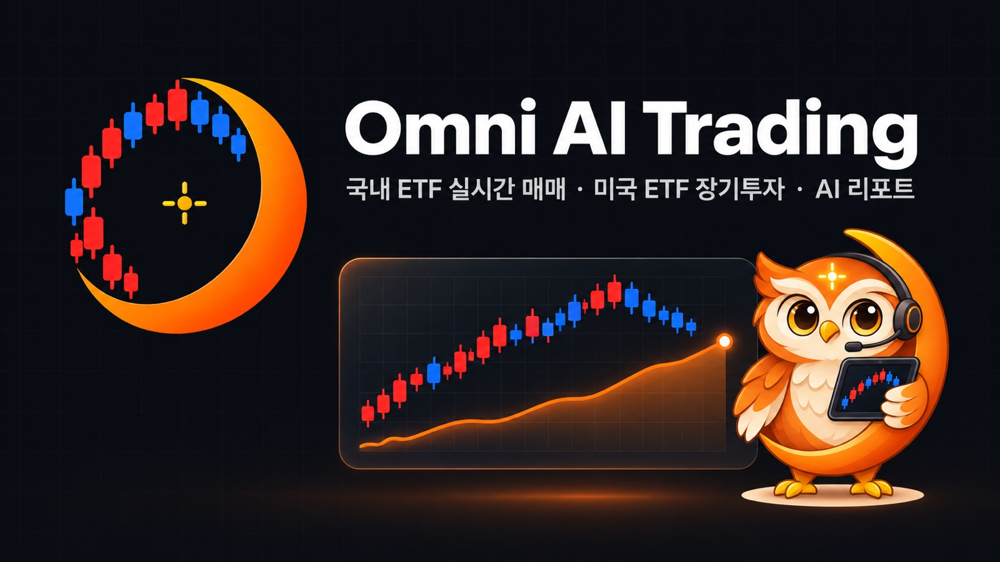

# Omni AI Trading 대시보드



> NH투자증권과 무관한 비공식 프로젝트입니다. 로고는 `streamlit_namuh/assets/logo.png`(사이드바·탭 아이콘)이며 원본 배너는 `assets/omni-banner.jpg`입니다.

NH 나무 PLUG 연결 설정과 Python 환경이 준비된 로컬 컴퓨터에서 실행합니다.

```bash
uv pip install --python .venv/bin/python -r streamlit_namuh/requirements.txt
.venv/bin/streamlit run streamlit_namuh/app.py --server.address 127.0.0.1 --server.port 8501
```

브라우저에서 http://localhost:8501 을 엽니다. 인증과 접근 통제가 없는 개인용 앱이므로 외부 네트워크에 공개하지 마세요. 계좌번호와 인증키는 화면에 표시하지 않습니다.

- 첫 화면은 기존 종합 모의계좌를 사용하는 ETF 보유·진행 현황입니다. 모의 주문·AI 차트, 실계좌, 운영 상태는 다른 탭으로 구분합니다. [화면 설계](DESIGN.md)에 표시 기준을 기록했습니다.
- 모의·실계좌의 증권사 잔고, 주문·체결, 로컬 AI 판단은 출처와 조회 시각을 구분합니다. 증권사 전체 페이지 조회가 실패하면 빈 잔고나 체결 0으로 간주하지 않습니다. 평가손익의 비용 포함 여부는 증권사 응답을 확인하기 전까지 알 수 없습니다.
- 화면의 선택적 자동 조회는 30초 REST이며 실시간 체결 스트림이 아닙니다. 화면이 닫히면 화면 조회는 중단되지만 별도 실행기는 화면과 독립적으로 작동합니다.
- 모의 AI 설정은 Jev와 Decision의 사용 요청을 별도로 저장합니다. 실행기가 주문 대조 후 안전한 주기에 요청을 적용하므로 저장된 요청과 현재 적용값을 구분해야 합니다. 두 모델을 꺼도 실행기 작동 중 2% 보호 감시는 유지합니다.
- AI 차트는 저장된 완료 1분봉, Jev·Decision 의견과 확인 체결을 표시합니다. 체결 확인 시각은 증권사 실제 체결 시각이 아닙니다. 신선한 증권사 보유와 로컬 확인 매수의 수량·가격이 일치할 때만 보유 확인 시각 이후에 매입가와 ±2% 기준선을 표시합니다. 가격 구간은 수수료·세금을 반영한 순손익이 아닙니다.
- TradingView Lightweight Charts 라이브러리는 브라우저에서 외부 CDN으로 불러옵니다. 계좌 정보나 뉴스는 차트 컴포넌트에 전달하지 않습니다. 마커는 해당 분봉이 있을 때만 표시합니다.
- 시세 선택, 모의 주문과 AI 차트는 요청된 일곱 ETF만 지원합니다. 전략 국면과 모의 연구 예측은 검증 중인 관찰이며 자동매매 성과나 수익성을 뜻하지 않습니다.
- 실계좌 탭은 조회와 기존 보호 실행기의 시작·신규매수 중단을 분리합니다. 신규매수 중단은 보유분 청산을 뜻하지 않습니다. 실행기가 없거나 HALT가 켜져 있으면 손절 감시도 보장할 수 없습니다. 실계좌는 인버스 전용이며 모의 학습 자동 적용 및 7종 실계좌 매매는 검증되지 않았습니다.
- 모의 지정가 주문은 내용을 검토한 다음 제출하며, 기존 NH 계좌별 주문 보호와 미확인 주문 차단을 거칩니다. 이 화면은 실주문을 직접 제출하지 않습니다.

오프라인 검사: `.venv/bin/python -m unittest discover -s streamlit_namuh -p 'test_*.py'`
